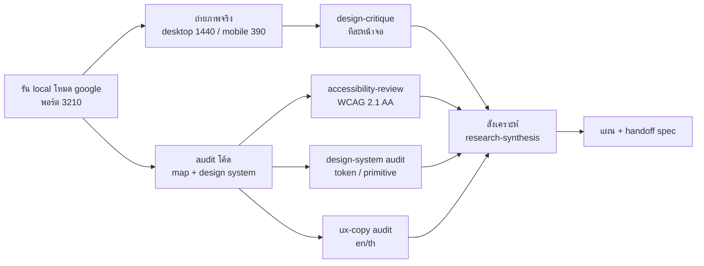
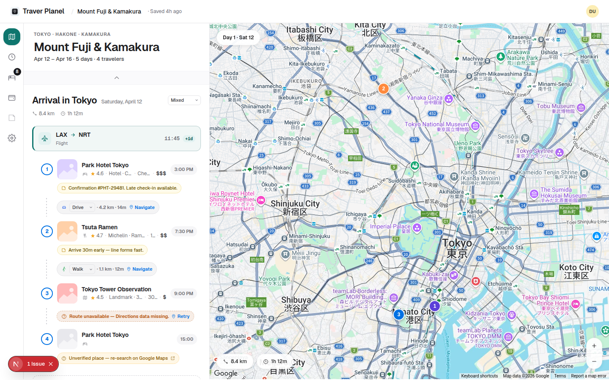
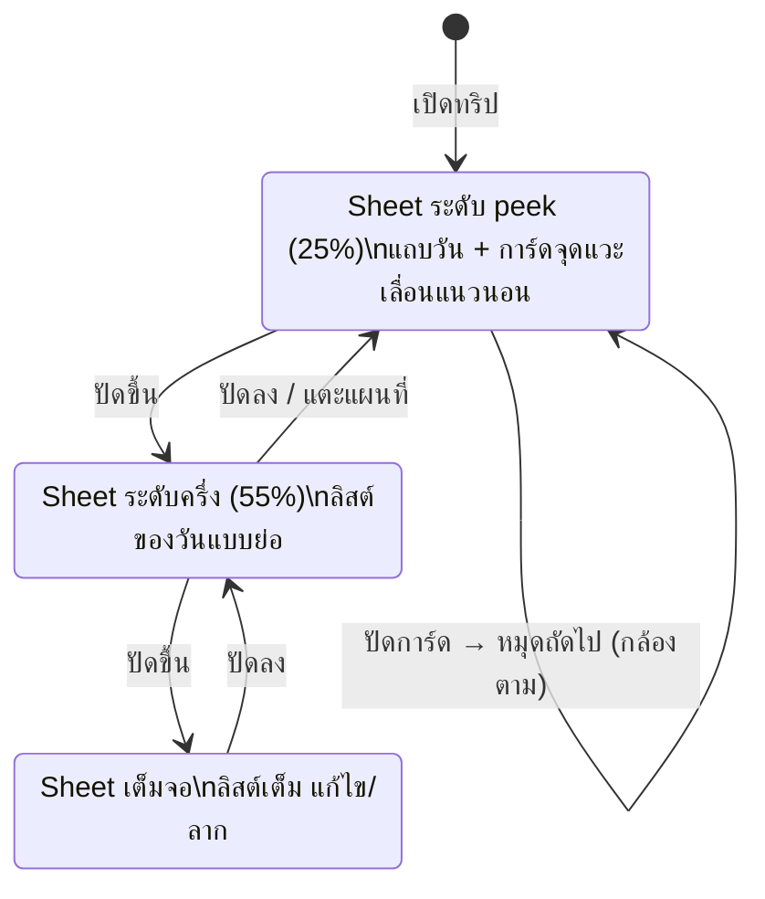
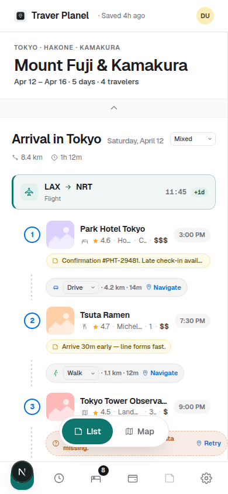
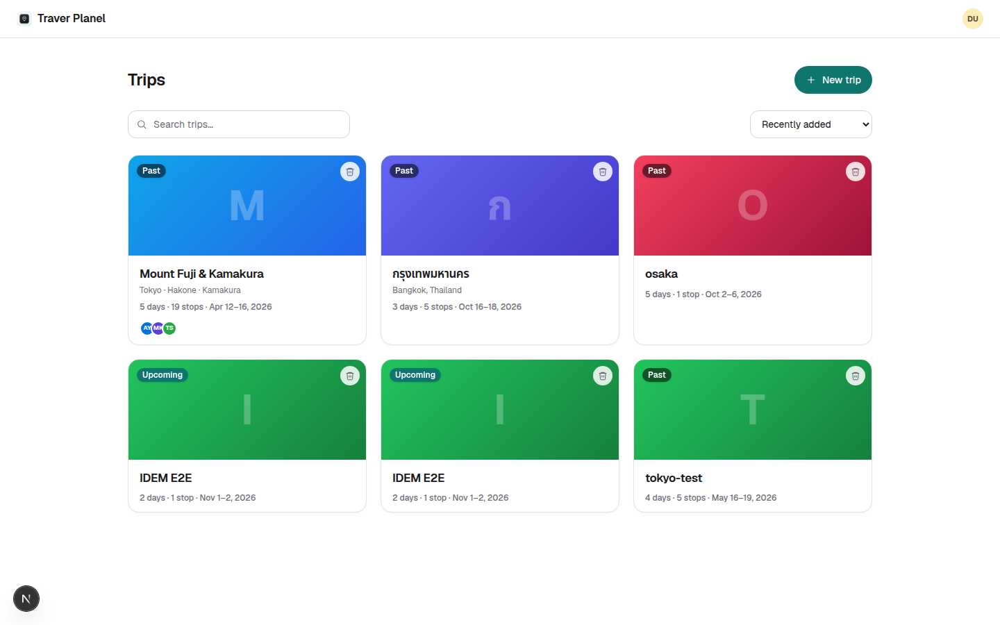
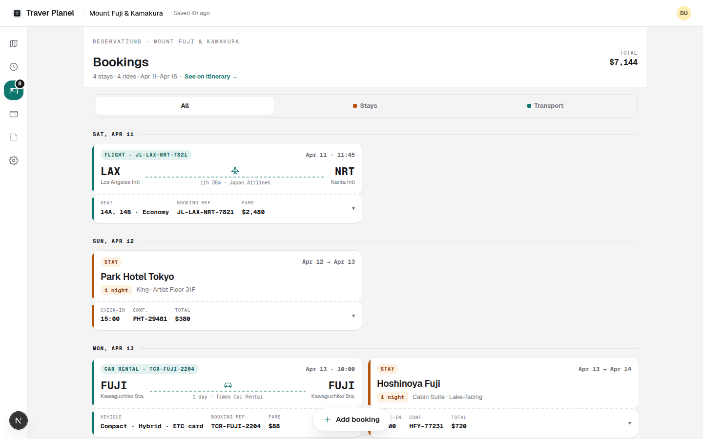
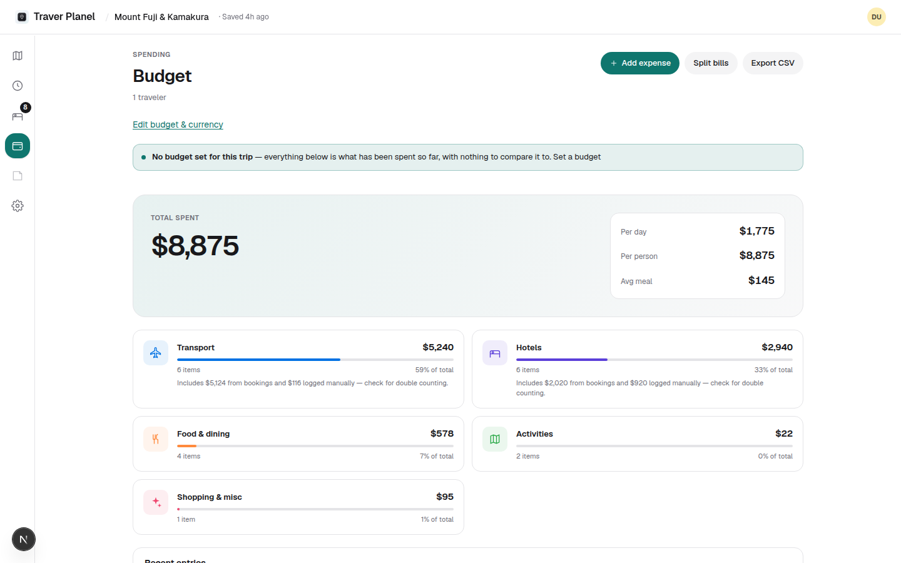
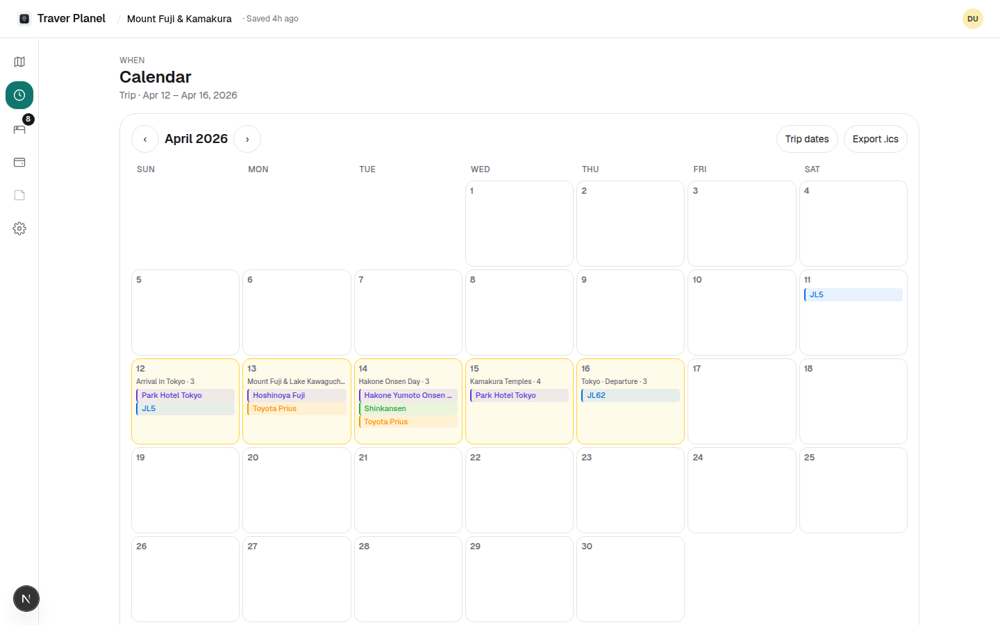
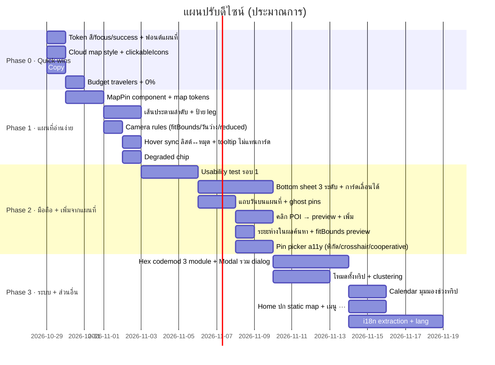
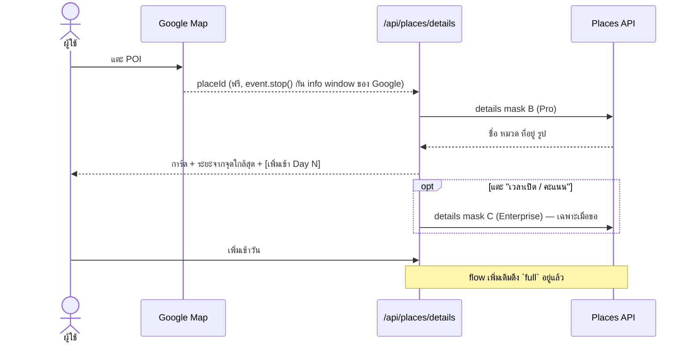

# Travel Planner v2 — รีวิว UI/UX + แผนปรับปรุงดีไซน์ (เน้นแผนที่ Google)

> วันที่ 2026-10-28 · ดูจาก HEAD `5dfc63d` · รันในเครื่อง `MAPS_PROVIDER=google` + `AUTH_BYPASS` บนพอร์ต 3210 (พอร์ตที่ browser key อนุญาต) ใช้ Google Maps JS และ Places จริง
> Skills ที่ใช้: `design:design-critique` · `design:accessibility-review` · `design:design-system` · `design:ux-copy` · `design:design-handoff` · `design:user-research` · `design:research-synthesis`
> ภาพหน้าจออยู่ที่ `docs/design-review/shots/` (ยังไม่ commit)

---

## 0. สรุปสั้น (TL;DR)

แอปมีฐานที่ดี: Bookings แบบตั๋ว, pin card ที่มีรูปจาก Google, การค้นหาที่รับลิงก์ Google Maps ได้, skeleton ที่ตรงกับหน้าจริง แต่**แผนที่ยังทำหน้าที่ได้แค่ "จุดบนพื้นหลัง"** ยังไม่ช่วยตอบคำถามที่คนวางทริปถามจริงๆ ว่า *"วันนี้ไปไหนก่อนหลัง แต่ละที่ห่างกันแค่ไหน แล้วที่ใหม่ที่จะเพิ่มอยู่ตรงไหนเทียบกับเส้นทางเดิม"*

**10 อันดับที่ควรทำก่อน** (เรียงตามผลต่อผู้ใช้ ÷ แรงที่ต้องลง)

| # | เรื่อง | ทำไม | แรง |
|---|---|---|---|
| 1 | **ทำ style แผนที่ใหม่ผ่าน Cloud styling ของ Map ID** (ซ่อน POI ธุรกิจ, ลดสี transit, โทนจาง) + ตั้ง `clickableIcons={false}` | ตอนนี้หมุดของเรากลืนไปกับ POI ของ Google และใช้สีชุดเดียวกับ Google (ม่วง/ส้ม/ฟ้า) | S |
| 2 | **ลากเส้นเชื่อมจุดตามลำดับ** (เส้นตรง/geodesic ประ, ไม่เสียค่า API) | ตอนนี้ดูลำดับจากแผนที่ไม่ออกเลย ต้องอ่านเลขทีละหมุด | S |
| 3 | **ออกแบบหมุดใหม่**: หมุดหยดน้ำ 36px, สีของเราเองที่ไม่ชนกับ Google, ตอน active ยังคงสีตามประเภท, มีป้ายบอกชื่อ | หมุดตอนนี้ 28px เป็นวงกลม สีส้มของร้านอาหารคอนทราสต์ 2.35:1 | S |
| 4 | **ห้ามทำให้เสีย context**: ตอนคลิกหมุดหรือดูตัวอย่างผลค้นหา ให้ใช้ `fitBounds(จุดของวัน + จุดเป้าหมาย)` แทน `panTo` | ตอนคลิกหมุดหรือดูตัวอย่าง จุดอื่นของวันหลุดออกจากจอหมด | S |
| 5 | **มือถือ: bottom sheet + การ์ดจุดแวะที่ปัดได้** ซิงก์กับหมุด และ**เลือกวันได้บนแผนที่** | บนมือถือตอนนี้เปลี่ยนวันจากแผนที่ไม่ได้ ไปจุดถัดไปไม่ได้ ปุ่มต่างๆ ทับกัน | M |
| 6 | **แก้ chip "Route unavailable … Retry"** ซึ่งที่จริงเป็นลิงก์ไป Google Maps ไม่ได้ retry อะไร | ข้อความผิดและทำให้เข้าใจผิด | XS |
| 7 | **ใส่ token: focus ring / input border / success** ให้ผ่าน 3:1 และ 4.5:1 | focus ring ทุกตัวในแอปมีคอนทราสต์แค่ 2.49:1 | XS |
| 8 | **ใช้ฟอนต์ `var(--font-sans)` ในทุก UI ของแผนที่** และกำหนด line-height ของภาษาไทย | หมุดกับการ์ดใช้ `-apple-system` ทำให้ชื่อภาษาไทยบน Android/Windows ใช้ฟอนต์ระบบ | XS |
| 9 | **แสดงว่าอยู่ในโหมด degraded** ตอนที่ Google โหลดไม่ได้แล้วถอยไปใช้ MapLibre | ตอนนี้สลับไปเงียบๆ ผู้ใช้ไม่รู้ว่าทำไมแผนที่หน้าตาเปลี่ยน | XS |
| 10 | **จำนวนผู้เดินทางใน Budget ไม่ตรงกับทริป** (1 vs 4) และยอดรวมไม่ตรงกับ Bookings | ตัวเลข "ต่อคน" ผิด ทำให้ไม่น่าเชื่อถือ | S |

---

## 1. วิธีรีวิว

ข้อจำกัด:
- ใช้ข้อมูลทดสอบ (ทริป "Mount Fuji & Kamakura" 19 จุด) ยังไม่มีข้อมูลจากผู้ใช้จริง ข้อ 9 จึงเป็นแผน research แทนการสังเคราะห์
- headless Chrome ไม่มี WebGL ทำให้ Google ถอยไปใช้ **raster** แทน vector สีหรือรายละเอียดบางอย่างใน vector map จริงอาจต่างไปเล็กน้อย
- ภาพ `02-trip-desktop.png` ถ่ายตอน Google โหลดไม่ผ่าน (referrer ไม่ถูก) แล้วถอยไปใช้ MapLibre ซึ่งเป็นตัวอย่างโหมด degraded ได้พอดี

---

## 2. แผนที่ (เน้น) — Design Critique

### 2.1 ภาพรวมแรก (2 วินาที)

- **สิ่งแรกที่สายตาเห็น**: ป้ายชื่อเมืองภาษาญี่ปุ่นกับ POI สีๆ ของ Google ไม่ใช่หมุดของทริป ซึ่ง**ผิด** หมุดของเรา (1, 2, 3) ตัวเล็กกว่าไอคอนพิพิธภัณฑ์ของ Google และสีม่วง/ส้มก็ชนกับ POI ของ Google
- **อารมณ์**: รก เหมือนเปิด Google Maps ทั่วไป ไม่รู้สึกว่าเป็น "แผนที่ทริปของฉัน"
- **จุดประสงค์ชัดไหม**: ไม่ชัด ไม่รู้ว่าไปทางไหนก่อนหลัง เพราะไม่มีเส้นเชื่อม

### 2.2 ปัญหาการใช้งาน

| # | ข้อค้นพบ | ความรุนแรง | หลักฐาน | ข้อเสนอ |
|---|---|---|---|---|
| M1 | **หมุดกลืนกับ POI ของ Google** ทั้งเพราะสีชุดเดียวกัน (`KIND_COLOR` hotel `#5b3fd9` ≈ ม่วงของ Google ที่ใช้กับสถานที่ท่องเที่ยว, food `#ff8a3d` ≈ ส้มของร้านอาหาร Google, sight `#0071e3` ≈ ฟ้าของ transit) และเพราะแผนที่ยังใช้ style ค่าเริ่มต้นที่มี POI ครบทุกชั้น | 🔴 | `lib/map-helpers.ts:22-27`, ภาพ 03/04 | Cloud-based map style บน Map ID เดิม (ดูข้อ 7.1) + ชุดสีหมุดใหม่ที่ไม่มีใน Google เช่น teal / magenta / น้ำเงินเข้ม |
| M2 | **ไม่มีเส้นบอกลำดับ** หลังจากเลิกใช้ Routes API ก็ไม่มีอะไรมาแทน | 🔴 | REQUIREMENTS §10, ภาพ 03 | `google.maps.Polyline` แบบ geodesic เส้นประ สีตาม mode ของ leg (`MODE_COLOR`) ใส่ลูกศรกำกับทิศ **ไม่มีค่าใช้จ่ายเพิ่ม** ถ้า leg มี polyline ที่บันทึกไว้แล้วให้ใช้เส้นนั้นแทน |
| M3 | **คลิกหมุดแล้วจุดอื่นหลุดจอ**: `panTo` ไปที่หมุดโดยไม่ซูมออก หมุด 1 กับ 3 หายจากเฟรม | 🟡 | ภาพ 04, `map-active-focus-google.tsx` | ถ้าหมุดยังอยู่ในจอแล้ว**ไม่ต้องขยับกล้อง** ถ้าไม่อยู่ให้ `fitBounds(pins ∪ active)` |
| M4 | **ตัวอย่างผลค้นหาซูมเข้าไปที่จุดเดียว** ทำให้ไม่เห็นว่าร้านใหม่อยู่ใกล้เส้นทางวันนั้นแค่ไหน ซึ่งเป็นสิ่งที่ผู้ใช้อยากรู้ที่สุด | 🟡 | ภาพ 11 | `fitBounds(day pins + preview)` + เส้นประจาง "จากจุดที่ใกล้ที่สุด → ที่ใหม่" + ป้าย "1.2 กม. จาก Tsuta Ramen" |
| M5 | **ไม่บอกระยะทางในผลค้นหา** | 🟡 | ภาพ 10 | แสดง "≈ 2.3 กม. จากจุดที่ใกล้สุดในวันนี้" ใต้แต่ละผล (คำนวณ haversine ฝั่ง client ฟรี) |
| M6 | **hover หมุดอื่นแทนที่ pin card ที่เปิดอยู่** (`popupId = hovered ?? active`) ทำให้การ์ดกระพริบ | 🟡 | `real-map-canvas-google.tsx:~74` | ให้ hover แสดงแค่ tooltip ชื่อ (ไม่แทนที่การ์ด) |
| M7 | **บนมือถือเปลี่ยนวันจากแผนที่ไม่ได้** chip "Day 1 · Sat 12" แสดงอย่างเดียว กดไม่ได้ และ "Day" เป็นภาษาอังกฤษ hardcode | 🟡 | `persistent-map.tsx:116`, ภาพ 07 | ทำ chip เป็น segmented/dropdown ‹ Day 1 › + ปัดซ้ายขวาบนการ์ด |
| M8 | **บนมือถือไปจุดถัดไปไม่ได้** pin card เป็น popup ลอยๆ ไม่มีปุ่มก่อนหน้า/ถัดไป | 🟡 | ภาพ 08 | bottom sheet ที่มีการ์ดจุดแวะเลื่อนแนวนอน (รูปแบบเดียวกับ Google Maps / Wanderlog) ซิงก์กับหมุด |
| M9 | **ปุ่มบนแผนที่มือถือทับกัน**: toggle List/Map, chip ระยะทาง, ปุ่มซูม, โลโก้ Google และ badge ของ Next dev อยู่ในพื้นที่ 120px ล่างเหมือนกันหมด | 🟡 | ภาพ 07 | ตัดปุ่มซูมบนมือถือ (มี pinch แล้ว), ย้าย chip ระยะทางไปไว้ใน sheet, ต้องเห็นโลโก้ Google เสมอ (ToS) |
| M10 | **ไม่มี clustering** ทั้งที่ REQUIREMENTS §10 ระบุไว้ ถ้าทริปมีหลายเมืองแล้วดูทั้งทริปหมุดจะทับกัน | 🟢 (ตอนนี้) | grep ไม่เจอ clusterer | ทำทีหลังพร้อม "โหมดทั้งทริป" (ข้อ 3.3) |
| M11 | **คลิก POI ของ Google ได้** (ดูข้อ 13 — เลือกแบบดัก click) (ไม่ได้ตั้ง `clickableIcons`) จะเปิด info window ของ Google ซ้อนกับ pin card ของเรา | 🟡 | `real-map-canvas-google.tsx:85-95` | `clickableIcons={false}` หรือดีกว่านั้นคือดัก click ของ POI แล้วเปิด **preview ของเราพร้อมปุ่ม "เพิ่มเข้าวันนี้"** (ใช้ `placeId` ที่ได้มาฟรีจาก event) ซึ่งเป็นฟีเจอร์ที่ดีมาก |
| M12 | **วันที่ไม่มีจุดจะ fallback ไปโตเกียว** (`centroid([])` → 35.65,139.74) ทริปกรุงเทพที่มีวันว่างจะเห็นโตเกียว | 🟡 | `lib/map-helpers.ts:35-36` | fallback เป็น: จุดของวันก่อนหน้า → ที่พัก → จุดศูนย์กลางของทริป → geocode ปลายทาง |
| M13 | **ถอยไปใช้ MapLibre เงียบๆ** (`markDegraded`) หน้าตาแผนที่เปลี่ยนโดยไม่มีคำอธิบาย และใน headless ยังเห็นแค่พื้นเปล่า | 🟢 | ภาพ 02, console log | ใส่ chip เล็กๆ "แผนที่สำรอง · Google ไม่พร้อมใช้งาน" + log ไปที่ telemetry |
| M14 | **hover แถวในลิสต์ไม่ไฮไลต์หมุด** (ซิงก์แค่ทางคลิก) | 🟢 | สังเกตตอนใช้งาน | hover/focus แถว → หมุดขยายและเด้ง (เคารพ reduced-motion) |
| M15 | **pin card บอกข้อมูลน้อย** (ชื่อ · หมวด · เวลา + ลิงก์) ส่วนลิสต์ฝั่งซ้ายกางรายละเอียดเต็มพร้อมกัน ข้อมูลเลยซ้ำกันแต่คนละระดับ | 🟢 | ภาพ 04 | การ์ดควรเน้น "จะทำอะไรต่อ": นำทางมาจากจุดก่อนหน้า, เปลี่ยนเวลา, ลบ, จุดถัดไป › |

### 2.3 ลำดับสายตา (Visual hierarchy)

- **สิ่งแรกที่เห็น**: label ของ basemap ซึ่ง**ไม่ถูก** ควรเป็นเส้นทางและหมุดของวันนั้น
- **การไล่สายตา**: กระโดดไปมาระหว่างหมุด 2 (บนซ้าย) กับ 1/3 (ล่างขวา) โดยไม่มีอะไรนำทาง
- **การเน้น**: หมุดที่ active เปลี่ยนเป็นสี teal ทำให้**ไม่รู้แล้วว่าจุดนั้นเป็นประเภทอะไร** (`map-pin-badge.tsx:14`) ควรใช้วงแหวนหนาหรือขยายขนาดแทนการเปลี่ยนสี

### 2.4 สิ่งที่ทำได้ดีแล้ว

- preview จากผลค้นหามีรูป มี attribution ถูกต้อง และมีปุ่ม "Add to Day 1" ที่ชัด (ภาพ 11)
- ช่องค้นหารับลิงก์ Google Maps ได้ และ placeholder ก็บอกไว้
- `reuseMaps` ช่วยลดค่า map load, แผนที่แบบ persistent ไม่โหลดใหม่ตอนเปลี่ยนวัน
- ปุ่ม ✕ บน pin card มือถือขนาด 32px แล้ว (TP-0075)
- ยังคงตัวเลขบนหมุดให้ตรงกับเลขในลิสต์

---

## 3. ข้อเสนอที่กล้ากว่า (แหกกฎได้)

### 3.1 "แผนที่ = พระเอก" สำหรับวันที่กำลังดู

ตอนนี้ desktop แบ่ง list 495px กับ map ที่เหลือ ข้อเสนอคือ:

- **เส้นทางของวันเป็นชั้นบนสุด**: เส้นประตามลำดับ + ป้ายบนเส้น ("🚶 12 น.") วางกลางแต่ละ leg ข้อมูลนี้มีอยู่แล้วใน segment ไม่ต้องจ่ายเพิ่ม
- **หมุดที่พักเป็น "หมุดหลัก" ของวัน**: รูปบ้าง/เตียง ขนาดใหญ่กว่า แสดงทุกวันที่พักอยู่ (แม้ไม่ได้อยู่ในลิสต์) เพราะคนวางแผนทุกอย่างรอบที่พัก
- **วันอื่นเป็นเงาจางๆ**: หมุดของวันอื่นเป็นจุดเทาเล็ก กดได้ ("Day 3 · Hakone") จะได้เห็นว่าเมืองไหนเป็นวันไหน
- **หัวแผนที่เป็นแถบวัน** ‹ D1 D2 D3 D4 D5 › แทน chip ที่กดไม่ได้

### 3.2 มือถือ: แผนที่ก่อน แล้วค่อย sheet (แทน toggle List/Map)

- ตัด toggle List/Map ทิ้ง เพราะ toggle บังคับให้เลือกอย่างใดอย่างหนึ่ง ทั้งที่ผู้ใช้ต้องการเห็นทั้งสองอย่าง
- การ์ดเลื่อนแนวนอน: รูป · ชื่อ · เวลา · "นำทาง" · ระยะจากจุดก่อนหน้า
- ใช้ `gestureHandling="greedy"` ได้ต่อเพราะแผนที่เต็มจอ แต่**ตัว pin picker ในฟอร์มต้องเป็น `cooperative`**

### 3.3 โหมด "ทั้งทริป"

ปุ่ม "ทั้งทริป" บนแถบวัน → แสดงทุกวัน ใช้สีต่อวัน (ไม่ใช่ต่อประเภท) + clustering + เส้นเชื่อมระหว่างเมือง ตอบคำถาม "ทริปนี้ไปไหนบ้าง" ใช้แทน hero card ที่ตอนนี้เป็นแค่ตัวอักษร

### 3.4 เพิ่มจากแผนที่โดยตรง

- คลิก POI ของ Google → preview ของเรา + "เพิ่มเข้า Day N" (event มี `placeId` ให้ฟรี แต่ details ยังมีค่าใช้จ่ายแบบเดียวกับตอนนี้)
- กดค้างบนแผนที่ (มือถือ) / คลิกขวา (desktop) → "เพิ่มหมุดตรงนี้" ใช้แทนฟอร์ม manual ที่ต้องคลิกบนแผนที่เล็กๆ
- ช่องค้นหา**ลอยบนแผนที่**ด้วย (ไม่ต้องเลื่อนลิสต์ลงไปล่างสุดของวันเพื่อหาช่องค้นหา)

### 3.5 "ช่องว่าง" ของวัน

ใช้เวลาที่ผู้ใช้ใส่ไว้กับระยะเส้นตรงคำนวณว่า "15:00 → 19:30 ว่าง 4 ชม. 30 นาที ใกล้ๆ มี…" แล้วแสดงเป็นแถบบนลิสต์ ฟีเจอร์นี้ต่อยอดไปเป็น "Recco sidebar" ใน REQUIREMENTS §5 ได้ (Nearby Search มีค่าใช้จ่าย ควรเป็นปุ่มที่ผู้ใช้กดเอง)

---

## 4. ส่วนอื่นของแอป — Critique

### 4.1 Itinerary list

| # | ข้อค้นพบ | ความรุนแรง | ข้อเสนอ |
|---|---|---|---|
| I1 | **แถว meta ถูกตัดจนอ่านไม่ออก** "Ho… · C… · $$$", "Michel… · 1…" ทั้งบน desktop และ mobile | 🟡 | เหลือแค่ ★ 4.6 · หมวด · ราคา ส่วนที่เหลือย้ายไปไว้ตอนกางแถว ห้าม ellipsis ซ้อนกันหลายชั้น |
| I2 | **รูปแบบเวลาปนกัน** "3:00 PM" กับ "15:00" อยู่ในวันเดียวกัน (แถวที่ 4 มาจาก hotel booking) | 🟡 | ใช้ formatter เดียว ตาม locale หรือ settings |
| I3 | **thumbnail เป็นภาพ placeholder สีพาสเทล** ทั้งที่มี photo จาก Google | 🟢 | ใช้ photo ref ตัวเดียวกับ pin card (มี cache อยู่แล้ว) หรือใช้ไอคอนหมวดบนสีที่ไม่ชนกับ Google |
| I4 | **"Hours: Today · 11:00–21:00"** แสดงเวลาเปิดของวันนี้ ทั้งที่วันในทริปคือวันเสาร์ 12 เม.ย. | 🟡 | แสดงเวลาเปิดของ**วันในทริป**: "เสาร์ · 11:00–21:00" ถ้าปิดวันนั้นให้เตือน (`ปิดวันเสาร์`) |
| I5 | **"Route unavailable — Directions data missing. · Retry"** แต่สาเหตุจริงคือจุดถัดไปไม่มีพิกัด และ "Retry" เป็นลิงก์ไป Google Maps | 🔴 copy | "ยังไม่มีตำแหน่งของ Park Hotel Tokyo · **แก้ตำแหน่ง**" (ลิงก์ไปหน้าแก้ไข) |
| I6 | ดรอปดาวน์ "Mixed" กับ Drive/Walk ตัวเล็ก (17px) | 🟢 | ใช้ segmented ไอคอน 🚗🚶🚆 ขนาด 32px+ |
| I7 | ปุ่ม collapse hero (^) เต็มแถบแต่ไม่มีป้าย | 🟢 | ใส่ aria-label + ป้าย "ย่อ" หรือยุบ hero ตอนเลื่อนแทน |
| I8 | ปุ่ม List/Map ลอยทับเนื้อหาด้านล่าง | 🟡 | แก้ไปพร้อมข้อ 3.2 |

### 4.2 Home (trip grid)

- **ปก gradient + ตัวอักษรตัวแรกตัวใหญ่** ดูเป็น template ทั่วไป และไม่ได้บอกอะไรเกี่ยวกับทริป → ใช้ **static map ของเส้นทางทริป** (มี `static-map.ts` อยู่แล้ว ใช้ Google Static Maps ที่มี signing secret อยู่แล้ว) หรือรูปจาก Google ของจุดแรก
- **ปุ่มถังขยะบนการ์ดทุกใบ** เป็น action ทำลายข้อมูลที่เด่นเกินไป → ย้ายไปไว้ในเมนู ⋯
- "Past" อยู่ก่อน "Upcoming" (เรียงตาม Recently added) → จัดกลุ่ม **กำลังจะมา / ผ่านไปแล้ว** และให้ทริปที่ใกล้ที่สุดอยู่ใหญ่ด้านบน
- avatar stack ขนาด 16px ตัวอักษรเบียดกัน

### 4.3 Bookings

- สไตล์ตั๋วแบบ mono **มีเอกลักษณ์ ทำได้ดี** แต่ใช้กับหน้านี้หน้าเดียว ภาษาภาพจึงไม่เข้ากับหน้าอื่น
- grid 2 คอลัมน์แต่วันที่มีการ์ดเดียวเหลือที่ว่างครึ่งจอ → ใช้คอลัมน์เดียวแบบ timeline หรือ masonry
- ปุ่ม "+ Add booking" ลอยทับข้อมูลในการ์ด
- **ไม่มีแผนที่**: ที่พักควรเห็นบนแผนที่เทียบกับจุดเที่ยวของแต่ละวัน (มินิแมปหรือลิงก์ "ดูบนแผนที่")

### 4.4 Budget

- **"1 traveler" แต่ทริปมี 4 คน** → "Per person $8,875" ผิด 🔴
- Total spent $8,875 แต่ Bookings รวม $7,144 พร้อมคำเตือน "check for double counting" → ระบบควร**ตัดซ้ำให้เอง** หรือให้กด "รวมกับ booking" ได้ ไม่ควรโยนให้ผู้ใช้
- "Activities 0% of total" ทั้งที่มี $22 → ปัดทศนิยมแล้วกลายเป็น 0% ให้ใช้ "<1%"
- แถบ "No budget set" ใช้สี success (เขียว) ทั้งที่เป็นข้อมูล/คำเตือน

### 4.5 Calendar

- grid ทั้งเดือน แต่ทริปมี 5 วัน → **เนื้อที่ 80% ว่างเปล่า** → ค่าเริ่มต้นควรเป็นมุมมอง**ช่วงทริป** (คอลัมน์ละวัน + แกนเวลา) ส่วนมุมมองรายเดือนเก็บไว้เป็นตัวเลือก
- ไฮไลต์สีเหลืองของวันในทริปไปทับกับสีเหลืองของโน้ต/คำเตือนในหน้า Itinerary

### 4.6 Navigation

- rail บน desktop เป็น**ไอคอนล้วน** ป้ายเห็นแค่ใน tooltip ส่วน bottom bar มือถือก็ไม่มีป้าย (หรือ 10px) → ใส่ป้ายขนาด 12px ใต้ไอคอนบนมือถือ (หลัก Material/HIG)
- **Notes เป็นปุ่ม disabled "coming soon"** ใน nav หลัก → ซ่อนไว้จนกว่าจะพร้อม
- Header ไม่มี Share / Export / Undo-redo ตามที่ REQUIREMENTS §3/§16 ระบุ → ควรตัดสินใจว่าจะทำหรือแก้ spec
- ชื่อแบรนด์ **"Traver Planel"** ตั้งใจผวนคำแบบไทย (ยืนยันแล้ว 2026-10-29) ข้อเสนอ: ใส่ `<title>`/meta description ให้มีคำว่า "Travel Planner" ด้วย เพื่อให้ SEO และการแชร์ลิงก์ยังค้นเจอ

---

## 5. Accessibility Audit (WCAG 2.1 AA)

**สรุป**: พบ 19 ข้อ · Critical 3 · Major 10 · Minor 6

### Perceivable

| # | ปัญหา | เกณฑ์ | ระดับ | แก้ |
|---|---|---|---|---|
| A1 | ตัวเลขสีขาวบนหมุดร้านอาหาร `#ff8a3d` = 2.35:1 | 1.4.3 | 🔴 | `#c2410c` (5.18:1) หรือชุดสีใหม่ใน 7.2 |
| A2 | focus ring `--ring #14b8a6` บนพื้นขาว = 2.49:1 | 1.4.11 | 🔴 | `--brand #0f766e` (5.47:1) |
| A3 | ขอบ input `#d4d4d8` = 1.48:1 | 1.4.11 | 🟡 | ประมาณ `#8a8a93` |
| A4 | `--success #16a34a` เป็นตัวอักษร = 3.3:1 | 1.4.3 | 🟡 | `#15803d` |
| A5 | สีเก่า `#86868b` (3.62:1), `#c7c7cc` (1.68:1), `#d4a017` (2.38:1) ใน itinerary module | 1.4.3 | 🟡 | ใช้ `--muted` |
| A6 | ใช้สีอย่างเดียวบอกประเภทหมุด | 1.4.1 | 🟡 | ใส่ไอคอนเล็กบนหมุด (🍜/🏨/📍) หรือรูปทรงต่างกัน |
| A7 | ตัวอักษร 9–10px 16 จุด (trip-card, rail, calendar) | 1.4.4 | 🟡 | ขั้นต่ำ 12px ถ้าเป็นภาษาไทยขั้นต่ำ 13px |
| A8 | `<html lang="en">` hardcode | 3.1.1 | 🟢 | อ่านค่าจาก `getLang()` |

### Operable

| # | ปัญหา | เกณฑ์ | ระดับ | แก้ |
|---|---|---|---|---|
| A9 | **pin picker ตั้งตำแหน่งได้ทางเดียวคือคลิกบนแผนที่** คนใช้คีย์บอร์ดเพิ่มสถานที่แบบ manual ไม่ได้ | 2.1.1 | 🔴 | ช่องกรอก lat/lng / วางพิกัด / "ใช้จุดกลางแผนที่" + crosshair |
| A10 | หมุด Google มี accessible name แค่ "1","2" ส่วนหมุด MapLibre focus ไม่ได้ | 4.1.2 | 🟡 | `title="จุดที่ 2: Tsuta Ramen, 19:30"` ทั้งสอง renderer |
| A11 | pin card / preview เป็น `role="dialog"` แต่ไม่ย้าย focus และกด Esc ไม่ปิด | 2.4.3 | 🟡 | ใช้ `role="group"` หรือทำเป็น dialog จริง |
| A12 | toggle List/Map ใช้ `role=tablist` แต่ไม่มี tabpanel และไม่รองรับปุ่มลูกศร | 4.1.2 | 🟡 | ใช้ `aria-pressed` (หรือตัดทิ้งตามข้อ 3.2) |
| A13 | `.searchInput { outline:none }` ไม่มี focus style | 2.4.7 | 🟡 | `:focus-within` ring ที่ wrapper |
| A14 | touch target ต่ำกว่า 44px: reorder 28px, edit/note 28px, Navigate/Retry สูง 17px, delete บนการ์ดทริป 28px | 2.5.5 | 🟡 | ขยายพื้นที่กดด้วย padding หรือ `::after` |
| A15 | `panTo` มี animation แม้ผู้ใช้ตั้ง reduced-motion | 2.3.3 (AAA) | 🟢 | ใช้ `setCenter` แทนเมื่อตั้ง reduced-motion |
| A16 | pin picker ในฟอร์มใช้ `greedy` ทำให้มือถือเลื่อนหน้าผ่านแผนที่ไม่ได้ (ติดอยู่ในแผนที่) | 2.1.2 | 🟡 | `cooperative` |

### Understandable / Robust

| # | ปัญหา | เกณฑ์ | ระดับ | แก้ |
|---|---|---|---|---|
| A17 | Input ไม่มีสถานะ invalid (`aria-invalid` ใช้ 0 ครั้ง) | 3.3.1 | 🟡 | เพิ่ม prop `invalid` + `aria-describedby` |
| A18 | error ภายในหลุดถึงผู้ใช้ ("Invalid idx", "Invalid leg") | 3.3.1 | 🟢 | แปลงเป็นข้อความที่ผู้ใช้เข้าใจ |
| A19 | แถวที่ active ไม่มี `aria-current`/`aria-pressed` | 4.1.2 | 🟢 | `aria-current="true"` |

### Screen reader (แผนที่)

| องค์ประกอบ | อ่านออกมาเป็น | ปัญหา |
|---|---|---|
| หมุด Google | "1" | ไม่มีชื่อสถานที่ ไม่มีเวลา |
| region แผนที่ | "Map" | ไม่มีสรุป → เพิ่ม `aria-describedby` "วันที่ 1 มี 3 จุด: …" |
| chip ระยะทาง | "8.4 km" | ไม่มีบริบทว่าเป็นระยะของอะไร → "ระยะรวมวันนี้ 8.4 กม." |

---

## 6. Design System Audit

**คะแนน: 58/100** · มี token และ primitive ที่ดี แต่โค้ดฟีเจอร์รุ่นเก่าไม่ได้ใช้

| หมวด | มีแล้ว | ที่ hardcode อยู่ |
|---|---|---|
| สี | brand ramp + semantic ครบ light/dark | **hex 389 จุด** + rgb 94 + Tailwind palette 88 (3 module ใหญ่สุดรวมกัน 192) |
| Spacing | ❌ ไม่มี token | arbitrary 53 จุด, `top-[57px]` |
| Typography | display/title/caption | 9–17px กระจัดกระจาย, `-apple-system` ใน UI แผนที่ 5 ไฟล์ |
| Radius | 6 ระดับ | px 89 จุด (`980px` ×23) |
| Shadow | 3 ระดับ | raw 21 จุด |
| Motion | ❌ ไม่มี | 180ms ×28 และอื่นๆ |
| Map | ❌ ไม่มี token สำหรับแผนที่เลย | `KIND_COLOR`/`MODE_COLOR` เป็น hex ใน TS |

| Component | States | Variants | ใช้จริง | หมายเหตุ |
|---|---|---|---|---|
| Button | ✅ | ✅ 6×4 | 29 vs `<button>` ดิบ 80 | |
| Input | ⚠️ ไม่มี invalid | ⚠️ ไม่มี lg | 10 vs ดิบ 65 | |
| Modal | ✅ | – | 3 vs dialog ทำเอง 10 | |
| Card | – | – | **0** | ลบทิ้งหรือนำไปใช้ |
| **MapPin** | ❌ | ❌ | inline style | ต้องสร้าง (ดูข้อ 7.2) |

**ลำดับที่ควรทำ**: (1) แก้ token สี 3 ตัว (2) **เพิ่ม token แผนที่** `--map-pin-*`, `--map-route-*` (3) codemod hex ใน 3 module (4) สร้าง `Modal` เป็นฐานให้ dialog ทั้ง 10 (5) เพิ่ม spacing/motion token

---

## 7. Handoff Spec — แผนที่ (ระยะ 1)

### 7.1 Cloud map style (บน Map ID เดิม ไม่ต้องแก้โค้ด)

ตั้งใน Google Cloud Console → Map Management → Map Styles แล้วผูกกับ Map ID ที่ใช้อยู่ (ทำ style dark ด้วยสำหรับ `ColorScheme.DARK`)

| Feature | ค่า |
|---|---|
| `poi.business` | ซ่อน |
| `poi.attraction`, `poi.park` | แสดง ลด saturation 60% ไอคอนเทา |
| `poi.medical`, `poi.school`, `poi.government`, `poi.place_of_worship` | ซ่อนไอคอน แสดงแค่ label เล็ก |
| `transit.station` | แสดง (สำคัญกับคนญี่ปุ่น/กรุงเทพ) ไอคอนเทา |
| `transit.line` | ลด opacity 40% |
| `road.highway` shield | ซ่อน |
| `landscape` | `#f4f3ef` (อุ่น จางๆ) |
| `water` | `#cfe3ea` |
| label | ลดความเข้ม 20% |

> ถ้าต้องให้ POI ที่คลิกได้ยังเห็นอยู่ (ข้อ 3.4) ให้เก็บ `poi.attraction` ไว้ ส่วน business ซ่อน

### 7.2 MapPin component (ใหม่)

| Token | ค่า | ใช้กับ |
|---|---|---|
| `--map-pin-sight` | `#0f766e` (brand teal) | สถานที่เที่ยว |
| `--map-pin-food` | `#c2410c` | อาหาร |
| `--map-pin-stay` | `#1e3a8a` | ที่พัก (หมุดหลัก) |
| `--map-pin-other` | `#334155` | อื่นๆ / transit |
| `--map-pin-ghost` | `#94a3b8` 60% | จุดของวันอื่น |
| `--map-route-walk` | `#15803d` ประ 2/6 | leg เดิน |
| `--map-route-drive` | `#1d4ed8` ประ 6/4 | leg ขับรถ |
| `--map-route-transit` | `#7c3aed` ทึบ | leg transit |

> ทุกสีผ่าน 4.5:1 กับตัวเลขสีขาว และไม่ซ้ำโทนกับ POI ของ Google

| State | รูปร่าง | ขนาด | พฤติกรรม |
|---|---|---|---|
| default | หยดน้ำ + เลข + ไอคอนหมวดเล็กมุมขวาบน | 36×44 (พื้นที่กด 44×44) | – |
| hover / แถวในลิสต์ถูก hover | scale 1.12, เงา md | – | 120ms ease-out, ไม่มีเมื่อ reduced-motion |
| active | **สีเดิม** + วงแหวนขาว 3px + วงแหวนนอกสี 30% + ชื่อแสดงใต้หมุด | 44×54 | z-index สูงสุด |
| ghost (วันอื่น) | จุด 10px | 10 | คลิก → สลับวัน |
| preview (ผลค้นหา) | หยดน้ำขอบประ ไม่มีเลข ไอคอน + | 36×44 | pulse 1 ครั้ง |
| stay | สี่เหลี่ยมมุมมน ไอคอนเตียง | 40×40 | แสดงทุกวันที่พักอยู่ |

- ARIA: `title="จุดที่ {n}: {name}, {time}"` / ghost: `"Day {d}: {name}"`
- ฟอนต์: `var(--font-sans)` ขนาด 13/700

### 7.3 Camera rules

| Trigger | พฤติกรรม |
|---|---|
| เปลี่ยนวัน | `fitBounds(pins ของวัน + stay, padding {top:72, bottom: sheet+24, left/right:48})`, maxZoom 15 |
| คลิกหมุด/แถว | ถ้าอยู่ใน safe-area แล้ว → ไม่ขยับ ถ้าไม่อยู่ → `panTo` แบบน้อยที่สุด |
| ดูตัวอย่างผลค้นหา | `fitBounds(pins ของวัน ∪ preview)` |
| วันว่าง | วันก่อนหน้า → stay → ศูนย์กลางของทริป (ห้ามใช้โตเกียว) |
| reduced-motion | `moveCamera` แทน `panTo` |

### 7.4 Responsive

| Breakpoint | Layout |
|---|---|
| ≥1024 | list 440px + map + แถบวันบนแผนที่ + ช่องค้นหาลอย |
| 768–1023 | list 380px + map (เหมือนเดิม, dvh) |
| <768 | map เต็มจอ + bottom sheet 3 ระดับ (ข้อ 3.2) ตัดปุ่มซูม, ป้ายใน rail ล่าง |

### 7.5 Edge cases

- ชื่อสถานที่ยาว/ไทย/ญี่ปุ่น: การ์ดยอม 2 บรรทัด, `line-height:1.45` สำหรับ `:lang(th)`
- 30+ จุดในวันเดียว: cluster เมื่อ zoom < 12
- จุดซ้อนพิกัดเดียวกัน (โรงแรมต้นวัน/ท้ายวัน): รวมเป็นหมุดเดียว "1 · 4"
- ไม่มีพิกัด: ไม่แสดงหมุด แต่ลิสต์มีป้าย "ยังไม่มีตำแหน่ง · แก้" (ข้อ I5)
- Google โหลดไม่ได้: chip "แผนที่สำรอง" + fallback MapLibre (โดยไม่แสดงข้อมูลจาก Places ตาม ToS 14.2 ที่มีอยู่แล้ว)

---

## 8. UX Copy — ก่อน/หลัง

| ที่ | ปัจจุบัน | เสนอ (EN) | เสนอ (TH) |
|---|---|---|---|
| leg ไม่มีพิกัด | Route unavailable — Directions data missing. · Retry | No location for *Park Hotel Tokyo* · **Fix location** | ยังไม่มีตำแหน่งของ *Park Hotel Tokyo* · **แก้ตำแหน่ง** |
| ที่ยังไม่ยืนยัน | Unverified place — re-search on Google Maps ↗ | Not matched to a map place · **Find on map** | ยังไม่ได้จับคู่กับสถานที่บนแผนที่ · **ค้นหาบนแผนที่** |
| preview | Full details load once you add this place to your day. | Add it to see hours, phone and photos. | เพิ่มเข้าทริปเพื่อดูเวลาเปิด เบอร์โทร และรูป |
| ป้ายวันบนแผนที่ | Day 1 · Sat 12 (hardcode) | ‹ Day 1 · Sat 12 › | ‹ วันที่ 1 · ส. 12 › |
| chip ระยะ | 8.4 km · 1h 12m | 8.4 km · 1h 12m travel today | เดินทางวันนี้ 8.4 กม. · 1 ชม. 12 น. |
| Budget ว่าง | No budget set for this trip — everything below… Set a budget | No budget yet. **Set a budget** to track what's left. | ยังไม่ได้ตั้งงบ · **ตั้งงบ** เพื่อดูว่าเหลือเท่าไร |
| Bookings ว่าง | Nothing here yet | No bookings yet — add a stay or transport. | ยังไม่มีการจอง · เพิ่มที่พักหรือการเดินทาง |
| ศัพท์ | Hotel / Stay / Hotels · Transport / Ride · Place / Stop | **Stay** · **Transport** · **Place** (นับเป็น "places") | **ที่พัก** · **การเดินทาง** · **สถานที่** |
| TH | `notes` = "บันทึก" (ชนกับ save) | – | **โน้ต** |
| Delete/Remove | ใช้ปนกัน | Delete = ลบถาวร · Remove = เอาออกจากวัน | ลบ · เอาออก |

**หมายเหตุเรื่องแปล**: ภาษาไทยยาวกว่าภาษาอังกฤษประมาณ 10–30% และต้องมีความสูงบรรทัดเผื่อสระบน/ล่าง ชิปบนแผนที่ต้องไม่ fix ความกว้าง / ตอนนี้ `getLang()` บังคับให้เป็น `en` และมีข้อความ hardcode ประมาณ 520 จุด i18n จึงยังใช้ไม่ได้จริง

---

## 9. แผน User Research (ยังไม่มีข้อมูลให้สังเคราะห์)

ตอนนี้ผู้ใช้ใน prod เป็นผู้ทดสอบทั้งหมด จึงเหมาะกับ **usability test 5 คน** ก่อน Phase 2

| ส่วน | รายละเอียด |
|---|---|
| เป้าหมาย | (1) เข้าใจลำดับวันจากแผนที่ได้ไหม (2) เพิ่มที่ใหม่ "ระหว่างทาง" ได้เร็วแค่ไหน (3) บนมือถือระหว่างทริปใช้อะไรมากที่สุด |
| วิธี | Usability test ทางไกล 5 คน × 30 นาที (คนไทยที่เคยวางทริปญี่ปุ่น) + ใส่ event telemetry ในแผนที่ |
| งาน | A: "บอกว่าวันที่ 2 ไปไหนก่อนหลัง" (ดูแผนที่อย่างเดียว) · B: "หาราเมงใกล้ Tokyo Tower แล้วใส่ระหว่างจุด 2 กับ 3" · C: (มือถือ) "นำทางไปจุดถัดไป" |
| วัดผล | อัตราสำเร็จ, เวลา, จำนวนครั้งที่สลับ List/Map, SEQ 1–7 |
| Telemetry | `map_pin_click`, `map_day_switch`, `search_preview_open`, `search_add`, `navigate_click`, `fullmap_toggle`, `map_degraded` |
| ทำซ้ำ | หลัง Phase 1 และหลัง Phase 2 แล้วเทียบผล |

---

## 10. Roadmap

### รายการ ticket ที่เสนอ (เปิดใน `pm` ก่อนเริ่ม implement ตามกติกาของโปรเจกต์)

| Ticket (เสนอ) | ขอบเขต | Impact | Effort |
|---|---|---|---|
| DS-01 Token contrast fix | `--ring`, `--input`, `--success` | สูง | XS |
| MAP-01 Cloud style + `clickableIcons` | Console + 1 บรรทัด | สูง | XS |
| MAP-02 MapPin + map tokens | `map-pin-badge.tsx` → `map-pin.tsx`, `map-helpers.ts` | สูง | S |
| MAP-03 Route polyline (geodesic, ไม่มีค่า API) | `real-map-canvas-google/maplibre` | สูง | S |
| MAP-04 Camera rules | `map-active-focus-*` | กลาง | S |
| MAP-05 Empty-day fallback | `map-helpers.centroid` | กลาง | XS |
| MAP-06 Hover sync + tooltip | canvas + `sortable-place-item` | กลาง | S |
| MAP-07 Degraded chip | `maps-config-provider` | ต่ำ | XS |
| MAP-08 Mobile bottom sheet + carousel | layout ใหม่ + `map-panel-toggle` (ลบ) | สูงมาก | M |
| MAP-09 Day switcher + ghost pins | `persistent-map`, `day-augment` | สูง | S |
| MAP-10 POI click → add | canvas google + preview | สูง | S |
| MAP-11 Search distance + preview framing | `place-search-picker`, `map-preview` | กลาง | S |
| MAP-12 Pin picker a11y | `pin-picker-map-*`, manual forms | สูง (a11y) | S |
| MAP-13 Trip overview + clustering | ใหม่ | กลาง | M |
| IT-01 Meta row / time format / hours-of-trip-day | itinerary row | กลาง | S |
| COPY-01 Glossary + copy table ในข้อ 8 | en/th json | กลาง | S |
| BUD-01 Travelers + dedupe bookings | budget | สูง (ความถูกต้อง) | S |
| HOME-01 Static map cover + ⋯ menu + grouping | trip-card | กลาง | S |
| CAL-01 Trip-range view | calendar | ต่ำ | S |

---

## 11. คำถามที่ต้องตัดสินใจ

1. ~~**"Traver Planel"** ตั้งใจหรือพิมพ์ผิด?~~ → ตั้งใจ (ผวนคำ)
2. **มือถือ**: ยอมตัด toggle List/Map แล้วเปลี่ยนเป็น bottom sheet ไหม? → ดูข้อ 12
3. **คลิก POI → เพิ่ม**: ค่า Place Details ต่อครั้งรับได้ไหม? → ดูข้อ 13
4. **สีหมุด**: ใช้ตามประเภท (แบบตอนนี้) หรือตามวัน? (ข้อเสนอ: ใช้ตามประเภทในมุมมองวัน และตามวันในมุมมองทั้งทริป)
5. Header ที่หายไป (Share/Export/Undo): จะทำหรือจะตัดออกจาก spec?
6. Dark mode: ปล่อยให้ pin เป็น light ไว้ก่อนจนกว่าจะ codemod hex เสร็จ ใช่ไหม?

---

## 12. Bottom sheet ได้อะไร (ตอบคำถาม 2026-10-29)

### ตอนนี้บนมือถือเป็นยังไง

มีโหมด **List** กับ **Map** ให้สลับกัน เห็นได้ทีละอย่าง (ภาพ 06/07/08) แต่สิ่งที่คนถามระหว่างอยู่ในทริปจริงต้องใช้ข้อมูล**ทั้งสองฝั่งพร้อมกัน**: "ต่อไปไปไหน (list) · อยู่ตรงไหน ไกลแค่ไหน (map) · นำทาง (action)"

| งาน: "ไปจุดถัดไป" | ตอนนี้ (toggle) | Bottom sheet |
|---|---|---|
| 1 | เปิดทริป (เห็น List) | เปิดทริป (เห็นแผนที่ + การ์ดจุดแรก) |
| 2 | เลื่อนหาจุดถัดไป | ปัดการ์ดไปทางซ้าย 1 ครั้ง (กล้องเลื่อนตาม) |
| 3 | กด Map | กด "นำทาง" บนการ์ด |
| 4 | หาหมุดที่มีเลขนั้น / กดหมุด | – |
| 5 | กด "View on Google Maps" (ไปหน้า place ไม่ใช่เส้นทาง) | – |
| **รวม** | **4–5 tap + ต้องหาเอง** | **2 ครั้ง** |

### สิ่งที่ได้

1. **เห็นทั้ง "ที่ไหน" และ "อะไร" พร้อมกัน** ไม่ต้องจำว่าเลข 3 คืออะไรแล้วสลับไปดู
2. **การ์ดที่ปัดได้ทำหน้าที่แทนเส้นทาง** ปัดการ์ดตามลำดับ กล้องก็เลื่อนตามลำดับ ทำให้เข้าใจลำดับได้แม้ยังไม่มี polyline
3. **progressive disclosure**: peek = ระหว่างเดินทาง, half = ดูทั้งวัน, full = แก้ไข/ลาก ใช้ list เดิมได้ทั้งหมด ไม่เสียอะไร
4. **แก้ปัญหาปุ่มทับกัน (M9)** chip ระยะทางกับปุ่ม toggle ย้ายเข้าไปอยู่ใน sheet ทั้งหมด เหลือแค่โลโก้ Google กับแผนที่
5. **รูปแบบที่ทุกคนรู้จัก** (Google Maps, Apple Maps, Grab, Airbnb, Wanderlog) ไม่ต้องสอน

### สิ่งที่ต้องจ่าย / ความเสี่ยง

| เรื่อง | รายละเอียด | ทางลด |
|---|---|---|
| gesture ชนกัน | ลาก sheet vs เลื่อนแผนที่ vs เลื่อน list vs ลากเรียงลำดับ (dnd-kit) | ลากเรียงลำดับได้เฉพาะตอน full; list เลื่อนได้เฉพาะตอน half/full |
| **ค่าโหลดแผนที่** | ตอนนี้แผนที่มือถือ mount แบบ lazy (`use-trip-map-visible`) **เฉพาะตอนกด Map** ถ้าเป็นแบบ map-first ทุกครั้งที่เปิดทริปบนมือถือ = 1 Dynamic Maps load (ฟรี 10,000/เดือน, $7/1k หลังจากนั้น) | สำหรับผู้ใช้ทดสอบตอนนี้ไม่มีปัญหา ถ้าโตค่อยใช้ static map เป็น placeholder แล้วค่อยโหลดตอนแตะ |
| a11y | ต้องมีปุ่มกด (ไม่ใช่แค่ gesture) สำหรับขยาย/ย่อ sheet, screen reader ต้องอ่านเป็น region | handle เป็น `<button aria-expanded>` + ปุ่ม "ดูรายการ" |
| แรงพัฒนา | ใหญ่ที่สุดในแผน (M) | แบ่งเป็น 2 ขั้น (ด้านล่าง) |

### ข้อเสนอ: ทำทีละขั้น

- **ขั้น A (S, เสี่ยงต่ำ)**: เก็บ toggle ไว้ แต่ในโหมด Map เพิ่ม**แถบการ์ดที่ปัดได้ด้านล่าง** + ปุ่มนำทาง (จากจุดก่อนหน้า) + แถบวัน ได้คุณค่าประมาณ 70% (งาน "ไปจุดถัดไป" เหลือ 3 tap)
- เก็บ telemetry `fullmap_toggle`, `carousel_swipe`, `navigate_click` 2–3 สัปดาห์
- **ขั้น B (M)**: ถ้าคนสลับ List↔Map บ่อย (> 2 ครั้งต่อ session) ค่อยเปลี่ยนเป็น bottom sheet เต็มรูปแบบ แล้วลบ toggle ทิ้ง

---

## 13. คลิก POI แล้วดึง detail ได้อะไร (ตอบคำถาม 2026-10-29)

### event ให้อะไรฟรี

ตอนคลิก POI ของ Google, Maps JS ส่ง `IconMouseEvent` มาให้แค่ **`placeId` + `latLng`** เท่านั้น — **ไม่มีชื่อ** (ชื่อที่เห็นบนแผนที่เป็นแค่ภาพของ tile) ถ้าจะแสดงการ์ดของเราต้องเรียก Place Details อย่างน้อย 1 ครั้ง ส่วน info window ของ Google เองฟรีแต่เราใส่ปุ่ม "เพิ่ม" ลงไปไม่ได้

### ระดับข้อมูล vs ราคา (Places API New, ตาม `docs/research/2026-10-23-google-places-billing-verification.md`)

> SKU ถูกตัดสินจาก field ที่แพงที่สุดใน mask — ใส่ field ระดับ Pro แม้ตัวเดียว ทั้ง request คิดเป็น Pro

| ระดับ | field | SKU | ฟรี/เดือน | $/1k หลังฟรี | การ์ดแสดงอะไรได้ |
|---|---|---|---|---|---|
| 0 | (ไม่เรียก) `placeId`, `latLng` | – | – | 0 | ไม่มีชื่อ ใช้ไม่ได้ |
| A | mask `preview` ที่มีอยู่: `id,formattedAddress,location,types,photos` | Essentials | 10,000 | $5 | ที่อยู่ · หมวด · รูป — **ยังไม่มีชื่อ** |
| **B ✅** | A + `displayName,primaryType,googleMapsUri` | **Pro** | **5,000** | $17 | **ชื่อ · หมวด · ที่อยู่ · รูป · ลิงก์ Google Maps** |
| C | B + `rating,userRatingCount,regularOpeningHours,priceLevel` | Enterprise | 1,000 | $20 | + ★ คะแนน · **เปิดวันในทริปไหม** · ระดับราคา |
| D | + `editorialSummary`, reviews | Enterprise + Atmosphere | 1,000 | $25 | + คำอธิบาย/รีวิว (ไม่จำเป็น) |
| รูป | Place Photo (คนละ request) | Photo | 1,000 | $7 | รูปจริง (ใช้ cap `gplaces:photo` 100/วัน ที่มีอยู่) |

### ผู้ใช้ได้อะไร

- **ค้นพบโดยไม่ต้องพิมพ์**: เห็นศาลเจ้าข้างร้านราเมงบนแผนที่ → แตะ → การ์ดของเรา → "เพิ่มเข้า Day 1 (ต่อจาก #2)" ปัจจุบันต้องจำชื่อแล้วไปพิมพ์ในช่องค้นหาเอง
- **ตัดสินใจจากบริบท**: การ์ดบอก "≈ 350 ม. จาก Tsuta Ramen" (คำนวณเองฟรี) ซึ่งเป็นสิ่งที่ Google ไม่บอก
- ระดับ C เพิ่มสิ่งที่ช่วยตัดสินใจได้จริง: **"เปิดวันเสาร์ 11:00–21:00"** หรือ "ปิดวันเสาร์ ⚠️"

### ข้อเสนอ

- คลิก = ระดับ **B** · ระดับ C ดึง**เฉพาะเมื่อผู้ใช้กดดูเพิ่ม** (หรือตอนเพิ่ม ซึ่ง flow เดิมดึง `full` อยู่แล้ว)
- cap ใหม่ `gplaces:details:poi` = **100/วัน ≈ 3,000/เดือน < 5,000 ที่ฟรีของ Pro** → ในระดับการใช้งานตอนนี้ $0
- cache ตาม `placeId` ในหน่วยความจำต่อ page session (แตะ POI เดิมซ้ำไม่เสียเงินซ้ำ) ไม่เก็บลง DB จนกว่าจะเพิ่ม (ตาม ToS ที่ทำอยู่แล้ว)
- **แก้ข้อ M11 ในแผน**: ไม่ปิด `clickableIcons` แต่ดัก click ของ POI ด้วย `event.stop()` แทน และใน cloud style (7.1) ให้เก็บ `poi.attraction` / `poi.park` ไว้ให้เห็น ซ่อนแค่ `poi.business` (ถ้าอยากให้แตะร้านอาหารได้ ให้แสดง `poi.business` แบบจาง)
