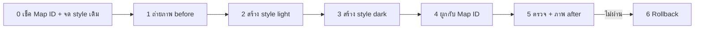

# Cloud-based map style (light + dark) สำหรับ Map ID ของแอป

**วันที่:** 2026-10-29 · **ที่มา:** [design review §7.1](../design-review/2026-10-28-ui-ux-review.md) + §13 (ข้อแก้ M11) · **แผน:** [2026-10-29-maps-cloud-style-runbook.md](../superpowers/plans/2026-10-29-maps-cloud-style-runbook.md)
**ใช้คู่กับ:** [google-maps-setup.md](google-maps-setup.md) ข้อ 5 (Map ID) · [maps-cost-guardrails.md](maps-cost-guardrails.md)

runbook นี้ทำใน Google Cloud Console ทั้งหมด **ไม่ต้องแก้โค้ดและไม่ต้อง deploy** แอปส่ง `GOOGLE_MAPS_MAP_ID` ให้ทั้งแผนที่ทริป (`real-map-canvas-google.tsx`) และ pin picker (`pin-picker-map-google.tsx`) อยู่แล้ว style ที่ผูกกับ Map ID จึงมีผลกับทั้งสองที่ทันทีที่ publish

ชื่อเมนูใน Console เขียนเป็นภาษาอังกฤษตามที่เห็นบนหน้าจอ เช็คชื่อ project ที่ dropdown บนแถบด้านบนก่อนทุกครั้ง



---

## ข้อควรรู้ก่อนเริ่ม

| เรื่อง | สรุป |
|---|---|
| ชื่อ feature | ตาราง §7.1 ในรีวิวใช้ชื่อแบบเก่า (`poi.business`, `poi.attraction` ซึ่งเป็น JSON styling แบบ legacy) ตอนนี้ Console ใช้ **taxonomy ใหม่** แล้ว (Google ย้าย style แบบ legacy ทั้งหมดไปแบบใหม่ตั้งแต่ 25 มี.ค. 2025) ตารางในข้อ 2 แปลงชื่อให้แล้ว |
| light / dark | ตั้งแต่ 31 มี.ค. 2025 Map ID ผูก style **light** และ style **dark** แยกกันได้ แผนที่จะเลือกใช้ตาม `colorScheme` ที่แอปส่งไป (`ColorScheme.DARK` / `LIGHT` ตาม theme) |
| ตอนนี้ dark ยังไม่ทำงาน | แอปล็อค theme เป็น light อยู่ (`SETTINGS_DEFAULTS.theme = 'light'`, ปุ่ม Appearance ยังขึ้น "coming soon") style dark จึงยังไม่มีใครเห็นจนกว่า dark mode จะเปิดใช้ ทำไว้ก่อนตามที่รีวิวขอ เพื่อไม่ให้ dark mode ไปใช้ style ค่าเริ่มต้นของ Google ที่รก |
| vector / raster | ตามข้อ 5 ของ setup, Map ID เป็น **JavaScript · Vector** เอกสารของ Google ไม่ได้บอกตรงๆ ว่า cloud style ใช้กับ raster ได้เหมือนกันทุกอย่าง (บอกแค่ว่าใช้กับ map type `roadmap` ได้) ใน browser ที่ไม่มี WebGL (เช่น headless Chrome) Google จะถอยไปใช้ raster เราจึง**ตรวจทั้งสองแบบ**ในข้อ 5 ถ้า Map ID ที่ใช้อยู่เป็น Raster ก็ยังผูก style ได้ แต่อย่าเปลี่ยนเป็น Vector ในขั้นตอนนี้ เพราะต้องสร้าง Map ID ใหม่ (ประเภทแก้ไม่ได้) และต้องเปลี่ยน env |
| POI ต้องแตะได้ | TP-0077 (แตะ POI → การ์ด preview → เพิ่มเข้าวัน) ใช้ `placeId` จาก click event ของ POI ที่**มองเห็นอยู่บนแผนที่** POI ที่ซ่อนจะแตะไม่ได้ ดังนั้น **ห้ามซ่อน** Entertainment / Landmark / Recreation และ **ห้าม**ตั้ง `clickableIcons={false}` ในแผนที่ทริป (ข้อ 1 ของ TL;DR ในรีวิวถูกแทนด้วยข้อแก้ M11 ใน §13 แล้ว) |
| ค่าใช้จ่าย | style ไม่มีค่าใช้จ่ายเพิ่ม แผนที่ JS ยังคิดเป็น Dynamic Maps load เท่าเดิม (ฟรี 10,000/เดือน, quota 300/วัน ดูได้ที่ cost guardrails) แต่ละ load จะดาวน์โหลด style ครั้งแรกแล้ว cache ไว้ |
| ค่าสี | ค่า hex ด้านล่างใส่ใน Console เท่านั้น ไม่ได้อยู่ในโค้ด (กติกา "ห้ามใส่ hex นอกไฟล์ token" ใช้กับโค้ด) |

---

## 0. เช็ค Map ID และจด style เดิม (สำหรับ rollback)

1. ☰ → **Google Maps Platform** → **Map management**
2. เปิด Map ID ที่ชื่อ `travel-planner-trip-map` เทียบค่า Map ID กับ `GOOGLE_MAPS_MAP_ID` ใน Vercel (Production) ด้วย `vercel env ls` (ดูได้แค่ว่ามีค่า **ห้าม**เปิดอ่านไฟล์ `.env`) หรือดูจาก network tab ของ prod (คำขอ `maps.googleapis.com` จะมี `map_ids=`)
3. จดลงตาราง rollback ท้ายไฟล์นี้:
   - **Map type** ต้องเป็น **JavaScript**
   - **Rendering** Vector หรือ Raster
   - **Map style ที่ผูกอยู่** ทั้ง light และ dark (ถ้าว่างคือใช้ style ค่าเริ่มต้นของ Google)
4. ถ้า Map type **ไม่ใช่** JavaScript ให้หยุด (style ผูกไม่ได้ ต้องสร้าง Map ID ใหม่ตาม setup ข้อ 5)

## 1. ถ่ายภาพ before

ในเครื่อง local (browser key อนุญาตแค่พอร์ต 3210):

```bash
cd ~/development/travel-planner-v2/app
MAPS_PROVIDER=google AUTH_BYPASS=true pnpm dev -p 3210
```

เปิดทริปทดสอบ `http://localhost:3210/trip/79efe162-dfb2-46c2-ad46-a34695771b8b` ("Mount Fuji & Kamakura") แล้วถ่ายภาพลง `docs/design-review/shots/` (โฟลเดอร์นี้**ไม่ได้**อยู่ใน `.gitignore` — `.gitignore` ignore แค่ `docs/research/wanderlog/shots/` — อย่า commit ภาพ ให้แนบใน PR/ticket แทน)

| ไฟล์ | ขนาด | หน้าจอ |
|---|---|---|
| `71-before-desktop-day1.png` | 1440×900 | Day 1 ไม่ได้เลือกหมุด |
| `71-before-desktop-kamakura.png` | 1440×900 | วันที่มีจุดในคามาคุระ ซูมเข้าใกล้ศาลเจ้า/วัด |
| `71-before-mobile-fullmap.png` | 390×844 | กด Map (full-map) พร้อม carousel |

ถ่ายด้วย Chrome ปกติ (มี WebGL = vector) ถ้าถ่ายด้วย Playwright headless จะได้ raster ให้ใส่ `-raster` ต่อท้ายชื่อไฟล์

## 2. สร้าง style light `tp-trip-light`

1. **Map management** → แท็บ **Map styles** → **Create style** → เลือก **Light**/Standard เป็นฐาน → **Customize**
2. ตั้งชื่อ `tp-trip-light` (ใส่คำอธิบาย: `Design review §7.1 — 2026-10-29`)
3. ตั้งค่าตามตาราง ตรงไหนไม่ได้ระบุให้ปล่อยเป็นค่าเริ่มต้น

### 2.1 Points of interest

| §7.1 (ชื่อเก่า) | feature ใน Console (ชื่อใหม่) | ตั้งค่า | เหตุผล |
|---|---|---|---|
| `poi.attraction` | **Entertainment** → Arts, Historic, Museum, Theme park, Tourist attraction · **Landmark** | Visibility **On** · Pin fill `#7b8794` · Pin glyph `#ffffff` · Pin outline `#ffffff` · Text fill `#5f6b78` | ยังเห็นและแตะได้ (TP-0077) แต่เป็นสีเทา ไม่ชนกับสีหมุดของเรา (ลด saturation ตาม §7.1) · หมายเหตุ: ตั้งแต่ 2024-09-26 Google แสดง **Landmark** เป็นไอคอนภาพวาด ไม่ใช่ POI pin ค่า Pin fill อาจไม่มีผลกับ Landmark — ถ้ายังมีสีใน 5.1 ไม่ถือว่าตรวจไม่ผ่าน |
| (ธุรกิจใน Entertainment) | **Entertainment** → Casino, Cinema | **Off** | เป็นธุรกิจ ไม่ใช่ที่เที่ยว |
| `poi.park` | **Recreation** → Park, Nature reserve, Beach, Peak, Zoo, Hot spring, Trailhead | Visibility **On** · Pin fill `#7b8794` · glyph `#ffffff` · Polygon fill (Park) `#dde6d5` | ที่เที่ยวกลางแจ้ง ต้องแตะได้ สีเขียวจางลง |
| (กีฬา) | **Recreation** → Sports complex, Sports field, Golf course, Boating, Fishing | **Off** | ไม่เกี่ยวกับการวางทริปส่วนใหญ่ ลดความรก |
| `poi.business` | **Food and drink** (Bar, Cafe, Restaurant, Winery) | ดู **การตัดสินใจ A** | |
| `poi.business` | **Retail → Shopping** | **On** (ค่าเริ่มต้นของ Google) | เจ้าของตัดสิน 2026-10-29: ให้แตะตลาด/ถนนช้อปปิ้งเพิ่มเข้าทริปได้ |
| `poi.business` | **Retail** (Grocery) · **Service** (ATM, Bank, Car rental, EV charging, Gas station, Parking lot, Post office, Rest stop, Restroom) · **Lodging** | **Off** | ซ่อนธุรกิจตาม §7.1 · ที่พักเพิ่มผ่านค้นหาโรงแรมอยู่แล้ว และหมุดโรงแรมของเราเองแสดงอยู่ |
| `poi.medical`, `poi.government`, `poi.school` | **Emergency** (Fire, Hospital, Pharmacy, Police) · **Other** → Government, School, Library, Military, Cemetery | ถ้า editor ซ่อนได้เฉพาะ pin: ซ่อน pin เหลือ label (Text fill `#8a8f98`) · ถ้าไม่ได้: **Off** | §7.1 "ซ่อนไอคอน แสดงแค่ label เล็ก" |
| `poi.place_of_worship` | **Other → Place of worship** (Buddhist, Shinto, Christian, …) | ดู **การตัดสินใจ B** | |
| — | **Transit** → Airport | On · Pin fill `#7b8794` | ใช้วางแผนการเดินทาง |

### 2.2 Infrastructure / Natural

| §7.1 | feature ใน Console | ตั้งค่า |
|---|---|---|
| `transit.station` | **Infrastructure → Transit station** (Rail station, Subway station, Bus station, Tram station, Ferry terminal, Monorail, Funicular station, Gondola station, Bicycle share) | On · Icon color `#7b8794` · Text fill `#5f6b78` (สถานีสำคัญกับคนที่ไปญี่ปุ่น/กรุงเทพ · สถานีเป็น icon ของ infrastructure ไม่ใช่ POI pin จึงใช้ element **Icon color**) |
| `transit.line` | **Infrastructure → Railway track** (Commercial, Commuter) | Stroke opacity **40%** |
| `road.highway` shield | **Infrastructure → Road network → Road shield** | **Off** |
| (โทนธุรกิจ) | **Infrastructure → Business corridor** | **Off** (พื้นสีส้มย่านการค้า ทำให้รก) |
| `landscape` | **Natural → Land** | Fill `#f4f3ef` |
| `water` | **Natural → Water** (Ocean, Lake, River, Other) | Fill `#cfe3ea` · Text fill `#5b7f8c` |
| label ลด 20% | **Political** (ชื่อเมือง/เขต) และ **Road network → Road** (label) | Text fill opacity **80%** |

4. กด **Save** แล้ว **Publish**

### การตัดสินใจ A — ร้านอาหาร (Food and drink)

| ทางเลือก | ผล |
|---|---|
| **จาง (แนะนำ)** On · Pin fill `#b8bec6` · glyph `#ffffff` · Text fill opacity 60% | ยังแตะร้านเพื่อเพิ่มเข้าทริปได้ (§13: "ถ้าอยากให้แตะร้านอาหารได้ ให้แสดง `poi.business` แบบจาง") สีส้มของ Google หายไป จึงไม่ชนกับหมุดอาหารของเรา (M1) |
| ซ่อน (Off) | แผนที่โล่งที่สุดตาม §7.1 แต่ "หาราเมงใกล้ Tokyo Tower" ต้องค้นหาเท่านั้น |

ทำแบบ **จาง** ก่อน ถ้าภาพ after (ข้อ 5) ยังรกที่ zoom 14–15 ให้เปลี่ยนเป็น Off ได้ทันทีโดยไม่ต้อง deploy

> **trade-off เดียวกันกับ Retail → Shopping:** ตารางข้อ 2.1 ปิด Retail ตาม §7.1 ทำให้ถนนช้อปปิ้ง/ตลาดที่ Google จัดเป็น Shopping (เช่น Komachi-dori ในคามาคุระ) แตะเพื่อเพิ่มเข้าทริปไม่ได้ ถ้าผู้ใช้อยากแตะได้ ให้ตั้ง **Retail → Shopping** แบบจางเหมือนร้านอาหาร → **เจ้าของตัดสินแล้ว (2026-10-29): Retail → Shopping แสดงปกติ (On)** ส่วน Grocery ยังปิด

### การตัดสินใจ B — วัดและศาลเจ้า (Place of worship)

§7.1 ให้ซ่อนไอคอน แต่ทริปญี่ปุ่นและไทย **วัดกับศาลเจ้าคือที่เที่ยวหลัก** (ทริปทดสอบมี Tsurugaoka Hachimangu และพระใหญ่คามาคุระ) ถ้าซ่อน pin ก็จะแตะเพื่อเพิ่มเข้าทริปไม่ได้ **แนะนำ: ตั้งเหมือนสถานที่ท่องเที่ยว** (On, pin เทา `#7b8794`) แทนที่จะทำตาม §7.1

## 3. สร้าง style dark `tp-trip-dark`

ทำแบบข้อ 2 แต่เลือกฐานเป็น **Dark** ตั้งชื่อ `tp-trip-dark` แล้วใส่ค่า **visibility เหมือน light ทุกตัว** ต่างกันแค่สี:

| ส่วน | light | dark |
|---|---|---|
| Pin fill ที่เที่ยว/สวน/สถานี/สนามบิน | `#7b8794` | `#5c6672` |
| Pin fill ร้านอาหาร (จาง) | `#b8bec6` | `#454c55` |
| Text fill POI | `#5f6b78` | `#a3acb6` |
| Land | `#f4f3ef` | `#1e2023` |
| Water | `#cfe3ea` | `#1b3440` |
| Park polygon | `#dde6d5` | `#23302a` |

**Save** → **Publish**

## 4. ผูก style กับ Map ID

1. **Map management** → เปิด Map ID `travel-planner-trip-map`
2. ในส่วน **Map styles**: ช่อง **Light** เลือก `tp-trip-light` · ช่อง **Dark** เลือก `tp-trip-dark`
3. **Save**
4. style ถูก cache ใน browser ให้ hard reload (Ctrl+Shift+R) ตอนตรวจ ถ้าภายใน ~15 นาทียังไม่เปลี่ยน ให้เปิดหน้าต่าง incognito

## 5. ตรวจ + ภาพ after

ใช้ dev server เดิมในข้อ 1 และทริปเดิม

| # | ตรวจ | ผ่านเมื่อ |
|---|---|---|
| 5.1 | ภาพแรกของ Day 1 (1440×900) | หมุดตัวเลขของเราเด่นที่สุดในภาพ ไม่มี pin สีม่วง/ส้ม/ฟ้าของ Google ข้างหมุดเรา |
| 5.2 | แตะ POI พิพิธภัณฑ์หรือศาลเจ้า | การ์ด preview ของเรา (TP-0077) ขึ้นพร้อม "Add to Day N" และ**ไม่มี** info window ของ Google |
| 5.3 | แตะ POI ร้านอาหารแบบจาง (ถ้าใช้ทางเลือก A แบบจาง) | การ์ด preview ขึ้น |
| 5.4 | ร้านค้า/ATM/ปั๊มน้ำมัน/โรงแรมของ Google | มองไม่เห็นที่ zoom 13–17 |
| 5.5 | สถานีรถไฟ | ยังเห็นชื่อ ไอคอนเทา เส้นรางจางลง |
| 5.6 | มือถือ 390×844 full-map | carousel, โลโก้ Google และ attribution ยังเห็นครบ (ToS) |
| 5.7 | pin picker (Add place → ปักหมุดเอง) | ใช้ style เดียวกัน ยังคลิกปักหมุดได้ (picker ตั้ง `clickableIcons={false}` อยู่แล้ว) |
| 5.8 | Raster | ถ่ายด้วย Playwright headless (ไม่มี WebGL) แล้วเทียบกับ 5.1 · ถ้าสี/การซ่อนใน raster ไม่ตรง ให้จดไว้ในตาราง rollback เป็น known gap (ผู้ใช้จริงเกือบทั้งหมดมี WebGL) ไม่ต้องแก้ |
| 5.9 | Dark (ไม่บังคับ) | ใน DevTools console: `document.cookie='theme=dark; path=/'` แล้ว reload (root layout อ่าน cookie `theme=dark` → `data-theme="dark"` → แผนที่สร้างด้วย `ColorScheme.DARK`, นับเป็น 1 map load) ต้องได้ `tp-trip-dark` · ทางเลือกแบบไม่ reload: `document.documentElement.dataset.theme='dark'` (`useTheme` จับการเปลี่ยน attribute แล้ว vis.gl สร้างแผนที่ใหม่) · เสร็จแล้วลบ cookie (`document.cookie='theme=; path=/; max-age=0'`) · Google ยังติดป้าย dark style ว่า experimental ถ้าแผนที่ไม่สลับ ให้จดไว้ว่า "ตรวจเมื่อ dark mode เปิด" |
| 5.10 | Production | เปิด https://travel-planner-v2-eight.vercel.app ทริปเดียวกัน ทำ 5.1 + 5.2 ซ้ำ |

ภาพ after ใช้ชื่อเดียวกับข้อ 1 แต่เปลี่ยน `before` เป็น `after` แล้วแนบคู่ before/after ใน ticket

## 6. Rollback

ทำได้ภายในไม่กี่นาที ไม่ต้อง deploy

1. **Map management** → Map ID → **Map styles** → เปลี่ยนช่อง Light/Dark กลับเป็นค่าที่จดไว้ในข้อ 0 (ถ้าเดิมว่าง ให้เลือก **None** หรือเลือก style ค่าเริ่มต้นของ Google) → **Save**
2. ถ้าแค่ค่าบางตัวผิด (เช่น ร้านอาหารยังรก) ให้แก้ใน `tp-trip-light` แล้ว **Publish** ใหม่ ไม่ต้องถอดออกจาก Map ID
3. **อย่าลบ** style `tp-trip-*` เก็บไว้เพื่อเปิดใช้อีกครั้ง
4. hard reload เพื่อยืนยัน

## ตารางบันทึก (กรอกตอนทำ)

| รายการ | ค่า |
|---|---|
| วันที่ทำ | |
| Map ID type / rendering | JavaScript / … |
| style เดิม (light / dark) | … / … |
| การตัดสินใจ A (ร้านอาหาร) | จาง / ซ่อน |
| การตัดสินใจ B (วัด/ศาลเจ้า) | แสดงแบบที่เที่ยว / ซ่อนไอคอน |
| known gap (raster) | |

## Checklist

- [ ] 0 Map ID เป็น JavaScript, จด rendering และ style เดิมแล้ว
- [ ] 1 ภาพ before 3 ภาพ
- [ ] 2 `tp-trip-light` publish แล้ว
- [ ] 3 `tp-trip-dark` publish แล้ว
- [ ] 4 ผูก light + dark กับ Map ID
- [ ] 5 ผ่าน 5.1–5.8 และ 5.10 (5.9 เมื่อ dark mode เปิด)
- [ ] ภาพ after แนบใน ticket
