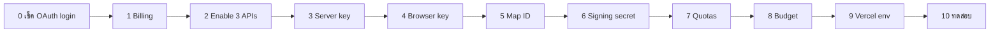

# Google Cloud setup สำหรับโหมด `MAPS_PROVIDER=google`

**วันที่:** 2026-10-22 · **ใช้คู่กับ:** [แผน multi-provider](../superpowers/plans/2026-10-22-maps-multi-provider.md)
**สถานะ:** สร้าง Google Cloud project ใหม่แล้ว ส่วน project เก่าลบไปแล้ว

ชื่อเมนูใน Console เขียนเป็นภาษาอังกฤษตามที่เห็นบนหน้าจอ ทุกข้อทำใน **project ใหม่** ให้เช็คชื่อ project ที่ dropdown บนแถบด้านบนก่อนทุกครั้ง



---

## 0. ⚠️ เช็คก่อน: Google login ของแอปอาจพังไปแล้ว

แอป login ด้วย Google OAuth (`GOOGLE_CLIENT_ID` / `GOOGLE_CLIENT_SECRET` ใน Vercel ตั้งไว้เมื่อ 171 วันก่อน) ถ้า OAuth client ตัวนี้อยู่ใน **project เก่าที่ลบไป** มันก็ถูกลบไปด้วย และ "Sign in with Google" บน production จะ error ว่า `deleted_client` หรือ `invalid_client`

**เช็ค:** เปิด https://travel-planner-v2-eight.vercel.app ในหน้าต่าง incognito แล้วกด Sign in with Google

- **login ผ่าน** → OAuth client อยู่ที่อื่น ข้ามไปข้อ 1 ได้
- **error** → เลือกทางใดทางหนึ่ง
  - **กู้ project เก่า (ง่ายที่สุด):** project ที่ลบแล้วกู้คืนได้ภายใน **30 วัน** ไปที่ IAM & Admin → **Manage resources** → ด้านล่างกด **Resources pending deletion** → เลือก project → **Restore** แล้วเก็บไว้ใช้แค่ OAuth ไม่ต้องเปิด Maps
  - **สร้าง OAuth ใหม่ใน project ใหม่:**
    1. ไปที่ **Google Auth Platform** → Branding (consent screen) แล้วใส่ชื่อแอปและอีเมล
    2. ไปที่ **Clients** → Create client → *Web application*
    3. ใส่ Authorized redirect URIs เป็น `https://travel-planner-v2-eight.vercel.app/api/auth/callback/google` และ `http://localhost:3210/api/auth/callback/google`
    4. ไปที่ **Audience** → ถ้ายังเป็น *Testing* ให้เพิ่มอีเมลผู้ใช้เป็น test user หรือกด *Publish app*
    5. เปลี่ยน `GOOGLE_CLIENT_ID` / `GOOGLE_CLIENT_SECRET` ใน Vercel (ดูข้อ 9) แล้ว redeploy

## 1. Billing

1. ไปที่ ☰ → **Billing** ถ้าหน้าขึ้นว่า *This project has no billing account* ให้กด **Link a billing account** แล้วเลือก account ที่แก้แล้ว
2. ตรวจว่า billing account สถานะเป็น **Active** และวิธีจ่ายเงินใช้ได้

## 2. เปิด API 3 ตัว

ไปที่ ☰ → **APIs & Services** → **Library** ค้นหาแล้วกด **Enable** ทีละตัว:

| API | ใช้ทำ | ระวัง |
|---|---|---|
| **Places API (New)** | ค้นหาและรายละเอียดสถานที่ (server) | **ไม่ใช่** "Places API" (legacy) ที่ไม่มีคำว่า (New) |
| **Maps JavaScript API** | แผนที่ใน browser | — |
| **Maps Static API** | รูป OG ตอนแชร์ลิงก์ | — |

**ไม่ต้อง**เปิด Geocoding, Directions, Routes หรือ Map Tiles เพราะแอปไม่ได้ใช้

## 3. Server key (`GOOGLE_MAPS_API_KEY`)

1. ไปที่ **APIs & Services** → **Credentials** → **+ Create credentials** → **API key**
2. หลังได้ key แล้ว กด **Edit API key** (หรือกดที่ชื่อ key)
   - **Name:** `travel-planner-server`
   - **Application restrictions:** **None** (Vercel ใช้ IP ขาออกที่ไม่คงที่ ล็อค IP จึงไม่ได้)
   - **API restrictions:** *Restrict key* แล้วติ๊กแค่ **Places API (New)** และ **Maps Static API**
   - กด **Save**
3. คัดลอก key ไปเก็บไว้ใช้ในข้อ 9 key นี้**ห้าม**ใส่ใน client หรือตั้งชื่อขึ้นต้นด้วย `NEXT_PUBLIC_`

### 3.1 Text Search server key (`GOOGLE_PLACES_SERVER_KEY`)

key นี้แยกจาก `GOOGLE_MAPS_API_KEY` ข้างบน ใช้เฉพาะ `GET /api/v1/places/search` (TP-0038) **ห้าม**เอา Text Search ไปรวมกับ `GOOGLE_MAPS_API_KEY`

1. **+ Create credentials** → **API key** → **Edit**
   - **Name:** `travel-planner-text-search`
   - **Application restrictions:** **None** (Vercel ใช้ IP ขาออกที่ไม่คงที่)
   - **API restrictions:** *Restrict key* แล้วติ๊กแค่ **Places API (New)** ตัวเดียว (อย่ารวม Static/Maps JS)
   - กด **Save**
2. คัดลอก key ไปใส่ `GOOGLE_PLACES_SERVER_KEY` ในข้อ 9 (server-only เหมือนกัน) และตั้ง Text Search quota ตามข้อ 7

## 4. Browser key (`GOOGLE_MAPS_BROWSER_KEY`)

key นี้จะอยู่ใน browser ทำให้คนอื่นเห็นได้ จึงต้องป้องกันด้วย referrer

1. **+ Create credentials** → **API key** → **Edit**
   - **Name:** `travel-planner-browser`
   - **Application restrictions:** **Websites** แล้วกด *Add* ทีละบรรทัด:
     ```
     https://travel-planner-v2-eight.vercel.app/*
     http://localhost:3210/*
     http://wadjakorn-bmax:3210/*
     http://100.78.126.1:3210/*
     ```
   - **API restrictions:** *Restrict key* แล้วติ๊กแค่ **Maps JavaScript API**
   - **Save**
2. ถ้าภายหลังผูก custom domain ให้เพิ่ม `https://<โดเมน>/*` ที่นี่ด้วย

> **Preview deployments** (`travel-planner-v2-xxxx-wazjakorngmailcoms-projects.vercel.app`) ใส่ wildcard กลางชื่อแบบนี้ใน Google ไม่ได้ และถ้าใส่ `*.vercel.app` ก็กว้างเกินไป (ใครก็ deploy บน vercel.app ได้) ดังนั้นให้ **Preview ใช้ `MAPS_PROVIDER=open`** ถ้าต้องการทดสอบโหมด Google บน preview ตัวไหน ให้เพิ่ม URL ของ preview นั้นใน referrer ชั่วคราว แล้วลบออกเมื่อทดสอบเสร็จ

## 5. Map ID (`GOOGLE_MAPS_MAP_ID`)

ต้องมี Map ID ถึงจะใช้ Advanced Markers (หมุดตัวเลขของแอป) และแผนที่แบบ vector ได้

1. ☰ → **Google Maps Platform** → **Map management** → **Create Map ID**
2. **Name:** `travel-planner-trip-map` · **Map type:** **JavaScript** · เลือก **Vector**
   - ถ้ามีตัวเลือก *Tilt / Rotation* ให้ปิดทั้งคู่
3. **Save** แล้วคัดลอก **Map ID** (เป็นเลขฐาน 16) ค่านี้ไม่ใช่ความลับ

## 6. URL signing secret (`GOOGLE_MAPS_URL_SIGNING_SECRET`)

1. ☰ → **Google Maps Platform** → **Keys & Credentials** แล้วหาส่วน **Maps Static API → URL signing secret** (บางบัญชีจะอยู่ใน **APIs & Services → Maps Static API → Credentials** แทน)
2. คัดลอก **Current secret** ไปเก็บไว้ ค่านี้เป็นความลับ
3. **บังคับให้ทุก request ต้อง sign:** ไปที่ **Quotas** ของ Maps Static API (ข้อ 7) แล้วตั้ง **Unsigned requests per day = 0** ทำแบบนี้แล้ว ถึง server key จะรั่ว คนอื่นก็ใช้เรียก Static Maps ไม่ได้

## 7. Quotas — ตัวกันบิลบานตัวจริง

budget ในข้อ 8 แค่แจ้งเตือน ไม่ได้หยุดการใช้งาน ตัวที่หยุดจริงคือ quota เมื่อ request ชน quota แล้ว Google ตอบ 429 และแอปจะ fallback ไปใช้ Geoapify/Photon/MapLibre เอง

☰ → **Google Maps Platform** → **Quotas** → เลือก API ตามตาราง ติ๊ก quota ที่ต้องการ → **Edit quotas** → ใส่ค่า → **Submit**

| API | Quota (ชื่อที่เห็นอาจต่างไปเล็กน้อย) | ตั้งเป็น | เหตุผล |
|---|---|---|---|
| Places API (New) | Place Details / `GetPlace` … **per day** | **135** | ตรงกับ cap ในแอป: 30 (เพิ่มสถานที่, Enterprise + Atmosphere ฟรี 1,000/เดือน) + 80 (โรงแรม/การเดินทาง, Essentials ฟรี 10,000/เดือน) + 20 (cron refresh `/api/internal/google-resync`, Enterprise ฟรี 1,000/เดือน) + 5 (ปุ่ม "Update from Google", Enterprise เดียวกัน; 25/วัน ≈ 750/เดือน) — console แยก SKU ไม่ได้ |
| Places API (New) | Autocomplete … **per day** | **300** | Autocomplete Requests ฟรี 10,000/เดือน โดยเฉพาะ session ที่ปิดด้วย Essentials จะถูกคิดเงิน autocomplete ไม่เกิน 12 request |
| Places API (New) | Text Search (New) … **per day** | **200** | ล้อกับ in-app per-user cap `places:search:${userId}` 200/วัน (TP-0038, `GET /api/v1/places/search`) เป็น **Pro tier** (~$32/1k, ไม่มี Essentials) ยิงด้วย server key `GOOGLE_PLACES_SERVER_KEY` และ field mask ขั้นต่ำ (ไม่มี Atmosphere/Enterprise) in-app limiter fail-open → console quota คือ hard stop จริง เพิ่มผู้ใช้ค่อยขยาย |
| Maps JavaScript API | **Map loads per day** | **300** | free cap 10,000/เดือน |
| Maps Static API | **Requests per day** | **200** | OG cache วันละครั้งต่อทริป |
| Maps Static API | **Unsigned requests per day** | **0** | ข้อ 6 |

> ถ้า Places API (New) **มีแค่ quota แบบ per minute** ไม่มี per day ให้ตั้ง per minute ต่ำ ๆ (เช่น Place Details 10/นาที, Autocomplete 60/นาที, Text Search 10–20/นาที) ในแอปมี daily cap เป็นตัวกันชั้นที่สองอยู่แล้ว (`GOOGLE_PLACES_DETAILS_FULL_DAILY_CAP` 30, `GOOGLE_PLACES_DETAILS_BASIC_DAILY_CAP` 80, `GOOGLE_PLACES_AUTOCOMPLETE_DAILY_CAP` 300 ซึ่งอยู่ใน Stage A ของแผน; `GOOGLE_PLACES_REFRESH_DAILY_CAP` 20 และ `GOOGLE_PLACES_REFRESH_MANUAL_DAILY_CAP` 5 อยู่ใน Stage C)

ตัวเลขข้างบนเป็นจุดเริ่มต้นสำหรับใช้คนเดียวหรือกลุ่มเล็ก ปรับเพิ่มได้ภายหลังจากหน้า Metrics

## 8. Budget alert

1. ☰ → **Billing** → **Budgets & alerts** → **Create budget**
2. **Scope:** เลือก project ใหม่ · **Services:** Maps / Places ทั้งหมด หรือ All services
3. **Amount:** *Specified amount* = **$5** (ปรับได้ ถ้าใช้ไม่เกิน free cap ควรเป็น $0)
4. **Thresholds:** 50%, 90%, 100% ของ Actual และ 100% ของ Forecasted
5. **Notifications:** ส่งอีเมลหา billing admins
6. **Finish**

## 9. ใส่ค่าใน Vercel และเครื่อง local

### 9.1 ลบ env เก่าที่ค้างอยู่ใน Vercel (ค่าเหล่านี้มาจาก project ที่ลบไปแล้ว)

```bash
cd ~/development/travel-planner-v2
vercel env rm NEXT_PUBLIC_GOOGLE_MAPS_API_KEY production --yes
vercel env rm NEXT_PUBLIC_GOOGLE_MAPS_API_KEY preview --yes
vercel env rm NEXT_PUBLIC_GOOGLE_MAPS_MAP_ID  production --yes
vercel env rm NEXT_PUBLIC_GOOGLE_MAPS_MAP_ID  preview --yes
vercel env rm GOOGLE_MAPS_API_KEY             production --yes
vercel env rm GOOGLE_MAPS_API_KEY             preview --yes
```

(`vercel env rm` รับได้ทีละ environment เลยต้องรันแยกบรรทัด)

### 9.2 เพิ่มค่าใหม่ (Production)

```bash
vercel env add GOOGLE_MAPS_API_KEY            production --sensitive   # วาง server key
vercel env add GOOGLE_MAPS_BROWSER_KEY        production               # วาง browser key
vercel env add GOOGLE_MAPS_MAP_ID             production               # วาง Map ID
vercel env add GOOGLE_MAPS_URL_SIGNING_SECRET production --sensitive   # วาง signing secret
vercel env add GOOGLE_PLACES_SERVER_KEY       production --sensitive   # วาง Text Search server key (ข้อ 3.1)
vercel env add GOOGLE_PLACES_SERVER_KEY       preview    --sensitive   # วางค่าเดียวกัน
```

`GOOGLE_PLACES_SERVER_KEY` เป็น **key คนละตัว** กับ `GOOGLE_MAPS_API_KEY` ใช้กับ `GET /api/v1/places/search` (TP-0038) และเป็น server-only (ห้ามขึ้นต้นด้วย `NEXT_PUBLIC_`) ใส่ทั้ง **Production และ Preview** เพราะ endpoint นี้ทำงานแยกจาก `MAPS_PROVIDER` (ไม่ได้ตั้ง → endpoint ตอบ 503 ไม่ล้ม)

Stage B (แผนที่ Google) deploy แล้ว จึงตั้ง `MAPS_PROVIDER=google` ได้ที่ **Production เท่านั้น** (การเปิดจริงทำตอน go-live ตาม runbook ไม่ใช่ตอนเพิ่ม 4 ค่าด้านบน):

```bash
printf google | vercel env add MAPS_PROVIDER production
```

แล้ว redeploy Preview ไม่มี Google vars เลยและคงเป็น `open` (ถ้าตั้ง `MAPS_PROVIDER=google` หลุดไป Preview โค้ดจะบังคับ `open` พร้อม warning เพราะ browser key ผูก referrer กับ production + localhost) โหมด google ต้องมีครบ **4 ค่า** (`GOOGLE_MAPS_API_KEY`, `GOOGLE_MAPS_URL_SIGNING_SECRET`, `GOOGLE_MAPS_BROWSER_KEY`, `GOOGLE_MAPS_MAP_ID`) ถ้าขาดตัวใดตัวหนึ่งจะทำงานเป็น `open` และ log warning หนึ่งครั้งบอกชื่อค่าที่ขาด (เพราะ ToS ข้อ 14.2 ห้ามแสดงผลจาก Places บนแผนที่ที่ไม่ใช่ Google)

### 9.3 เครื่อง local (`app/.env`, ถูก gitignore แล้ว)

```bash
GOOGLE_MAPS_API_KEY="…server key…"
GOOGLE_MAPS_BROWSER_KEY="…browser key…"
GOOGLE_MAPS_MAP_ID="…"
GOOGLE_MAPS_URL_SIGNING_SECRET="…"
GOOGLE_PLACES_SERVER_KEY="…text search server key…"   # ข้อ 3.1 — คนละตัวกับ GOOGLE_MAPS_API_KEY
# MAPS_PROVIDER="google"
# optional: daily caps (ค่าเริ่มต้น 30 / 80 / 300 / 20 / 5)
# GOOGLE_PLACES_REFRESH_DAILY_CAP="20"
# GOOGLE_PLACES_REFRESH_MANUAL_DAILY_CAP="5"
```

## 10. ทดสอบ key (รันในเครื่องตัวเอง)

```bash
export K="…server key…"

# 10.1 Places Autocomplete (New) → ต้องได้ JSON ที่มี "suggestions"
curl -s -X POST https://places.googleapis.com/v1/places:autocomplete \
  -H "Content-Type: application/json" -H "X-Goog-Api-Key: $K" \
  -d '{"input":"jay fai bangkok","languageCode":"th"}' | head -c 400; echo

# 10.2 Place Details (New) basic mask (Essentials) → ต้องได้ location + formattedAddress
curl -s "https://places.googleapis.com/v1/places/ChIJN1t_tDeuEmsRUsoyG83frY4" \
  -H "X-Goog-Api-Key: $K" \
  -H "X-Goog-FieldMask: id,formattedAddress,location,types" | head -c 400; echo

# 10.3 Static Maps แบบไม่ sign → ต้องโดนปฏิเสธ (403) ถ้าตั้ง unsigned = 0 แล้ว
curl -s -o /dev/null -w "%{http_code}\n" \
  "https://maps.googleapis.com/maps/api/staticmap?center=13.75,100.5&zoom=12&size=200x100&key=$K"

# 10.4 Place Details (New) refresh mask (Enterprise, ไม่มี sessionToken) → ต้องได้ displayName, rating, regularOpeningHours, businessStatus
curl -s "https://places.googleapis.com/v1/places/ChIJN1t_tDeuEmsRUsoyG83frY4?languageCode=en" \
  -H "X-Goog-Api-Key: $K" \
  -H "X-Goog-FieldMask: id,displayName,formattedAddress,location,businessStatus,nationalPhoneNumber,websiteUri,regularOpeningHours,rating,userRatingCount" | head -c 600; echo

unset K
```

| ผลที่ได้ | ความหมาย |
|---|---|
| `PERMISSION_DENIED … API has not been used / is disabled` | ยังไม่ได้ Enable API ในข้อ 2 หรือเพิ่ง enable ให้รอ 1–5 นาที |
| `API_KEY_SERVICE_BLOCKED` | API restriction ของ key ไม่มี API นั้น (ข้อ 3) |
| `BILLING_DISABLED` | ยังไม่ได้ link billing (ข้อ 1) |
| 10.2 ได้ `NOT_FOUND` | place id ตัวอย่างอาจเปลี่ยนไปแล้ว ให้ใช้ `placeId` จากผลของ 10.1 แทน |

browser key กับ Map ID ทดสอบจาก curl ไม่ได้ จึงทดสอบใน Stage B บน localhost และอีกครั้งตอน go-live บน production

## Checklist

- [ ] 0 login ด้วย Google บน production ได้ (หรือแก้ OAuth แล้ว)
- [ ] 1 billing ผูกกับ project ใหม่แล้ว
- [ ] 2 เปิด Places API (New), Maps JavaScript API, Maps Static API แล้ว
- [ ] 3 server key: ไม่มี application restriction, จำกัดแค่ Places (New) + Static
- [ ] 3.1 `GOOGLE_PLACES_SERVER_KEY` (Text Search) เป็น key แยก จำกัดแค่ Places API (New), ตั้ง Text Search quota 200/วัน (ข้อ 7), ใส่ Vercel env Production + Preview
- [ ] 4 browser key: referrer = production + localhost, จำกัดแค่ Maps JS
- [ ] 5 Map ID (JavaScript, Vector)
- [ ] 6 signing secret และตั้ง unsigned requests = 0
- [ ] 7 ตั้ง quotas ตามตาราง (แจ้งผมถ้ามีแค่ per-minute)
- [ ] 8 budget $5 + alerts
- [ ] 9 ลบ env เก่าใน Vercel, เพิ่ม 4 ค่าใหม่, ใส่ `app/.env`
- [ ] 10 curl 10.1 / 10.2 ผ่าน, 10.3 ได้ 403 และ 10.4 ได้ displayName/rating/regularOpeningHours/businessStatus
- [ ] 11 MAPS_PROVIDER=google (Production) + redeploy
