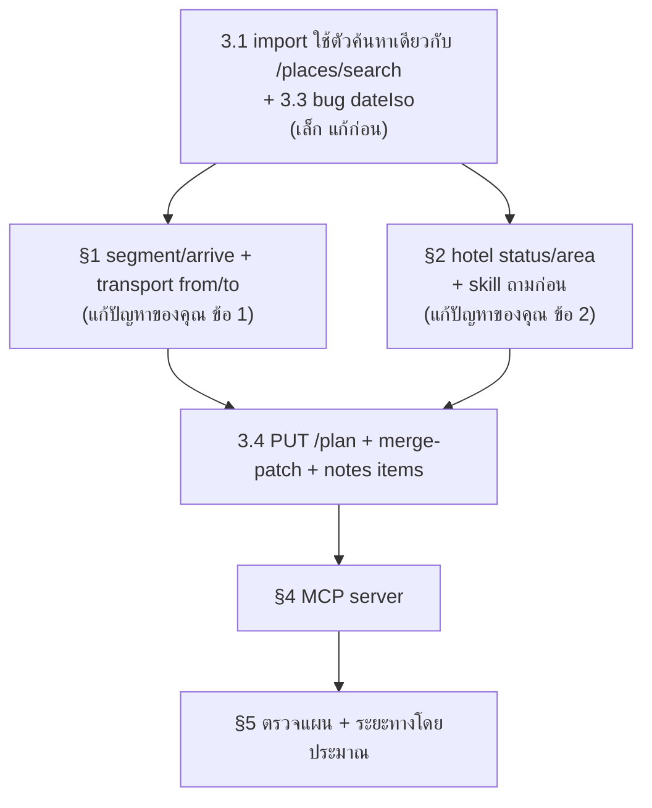

# API / Skill: ปัญหาที่เจอตอนให้ agent จัดทริป และสิ่งที่ควรปรับ

> 2026-11-04 · ทดสอบจริงบน prod: import แผน **E-city** (10 วัน, 44 จุด, 8 โรงแรม) จาก `../japan-trip`
> ทริปทดสอบ: `/trip/f862ff20-8ef3-4be7-bf6d-6c61011e299a`
> ไฟล์ request/response: `~/development/_scratch/tp-import/`
> Tickets: EPIC **TP-0138** → TP-0139…TP-0149 · MCP ใส่ไว้ที่ TP-0035 (ตรวจกับโค้ดแล้ว 2026-11-04)

## 0. สรุปสั้น

API ตอนนี้ **ออกแบบมาให้เก็บ "รายการจุด"** แต่สิ่งที่ agent ต้องสร้างจริงคือ **"เส้นทาง"**
ได้แก่ จุด → การเดินทาง → จุด → ที่พัก → การเดินทางข้ามเมือง
ผลที่ตามมาคือการเดินทางกับที่พักกลายเป็นข้อมูลที่ลอยอยู่ ไม่ได้ผูกกับแผนที่ ปัญหาทั้งสองข้อของคุณมาจากจุดนี้

เรื่องที่ควรแก้ก่อน เรียงตามผลกระทบ

1. **ให้ "ขาเดินทาง (leg)" เป็นข้อมูลระดับเดียวกับจุด** ระบุโหมด เวลา และโน้ตได้ และกำหนดจุดต้นทาง/ปลายทางได้ชัด (§1)
2. **ที่พักแบบยังไม่เลือก** ให้มีสถานะ `tbd` และใส่หมุดระดับย่านได้ ส่วน skill ต้องถามผู้ใช้ก่อน (§2)
3. **ตัวค้นหาพิกัดตอน import หาไม่เจอ 30 จาก 39 จุด** แต่ `/places/search` หาเจอครบ 39 จุด (§3.1)
4. **มี MCP server** แทนการให้ agent ประกอบคำสั่ง curl/jq เอง (§4)

---

## 1. การเดินทางถูกใส่เป็นสถานที่ (ปัญหาของคุณ ข้อ 1)

### เกิดอะไรขึ้น

ทางที่ agent เห็นว่าใช้บันทึก "ขับจาก A ไป B" ได้มีสามทาง และไม่มีทางไหนตรงความต้องการ

| ทางที่มี | ปัญหา |
|---|---|
| place `kind:"transit"` (ทางที่ผมใช้) | ไม่มีพิกัด จึงทำให้เส้นทางบนแผนที่ขาดตรงจุดนั้น (`segment-fix.ts` แสดง "No location for …") และถูกนับเป็น "จุด" อีกหนึ่งจุดในวันนั้น |
| `transport` booking | ไม่มีพิกัดต้นทาง/ปลายทาง มีแค่ `fromCode`/`toCode` ที่เป็นข้อความอิสระ ผมใส่ `"OSA"` ไปมั่ว ๆ ได้ก็ไม่ error มี `dayIdx`/`fromDate` แล้ว และ `ridesForDay` ใช้ผูก ride เข้ากับวันใน itinerary แต่ skill ไม่ได้บอกฟิลด์นี้ agent จึงไม่ได้ส่ง และยังไม่มีพิกัด จึงไม่ขึ้นบนแผนที่ |
| `segment` (ขาเดินทางระหว่างจุด) | **มีอยู่แล้วใน DB** (`dayId, idx, mode, distance, time`) แต่ API ไม่เปิดให้เขียน (§8 ของ skill) และไม่มี `note` |

### ข้อเสนอ: `segment` เป็นข้อมูลระดับเดียวกับจุด

ใช้ตาราง `segment` ที่มีอยู่แล้ว ขยายแทนการสร้างตารางใหม่


- **คอลัมน์ที่เพิ่ม:** `note`, `departAt`/`arriveAt` (ไม่บังคับ), `transportId` (ผูกกับ booking เช่นไฟลต์ เรือ หรือรถไฟที่จองไว้) และเพิ่มโหมด `train`/`ferry`/`flight`
- **ฝั่ง API ใช้รูปแบบ "ขามาถึงจุดนี้"** ให้แต่ละ place มีฟิลด์ `arrive` ที่อธิบายการเดินทางจากจุดก่อนหน้า
  agent จะเขียนเรียงลำดับได้ตามธรรมชาติ และไม่ต้องอ้าง id ของจุด

  ```jsonc
  { "kind": "sight", "name": "Tobe Zoo", "lat": 33.764, "lng": 132.792,
    "arrive": { "mode": "drive", "duration": "2h30m", "note": "ทางด่วน Matsuyama · แวะ SA Ishizuchi" } }
  ```
  - จุดแรกของวัน = ขาจากโรงแรมของคืนก่อน
- **ไม่รับ place `kind:"transit"` ที่ไม่มีพิกัดตอน import** ถ้าส่งมาให้ตอบ warning ว่า "ใช้ `arrive` แทน"
  หรือจะเลิกใช้ `transit` เป็นค่าของ place kind ไปเลยก็ได้ ยกเว้นจุดที่มีตัวตนจริง เช่นสถานี สนามบิน หรือท่าเรือ
- **การเดินทางข้ามเมืองหรือข้ามวัน** (ไฟลต์, rapi:t, รถเช่ารับ/คืน) ให้ transport รับ `from`/`to` เป็น
  `{ name, lat, lng }` หรือ `googleMapsUrl` แล้วแปลงเป็นพิกัดด้วยวิธีเดียวกับ place
  และใช้ `fromDate`/`dayIdx` (มีใน DB แล้ว) ผูกกับวัน แผนที่จะวาดขา "KIX → Suma" ของวันแรกได้

---

## 2. โรงแรมไม่มี location (ปัญหาของคุณ ข้อ 2)

### ความเห็นผม

**"ให้สุ่มเลือก" ผมไม่แนะนำ** agent ที่เลือกโรงแรมจริงแทนผู้ใช้ จะทำให้แผนดูเหมือนจองแล้ว
ทั้งที่ยังไม่ได้ตรวจราคาหรือห้องว่างเลย ซึ่งอันตรายกว่าการไม่มีหมุด
ผมแนะนำให้มี 3 สถานะ และให้ skill ถามผู้ใช้ก่อนทุกครั้ง

| สถานะ | ใส่อะไร | แผนที่ |
|---|---|---|
| **จองแล้ว** (`confirmed`) | ชื่อจริง + `googleMapsUrl` หรือ `placeIdExternal` | หมุดตรงตำแหน่ง |
| **ยังไม่เลือก แต่รู้ย่าน** (`tbd`) (ค่าตั้งต้นที่แนะนำ) | `area: "Dogo Onsen, Matsuyama"` แล้ว server หาพิกัดกลางของย่านให้ | หมุดแบบประ ๆ หรือวงกลมรัศมี ขาจากโรงแรมยังวาดได้โดยประมาณ |
| **ให้ agent เสนอตัวเลือก** (`tbd` + `candidates[]`) | 2–3 โรงแรมพร้อม link และราคาโดยประมาณ | หมุดตามย่าน ส่วนตัวเลือกแสดงใน UI ให้กดเลือก |

ต้องแก้ทั้ง API และ skill:
- **API:**
  - hotel รับ `status`, `area` (หรือ `query`/`near` เหมือน place) และ `googleMapsUrl` ได้ ตอนนี้ skill บอกว่า `googleMapsUrl` ใช้ได้ "places only, not hotels"
  - เพิ่ม warning `hotel_without_location`
- **Skill:**
  - เพิ่มขั้นตอน **"ถามก่อนสร้าง"** ว่าจองโรงแรมแล้วหรือยัง แต่ละคืนอยู่ย่านไหน
  - ห้ามตั้งชื่อ placeholder แบบ `"… (ยังไม่เลือก)"` ซึ่งเป็นสิ่งที่ผมทำ และทำให้ชื่อดูเป็นข้อมูลขยะ

---

## 3. ปัญหาที่ผมเจอระหว่างทำจริง

### 3.1 ตัวหาพิกัดของ import กับ `/places/search` ให้ผลไม่ตรงกัน (ร้ายแรงที่สุด)

| | import `query` | `GET /places/search` |
|---|---|---|
| ตัวค้นหา | `searchPlaces(…, skipGoogle:true)` = Geoapify autocomplete → Photon (`place-link.ts:164`) · `near` ไม่ได้ส่งเป็น bias ใช้แค่เลือกผลที่ใกล้สุดหลังค้นเสร็จ (`:169`) | Google Text Search + `locationBias` |
| จุดในแผนนี้ | **เจอ 9 จาก 39** (ไม่เจอ Matsuyama Castle, Kaiyukan, USJ, Ritsurin…) | **เจอ 39 จาก 39** |
| งบเวลา | 50 lookup + deadline 20 วินาที → 7 จุดท้าย `lookup_skipped` | ไม่ติด |

- skill §2 แนะนำให้ส่ง `query` เพราะ "ง่าย" แต่ผลจริงทำให้ agent ต้องเปลี่ยนวิธีกลางทาง
  โดยค้นทีละจุด 40 ครั้ง และต้อง `sleep 1.1` กัน rate limit
- **แก้:** ให้ import ใช้ตัวค้นหาเดียวกับ `/places/search` และส่ง `near` เป็น bias (import ค้นขนาน `PLAN_CONCURRENCY=5` อยู่แล้ว แต่ยังหมด deadline 20 วินาทีได้)
  - หรืออย่างน้อยให้ skill บอกตรง ๆ ว่า "ค้นด้วย `/places/search` ก่อน แล้วค่อย import พร้อมพิกัด"
- dryRun ใช้โควตา geocode 300/วัน ไปแล้ว ถ้า commit ซ้ำโดยไม่ copy พิกัดจาก dryRun มาใส่ จะใช้โควตาเป็นสองเท่า
  ข้อนี้ skill เตือนไว้แล้ว แต่ที่จริงควรให้ dryRun คืน `resolveToken` มาให้ใช้ตอน commit ได้เลย

### 3.2 Warning มีเยอะเกินไปจนอ่านไม่ได้

- จุดเดียวได้ทั้ง `place_unresolved` และ `place_without_coords` dryRun แรกจึงได้ **72 warning จาก 44 จุด**
- **การนับ index ไม่ตรงกัน:** `day`/`place` เริ่มที่ 1 แต่ `path` เริ่มที่ 0 (`/days/0/places/3`) ทำให้ agent ต้องแปลงเลขเอง
- **แก้:**
  - รวม warning ของแต่ละจุดเป็นรายการเดียว `{ path, codes[], name }`
  - ใส่ `name` ของจุดนั้นมาด้วย
  - ใช้ path แบบเดียวกันทุก warning

### 3.3 Bug: dryRun คืน `dateIso: null`

- trip มี `startDate` และแต่ละวันส่ง `date` มาครบ แต่ใน preview ทุกวันได้ `dateIso: null`
  ส่วน `date` เป็น `"Saturday, April 10"` ซึ่งคนละรูปแบบกับ `"Sat, Nov 1"` ที่ doc บอก
- doc บอกว่า `dateIso` เป็น null เฉพาะเมื่อ "ไม่รู้วันที่" จึงขัดกับ doc

### 3.4 Import ทำแบบ "ทั้งหมดในครั้งเดียว" ยังไม่ได้จริง

- **`notes[]` ใส่ checklist item ไม่ได้** ผมต้องยิงเพิ่มอีก 10 ครั้ง (`POST /notes/:id/items`) ควรรับ `items: [{text, done}]` มาเลย
- **หลัง import แก้ไขต่อลำบาก**
  - import สร้างทริปใหม่เสมอ ไม่มี "import ทับทริปเดิม" หรือ upsert
  - `PATCH /places` ต้องส่งทุกฟิลด์ ไม่ส่งฟิลด์ไหนฟิลด์นั้นจะถูกล้าง เช่นถ้าลืม `placeIdExternal` ค่าจะหาย
  - การเรียงลำดับจุดยังทำผ่าน API ไม่ได้
  - **แก้:**
    - `PUT /trips/:id/plan` รับ body รูปแบบเดียวกับ import ทำเป็น diff แบบ atomic และรับ `dryRun` ด้วย
    - `PATCH /places` อัปเดตเฉพาะฟิลด์ที่ส่งมา (merge-patch) แบบเดียวกับ resource อื่น
- **ค้นหลายจุดในครั้งเดียวไม่ได้:** ควรมี `POST /places/search:batch` รับได้สูงสุด 25 query ปัจจุบันทริปเดียวใช้โควตา search 200/วัน ไปแล้ว 20%

### 3.5 รูปแบบข้อมูลไม่สม่ำเสมอ

| เรื่อง | ตอนนี้ | ควรเป็น |
|---|---|---|
| `near` | import รับ object `{lat,lng}` แต่ `/places/search` รับเฉพาะ string `"lat,lng"` | รับทั้งสองแบบทุกที่ |
| `time` | ตัวอย่างใน doc มีทั้ง `"8:30 AM"` และ `"10:00"` | `HH:mm` แบบ 24 ชั่วโมงอย่างเดียว |
| `duration` | ข้อความอิสระ (`"2.5h"`, `"เต็มวัน"`) | นาที (`durationMin: 150`) จะได้คำนวณตารางเวลาได้ |
| `fromCode`/`toCode` | ข้อความอิสระ ไม่มีการตรวจ | ถ้าเป็นไฟลต์ให้ตรวจว่าเป็นรหัส IATA |
| สกุลเงิน | budget เป็น THB แต่ค่าโรงแรมเป็น JPY แล้วจะตรวจ `over_budget` อย่างไร ไม่ชัด | doc ต้องบอกว่าใช้อัตราแลกเปลี่ยนจากไหน หรือให้ระบุ `fxRate` ใน budget |
| response ของ `GET /notes` | doc ไม่ได้บอก shape ผมเลยต้องเขียน `(.notes // .)` | ระบุใน doc |

### 3.6 Place `kind` มีแค่ 4 แบบ

- มีแค่ `hotel/food/sight/transit` ทำให้ onsen, USJ, ช้อปปิ้ง และเรือชมวังน้ำวน ต้องเป็น `sight` ทั้งหมด
- **แก้:** เพิ่ม `activity`, `shopping`, `nature` หรืออย่างน้อยให้ `category` ใช้ filter และเลือกไอคอนได้

---

## 4. MCP / Skill

### ยังไม่มี MCP server

- ตอนนี้มีแค่ REST + skill ทำให้ agent ต้องประกอบ `curl` + `jq` + `uuidgen` เอง
- ที่เจอจริงคือต้อง escape JSON ภาษาไทยใน heredoc ต้องคุมเวลา `sleep` กัน rate limit และต้องจัดการ idempotency key เอง
- MCP server ที่ใช้ token เดิมจะช่วยได้
  - **tools ที่ควรมี:**
    - `search_places` (แบบ batch)
    - `preview_trip` / `create_trip`
    - `update_plan`
    - `add_leg`
    - `set_hotel`
    - `get_trip`
  - **ได้อะไร:** schema มี type ชัด agent ส่ง body ผิดน้อยลง idempotency กับ retry จัดการใน server และไม่ต้องให้ token ไปปรากฏใน shell
- **อีกตัวที่ช่วยมาก:** `get_trip` ที่คืน**สรุปแบบอ่านง่าย** เช่น "Day 3 · 5 จุด · ขับ 140 กม. · ⚠️ ไม่มีโรงแรม" แทน JSON ยาว ๆ

### ควรเพิ่มใน skill

1. **ถามก่อนสร้าง:**
   - จองไฟลต์ / โรงแรม / รถแล้วหรือยัง
   - ไปกี่คน
   - ชอบเที่ยวช้าหรือเร็ว
   - สกุลเงินที่ใช้คิดงบ
2. **ลำดับขั้นที่แนะนำ:** ค้นด้วย `/places/search` แล้ว dryRun แล้ว **แสดงสรุปให้ผู้ใช้ยืนยัน** แล้วค่อย commit
   - ตอนนี้ skill ไม่บังคับให้ถามผู้ใช้ก่อน commit
   - ครั้งนี้ผมเองก็ import ก่อนถาม เพราะแผนมาจากโปรเจกต์ของคุณเอง
3. **การเดินทางอย่าใส่เป็น place** ให้ใช้ `arrive` / transport (หลังทำ §1 แล้ว)
4. **ไม่ใส่ชื่อ placeholder** ให้ใช้ `status: "tbd"` (หลังทำ §2 แล้ว)

---

## 5. ฟีเจอร์ที่ทำให้ "จัดทริป" ง่ายขึ้นจริง

เรียงจากคุ้มที่สุด

| # | ฟีเจอร์ | ทำไม |
|---|---|---|
| 1 | **ตรวจว่าแผนทำได้จริง** ใน dryRun เช่น วันที่สถานที่ปิด (Tobe Zoo ปิดวันจันทร์), เวลาขับรวมต่อวันเกิน X ชม., ถึงหลังเวลาปิด | แผนนี้มีกฎแบบนี้กระจายอยู่ใน note เต็มไปหมด ถ้าระบบตรวจให้ได้ทั้ง agent และคนจะได้ประโยชน์ |
| 2 | **ระยะทางและเวลาโดยประมาณ** ของแต่ละขา คำนวณแบบเส้นตรง (haversine) × ค่าปรับ ไม่ต้องเรียก Routes API | ไม่มีค่าใช้จ่าย ช่วยให้ตรวจข้อ 1 ได้ และ agent จัดวันได้สมเหตุสมผล |
| 3 | **โรงแรมแบบ `tbd` + candidates** (§2) | ส่วนใหญ่วางแผนก่อนจองโรงแรม |
| 4 | **แผนสำรอง (alternative)** ต่อจุดหรือต่อวัน เช่น "ถ้าฝนตก" หรือ "ถ้าจอง Pokémon Café ไม่ได้" | แผน E-city มีแผนสำรองหลายจุด ตอนนี้ต้องซ่อนไว้ใน note |
| 5 | **Deadline การจอง** เป็นข้อมูลที่ระบบอ่านได้ เช่น "Pokémon Café เปิดจอง 19 มี.ค. 18:00 JST" แล้วแจ้งเตือน | ตอนนี้เป็นแค่ข้อความใน checklist |
| 6 | **ชื่อหรือธีมของแต่ละวัน** เช่น "Day 3 · Iya → Kotohira" | ช่วยให้อ่านภาพรวมทั้งทริปง่ายขึ้น |
| 7 | **เปรียบเทียบแผน**: import แผนที่สองเป็น variant ของทริปเดิม (เช่น E vs EF-city) | การวางแผนจริงคือเลือกระหว่างหลายเส้นทาง |

---

## 6. ลำดับที่แนะนำ


