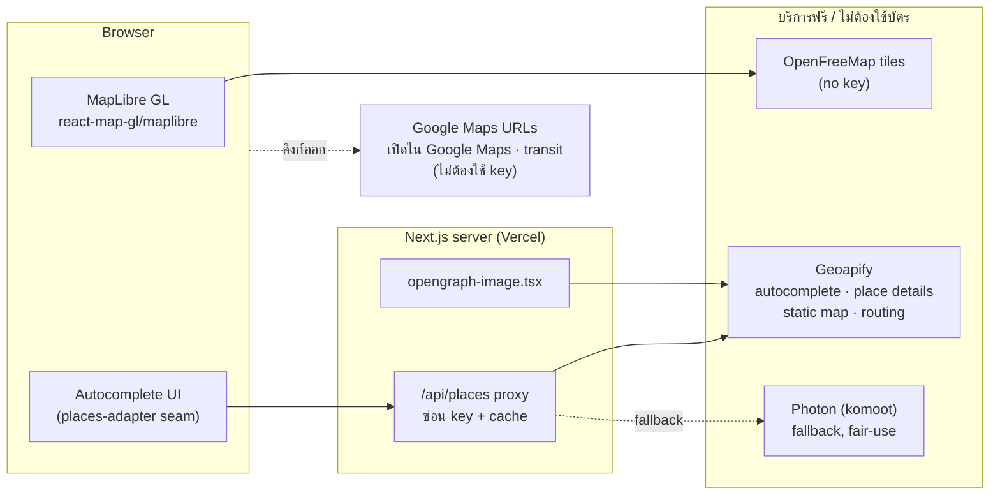
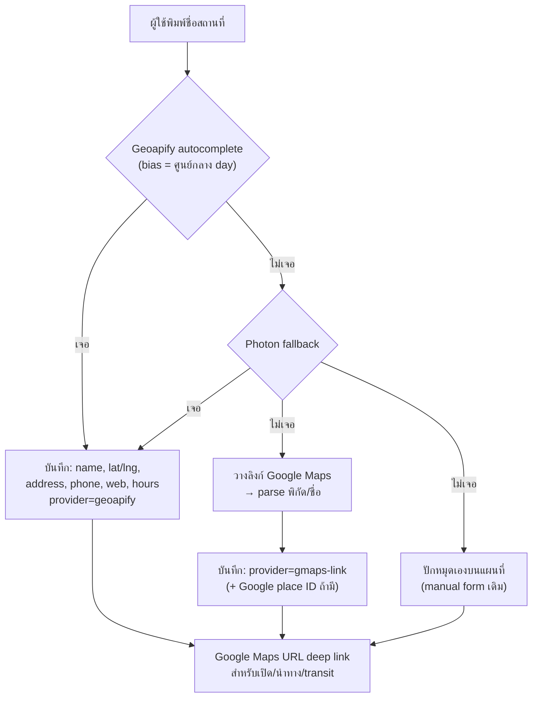
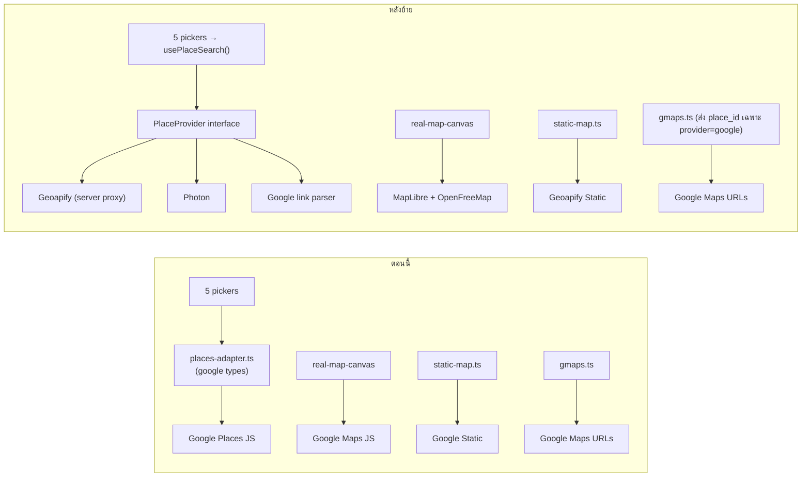

# ทางเลือกแทน Google Maps Platform สำหรับ Travel Planner v2

> วันที่ตรวจสอบข้อมูลทั้งหมด: **2026-10-15** (ราคา, free tier และ ToS อาจเปลี่ยนได้ ให้ตรวจที่ลิงก์อีกครั้งก่อนสมัคร)
> ขอบเขต: research อย่างเดียว ไม่ได้แก้โค้ด ไม่ได้สมัครหรือใช้ credential ของผู้ให้บริการใด
> สัญลักษณ์: ✅ = ยืนยันจากแหล่งทางการแล้ว · ⚠️ = ยืนยันได้บางส่วนหรือแหล่งข้อมูลขัดกัน · ❓ = ยังยืนยันไม่ได้

---

## 1. TL;DR: ข้อแนะนำ

**บริบท:** billing account ของ Google ใช้ไม่ได้ จึงถือว่า Google Maps Platform (Maps JS, Places, Static) ใช้ไม่ได้ทั้งหมด ส่วนที่ใช้ได้ต่อโดยไม่ต้องมี key คือ **Google Maps URLs** (deep link ที่แอปใช้อยู่แล้ว) และ (แบบไม่เป็นทางการ) iframe embed ที่ไม่ต้องใช้ key

ปริมาณการใช้งานที่ใช้ประมาณ (ใช้ส่วนตัว/กับเพื่อน): map load ~3,000 ครั้ง/เดือน, การค้นหา ~2,000 ครั้ง/เดือน (autocomplete ~10,000 request เพราะยิงทุกครั้งที่พิมพ์หลัง debounce), place details ~2,000 ครั้ง, OG static map ~100 ภาพ/เดือน

| อันดับ | Stack | ค่าใช้จ่าย/เดือน | ต้องใช้บัตร? | เหมาะเมื่อ |
|---|---|---|---|---|
| **A (แนะนำ)** | **MapLibre GL + OpenFreeMap** (แผนที่) · **Geoapify** (autocomplete + details + static map + routing) · **Photon** เป็น fallback · **Google Maps URLs** สำหรับ "เปิดใน Google Maps"/transit | **$0** | ไม่ต้อง | ต้องการเริ่มเร็ว ฟรีจริง ไม่ผูกบัตร และย้ายผู้ให้บริการได้ทีละชั้น |
| **A+ (เสริม A)** | A + **Overture Maps places ของไทย import ลง Postgres** เป็นชั้นค้นหาที่สอง (ข้อมูล Meta/Microsoft/Foursquare, license เปิด) | **$0** (ใช้ storage DB เพิ่ม) | ไม่ต้อง | เมื่อต้องการร้านเล็ก/คาเฟ่ที่ OSM ไม่มี ทดสอบแล้ว (§5) เจอ No.39, GRAPH Cafe, ข้าวซอยแม่สาย, Kata Rocks ซึ่ง OSM ไม่มีทั้งหมด |
| **B** | Stack A แต่เปลี่ยนชั้นค้นหาเป็น **TomTom Search** (POI เชิงพาณิชย์, `th-TH`) | **$0** ถ้าไม่เกิน 10K suggest + 5K details/เดือน | ไม่ต้อง | ไม่อยากดูแล dataset เอง (ToS ของ TomTom ยังยืนยันไม่ได้ ดู §4) |
| **C (ทางเลือกเน้นไทย)** | **Longdo Map** ทั้ง stack (แผนที่ + ค้นหา + routing) | **฿0** ถ้าไม่เกิน 100K service req/เดือน | ไม่ต้อง (ต้องขอ key) | ทริปเกือบทั้งหมดอยู่ในไทย และยอมรับว่าต้องแสดงข้อมูลบนแผนที่ Longdo เท่านั้น (ToS §1.6) ซึ่งไม่เหมาะกับทริปญี่ปุ่น |

**เหตุผลหลักที่เลือก A**

1. ทุกชั้นฟรีจริงและสมัครโดยไม่ต้องใช้บัตร: OpenFreeMap ไม่ต้องมี key เลย ([openfreemap.org](https://openfreemap.org/)), Geoapify ให้ 3,000 credits/วัน ใช้เชิงพาณิชย์ได้และไม่ต้องใช้บัตร ([geoapify.com/pricing](https://www.geoapify.com/pricing/))
2. Geoapify **อนุญาตให้ cache, เก็บ และเผยแพร่ผลลัพธ์ต่อได้** ([FAQ ของ Places API](https://www.geoapify.com/places-api/)) ซึ่งตรงกับที่แอปบันทึก lat/lng/ชื่อ/ที่อยู่ลง DB ถาวร ในขณะที่ Google, Mapbox Search Box และ Longdo จำกัดเรื่องนี้ทั้งหมด
3. ทุกอย่างมาจากข้อมูล OSM ซึ่งจากการทดสอบจริง (§5) **หาสถานที่ท่องเที่ยวหลักในไทยด้วยชื่อภาษาไทยเจอแทบทั้งหมด** (ตลาดน้ำอัมพวา, บ้านจิม ทอมป์สัน, วัดพระธาตุดอยสุเทพ, ตลาดนัดจตุจักร, ร้านเจ๊ไฝ, สุวรรณภูมิ) และร้านกาแฟดังในเชียงใหม่ก็เจอ (Ristr8to, Baan Kang Wat) **จุดอ่อน** คือรีสอร์ตหรูบางแห่ง (เช่น Kata Rocks) และร้านเล็กที่ไม่มีใครเพิ่มลง OSM ช่องว่างนี้ปิดได้ด้วย Overture (A+) หรือการวางลิงก์ Google Maps (§6.2)
4. MapLibre ใช้กับ `react-map-gl/maplibre` ได้ ([visgl docs](https://visgl.github.io/react-map-gl/docs/get-started)) ซึ่งเป็นตระกูล vis.gl เดียวกับ `@vis.gl/react-google-maps` ที่ใช้อยู่ โครงสร้าง component จึงย้ายได้ค่อนข้างตรง
5. สิ่งที่จะเสียไป: **rating, จำนวนรีวิว และรูปภาพ** (OSM ไม่มี) กับ **utc offset** ของสนามบิน (ต้องคำนวณเองจาก lat/lng) ส่วน transit ยังพึ่ง Google Maps deep link ได้เหมือนเดิม เพราะตอนนี้ก็ทำแบบนั้นอยู่แล้ว

---

## 2. สิ่งที่แอปใช้อยู่จริง (อ้างอิงจากโค้ด)

| ความสามารถ | ใช้ที่ไหน | รายละเอียด |
|---|---|---|
| **Loader** | `app/src/components/maps-provider.tsx:20-29` | `APIProvider` + `libraries={['places']}` ใช้ key ฝั่ง browser `NEXT_PUBLIC_GOOGLE_MAPS_API_KEY` (`lib/maps-config.ts`) |
| **แผนที่หลัก + markers** | `components/real-map-canvas.tsx:59-125`, mount ที่ `components/persistent-map.tsx:70` | `<Map>` แบบ `disableDefaultUI`, `colorScheme` dark/light, `AdvancedMarker` ที่ render HTML เอง (`PinBadge` ตัวเลข + สีตาม kind) และ `InfoWindow` (hover/active) มีปุ่มซูมทำเอง (`:48-52`) |
| **กล้อง** | `components/map-active-focus.tsx:24,28,37` | `panTo`, `moveCamera(center, zoom)` ใช้ `centroid`/`deriveZoom` (`lib/map-helpers.ts:43-57`) |
| **Polyline / routing** | ไม่มีแล้ว | Routes API ถูกถอดออกใน `ab0e8a9` "drop Routes API — remove server route computation + polylines (#24)" และ `docs/ops/maps-cost-guardrails.md` §1 ก็ระบุว่าไม่ใช้ Routes/Directions/Distance Matrix **`lib/routes-server.ts` ไม่มีอยู่แล้ว** ส่วน `toGoogleMode`/`toRestTravelMode` (`lib/map-helpers.ts:25-41`) เป็นโค้ดค้างที่ไม่ได้ใช้ |
| **ระยะทาง/เวลาระหว่างจุด** | `db/schema.ts` ตาราง `segment` (`mode`, `distance`, `time` เป็น text), `lib/services/segment-service.ts:29` | เป็น **ข้อความที่กรอกเอง** ไม่มีการคำนวณ มี mode `drive`/`walk`/`transit` |
| **นำทาง / เปิดสถานที่** | `lib/gmaps.ts:18-45` (directions), `:56-67` (search), ใช้ที่ `components/segment.tsx:57`, `place-row.tsx:60`, `booking-card-stay.tsx:32`, `hotels-view.tsx:300` | **Google Maps URLs** (`/maps/dir/?api=1`, `/maps/search/?api=1` + `query_place_id`) ไม่ต้องใช้ key จึง**ยังใช้ได้ต่อ** ([Maps URLs docs](https://developers.google.com/maps/documentation/urls/get-started)) transit ก็ทำผ่านลิงก์นี้ |
| **Autocomplete** | `place-autocomplete.tsx:102`, `place-search-picker.tsx:72`, `hotel-place-picker.tsx:79`, `hotel-search-picker.tsx:60`, `transport-place-picker.tsx:87` | `AutocompleteSuggestion.fetchAutocompleteSuggestions` + session token **ไม่ได้ส่ง region/locationBias/language** (`place-search-picker.tsx:72-75`) |
| **Adapter seam** | `lib/places-adapter.ts:3-15,17-36` | type `Prediction` ผูกกับ `google.maps.places.PlacePrediction` (ฟิลด์ `placePrediction` เป็น required) ส่วน `kindFromTypes` (`:38-60`) map Google `types` เป็น hotel/food/sight/transit |
| **Place details** | `lib/place-details.ts:63-96` | `prediction.toPlace().fetchFields()` ฟิลด์ที่ขอจริงตาม call site: |
| | `place-search-picker.tsx:139-152` | name, formatted_address, geometry, place_id, phone, website, opening_hours, **rating, user_ratings_total**, types |
| | `place-autocomplete.tsx:126-137` | name, address, geometry, place_id, phone, website, opening_hours |
| | `hotel-*-picker.tsx` (`:99`, `:127`) | name, address, geometry, place_id |
| | `transport-place-picker.tsx:106-118` | name, geometry, place_id, **utc_offset_minutes** (ใช้คำนวณเวลาถึงข้าม timezone, `transport-form-client.tsx:202`) |
| **รูปภาพ (photos)** | `lib/place-details.ts:17,85-89` | มี mapping ไว้ แต่**ไม่มี call site ไหนขอ `photos`** คอลัมน์ `thumb` เป็นสี hex (`place-form.tsx:267`) ไม่ใช่รูป **สรุปว่าตอนนี้ไม่ได้ใช้รูป** |
| **Map คลิกเพื่อปักหมุด (manual)** | `place-manual-form.tsx:189-214`, `hotel-manual-form.tsx:182-205`, `hotel-edit-modal.tsx:252-258` | `<Map onClick>` อ่าน lat/lng |
| **Static map (OG image)** | `lib/static-map.ts:77-140` เรียกจาก `app/trip/[id]/opengraph-image.tsx:134` | Static Maps API ขนาด 600×315@2x, markers สูงสุด 12, ไม่มี path, cache 24 ชม./7 วัน ถ้า fail จะ fallback เป็น gradient |
| **สิ่งที่เก็บใน DB** | `db/schema.ts` `place` (บรรทัด ~196-238): `rating`, `reviews`, `address`, `phone`, `website`, `hours` (text, คั่นด้วย `; `), `lat`, `lng`, `placeIdExternal`; `hotel_booking` (~263-300): `address`, `lat`, `lng`, `placeIdExternal`; `transport` เก็บแค่ `fromCode/fromName/toCode/toName` (ไม่มี lat/lng) | `placeIdExternal` ถูกส่งต่อเป็น `query_place_id` ใน `lib/gmaps.ts:28-31,62-64` จึง**ถือว่าเป็น Google Place ID เสมอ** |

**สรุป requirement ขั้นต่ำ**

- ต้องมี: แผนที่ vector + HTML marker + popup + dark mode + คลิกเพื่อปักหมุด, autocomplete POI ที่รองรับภาษาไทย, details (ชื่อ, ที่อยู่, lat/lng, ID) และ static image สำหรับ OG
- ดีถ้ามี: phone, website, opening hours, rating/reviews (place-search-picker เก็บลง DB) และ timezone ของสนามบิน
- ไม่จำเป็นตอนนี้: routing/polyline/transit แบบ in-app (ใช้ deep link อยู่แล้ว) และ photos

---

## 3. ตารางเปรียบเทียบตามความสามารถ

### 3.1 Render แผนที่ (tiles + JS)

| Provider | Free tier | บัตร? | ภาษาไทยบนแผนที่ | ToS / ข้อควรระวัง |
|---|---|---|---|---|
| **OpenFreeMap** | ไม่จำกัด map view/request, ไม่ต้องมี key ✅ [1] | ไม่ต้อง | ใช้ชื่อจาก OSM (`name` เป็นภาษาท้องถิ่น ไทยได้) | ต้องใส่ attribution, **ไม่มี SLA** ✅ [1] |
| MapTiler | 5k map sessions/เดือน ✅ [2] | ไม่ต้อง ✅ [2] | มี | free plan **ใช้ได้เฉพาะ non-commercial** ⚠️ [2][3], ต้องแสดงโลโก้ [3] |
| Stadia Maps | 200k credits/เดือน ✅ [4] | ไม่ระบุ | มี | free **ห้ามใช้เชิงพาณิชย์** ✅ [4] |
| Protomaps (hosted) | free สำหรับ non-commercial ✅ [5] | ไม่ต้อง | มี | ถ้าใช้เชิงพาณิชย์ต้องเป็น GitHub Sponsor หรือ **self-host PMTiles** (ODbL) [6] |
| Mapbox GL JS | 50,000 loads/เดือน ✅ [7] | demo ไม่ต้องใช้บัตรแต่มี cap, ถ้าจะใช้ production ต้อง upgrade ⚠️ [8] | มี | GL JS v2+ ไม่ใช่ open source (❓ ไม่ได้ตรวจ license รอบนี้) |
| TomTom | 200K vector tiles/เดือน ✅ [9] | ไม่ต้อง ✅ [9] | ❓ | ToS ยังตรวจไม่ได้ (หน้าเว็บ render ด้วย JS) |
| ArcGIS Location Platform | 2M basemap tiles/เดือน ✅ [10] | ❓ | ❓ | — |
| Azure Maps (Gen2) | 5,000 base map tiles/เดือน ⚠️ [11] | ต้องมี Azure subscription (โดยทั่วไปต้องใช้บัตร) ❓ | ❓ | Bing Maps free/basic ปิดไปแล้วตั้งแต่ 2025-06-30 ✅ [11b] |
| Apple MapKit JS | 250,000 map views/วัน ✅ [12] | ต้องเป็นสมาชิก Apple Developer **$99/ปี** ✅ [12b] | ❓ (คุณภาพ Apple Maps ในไทยยังไม่ได้ตรวจ) | ต้องมี server ออก JWT [12] |
| **Longdo Map v3** | 800k tile/เดือน ✅ [13][14] | ไม่ต้อง (ขอ key ฟรี) | ดีมาก (ผู้ให้บริการไทย) | ข้อมูลจาก API **ต้องแสดงบนแผนที่ Longdo เท่านั้น** (§1.6) ✅ [14], ไม่ใช่ MapLibre |
| Google Embed iframe (keyless) | ใช้ได้ในการทดสอบ (§6) ❓ | ไม่ต้อง | ดีมาก | **ไม่มีเอกสารรองรับ** แสดงได้ทีละจุด/เส้นทาง และ custom marker ไม่ได้ |

### 3.2 Search + Autocomplete (POI)

| Provider | Free tier | บัตร? | ไทย (ภาษา + POI) | ToS เรื่องการเก็บข้อมูล |
|---|---|---|---|---|
| **Geoapify Autocomplete** | 3,000 credits/วัน (1 req = 1 credit) ✅ [15][16] | ไม่ต้อง ✅ | `lang=th` ✅ [17], POI มาจาก OSM (คุณภาพใกล้เคียง Photon §5) | **cache/store/redistribute ได้** ✅ [18], free plan ต้องให้เครดิต Geoapify + OSM ✅ [19] |
| **Photon (komoot public)** | ฟรี แบบ fair use และ "extensive usage will be throttled" ✅ [20] | ไม่ต้อง | ทดสอบจริงแล้วดี (§5) | ODbL ต้อง attribution ไม่รับประกันว่าจะให้บริการตลอด [20] |
| **Overture places (self-import)** | ฟรี (เป็น dataset) | ไม่ต้อง | TH 2.08M records, ชื่อไทย 1.63M (ทดสอบ §5) ร้านเล็กดีมาก | CDLA/Apache เก็บถาวรได้ [35] |
| Nominatim (OSMF) | 1 req/s | ไม่ต้อง | ทดสอบแล้ว (§5) | **ห้ามใช้ทำ autocomplete** ✅ [21] |
| MapTiler Geocoding | 1k search sessions/เดือน ✅ [2] | ไม่ต้อง | ❓ (`language` param รับ ISO 639-1 แต่ไม่ได้ยืนยันว่ามี `th`) [22] | feature ID ไม่คงที่ ✅ [22], free เฉพาะ non-commercial |
| TomTom Search | 10K suggest + 5K details + 5K discover/เดือน ✅ [9] | ไม่ต้อง ✅ | รองรับ `th-TH`, `ja-JP` ✅ [23] และ POI เชิงพาณิชย์ | ❓ ยังตรวจไม่ได้ |
| HERE Autosuggest | ⚠️ ตัวเลขขัดกัน (5k–30k/เดือน) [24] | **ต้องใช้บัตร** (Base plan) ⚠️ [24] | ❓ | ❓ |
| Mapbox Search Box | 500 sessions/เดือน ✅ [7] | ดู [8] | **ไม่รองรับไทย**: "supports the United States, Canada, and Europe" และไม่มีภาษาไทย ✅ [25] | ข้อมูล "only available for temporary use" ✅ [25] |
| Radar | **ไม่มี free tier** ✅ [26] | — | ไม่ระบุว่าครอบคลุมไทย [27] | สัญญารายปี [26] |
| Foursquare Places | ⚠️ หน้าเดียวกันเขียนทั้ง 500 และ 10,000 Pro calls ฟรี [28] | ❓ | ❓ | Pro $15/1k, Premium (photos/tips) $18.75/1k ✅ [28] |
| **Longdo Search/Suggest** | 100k service req/เดือน, 60/นาที, 5,000/วัน ✅ [13][14] | ไม่ต้อง | ดีที่สุดสำหรับไทย: มี POI >1 ล้านจุด, soundex/ชื่อเล่น ✅ [29] | ต้องแสดงบนแผนที่ Longdo เท่านั้น ✅ [14] |
| Apple MapKit JS Search | 25,000 service calls/วัน ✅ [12] | $99/ปี | ❓ | ❓ |
| SerpApi (scrape Google Maps) | 250 searches/เดือน ✅ [30] | ❓ | ข้อมูล Google (ดีที่สุด) | **มีความเสี่ยงทางกฎหมาย** (Google ฟ้อง SerpApi ตั้งแต่ ธ.ค. 2025) ⚠️ [31] และต้องห้ามแสดงบนแผนที่อื่นตามเจตนา ToS ของ Google [32] |
| TrackAsia | ไม่พบ free tier สำหรับ autocomplete ⚠️ [33] | ❓ | เน้นเวียดนาม/สิงคโปร์ | API ออกแบบให้ "Google-compatible" [33] |

### 3.3 Place details + photos + rating + hours

| Provider | ชื่อ/ที่อยู่/พิกัด | Phone/Website | Opening hours | Rating/Reviews | Photos |
|---|---|---|---|---|---|
| Geoapify Place Details | ✅ | ✅ (ถ้ามี tag ใน OSM) | ✅ [18] | ❌ | ❌ |
| Photon | ✅ | ❌ (ต้องดึง OSM เพิ่ม) | ❌ | ❌ | ❌ |
| TomTom Place Details | ✅ | ✅ ❓ | ❓ | ❓ | ❓ |
| Foursquare | ✅ | ✅ | ✅ (Premium) | ✅ (Premium) | ✅ (Premium) [28] |
| Longdo | ✅ | ✅ (ที่อยู่, โทร, เว็บ, ประเภท) [29] | ❌ ไม่ระบุ | ❌ | ❌ |
| Apple MapKit JS `Place` | ✅ (`id`, `name`, `coordinate`, `formattedAddress`, `pointOfInterestCategory`) ✅ [34] | ❓ | ❓ | ❓ | ❓ |
| Overture Maps (dataset) | ✅ | ✅ (websites, phones) ✅ [35] | ❌ | ❌ | ❌ |
| SerpApi Google Maps | ✅ `gps_coordinates`, `place_id` | phone ✅ | ✅ `operating_hours` | ✅ rating + reviews | thumbnail + `photos_link` ✅ [36] |

### 3.4 Routing (drive/walk/transit)

ตอนนี้แอป**ไม่ได้คำนวณ route ในแอป** (§2) ส่วนนี้จึงเป็น "nice to have" ถ้าอยากเติมระยะทาง/เวลาให้ segment อัตโนมัติ

| Provider | Free | Transit? | หมายเหตุ |
|---|---|---|---|
| **Google Maps URLs** | ฟรี, ไม่ต้องใช้ key ✅ [37] | ✅ (`travelmode=transit`) | เปิดในแอป Google Maps ได้, waypoint สูงสุด 3 บน mobile/9 บน desktop ✅ [37] **ให้ใช้ต่อ** |
| Geoapify Routing | 1 credit ต่อคู่ waypoint ✅ [16] | ❌ ไม่ระบุ | drive/walk/bike |
| OpenRouteService | 2,000 directions/วัน ⚠️ [38] | ❌ | เงื่อนไขเชิงพาณิชย์ไม่ชัด |
| FOSSGIS OSRM (`routing.openstreetmap.de`) | demo server | ❌ | ทดสอบแล้วใช้ได้ (§5) แต่เป็น demo server ไม่ควรใช้ใน production [39] |
| GraphHopper | 500 credits/วัน ✅ [40] | ❌ | free = **non-commercial** ✅ [40] |
| TomTom Routing | 20K/เดือน ✅ [9] | ❌ | มีข้อมูล traffic |
| ArcGIS Routing | 20K routes/เดือน ✅ [10] | ❓ | — |
| Longdo Route | รวมอยู่ใน 100k service req | ❌ (มี road/rail/ferry) ⚠️ [41] | — |
| Apple MapKit JS | 25k calls/วัน | ❌ มีแค่ Automobile/Walking/Cycling ✅ [42] | — |

**ข้อสรุป:** transit ในไทยและญี่ปุ่นยังไม่มีทางเลือกฟรีที่ดีกว่า Google Maps deep link ควรใช้ deep link ต่อไป

### 3.5 Static map (OG image)

| Provider | Free | หมายเหตุ |
|---|---|---|
| **Geoapify Static Maps** | คิด credit ตามสูตร `1 + tiles/4 + จำนวน icon` ✅ [16] OG ขนาด 1200×630 ≈ 5×3 tiles → ~5 + 12 markers ≈ **17 credits/ภาพ** | มี cache 24 ชม. อยู่แล้ว ~100 ภาพ/เดือนจึงเท่ากับ ~1,700 credits/เดือน (เทียบกับโควตา 90k) |
| MapTiler Static | **ใช้ไม่ได้บน free plan** ✅ [43] | — |
| Mapbox Static Images | 50,000/เดือน ✅ [7] | ต้องใช้ account แบบ standard ([8]) |
| Apple Snapshots | 25,000/วัน ✅ [12] | $99/ปี |
| Render เอง | ฟรี | ใช้ satori/`ImageResponse` วาด marker บนพื้นหลังแบบ abstract (ไม่มี tile) หรือ stitch raster tiles เอง ส่วน OpenFreeMap เป็น vector-only จึงต้อง render ฝั่ง server ซึ่งหนักเกินจำเป็น |

---

## 4. บันทึกรายผู้ให้บริการ

### OpenFreeMap: แนะนำสำหรับ tiles
- ฟรีทั้งหมด "no registration, no user database, no API keys, and no cookies" ไม่จำกัด map view และใช้เชิงพาณิชย์ได้ มี style Positron/Bright/Liberty/**Dark**/Fiord/3D ต้องแสดง attribution "OpenFreeMap © OpenMapTiles Data from OpenStreetMap" (MapLibre ใส่ให้อัตโนมัติ) **ไม่มี SLA** [1]
- ทดสอบ `https://tiles.openfreemap.org/styles/liberty` ได้ HTTP 200 (43 KB)
- ความเสี่ยง: เป็นโครงการเล็กที่ไม่มี SLA ถ้าล่มสามารถเปลี่ยน style URL ไป MapTiler/Stadia หรือ self-host PMTiles ได้ (MapLibre ใช้ style spec เดียวกัน)

### Geoapify: แนะนำสำหรับ search/details/static
- Free 3,000 credits/วัน ใช้ใน production เชิงพาณิชย์ได้ถ้ามี attribution และไม่ต้องใช้บัตร [15] แผนจ่ายเงินเริ่ม $59/เดือน (10k credits/วัน) [15]
- autocomplete คืน amenity/POI ได้ (`type=amenity`), มี `lang=th`, กรอง/bias ด้วยประเทศหรือวงกลมได้ 1 req = 1 credit [17]
- Places API: "allowed to cache, store, and redistribute the results … without any additional limits" [18]
- Place Details มี address, contact, opening hours แต่ไม่มี rating และ photos [18]
- คุณภาพ POI ไทย: ❓ ไม่ได้ทดสอบโดยตรง (ต้องใช้ key) แต่ใช้ข้อมูล OSM จึงคาดว่าใกล้เคียง Photon/Nominatim ใน §5 (**เป็นการอนุมาน**)
- ข้อควรระวัง: autocomplete คิดเงินทุก request ไม่ได้คิดเป็น session แบบ Google ต้อง debounce (มีอยู่แล้ว) และควรทำ proxy + cache ฝั่ง server

### Photon (komoot): fallback ฟรี
- "search-as-you-type with OpenStreetMap" และ "please be fair … extensive usage will be throttled" [20]
- ทดสอบแล้วตอบช้าเป็นช่วง ๆ (บาง query timeout ที่ 25 วินาที เช่น "Senso-ji" ครั้งแรก แล้วครั้งถัดไปได้) **จึงไม่ควรเป็น primary ใน production** แต่ self-host Photon ด้วย extract เฉพาะไทย + ญี่ปุ่นได้ถ้าต้องการ (❓ ยังไม่ได้ประเมิน RAM/ดิสก์)

### Nominatim (OSMF)
- จำกัด 1 req/s, **ห้าม autocomplete** ("you must not implement such a service on the client side"), ต้อง cache และระบุ User-Agent ให้ถูกต้อง [21] จึงใช้ได้แค่ geocode ครั้งเดียว (เช่น ตอน parse ลิงก์ที่ผู้ใช้วาง)

### MapTiler
- Free: 5k map sessions, 1k search sessions, 100k API requests และไม่ต้องใช้บัตร Flex $30/เดือน [2] (บางหน้าเขียน $25 [3]) ⚠️
- free plan เป็น "non-commercial" ⚠️ ToS §6.1 กำหนดให้ free account ต้องแสดงโลโก้ MapTiler [3]
- Static Maps ใช้ไม่ได้บน free plan [43]
- แอปนี้ใช้ส่วนตัวไม่มีรายได้ จึงน่าจะนับเป็น non-commercial ได้ แต่ ToS ไม่ได้นิยามชัด ❓

### Longdo Map (ไทย)
- Free threshold: web service 100,000 req/เดือน (≤60/นาที), tiles 800,000/เดือน ใช้ฟรีได้กับ "services that are accessible to consumers, freely or restricted, with or without charge" [14] และหน้า pricing ระบุ 5,000 req/วันด้วย [13] แผนเสียเงินเริ่ม ฿8,250/เดือน [13]
- Place API: suggest, search, smart search (soundex/ชื่อเล่น), nearby POI >1,000 หมวด, POI >1 ล้านจุด อัปเดตทุกชั่วโมง ไม่มี hours/photos/rating [29]
- Routing: line type road/air/rail/ferry, mode `t`/`b` ไม่พบ walk/transit ⚠️ [41]
- **ToS สำคัญ:** §1.6 "must be used exclusively to obtain and display points or information on map images provided through the Service" และ §1.2 ต้องแสดง "in the same manner, form, format" [14] หมายความว่า**ถ้าใช้ search ของ Longdo ต้องใช้แผนที่ Longdo ด้วย** จะเอาผลไปปักบน MapLibre/OpenFreeMap ไม่ได้ และการเก็บลง DB ถาวรก็มีความเสี่ยงเพราะ ToS ห้าม copy Content
- ทดสอบไม่ได้: `search.longdo.com/mapsearch/json/search` ตอบกลับ `Search Service API Key Error` เมื่อไม่มี key
- Japan: ❓ (เป็นแผนที่ประเทศไทยเป็นหลัก)

### TomTom
- ไม่ต้องใช้บัตร Free/เดือน: vector tiles 200K, Search Suggest 10K, Place Details 5K, Discover 5K, Routing 20K [9] รองรับภาษา `th-TH` และ `ja-JP` [23]
- ❓ ToS เรื่อง caching และการแสดงบนแผนที่อื่น: หน้า terms ([developer.tomtom.com/terms-and-conditions](https://developer.tomtom.com/terms-and-conditions)) render ด้วย JS จึงอ่านไม่ได้ ต้องเปิดอ่านเองก่อนใช้ เพราะเป็นตัวตัดสินว่า Stack B ใช้ได้หรือไม่
- ❓ คุณภาพ POI ไทยยังไม่ได้ทดสอบ (ต้องใช้ key)

### HERE
- Base plan **ต้องใส่บัตร** แต่จะไม่เก็บเงินถ้าไม่เกิน free tier ตัวเลข free tier แต่ละบริการขัดกันระหว่างแหล่ง (5k–30k) ⚠️ [24] หน้า pricing ทางการไม่แสดงตัวเลข

### Mapbox
- GL JS 50k loads, Search Box 500 sessions, Temporary Geocoding 100k, Directions 100k, Static 50k ต่อเดือน, Permanent Geocoding ไม่มี free tier ($5/1k) [7]
- **Search Box ไม่รองรับไทย** (US/Canada/Europe เท่านั้น ไม่มีภาษาไทย) และผลลัพธ์ "only available for temporary use" [25] จึง**ไม่เหมาะ**กับแอปนี้
- ไม่ใช้บัตรได้แบบ demo access ซึ่งมี cap และ "upgrade to standard access" เมื่อจะใช้ production [8]

### Radar
- **ไม่มี free tier**: "Radar does not currently offer a free tier" Core $0.50/1k, Premium (places search) $2/1k และ**สัญญาเป็นรายปี** [26] บทความ "alternatives" ของ Radar เป็นบทความของ vendor และไม่ได้ให้ข้อมูลราคาของคู่แข่ง [44]
- Autocomplete ไม่มีพารามิเตอร์ภาษา และไม่ระบุว่าครอบคลุมไทย [27] **ไม่แนะนำ**

### Esri ArcGIS Location Platform
- Free/เดือน: basemap 2M tiles, geocoding (not stored) 20K, routes 20K, places nearby 500 [10] **stored geocodes ไม่มี free tier ($4/1k)** [10] ซึ่งแอปนี้เก็บพิกัดถาวร จึงน่าจะต้องจ่ายในส่วนนี้ ⚠️ ต้องใช้บัตรหรือไม่ ❓

### Azure Maps
- Gen1 ปลดระวาง 2026-09-15 และทุก account ย้ายไป Gen2 ซึ่งมี free monthly tier (เช่น base map tiles 5,000) [11] Bing Maps free/basic หมดอายุ 2025-06-30 [11b] ต้องมี Azure subscription ❓

### Apple MapKit JS
- 250k map views + 25k service calls + 25k snapshots ต่อวัน ต้องเป็นสมาชิก Apple Developer Program [12] ค่าสมาชิก $99/ปี [12b]
- มี Search autocomplete และ `Place` (มี id, name, coordinate, address, category) [34] Directions มีแค่ Automobile/Walking/Cycling ไม่มี transit [42]
- ❓ คุณภาพ POI ไทยของ Apple Maps และ ToS เรื่องการเก็บข้อมูลยังไม่ได้ตรวจ
- ข้อดีคือ quota สูงมากและมี snapshot ใช้ทำ OG ได้ ข้อเสียคือต้องจ่ายเงินรายปีด้วยบัตร และไม่ใช่ MapLibre

### Foursquare Places API
- Pro (search/details/autocomplete): ฟรี 0–500 calls จากนั้น $15/1k ส่วน Premium (photos/tips/rating/hours) $18.75/1k แต่หน้าเดียวกันก็เขียน "up to 10,000 free calls on Pro endpoints" ⚠️ [28]
- เป็นตัวเลือกเดียวที่เป็น API ถูกกฎหมาย มี rating และ photos แต่มีราคา ส่วนคุณภาพไทยยังไม่ได้ทดสอบ ❓
- มี **FSQ OS Places** (dataset เปิด) ให้ดาวน์โหลดผ่าน Places Portal/Iceberg/HuggingFace [45] ❓ license ของตัว dataset ไม่ได้ระบุชัดในหน้านั้น

### Overture Maps Places (dataset เปิด)
- ~81M places (Meta ~59M, Microsoft ~6.1M, Foursquare ~4.1M …) license CDLA Permissive 2.0 หรือ Apache 2.0 ไม่มีข้อมูล OSM มี websites/phones/addresses/confidence ดาวน์โหลดตาม bbox ได้ [35]
- ทางเลือกแบบใหม่: นำเข้าเฉพาะไทย + ญี่ปุ่นลง Postgres (pg_trgm) แล้วทำ autocomplete เอง ดู §6 และผลทดสอบ §5

### SerpApi (scrape Google Maps)
- Free 250 searches/เดือน (50/ชม.), Starter $25/1k, Developer $75/5k ส่วน **Legal Shield มีเฉพาะแผน $150 ขึ้นไป** และผลที่ cache แล้วไม่นับโควตา [30]
- ข้อมูลครบ: `place_id`, `data_id`, `gps_coordinates`, rating, reviews, hours, phone, thumbnail, `photos_link` [36] มี Google Maps Autocomplete engine ด้วย [46]
- **ความเสี่ยง:**
  1. Google ฟ้อง SerpApi เมื่อ 2025-12-19 (N.D. Cal. 25-10826, DMCA/anti-circumvention) มีรายงานว่าถูก dismiss แบบ leave to amend แต่ยืนยันสถานะล่าสุดไม่ได้ ⚠️ [31]
  2. ToS ของ SerpApi เองห้าม "reproduce, duplicate, copy … exploit" และ Legal Shield ไม่ครอบคลุม free plan [47]
  3. ข้อมูลเป็นของ Google ตาม Google Maps/Earth Terms §2.1/§2.3 ห้าม redistribute หรือ bulk feed [48] ส่วน GMP Terms §3.2.3(e) ห้ามแสดง Places content บนแผนที่ที่ไม่ใช่ Google [32] (ข้อหลังผูกกับลูกค้า GMP โดยตรง แต่สะท้อนเจตนาของ Google)
- **สรุป:** ใช้ได้ในทางเทคนิคและถูกที่ปริมาณน้อย แต่ไม่แนะนำเป็น primary ถ้าจะใช้ ให้ใช้เป็นปุ่ม "เติม rating/ชั่วโมงเปิด" แบบกดเองเป็นครั้งคราว และยอมรับความเสี่ยงเอง

### Google (สิ่งที่ยังใช้ได้โดยไม่ต้องมี billing)
- **Maps URLs**: "You don't need a Google API key" มี search/dir/display map/pano, `query_place_id`, transit [37] **ใช้ต่อได้ทันที** (ใช้อยู่แล้วใน `lib/gmaps.ts`)
- **Maps Embed API** (`/maps/embed/v1/...`): "free to use with unlimited requests" แต่ "An API key is required" [49] และ quickstart ให้เปิด billing ⚠️ ในกรณีนี้น่าจะใช้ไม่ได้ ทดสอบแล้วไม่มี key ได้ HTTP 401
- **Keyless embed** (`maps.google.com/maps?q=lat,lng&output=embed`): ทดสอบแล้ว redirect ไป `google.com/maps/embed?pb=…` ได้ HTTP 200 และไม่มี `X-Frame-Options` (ฝังเป็น iframe ได้) เส้นทางแบบ transit (`saddr/daddr/dirflg=r`) ก็ได้ 200 **แต่ไม่มีเอกสารรองรับเลย** อาจหยุดทำงานเมื่อไรก็ได้ ❓ ส่วนเมนู "Share → Embed a map" ใน Google Maps ให้ HTML ที่เป็น iframe แบบนี้ [50]
- **Gemini API "Grounding with Google Maps"**: Gemini 2.5 Flash free tier ให้ 500 RPD (Gemini 3+ ไม่มี free tier) [51] แต่คืนแค่ source name + URL ไม่มีพิกัดหรือ place ID ตามเอกสาร รองรับ prompt ภาษาอังกฤษเท่านั้น และต้องแสดงคำว่า "Google Maps" ตามกฎ attribution [52] ❓ ไม่แน่ใจว่า free tier ของ AI Studio ผูกกับ billing account ที่มีปัญหาหรือไม่

---

## 5. ผลทดสอบ POI ไทย (ยิงจริง 2026-10-15)

ทดสอบ endpoint ที่ไม่ต้องใช้ key: **Photon** (`photon.komoot.io/api?q=…&limit=3-4`), **Nominatim** (`format=jsonv2&accept-language=th`, เว้น 1.5 วินาที) และ **FOSSGIS OSRM** ส่วน Longdo, Geoapify, TomTom, MapTiler ต้องใช้ key จึงไม่ได้ทดสอบ

| Query | Photon (อันดับ 1) | Nominatim | ประเมิน |
|---|---|---|---|
| `ตลาดน้ำอัมพวา` | ตลาดน้ำอัมพวา · tourism=attraction · สมุทรสงคราม (13.4249, 99.9555) | เจอจุดเดียวกัน + ที่อยู่เต็มพร้อมรหัสไปรษณีย์ 75110 | ✅ ตรง |
| `ตลาดน้ำอัมพ` (พิมพ์ไม่ครบ) | ตลาดน้ำอัมพวา | — | ✅ prefix ภาษาไทยใช้ได้ |
| `Jim Thompson House` | Jim Thompson House · museum · กรุงเทพ (+ "พิพิธภัณฑ์บ้านจิม ทอมป์สัน" ซ้ำ 2 node) | เจอทั้งชื่อไทยและอังกฤษ + ที่อยู่ ซ.เกษมสันต์ 2 | ✅ ตรง (มี duplicate) |
| `จิม ทอม` (พิมพ์ไม่ครบ) | จิม ทอมป์สัน **ฟาร์ม** (ปักธงชัย) | — | ⚠️ partial ภาษาไทยได้ผลผิดที่ (ต้อง bias ด้วยตำแหน่ง) |
| `วัดพระธาตุดอยสุเทพ` | วัดพระธาตุดอยสุเทพราชวรวิหาร · place_of_worship | — | ✅ |
| `ตลาดนัดจตุจักร` | ตลาดนัดจตุจักร · marketplace | — | ✅ |
| `ICONSIAM` | ICONSIAM · mall (ซ้ำ 4 รายการ) | — | ✅ (ต้อง dedupe) |
| `สนามบินสุวรรณภูมิ` | สนามบินสุวรรณภูมิ · tourism=information (+ ป้ายรถเมล์ภายในสนามบิน) | — | ⚠️ เจอ แต่ไม่ใช่ feature `aeroway=aerodrome` อันดับแรก |
| `Ristr8to Chiang Mai` (คาเฟ่) | Ristr8to · cafe · เชียงใหม่ (18.7991, 98.9672) + Roast8ry Lab | `Ristr8to` → "ด็อปปิโอ ริสเทรสโต้" ถ.นิมมานเหมินท์ (พิกัดเดียวกัน) | ✅ |
| `Akha Ama Coffee` | อันดับ 1–2 เป็นสาขา **โตเกียว**, อันดับ 3 เป็น cafe เชียงใหม่ที่ `name=null` | — | ⚠️ ต้อง bias ด้วยประเทศ/ตำแหน่ง |
| `Baan Kang Wat` | Baan Kang Wat · craft + บ้านข้างวัด · attraction (สุเทพ) | — | ✅ |
| `Kalm Village` | Kalm Village Chiang Mai · arts_centre | — | ✅ |
| `No.39 Cafe Chiang Mai` | ได้คาเฟ่อื่นในเชียงใหม่ ไม่เจอ No.39 | — | ❌ ไม่มีใน OSM (หรือชื่อไม่ตรง) |
| `Graph Cafe` (bias เชียงใหม่) | ได้ร้านในฟิลิปปินส์/อิหร่าน/ยูกันดา | — | ❌ |
| `ร้านกาแฟ นิมมาน` (ค้นตามหมวด) | ไม่มีผล | — | ❌ Photon ไม่รองรับการค้นแบบหมวด + ย่าน |
| `ร้านข้าวซอยแม่สาย` | ไม่มีผล | — | ❌ |
| `Kata Rocks Phuket` (โรงแรมหรู) | เขากะตะ (ภูเขา) / bar ไม่มีชื่อ | `Kata Rocks` → เขากะตะ | ❌ ไม่มีโรงแรมนี้ใน OSM |
| `โรงแรม กะตะ ภูเก็ต` | ไอบิส ภูเก็ต กะตะ, โรงแรมกะตะธานี ฯลฯ · tourism=hotel | — | ✅ ค้นตามหมวด + ย่าน (ภาษาไทย) ได้ |
| `Mövenpick Resort Bangtao` | Mövenpick Resort Bangtao Beach · hotel | — | ✅ |
| `เจ๊ไฝ` / `ร้านเจ๊ไฝ` / `Jay Fai` | `เจ๊ไฝ` → เจ๊ไข่ซีฟู้ด ฯลฯ (fuzzy ผิด), `ร้านเจ๊ไฝ` → ✅ ร้านเจ๊ไฝ · restaurant (13.7525, 100.5047), `Jay Fai` (bias กทม.) → ✅ | `เจ๊ไฝ` → ภูเขาในอิสราเอล 🙃 | ⚠️ ชื่อสั้นภาษาไทยไม่แม่น |
| `Senso-ji` (ญี่ปุ่น) | Храм Сенсодзи 金龍山 浅草寺 (ครั้งแรก timeout 25 วินาที ครั้งที่สองได้) | — | ✅ แต่ช้า |
| `Ichiran Shibuya` | 一蘭 · restaurant · 渋谷区 | — | ✅ |

**OSRM (FOSSGIS demo):** บ้านจิม ทอมป์สัน → ICONSIAM ได้ **ขับรถ 8.3 กม./12.5 นาที** (ไม่รวม traffic ซึ่งกรุงเทพจริงนานกว่านี้มาก) และ**เดิน 3.9 กม./54 นาที**

**สรุปคุณภาพ OSM ในไทย**
- สถานที่ท่องเที่ยว วัด ตลาด ห้าง สนามบิน และคาเฟ่ดังในเชียงใหม่: **ดี** (ประมาณ 80–90% ของ query กลุ่มนี้เจอ)
- โรงแรม chain/ใหญ่: ดี ส่วนรีสอร์ตหรู boutique: **มีช่องว่าง** (Kata Rocks ไม่มี)
- ร้านเล็กหรือร้านที่รู้จักแค่ในท้องถิ่น: **อ่อน** และค้นตามหมวด + ย่านแบบ "ร้านกาแฟ นิมมาน" ไม่ได้ (Geoapify Places API แบบ category + circle น่าจะช่วยได้ ❓)
- ต้องใส่ **location bias** (ศูนย์กลางของ trip/day) และ **dedupe** เสมอ
- ผลลัพธ์ไม่มี rating/photos (คาดไว้แล้ว)

**Overture Maps (ทดสอบผ่าน DuckDB บน S3 release `2026-09-23.1`, bbox 97.3–105.7E / 5.5–20.5N):** ดึงมาได้ 2.37M แถวใน 13 นาที (ไฟล์ parquet 294 MB ทุกคอลัมน์) ในจำนวนนี้ `country=TH` **2.08M แถว** และมีชื่อเป็นอักษรไทย 1.63M แถว ค้นด้วย `ILIKE` แบบง่าย:

| Query | Overture (อันดับต้น · category · confidence) | เทียบกับ OSM |
|---|---|---|
| `kata rocks` | **The Kata Rocks Clubhouse** · restaurant · 0.99 · มี website katarocks.com | ✅ ดีกว่า (OSM ไม่มี) แต่ไม่เจอ record "resort" โดยตรง |
| `no.39` | **No.39** · coffee_shop · 0.97 · เชียงใหม่ (website เป็นลิงก์ goo.gl/maps) | ✅ ดีกว่า (OSM ไม่มี) |
| `graph cafe` | **GRAPH Cafe** · coffee_shop · 0.93 · เชียงใหม่ · graphdream.com | ✅ ดีกว่า (OSM ไม่มี) |
| `akha ama` | **Akha Ama Coffee (The New Original)** · เชียงใหม่ + สาขาอื่นในเชียงใหม่ | ✅ ดีกว่า (OSM ขึ้นสาขาโตเกียวก่อน) |
| `ข้าวซอยแม่สาย` | **ข้าวซอยแม่สาย** · casual_eatery · 0.99 · เชียงใหม่ | ✅ ดีกว่า (Photon ไม่มีผล) |
| `เจ๊ไฝ` | เจ๊ไฝส้มเช้ง (bar), **เจ๊ไฝ** · restaurant · 0.98 (13.7526, 100.5048) | ✅ ตรง (`Jay Fai` อังกฤษไม่เจอ) |
| `ristr8to` | Ristr8to Original (เชียงใหม่) + Ristr8to Bangkok | ✅ |
| `ตลาดน้ำอัมพวา` | ตลาดน้ำอัมพวา · shopping · 0.95 (+ ร้านที่มีคำนี้ในชื่อ) | ✅ |
| `วัดพระธาตุดอยสุเทพ` | 3 records ซ้ำ ชื่อยาวต่างกัน และอันดับ 1 **พิกัดคลาดไป ~6 กม.** (18.80, 98.976) | ⚠️ แย่กว่า OSM (พิกัดสถานที่สำคัญบาง record ผิด) |
| `jim thompson` | Art Center, ร้านอาหาร, outlet (ไม่มี "House" อันดับต้น) | ⚠️ แย่กว่า OSM |
| `iconsiam` | ร้านค้าใน ICONSIAM (Sephora, Apple…) แทนตัวห้าง | ⚠️ ต้องจัดอันดับ/กรองหมวด |
| `mövenpick resort bangtao` | Mövenpick Resort Bangtao Beach Phuket · resort · 0.85 | ✅ |
| คาเฟ่รอบนิมมาน (รัศมี ~1 กม.) | **469 แห่ง** | ครอบคลุมร้านเล็กมาก |

**สรุป:** Overture (ข้อมูล Meta/Microsoft/Foursquare) **ครอบคลุมร้านเล็ก คาเฟ่ และร้านอาหารท้องถิ่นในไทยดีกว่า OSM ชัดเจน** ส่วน OSM **แม่นกว่าสำหรับ landmark** (พิกัดถูก มี record เดียว) จึง**เสริมกันได้ดี** แต่ Overture มีข้อมูลซ้ำและพิกัดผิดบ้าง ต้องจัดอันดับด้วย `confidence` + ระยะทาง และไม่มี rating/hours

---

## 6. แนวทางแบบใหม่/ผสม

| แนวทาง | ทำอะไร | ความเป็นไปได้ | ข้อควรระวัง |
|---|---|---|---|
| **1. Google Maps URLs ต่อไป** | ปุ่ม "เปิดใน Google Maps" และ "นำทาง (transit)" ใช้อยู่แล้วใน `lib/gmaps.ts` | ✅ ใช้ได้ทันที ฟรี ไม่ต้องใช้ key [37] | `placeIdExternal` ต้องเป็น Google Place ID เท่านั้น ถ้าเป็น ID ของ provider อื่นต้อง fallback เป็น `lat,lng` (โค้ดรองรับกรณีไม่มี ID อยู่แล้ว) |
| **2. วางลิงก์ Google Maps แล้วดึงพิกัด** | ผู้ใช้กด Share ใน Google Maps แล้ววางลิงก์ (`maps.app.goo.gl/...` หรือ `google.com/maps/place/NAME/@lat,lng,z/data=...!3dLAT!4dLNG...`) server ตาม redirect แล้ว parse ชื่อ + พิกัด (+ `!19sChIJ…` ถ้ามี จะได้ place ID สำหรับ deep link) | ✅ สูงมาก เป็นวิธีที่ได้คุณภาพข้อมูลระดับ Google สำหรับร้านเล็ก/รีสอร์ตที่ OSM ไม่มี ทั้งที่ไม่ได้เรียก GMP | ❓ รูปแบบ URL ไม่มีเอกสาร (ยังไม่ได้ทดสอบกับ short link จริง) การให้ server ตาม redirect ของ goo.gl เป็นการเข้าถึงแบบอัตโนมัติขนาดเล็ก (เสี่ยงต่ำ) เก็บแค่พิกัด/ชื่อที่ผู้ใช้ให้มาเอง ไม่ใช่ bulk |
| **3. Keyless Google embed iframe** | แสดง preview ของสถานที่/เส้นทางเดียวใน modal (เช่น hotel preview) | ⚠️ ทดสอบแล้วใช้ได้ (§4) | ไม่มีเอกสาร ไม่มี custom marker ไม่ควรใช้แทนแผนที่หลัก |
| **4. Self-host OSM stack** | PMTiles (extract ไทย+ญี่ปุ่น) บน R2/Vercel Blob [6] + Photon/Pelias self-host | ⚠️ ทำได้ แต่ต้องมี VPS สำหรับ geocoder (Vercel serverless รัน Photon ไม่ได้) | ค่า VPS ~$5–10/เดือน (❓ ประมาณเอง) ต้อง maintain และอัปเดตข้อมูลเอง คุ้มเมื่อ OpenFreeMap/Photon ล่มบ่อย |
| **5. Overture places เป็น "ชั้นที่สอง" ของการค้นหา** | นำเข้า places ของไทย (~2.08M แถว) และญี่ปุ่นถ้าต้องการ เก็บแค่ name, category, lat/lng, website, phone, confidence ลง Postgres (`pg_trgm` + bias ด้วยพิกัด) แล้วค้นคู่กับ Geoapify/Photon (OSM) | ✅ **ทดสอบแล้วว่าได้ผลจริง** (§5) เจอร้านเล็กที่ OSM ไม่มี (No.39, GRAPH Cafe, ข้าวซอยแม่สาย, Kata Rocks) license CDLA/Apache เก็บถาวรได้ [35] | ขนาด DB: ทั้งหมด 294 MB ใน parquet ถ้าเลือกเฉพาะคอลัมน์และ confidence ≥ 0.7 คาดว่าราว 0.3–0.6 GB ใน Postgres รวม trigram index ❓ (ประมาณเอง ต้องเช็กโควตาของ DB host) ต้อง refresh ตาม release (รายเดือน) ต้อง dedupe และ Overture มีพิกัดผิดบาง record |
| **6. LLM ช่วยหาสถานที่** | ช่อง "ค้นด้วย AI" ให้ Claude + web search หาชื่อทางการ ที่อยู่ เว็บไซต์ แล้ว geocode ต่อด้วย Geoapify/Nominatim | ⚠️ ทำได้ ราคา $10/1k searches + token [53] เหมาะกับ query ยาก ๆ ไม่กี่ครั้ง/เดือน | ช้า (หลายวินาที) อาจแต่งพิกัดขึ้นมาเอง (ต้อง geocode/ตรวจซ้ำเสมอ) แอปตอนนี้ยังไม่มี LLM SDK และ plan BYO-agent/MCP (`docs/superpowers/plans/2026-09-17-mcp-server-byo-agent.md`) อาจเป็นช่องทางที่เหมาะกว่า เพราะ agent ภายนอกเติมสถานที่ผ่าน REST API ที่มีอยู่แล้วได้ |
| **7. Gemini grounding with Google Maps** | ถาม Gemini 2.5 Flash (free 500 RPD) แล้วได้ลิงก์ Google Maps | ❌ ไม่แนะนำ: ไม่คืนพิกัดหรือ place ID รองรับ prompt ภาษาอังกฤษเท่านั้น และมีกฎ attribution เข้ม [51][52] | ผูกกับ Google account เดิม |
| **8. SerpApi แบบกดเองเป็นครั้งคราว** | ปุ่ม "เติม rating/ชั่วโมงเปิด" เรียก SerpApi (free 250/เดือน) | ⚠️ ทางเทคนิคทำได้ | ความเสี่ยงทางกฎหมาย/ToS (§4) |
| **9. Cache + proxy ฝั่ง server** | `/api/places/*` ซ่อน key + cache ตาม query/ID (Next.js `fetch` revalidate หรือเก็บใน DB) | ✅ ควรทำในทุก stack | Geoapify อนุญาตให้ cache [18] แต่ Longdo/Mapbox Search ไม่อนุญาต |

---

## 7. ผลกระทบต่อ codebase (ภาพรวม ยังไม่ลงโค้ด)

1. **`placeIdExternal` ต้องมี namespace** ตอนนี้ค่านี้ถูกส่งเป็น `query_place_id`/`origin_place_id` ใน `lib/gmaps.ts:28-31,62-64` ถ้าเอา ID ของ Geoapify/OSM ใส่ลงไป deep link จะพัง แนวทางคือเพิ่มคอลัมน์ `placeProvider` (เช่น `google` | `geoapify` | `osm` | `gmaps-link` | `manual`) หรือใส่ prefix แล้วส่ง `query_place_id` เฉพาะเมื่อเป็น `google` แถวเดิมทั้งหมดถือว่าเป็น `google` ส่วน API/MCP input (`lib/api/place-input.ts`) ต้องรับ provider ด้วย
2. **Adapter seam:** `lib/places-adapter.ts` ผูก type `Prediction.placePrediction: google.maps.places.PlacePrediction` (เพื่อ guard billing) และ `lib/place-details.ts` ผูก `google.maps.LatLng` (call site เรียก `.lat()`/`.lng()`) ต้องเปลี่ยนเป็น interface กลาง เช่น `PlaceProvider { suggest(q, bias), details(id) }` ที่คืน `{lat, lng}` แบบตัวเลข แล้วให้ 5 picker เรียกผ่าน hook เดียว ตอนนี้แต่ละ picker มี logic session token ซ้ำกัน (`sessionTokenRef` ในทุกไฟล์) จึงเป็นโอกาสดีที่จะรวม
3. **`kindFromTypes`** ต้อง map หมวดของ OSM/Geoapify (`tourism=hotel`, `amenity=cafe|restaurant`, `aeroway=aerodrome`, `railway=station` …) แทน Google `types`
4. **Timezone ของสนามบิน** (`transport-place-picker.tsx:118`): provider ใหม่ไม่มี `utc_offset_minutes` ให้คำนวณจาก lat/lng ด้วยไลบรารี timezone lookup แบบ offline (มีหลายตัว ❓ ยังไม่ได้เลือก) หรือใช้ Geoapify ซึ่งคืน `timezone` ในผล geocoding (❓ ต้องยืนยันใน docs)
5. **Map component:** `real-map-canvas.tsx`, `map-active-focus.tsx`, `persistent-map.tsx` และ manual forms 3 ไฟล์ ย้ายไป `react-map-gl/maplibre` (`Map`, `Marker` ที่รับ children HTML, `Popup`, `onClick`, `panTo`→`flyTo/easeTo`) ส่วน dark mode ใช้การสลับ style URL (OpenFreeMap มี Dark) และ `MapsProvider` จะหายไป (MapLibre ไม่มี loader context)
6. **OG static map:** `lib/static-map.ts` เปลี่ยน URL builder ไป Geoapify Static (เอา signing secret ออก) ส่วนโครง fallback-null เดิมใช้ต่อได้ทั้งหมด
7. **Key ฝั่ง browser:** Geoapify key ถ้าเรียกจาก browser จะถูกเปิดเผย (เหมือนเดิม) ให้จำกัดด้วย allowed origins หรือ proxy ผ่าน server route (แนะนำ เพราะได้ cache + fallback Photon ไปด้วย)
8. **ข้อจำกัด ToS ในการผสมแหล่งข้อมูล**
   - **ห้าม**เอา Places content ของ Google ไปแสดงบน non-Google map (GMP Terms §3.2.3(e)) [32] และ §3.2.3(a) ห้าม pre-fetch/store/cache Google content นอก service [32] **แถวเก่าที่เก็บ name/address/lat/lng/rating จาก Google แล้วจะปักบน MapLibre** จึงอยู่ในพื้นที่สีเทา (ขัดตามตัวอักษร แต่เป็นข้อมูลที่ผู้ใช้ curate เองในแอปส่วนตัว) ⚠️ ทางที่ระวังที่สุดคือ re-geocode แถวเก่าด้วย provider ใหม่ หรือยอมรับความเสี่ยงต่ำนี้ (เป็นการตัดสินใจของผู้ใช้)
   - Longdo: ห้ามผสม ต้องใช้แผนที่ Longdo เท่านั้น [14]
   - Mapbox Search Box: ห้ามเก็บถาวร [25]
   - OSM/Geoapify/Overture: เก็บได้ ต้องใส่ attribution (OSM, OpenFreeMap/OpenMapTiles, Geoapify ตอนใช้ free plan)
9. **ข้อมูลที่จะหายไป:** `rating`/`reviews` สำหรับสถานที่ใหม่จะว่าง (UI ต้องรองรับ null ซึ่งเป็น nullable อยู่แล้วใน schema) ส่วน `hours` จะเป็นรูปแบบ OSM `opening_hours` (เช่น `Mo-Fr 08:00-17:00`) ไม่ใช่ `weekday_text` ต้องแปลงก่อนเก็บ
10. **โค้ดค้างที่ลบได้:** `toGoogleMode`, `toRestTravelMode` (`lib/map-helpers.ts:25-41`) ไม่มีที่ใช้ และ `docs/ops/maps-cost-guardrails.md` จะไม่ใช้แล้ว

---

## 8. คำถามที่ต้องถามผู้ใช้

1. **การใช้บัตรเครดิต:** ปัญหาอยู่ที่ "บัตร" หรือที่ "Google account/billing โดนระงับ" ถ้าใช้บัตรกับเจ้าอื่นได้ (HERE, Apple $99/ปี, Mapbox standard, Foursquare) ตัวเลือกจะกว้างขึ้น ถ้าไม่ได้ Stack A/B/C ไม่ต้องใช้บัตรทั้งหมด
2. **rating/reviews และรูปสำคัญแค่ไหน** ถ้าสำคัญ ทางที่ถูกกฎหมายมีแค่ Foursquare (เสียเงิน) ไม่อย่างนั้นก็ต้องยอมรับความเสี่ยงของ SerpApi หรือยอมให้ช่องนี้ว่างไป
3. **สัดส่วนทริปในไทยเทียบกับต่างประเทศ** ถ้าเกิน 90% อยู่ในไทย Stack C (Longdo ทั้ง stack) คุ้มที่จะพิจารณา แต่ต้องแยกแผนที่สำหรับทริปต่างประเทศ และต้องเช็ก ToS เรื่องการเก็บลง DB กับ Longdo โดยตรง
4. **แถวเก่าที่มาจาก Google** จะ re-geocode/ล้าง rating เพื่อให้สะอาดตาม ToS หรือเก็บไว้ตามเดิม (§7.8)
5. **นับเป็น "commercial" หรือไม่** (มีแผนเก็บเงินหรือเปิดสาธารณะในอนาคตไหม) เพราะ MapTiler/Stadia/Protomaps/GraphHopper free ห้ามเชิงพาณิชย์ ส่วน Geoapify/OpenFreeMap ใช้เชิงพาณิชย์ได้
6. **ยอมรับการพึ่ง OpenFreeMap ที่ไม่มี SLA ได้ไหม** หรือต้องการ fallback style (MapTiler) ไว้ด้วย
7. **ต้องการคำนวณระยะทาง/เวลา segment อัตโนมัติ (drive/walk) หรือไม่** ตอนนี้กรอกเอง ถ้าต้องการ ใช้ Geoapify routing ได้ในโควตาเดิม ส่วน transit ยังต้องใช้ deep link
8. **ฟีเจอร์ "วางลิงก์ Google Maps"** ควรทำเป็นทางหลักสำหรับสถานที่ที่ค้นไม่เจอหรือไม่ (§6.2)

---

## เอกสารอ้างอิง (ตรวจ 2026-10-15)

1. OpenFreeMap: https://openfreemap.org/
2. MapTiler pricing: https://www.maptiler.com/cloud/pricing/
3. MapTiler terms: https://www.maptiler.com/terms/ (และ https://www.maptiler.com/cloud/terms/)
4. Stadia Maps pricing: https://stadiamaps.com/pricing/
5. Protomaps API: https://protomaps.com/api
6. Protomaps downloads/PMTiles: https://docs.protomaps.com/basemaps/downloads
7. Mapbox pricing: https://www.mapbox.com/pricing
8. Mapbox demo access / signup: https://docs.mapbox.com/accounts/guides/demo-access/ , https://docs.mapbox.com/accounts/guides/signup/
9. TomTom pricing: https://docs.tomtom.com/pricing
10. ArcGIS Location Platform pricing: https://location.arcgis.com/pricing/
11. Azure Maps pricing / Gen1 retirement: https://azure.microsoft.com/en-in/pricing/details/azure-maps/ , https://azure.microsoft.com/updates/azure-maps-gen1-price-tier-retirement
11b. Bing Maps discontinued: https://microsoft.com/maps/faq.aspx
12. Apple MapKit JS: https://developer.apple.com/maps/web/
12b. Apple Developer Program ($99 annual): https://developer.apple.com/programs/
13. Longdo pricing: https://map.longdo.com/products/pricing
14. Longdo API Terms: https://map.longdo.com/api/terms
15. Geoapify pricing: https://www.geoapify.com/pricing/
16. Geoapify pricing details (credits): https://www.geoapify.com/pricing-details/
17. Geoapify Autocomplete docs: https://apidocs.geoapify.com/docs/geocoding/address-autocomplete/
18. Geoapify Places API (FAQ caching): https://www.geoapify.com/places-api/
19. Geoapify terms: https://www.geoapify.com/terms-and-conditions/
20. Photon: https://photon.komoot.io/
21. Nominatim usage policy: https://operations.osmfoundation.org/policies/nominatim/
22. MapTiler Geocoding API: https://docs.maptiler.com/cloud/api/geocoding/
23. TomTom Search supported languages: https://docs.tomtom.com/search-api/documentation/product-information/supported-languages
24. HERE (card + free tiers, ข้อมูลขัดกัน): https://www.here.com/learn/blog/how-to-get-started-with-here-platform , https://developer.here.com/pricing , https://webcf.waybackmachine.org/web/20221021143046/https://www.here.com/pricing
25. Mapbox Search Box API: https://docs.mapbox.com/api/search/search-box/
26. Radar pricing: https://radar.com/pricing
27. Radar autocomplete docs: https://docs.radar.com/maps/autocomplete
28. Foursquare pricing: https://foursquare.com/pricing/
29. Longdo Place API: https://map.longdo.com/products/api/place
30. SerpApi pricing: https://serpapi.com/pricing
31. Google v. SerpApi: https://searchengineland.com/google-sues-serpapi-466541 , https://ipwatchdog.com/2025/12/26/google-sues-serpapi-parasitic-scraping-circumvention-protection-measures/ , https://www.seo-day.de/news/article/google-lawsuit-against-serpapi-over-scraping-search-results?lang=en (สถานะ dismissal เป็นแหล่งรอง ⚠️)
32. Google Maps Platform Terms §3.2.3(a),(e): https://cloud.google.com/maps-platform/terms
33. TrackAsia: https://track-asia.com/sg/price-list , https://docs.track-asia.com/api-integration/
34. MapKit JS Place (doc JSON): https://developer.apple.com/documentation/mapkitjs/place
35. Overture Places guide: https://docs.overturemaps.org/guides/places/
36. SerpApi Google Maps API: https://serpapi.com/google-maps-api
37. Google Maps URLs: https://developers.google.com/maps/documentation/urls/get-started
38. openrouteservice plans: https://openrouteservice.org/plans/ (redirect ไป account.heigit.org ซึ่ง render ด้วย JS ตัวเลขมาจาก search snippet ⚠️)
39. FOSSGIS OSRM about: https://routing.openstreetmap.de/about.html
40. GraphHopper pricing: https://www.graphhopper.com/pricing/
41. Longdo routing docs: https://map.longdo.com/docs/javascript/routing/routing-webservice
42. MapKit JS TransportType: https://developer.apple.com/documentation/mapkitjs/transporttype
43. MapTiler Static Maps API: https://docs.maptiler.com/cloud/api/static-maps/
44. Radar blog (vendor-biased): https://radar.com/blog/google-maps-api-alternatives-competitors
45. FSQ OS Places access: https://docs.foursquare.com/data-products/docs/access-fsq-os-places
46. SerpApi Google Maps Autocomplete: https://serpapi.com/blog/how-to-scrape-google-maps-autocomplete/
47. SerpApi legal: https://serpapi.com/legal
48. Google Maps/Earth Additional Terms: https://www.google.com/help/terms_maps/
49. Maps Embed API usage & billing: https://developers.google.com/maps/documentation/embed/usage-and-billing (และ quickstart https://developers.google.com/maps/documentation/embed/quickstart)
50. Google Maps help: embed a map: https://support.google.com/maps/answer/144361
51. Gemini API pricing: https://ai.google.dev/gemini-api/docs/pricing
52. Gemini grounding with Google Maps: https://ai.google.dev/gemini-api/docs/maps-grounding
53. Claude web search tool pricing: https://platform.claude.com/docs/en/agents-and-tools/tool-use/web-search-tool
54. react-map-gl (MapLibre): https://visgl.github.io/react-map-gl/docs/get-started

### สิ่งที่ยังยืนยันไม่ได้ (สรุป)
- ToS ของ TomTom เรื่อง caching และการแสดงบนแผนที่อื่น (หน้า terms render ด้วย JS)
- คุณภาพ POI ไทยของ Geoapify, TomTom, MapTiler, Longdo, Apple (ต้องใช้ key)
- Esri/Azure ต้องใช้บัตรตอนสมัครหรือไม่, free tier ที่แน่นอนของ HERE
- รูปแบบ URL ของ Google Maps short link (`maps.app.goo.gl`) และ `!19s` place ID เป็นการสังเกต ไม่มีเอกสาร
- สถานะคดี Google v. SerpApi ล่าสุด
- license ของ FSQ OS Places dataset
