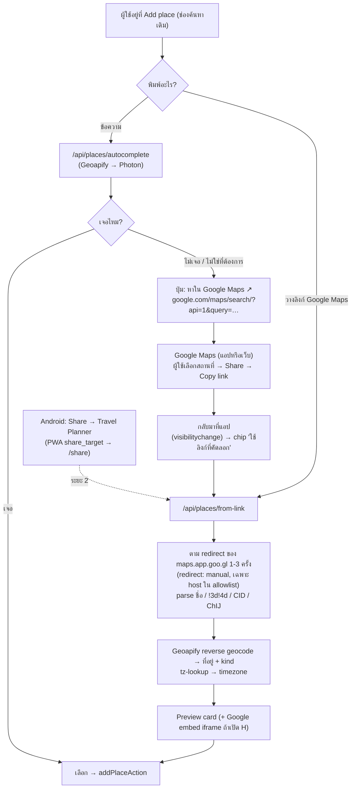
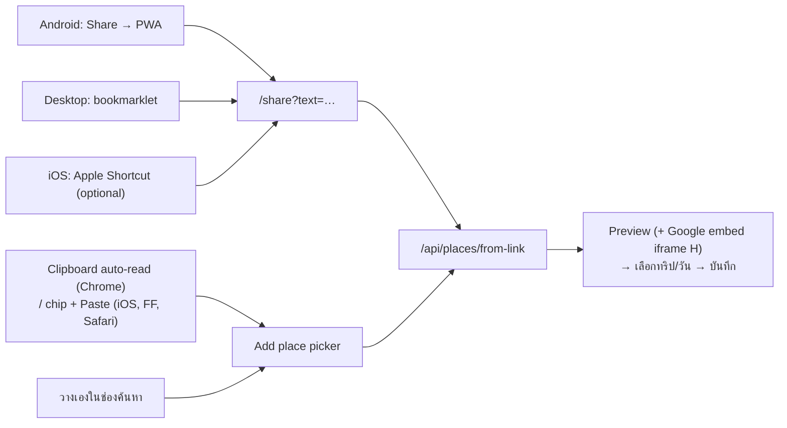

# เอาสถานที่จาก Google Maps เข้าแอป โดยไม่ใช้ Google Maps Platform API

**วันที่:** 2026-10-20 · **ต่อจาก:** [2026-10-15-maps-provider-alternatives.md](2026-10-15-maps-provider-alternatives.md) (หัวข้อ 6 ข้อ 2 ที่พูดถึงไว้สั้น ๆ)

**โจทย์:** แผนที่ในแอปเป็น MapLibre และการค้นหาใช้ Geoapify/Photon เรียก Google Maps Platform (Places/JS/Embed) ไม่ได้ เพราะ billing ใช้ไม่ได้ แต่อยากให้ผู้ใช้ **เอาสถานที่ที่เจอใน Google Maps มาใส่ หรือค้นหาผ่านแอปได้** โดยไม่ทำให้แอปใช้ยากขึ้น

---

## 1. TL;DR

| # | วิธี | ผู้ใช้ทำอะไร | ได้อะไร | ความเสี่ยง | ค่าแรง | แนะนำ |
|---|---|---|---|---|---|---|
| **A** | **วางลิงก์ Google Maps ในช่องค้นหาเดิม** | Share → Copy link → วางในช่องค้นหา | ชื่อ + พิกัดหมุดจริง + CID (+ ที่อยู่จาก reverse geocode) | ต่ำ (ขอ 1 ครั้งต่อการวาง ไปที่ `maps.app.goo.gl` และไม่โหลดหน้า Google) | S | ✅ **ทำก่อน** |
| **B** | **ปุ่ม "หาใน Google Maps"** ในผลค้นหา + ตรวจ clipboard เมื่อกลับมา | กดปุ่ม → เลือกที่ใน Google Maps → Copy link → กลับมาแตะ chip "ใช้ลิงก์ที่คัดลอก" | ใช้ข้อมูลค้นหาของ Google ผ่าน flow ของแอป | ต่ำ (เป็นแค่ลิงก์ Maps URLs ที่มีเอกสารรองรับ) | S | ✅ ทำคู่กับ A |
| **C** | **PWA Share Target** (Android) | ใน Google Maps กด Share → เลือก "Travel Planner" | เหมือน A แต่ไม่ต้อง copy/paste | ต่ำ แต่ใช้ได้เฉพาะ Android Chrome ที่ติดตั้ง PWA แล้ว (iOS ไม่รองรับ) | M | 🟡 ระยะ 2 |
| **D** | **Import ลิสต์ของ Google Maps** (ลิงก์ลิสต์ที่แชร์) | วางลิงก์ลิสต์ → ติ๊กเลือก → เพิ่มลงทริป/วัน | ทั้งลิสต์ทีเดียว: ชื่อ ที่อยู่ พิกัด CID | **กลาง-สูง** (endpoint ไม่มีเอกสาร และ robots.txt ห้าม `/maps/preview/`) | M | ❌ **ผู้ใช้ตัดสินใจไม่เอา (2026-10-20)** |
| **E** | **Import ไฟล์** (Takeout GeoJSON / My Maps KML) | export จาก Google แล้วอัปโหลด | ทั้งลิสต์ ผ่านช่องทางทางการ | ต่ำ แต่ UX หนัก และ CSV ของลิสต์ใน Takeout **ไม่มีพิกัด** | M | ⚪ ทำเมื่อมีคนขอ |
| **F** | **Bookmarklet / extension บน desktop** | อยู่ในหน้า Google Maps แล้วคลิก "Add to trip" | เหมือน A | ต่ำ | S | ⚪ ของแถมสำหรับ power user |
| **G** | **AI แยกสถานที่จาก screenshot/ข้อความ** | วางรูปหรือข้อความรีวิว | รายชื่อสถานที่ แล้ว resolve ผ่าน A หรือ Geoapify | กลาง (มีค่า LLM และความแม่นยำไม่แน่นอน) | M-L | ⚪ เป็นทิศทางของตลาด ยังไม่ใช่ตอนนี้ |
| **H** | **Google embed iframe แบบไม่ใช้ key** ใช้ preview สถานที่ที่ import มา | ไม่ต้องทำอะไร | การ์ดสถานที่ของ Google (รูปและรีวิว) ใน modal | กลาง (ไม่มีเอกสารรองรับ อาจหยุดทำงานได้) | S | 🟡 ใช้เป็น progressive enhancement |

**ข้อแนะนำ:** ทำ **A + B** ก่อน ไม่ต้องเพิ่มหน้าจอใหม่ ใช้ช่องค้นหาเดิมช่องเดียว พิมพ์ข้อความก็ค้นแบบเดิม ถ้าวางลิงก์ Google Maps ก็ resolve ให้เป็นสถานที่ทันที ส่วนปุ่ม "หาใน Google Maps" ใช้กรณีที่ Geoapify/Photon หาไม่เจอ (เช่น ร้านเล็ก ๆ ในไทย) แค่นี้ก็ได้ทั้ง "เอาของจาก Google มาใส่" และ "ค้นหาผ่านแอป" โดยไม่เรียก GMP API เลย

---

## 2. Flow ที่แนะนำ (A + B, และ C ทีหลัง)



---

## 3. รายละเอียดแต่ละวิธี

### A. วางลิงก์ Google Maps (แกนหลัก)

**ทดสอบจริงแล้ว (2026-10-20)** ใช้ short link จากชุดทดสอบของ GeoShare:

```
GET https://maps.app.goo.gl/mBtbC6qXLK2baGTV9   → 302
Location: https://www.google.com/maps/place/Steak+no+Don/@34.59539,133.7567242,17z/
          data=!4m6!3m5!1s0x3551565394d96b57:0x1c9bdbc5990908bf!8m2!3d34.5945482!4d133.7583428!16s%2Fg%2F1thfc7pn?...

GET https://maps.app.goo.gl/FP3EV7tTUKYbmcVp7   → 302
Location: https://www.google.com/maps/search/39.920439,+116.331538?...   (หมุดที่ปักเอง ไม่มีชื่อ)
```

redirect **ครั้งเดียว** ก็ได้ข้อมูลครบ โดยไม่ต้องโหลดหน้า Google Maps เลย ซึ่งสำคัญมาก เพราะ `robots.txt` ของ google.com **Disallow `/maps/`** ยกเว้น `/maps/search/`, `/maps/dir/`, `/maps/@` (ตรวจแล้ว) เราจึงอ่านแค่ header `Location` แล้วหยุด ไม่ไปขอหน้า `/maps/place/`

**ตาราง parse (เรียงตามลำดับความสำคัญ):**

| ข้อมูล | ที่มาใน URL | หมายเหตุ |
|---|---|---|
| ชื่อ | path segment `/maps/place/<ชื่อ>/` (decode `+` และ `%xx` รองรับภาษาไทย) | ถ้าไม่มี (หมุดที่ปักเอง) ให้ผู้ใช้ตั้งชื่อเอง หรือใช้ผล reverse geocode |
| พิกัด **หมุดจริง** | `!3d<lat>!4d<lng>` | **ต้องใช้ค่านี้ก่อน** ส่วน `@lat,lng,zoom` เป็นจุดกึ่งกลาง viewport ซึ่งอาจห่างจากหมุดหลายร้อยเมตร (ในตัวอย่างห่าง ~150 ม.) |
| พิกัด fallback | `@lat,lng`, `/search/lat,+lng`, `?q=lat,lng`, `?ll=`, `query=lat,lng` | |
| CID | `!1s0x<hex>:0x<hex>` ให้แปลง hex ตัว**หลัง**เป็นเลขฐานสิบ (`0x1c9bdbc5990908bf` → `2061482896174680255`) | ใช้เปิดสถานที่ใน Google แบบตรงตัวได้ด้วย `https://maps.google.com/?cid=<CID>` (ทดสอบแล้ว 302 ไปหน้าสถานที่) |
| Google Place ID (`ChIJ…`) | `query_place_id=`, `place_id:`, `!19s` (มีในบาง URL) | ถ้ามีจะใช้กับ deep link `query_place_id` ที่มีอยู่แล้ว (`lib/gmaps.ts`) ได้ทันที |
| ที่อยู่, kind, timezone | **ไม่มีใน URL** | เรียก Geoapify reverse geocode (มี key อยู่แล้ว) + `lib/places/tz-lookup.ts` |

**ข้อความที่แชร์จากแอป Google Maps** มักมาเป็น "ชื่อ + ที่อยู่ + ลิงก์" หลายบรรทัด ไม่ได้มาเป็น URL ล้วน ๆ ต้องดึง URL ด้วย regex ก่อน แล้วค่อยใช้บรรทัดก่อนหน้าเป็น hint ชื่อหรือที่อยู่ได้

**ความปลอดภัย (route ฝั่ง server):**
- allowlist host: `maps.app.goo.gl`, `goo.gl/maps`, `(www.)google.<tld>/maps`, `maps.google.<tld>` ทั้ง input และทุกครั้งที่ redirect เพื่อกัน SSRF
- `fetch(url, { redirect: 'manual' })` ตามไม่เกิน 3 ครั้ง ไม่อ่าน body และตั้ง timeout 5 วินาที
- ใช้ `lib/places/rate-limit.ts` ที่มีอยู่ และต้องมี session เหมือน `/api/places/*`
- region: Vercel ค่าเริ่มต้นอยู่สหรัฐฯ จึงไม่โดนหน้า consent ของ EU (`consent.google.com`) แต่ถ้าเจอ ให้ parse `continue=` ออกมา

**การเก็บข้อมูล:** `placeIdExternal = "gcid:<CID>"` (หรือ ChIJ แบบ bare ถ้ามี) จะต้องเพิ่ม `'gcid'` ใน `lib/places/place-id.ts` ตอนนี้ `placeProvider()` คืน `null` ถ้าเจอ prefix ที่ไม่รู้จัก ส่วน `gmapsSearchUrl` ควรใช้ `?cid=` เมื่อเป็น `gcid` เพราะเปิดตรงที่ listing ของร้าน ไม่ใช่แค่หมุดพิกัด ทำให้ผู้ใช้กลับไปดูรีวิวหรือรูปใน Google ได้

**ข้อกฎหมายและนโยบาย:** ไม่ได้ใช้ GMP API จึงไม่อยู่ใต้ Service Specific Terms เรื่อง caching ข้อมูลที่เก็บ (ชื่อ พิกัด) เป็นสิ่งที่ผู้ใช้ส่งมาเองทีละรายการ ไม่ใช่การดึงแบบ bulk ส่วนการตาม short link 1 ครั้งต่อการกระทำของผู้ใช้ก็เป็นพฤติกรรมเดียวกับ link preview ของแอปแชตทั่วไป จึงถือว่าเสี่ยงต่ำ แต่ **รูปแบบ URL ไม่มีเอกสารรองรับ** Google เปลี่ยนเมื่อไรก็ได้ ต้องมี fallback คือ ถ้า parse ไม่ได้ ให้เปิด manual form พร้อมปักหมุดตามพิกัดที่หาได้ หรือให้ผู้ใช้ปักเอง

**ไลบรารีที่หยิบมาใช้ได้:**

| แหล่ง | License | ใช้ยังไง |
|---|---|---|
| [jakubvalenta/geoshare](https://github.com/jakubvalenta/geoshare) (แอป Android, ⭐363, active ถึง 2026-10-19) | GPL-3.0 | **ใช้เป็นชุด test fixture** มีไฟล์ทดสอบรูปแบบ URL ของ Google ครบมาก (`GoogleMapsUriInputBehaviorTest.kt`, `…ShortLinkInput…`, `…PlaceListInput…`) ไม่ควร copy โค้ดเพราะเป็น GPL แต่ตัว URL ตัวอย่างนำมาใช้ทดสอบได้ |
| [kdcokenny/google-maps-link-parser](https://github.com/kdcokenny/google-maps-link-parser) (npm, ~1.1k ดาวน์โหลด/เดือน) | MIT | parse + unfurl + normalize เป็น TS ใช้ได้ทั้งตัว หรืออ่านเป็น reference ก็ได้ |
| `gmaps-url-coords`, `@ceptesoft/geo-link-parser` | MIT | เล็กมาก มีคนใช้น้อย ใช้แค่เป็น reference |
| `get-gplace-id` | — | ❌ ต้องใช้ Places API key |

ความเห็นของผม: **เขียน parser เองประมาณ 100 บรรทัด** ใน `lib/places/gmaps-link.ts` แล้วใช้ fixture จาก GeoShare ทดสอบ จะเข้ากับแนวของ repo (มี `geoapify.ts`/`photon.ts` และ `__fixtures__` อยู่แล้ว) และไม่ต้องพึ่ง dependency ที่มีคนใช้น้อย

### B. ปุ่ม "หาใน Google Maps" (ให้รู้สึกเหมือนค้นผ่านแอป)

- เมื่อพิมพ์คำค้นแล้ว ให้แสดงแถวท้ายผลลัพธ์ว่า **"ไม่เจอ? หา "<คำค้น>" ใน Google Maps ↗"** ซึ่งเป็นลิงก์ `https://www.google.com/maps/search/?api=1&query=<คำค้น + เมืองของทริป>` (Maps URLs มีเอกสารทางการและไม่ต้องใช้ key) บนมือถือจะเปิดแอป Google Maps เอง
- ผู้ใช้เลือกสถานที่แล้วกด Share → Copy link จากนั้นกลับมาที่แท็บของแอป
- แอปฟัง `visibilitychange` เมื่อกลับมาให้แสดง chip **"วางลิงก์ที่คัดลอกไว้"** ที่ต้องเป็นปุ่มเพราะ `navigator.clipboard.readText()` ต้องมี user gesture บน iOS ระบบจะขึ้นปุ่ม "Paste" ให้กดยืนยัน หรือผู้ใช้จะกดค้างที่ช่องค้นหาแล้ววางเองก็ได้
- ผลคือข้อมูลค้นหาของ Google ทั้งหมด (รีวิว รูป เวลาเปิด) ผู้ใช้ดูในแอป Google Maps เอง ส่วนแอปเราเก็บแค่ผลที่เลือก ต้นทุน $0

### C. PWA Share Target (Android)

- เพิ่ม `app/manifest.ts` (ตอนนี้ **ยังไม่มี manifest**) โดยใส่ `share_target: { action: '/share', method: 'GET', params: { title: 'title', text: 'text', url: 'url' } }`
- บน Android ลิงก์มักมาใน `text` ไม่ใช่ `url` ([Chrome docs](https://developer.chrome.com/docs/capabilities/web-apis/web-share-target)) จึงต้องดึง URL ด้วย regex จากทุก field
- หน้า `/share`: resolve ผ่าน A → ให้ผู้ใช้เลือกทริปและวัน (default เป็นทริปที่กำลังจะเดินทาง หรือทริปล่าสุด) → เพิ่ม
- ข้อจำกัด: ต้องติดตั้ง PWA ลงหน้าจอหลักก่อน **ใช้กับ iOS Safari ไม่ได้** สำหรับ iOS มีทางอ้อมคือ Apple Shortcut ที่รับ URL จาก share sheet แล้วเปิด `https://<app>/share?text=<url>` (แจกเป็นลิงก์ iCloud Shortcut ได้ แต่ผู้ใช้ต้องติดตั้งเอง)

### D. Import ลิสต์ของ Google Maps (เช่น "Want to go" ของเพื่อน)

**ทดสอบจริงแล้ว:** endpoint `GET https://www.google.com/maps/preview/entitylist/getlist?…&pb=!2e2!3e2!4i500!6m3!1s<rand>!15i204459!28e2!13s<list-url>!16b1` สำหรับลิสต์สาธารณะ `mfmnkPs6RuGyp0HOmXLSKg` ได้ HTTP 200 และ JSON ที่มี ชื่อลิสต์ ชื่อสถานที่ พิกัด และ CID ไม่ต้อง login (วิธีนี้มาจาก [ForceGT/gmaps-list-export](https://github.com/ForceGT/gmaps-list-export), MIT, Python ~240 บรรทัด, field mapping อยู่ใน `parse_place`)

- **UX:** วางลิงก์ลิสต์ในช่องเดียวกับ A (แยกจากลิงก์สถานที่ด้วย `placelists/list/` หรือ `!2s<id>` หลัง redirect) → แสดง checklist → "เพิ่ม 12 ที่ลง Day 2" หรือ "เก็บไว้ใน Ideas"
- **ความเสี่ยง:** เป็น endpoint ภายในที่ไม่มีเอกสาร และ **`/maps/preview/` ถูก Disallow ใน robots.txt** เป็นการดึงข้อมูลแบบ automated ชัดเจนกว่า A ใช้ได้กับลิสต์ที่เปิดเป็นลิงก์สาธารณะเท่านั้น และ JSON ยังมีชื่อกับรูปโปรไฟล์ของเจ้าของลิสต์ติดมาด้วย ซึ่ง**ไม่ควรเก็บ**
- **ข้อแนะนำ:** ถ้าจะทำ ให้อยู่หลัง feature flag จำกัด rate ต่อผู้ใช้ และ fail ได้อย่างนุ่มนวล (กลับไปบอกให้ "วางลิงก์ทีละที่") ทางเลือกที่ถูกกว่าคือเก็บรวมไว้ในตัวเลือก E

### E. Import ไฟล์ (ช่องทางทางการ)

| แหล่ง | สิ่งที่ได้ | ปัญหา |
|---|---|---|
| Takeout → Maps (your places) → `Saved Places.json` (GeoJSON) | starred places พร้อมพิกัด ชื่อ และที่อยู่ | ได้เฉพาะ "Starred" |
| Takeout → Saved → `<ชื่อลิสต์>.csv` | Title, Note, URL (, Comment) | **ไม่มีพิกัด** URL มีแค่ `!1s0x…:0x…` ถ้าจะได้พิกัดต้องโหลดหน้า `/maps/place` ซึ่ง robots ห้าม จึงไม่คุ้ม |
| Google My Maps → Export KML/KMZ | ชื่อ คำอธิบาย และพิกัด | ผู้ใช้ต้องย้ายสถานที่ไป My Maps ก่อน |

แอปที่ทำแบบนี้: **Mapstr** (import ไฟล์ kml/kmz/json/csv จาก Takeout) และ **Organic Maps** (KML/KMZ/GPX) ตัวเลือกนี้เหมาะกับคนที่ย้ายข้อมูลครั้งเดียว ไม่เหมาะกับ flow วางแผนทริปปกติ

### F. Bookmarklet / extension (desktop)

bookmarklet บรรทัดเดียว: `javascript:open('https://<app>/share?text='+encodeURIComponent(location.href))` บนหน้า google.com/maps จะได้ URL ยาวที่มี `!3d!4d` อยู่แล้ว ไม่ต้องตาม redirect ด้วยซ้ำ ใช้ปลายทาง `/share` เดียวกับ C ตัวอย่างในตลาดคือ Turas.app (Firefox extension ที่ "add places to itineraries directly from Google Maps")

### G. AI แยกสถานที่จาก screenshot / ลิงก์โซเชียล

ตลาดแอปวางแผนเที่ยวปี 2026 ไปทางนี้กันมาก: Go There (แชร์ลิงก์ Google Maps/TikTok/IG/YouTube), Packy (screenshot), Jasper Travel, TripSpire, PlaceSnap (ใช้ Claude) และ Google Maps เองก็มีฟีเจอร์สแกน screenshot (iOS US ภาษาอังกฤษเท่านั้น)
- pipeline: รูปหรือข้อความ → LLM vision แยก "ชื่อ + เมือง" → ค้นด้วย Geoapify ถ้าไม่มั่นใจ ให้แสดงปุ่ม B ("หาใน Google Maps")
- **Gemini Grounding with Google Maps** ไม่ช่วยในเคสนี้: รองรับแค่ภาษาอังกฤษ คืนมาแค่ชื่อกับ URL (เอกสารไม่ได้ระบุว่ามีพิกัด) ต้องแสดง attribution ตามกฎ และคิดเงิน $14/1k query (Gemini 3+ ฟรี 5,000/เดือน) แถมยังต้องใช้ billing ของ Google อยู่ดี
- repo มีแผน MCP แบบ BYO agent อยู่แล้ว (`docs/superpowers/plans/2026-09-17-mcp-server-byo-agent.md`) agent ของผู้ใช้ส่งลิงก์ Google Maps มาที่ API เดียวกับ A ได้ จึงได้ความสามารถนี้ "ฟรี" ถ้า A ถูกเปิดเป็น REST endpoint ด้วย

### H. Google embed iframe แบบไม่ใช้ key (preview ของสถานที่ที่ import มา)

ทดสอบแล้ว: `https://maps.google.com/maps?cid=<CID>&output=embed` → 302 ไปที่ `https://www.google.com/maps/embed?origin=mfe&pb=!1m3!3m2!1m1!4s<CID>` ได้ **HTTP 200 และไม่มี `X-Frame-Options`** ที่ปลายทาง (มี SAMEORIGIN เฉพาะที่ hop แรก จึงควรใช้ URL ปลายทางตรง ๆ) ในหน้าแสดงการ์ดของ "Steak no Don"
- ใช้ใน `place-preview-modal` ได้เมื่อ `placeIdExternal` เป็น `gcid:` ผู้ใช้จะเห็นรูป เรตติ้ง และรีวิวของ Google โดยไม่ต้องเรียก API
- **ไม่มีเอกสารรองรับ** Embed API ที่เป็นทางการต้องใช้ key และ billing ([docs](https://developers.google.com/maps/documentation/embed/quickstart)) จึงควร lazy-load ไว้หลังปุ่ม "ดูใน Google" และถ้าโหลดไม่ได้ก็ซ่อนไป

---

## 3.9 คำถามรอบ 2: เปิด Google Maps ใน iframe แล้วเอา URL มาเองได้ไหม (ไม่ต้อง copy/paste)

**คำตอบสั้น: ไม่ได้** ติดข้อจำกัด 2 ชั้น (ทดสอบ 2026-10-20)

1. **Google Maps ตัวเต็มไม่ยอมให้ฝังใน iframe:** `google.com/maps`, `/maps/search/…`, `/maps/place/…` ส่ง `X-Frame-Options: SAMEORIGIN` ทุกหน้า เบราว์เซอร์จึงแสดงเป็นกรอบว่าง ยอมให้ฝังได้แค่ `/maps/embed?…` ซึ่งเป็นการ์ดของสถานที่เดียว ไม่มี UI สำหรับค้นหาหรือเลือกสถานที่อื่น
2. **ต่อให้ฝังได้ ก็อ่าน URL หรือเนื้อหาข้างในไม่ได้:** iframe คนละ origin ติด same-origin policy (`iframe.contentWindow.location` จะ throw) ส่วนหน้า embed ก็ไม่มี `postMessage` ส่งออกมา (ค้นใน HTML ไม่เจอเลย) และการเปิดเป็น popup (`window.open`) ก็ติดข้อจำกัดเดียวกัน

**ข้อค้นพบระหว่างทดสอบ (ควรรู้แต่ไม่แนะนำ):** HTML ของ `google.com/maps/embed?pb=!1m2!2m1!1s<คำค้น>` (ไม่ใช้ key) มีข้อมูลผลลัพธ์อันดับแรกฝังมาครบ เช่น `"Jay Fai Bangkok"` ได้ชื่อ ที่อยู่เต็ม lat/lng CID `ChIJ…` เรตติ้ง จำนวนรีวิว เบอร์โทร และหมวด ถ้าให้ server ยิงไปแล้ว parse จะได้ "ค้นด้วย Google ในแอป" แบบไม่ต้อง copy/paste ทุกแพลตฟอร์ม **แต่เป็นการ scrape Google จาก server** (robots.txt ห้าม `/maps/embed`, ผิด ToS และ IP ของ Vercel โดน captcha หรือบล็อกได้) ความเสี่ยงอยู่ระดับเดียวกับ D ที่ตัดทิ้งไปแล้ว **จึงไม่แนะนำ**
ส่วนที่ทำได้อย่างถูกต้องคือ**แสดง** iframe embed ให้ผู้ใช้ดู (เบราว์เซอร์ผู้ใช้โหลดเอง) เพื่อยืนยันว่า "ใช่ที่นี้" (= H) แต่ข้อมูลที่บันทึกต้องมาจากลิงก์ที่ผู้ใช้ส่งมาเอง

### แล้วจะลด copy/paste ให้น้อยที่สุดในแต่ละแพลตฟอร์มได้อย่างไร

| แพลตฟอร์ม | วิธีที่ลดขั้นตอนได้มากที่สุด | ผู้ใช้ทำอะไร | หมายเหตุ |
|---|---|---|---|
| **Android** (Chrome) | **Share Target** (C) | Google Maps → Share → "Travel Planner" → เลือกทริปและวัน | **ไม่มี paste เลย** แต่ต้องติดตั้ง PWA ก่อน ถ้ายังไม่ติดตั้งให้ใช้แถวล่าง |
| Android / Desktop Chrome / Edge | **Auto-read clipboard** ตอนกลับมาที่แท็บ | Google Maps → Copy link → กลับมา → การ์ดสถานที่ขึ้นเอง | Chrome ขอ permission `clipboard-read` ครั้งแรกครั้งเดียว หลังจากนั้นอ่านได้เองตอน `focus`/`visibilitychange` (ต้องอ่านเฉพาะเมื่อผู้ใช้อยู่ในหน้า Add place เท่านั้น) |
| **iOS** (Safari / PWA) | **Clipboard chip** | Google Maps → Share → Copy → กลับมา → แตะ "วางลิงก์จาก Google Maps" แล้วแตะ "Paste" ที่ iOS แสดง | iOS **ไม่รองรับ** Share Target ของเว็บ และอ่าน clipboard ได้เฉพาะเมื่อผู้ใช้แตะ จึงเหลือ copy + แตะ 2 ครั้ง เป็นขั้นต่ำที่เว็บทำได้ |
| iOS (ตัวเลือกเสริม) | **Apple Shortcut** "Add to Travel Planner" | ติดตั้งครั้งเดียว → ใน Google Maps กด Share → Shortcut | ไม่ต้อง paste แต่ผู้ใช้ต้องติดตั้ง Shortcut เอง ทางที่สะอาดกว่าคือห่อแอปด้วย native wrapper (Capacitor) ที่มี Share Extension ซึ่งเป็นงานใหญ่และต้องผ่าน App Store |
| **Desktop** (ทุกเบราว์เซอร์) | **Bookmarklet** (F) บน bookmarks bar | อยู่ในหน้า Google Maps → คลิก "➕ Travel Planner" | **คลิกเดียว ไม่มี copy** ถ้าอยากได้ประสบการณ์ที่ดีกว่านี้ก็ทำเป็น extension ได้ |
| Desktop Firefox / Safari | Clipboard chip | Copy URL จาก address bar → แตะ chip | Firefox/Safari จะขึ้นเมนู "Paste" ให้ยืนยัน |

**ทุกทางใช้ปลายทางเดียวกัน** คือ `/api/places/from-link` (A) แล้วเข้า UI preview → เลือกทริปและวัน จึงเขียน logic ครั้งเดียวแล้ว "ทางเข้า" (paste, chip, share target, bookmarklet, shortcut) เป็นแค่ wrapper บาง ๆ



## 3.10 คำถามรอบ 3: ให้ Agent API (`/api/v1`, import, MCP) รับ Google Maps URL เป็นช่องทางหลัก

**ทำได้ และควรทำ** เพราะใช้ resolver ตัวเดียวกับข้อ A (`lib/places/gmaps-link.ts`) ไม่ต้องเขียนใหม่ เพิ่มแค่ field `googleMapsUrl` ใน `parsePlaceFields` (`lib/api/place-input.ts`) และในแผนของ import (`lib/api/import-input.ts`) แล้ว resolve ก่อนเรียก service ส่วน MCP tool `add_place` / `import_trip` ได้ไปด้วยโดยอัตโนมัติ เพราะใช้ parser ตัวเดียวกัน

**ข้อควรระวัง: URL ที่ agent ส่งมาไม่ได้มีพิกัดทุกแบบ**

| แบบของ URL ที่ agent มักส่งมา | มีพิกัด? | resolve ได้แค่ไหน |
|---|---|---|
| `maps.app.goo.gl/…` (agent เจอจากเว็บ/รีวิว) | ได้หลัง redirect | ✅ แม่น (`!3d/!4d` + CID) |
| `/maps/place/<ชื่อ>/@lat,lng,z/data=…!3d…!4d…` | ✅ | ✅ แม่น |
| `/maps/place/<ชื่อ>/@lat,lng,z` (ไม่มี `data=`) | ⚠️ เป็นจุดกลางจอ | ⚠️ คลาดได้ ~100–300 ม. |
| `/maps/search/?api=1&query=<ชื่อ>` (agent สร้างเองบ่อยที่สุด) | ❌ | ⚠️ ได้แค่ชื่อ → geocode ด้วย Geoapify/Photon |
| `…&query_place_id=ChIJ…` | ❌ | ⚠️ ChIJ ถอดไม่ได้ถ้าไม่ใช้ Google API → ใช้ `query` แทน, เก็บ ChIJ ไว้ทำ deep link |
| `?cid=<เลข>` | ❌ | ⚠️ เก็บ `gcid:` ไว้ทำ deep link ได้ แต่ต้องได้พิกัดจากทางอื่น |
| URL ที่ agent แต่งขึ้นเอง (hallucinate) | — | ❌ ต้องตรวจ ไม่เชื่อทันที |

**ลำดับความสำคัญที่แนะนำ (URL เป็นหลัก แต่มีตาข่ายรองรับ)**

```mermaid
flowchart TD
  IN["Agent ส่ง place<br/>{name, googleMapsUrl?, lat?, lng?, address?}"] --> U{มี googleMapsUrl?}
  U -- ไม่มี --> OLD["ใช้ name/lat/lng เดิม (เหมือนตอนนี้)"]
  U -- มี --> R["resolve URL<br/>(allowlist host, redirect ≤3, timeout, rate limit)"]
  R --> C{ได้พิกัดแม่น? (!3d/!4d)}
  C -- ได้ --> X{agent ส่ง lat/lng มาด้วย?}
  X -- ห่าง > 2 กม. --> W["ใช้พิกัดจาก URL + ใส่ warning ใน response"]
  X -- ใกล้กัน / ไม่ได้ส่ง --> OK["ใช้พิกัดจาก URL"]
  C -- ไม่ได้ --> G["geocode query/ชื่อ ด้วย Geoapify/Photon<br/>bias รอบเมืองของทริป"]
  G --> F{เจอ?}
  F -- เจอ --> OK2["ใช้ผล geocode + precision='approx'"]
  F -- ไม่เจอ --> L["ใช้ lat/lng ของ agent ถ้ามี<br/>ไม่มี → บันทึกแบบไม่มีหมุด + warning"]
  OK & W & OK2 & L --> S["บันทึก + เก็บ URL เดิมไว้ทำปุ่ม 'เปิดใน Google Maps'"]
```

หลักการ:

1. **ไม่ fail ทั้ง request เพราะ URL เสีย** โดยเฉพาะ import ทั้งทริป ให้บันทึกได้และคืน `warnings[]` ต่อสถานที่ (เช่น `url_unresolved`, `coords_approx`, `coords_mismatch`) agent จะได้แก้เองในรอบถัดไป
2. **เก็บ URL เดิมเสมอ** (เช่น field `sourceUrl`) แม้พิกัดที่ resolve ได้จะคร่าว ๆ ปุ่ม "เปิดใน Google Maps" จะพาไปที่ร้านที่ agent ตั้งใจถูกตัว เพราะ Google ตีความ URL นั้นเอง
3. **name ยังบังคับ** เพราะ search URL ไม่การันตีชื่อที่สะอาด และถ้า resolve ล้มเหลวก็ยังมีชื่อแสดง
4. **คำอธิบายใน API.md และ MCP tool description** บอก agent ว่า "แนบลิงก์ `maps.app.goo.gl` หรือ `/maps/place/…` ที่ได้จากการค้นจริง ห้ามแต่ง place_id เอง" ช่วยให้ได้ URL แบบแม่นบ่อยขึ้น
5. **ภาระต่อ Google** มีแค่ HEAD/GET ตาม redirect ของ short link หนึ่งครั้งต่อสถานที่ (ไม่อ่าน HTML) จำกัดต่อ token และ cache ผลตาม URL ไว้ เพราะ import หนึ่งครั้งอาจมีหลายสิบสถานที่

**งานที่เพิ่มจากข้อ 6:** `place-input.ts` / `import-input.ts` รับ `googleMapsUrl`, resolve แบบ async ก่อนเข้า service (parser ตอนนี้เป็น sync), คอลัมน์ `sourceUrl` ใน `places`, `warnings[]` ใน response, อัปเดต API.md + คำอธิบาย MCP tool

## 3.11 คำถามรอบ 4: ส่งคำแนะนำให้ agent ของผู้ใช้ผ่าน MCP หรือ Agent Skill

ทำได้ทั้ง 2 ทาง และมีของอยู่แล้วครึ่งหนึ่ง:

- **Agent Skill มีอยู่แล้ว:** `agent-skill/travel-planner-api/SKILL.md` (REST + PAT) แต่ยังสอนให้ใส่ `placeIdExternal: "ChIJ…"` (บรรทัด 70–86, 197) ซึ่งหลัง TP-0045 ไม่มีประโยชน์ และเปิดทางให้ agent แต่ง place_id
- **MCP มีแผนแล้ว แต่ยังไม่ได้สร้าง:** `docs/superpowers/plans/2026-09-17-mcp-server-byo-agent.md` [TP-0035] มี prompt `plan_trip` อยู่แล้ว แต่ `search_nearby` ยังผูกกับ Google Places API (New) ต้องเปลี่ยนเป็น Geoapify ก่อนเริ่ม

| | MCP | Agent Skill |
|---|---|---|
| ใช้กับ | client ที่รองรับ MCP (Claude, ChatGPT connector, Cursor, VS Code ฯลฯ) | agent ที่อ่าน `SKILL.md` และรัน shell/HTTP ได้ (Claude Code, Codex ฯลฯ) |
| คำแนะนำไปถึง agent ทาง | server `instructions`, คำอธิบาย tool/field, prompt `plan_trip` | เนื้อหา SKILL.md |
| ผู้ใช้ติดตั้ง | ใส่ URL + token ครั้งเดียว | ดาวน์โหลด/วางโฟลเดอร์ skill |
| ตรวจ input ได้ | ✅ zod schema + server ตอบ `warnings[]` | ❌ เป็นแค่ข้อความแนะนำ |

**แนะนำ:** MCP เป็นช่องทางหลัก (ใส่คำแนะนำไว้ในตัว server ผู้ใช้ไม่ต้องติดตั้งอะไรเพิ่ม) และ Skill เป็นช่องทางรองที่ใช้ข้อความชุดเดียวกัน

**ข้อความที่ควรสอน agent (ใช้ร่วมกันทั้ง 2 ทาง):**

1. ส่ง `name` + `address` (หรืออย่างน้อยเมือง) ทุกครั้ง เพราะเป็นทางสำรองตอน geocode
2. `googleMapsUrl` ลำดับความชอบ: ลิงก์ `maps.app.goo.gl` / `google.com/maps/place/…` ที่**เจอจากการค้นหาจริง** → ถ้าไม่มี ให้สร้าง `https://www.google.com/maps/search/?api=1&query=<ชื่อ>, <ที่อยู่/เมือง>` (สร้างแบบนี้ได้เสมอ ไม่มีวันผิด)
3. ห้ามแต่ง `query_place_id`, CID หรือพิกัด ถ้าไม่ได้มาจากแหล่งจริง
4. ถ้า response มี `warnings` (`coords_approx`, `coords_mismatch`, `url_unresolved`) ให้ใช้ tool `resolve_place` / `search_places` ตรวจ แล้วแก้ด้วย `update_place`

**Tool ที่ควรเพิ่มใน MCP:** `resolve_place({ googleMapsUrl?, name, near? })` เรียกตัว resolver เดียวกัน คืนชื่อ พิกัด และระดับความแม่น โดยไม่บันทึก ให้ agent ตรวจก่อนกด `add_place`

---

## 4. แอปอื่นทำอย่างไร

| แอป | วิธี | หมายเหตุ |
|---|---|---|
| Wanderlog | ใช้ Google Places API ตรง ๆ (แผนที่ก็เป็น Google) และ export ไป Google My Maps (Pro) | ไม่ใช่ทางเลือกของเรา |
| Mapstr | import ไฟล์ Takeout (kml/kmz/json/csv) + "open with" | = E |
| Organic Maps | import KML/KMZ/GPX (ต้องแปลงจาก Takeout เอง) | = E |
| GeoShare (Android, OSS) | รับ share intent จาก Google Maps → parse URL และตาม short link → ส่งต่อเป็น `geo:` ให้แอปแผนที่อื่น | = A + C แบบ native, **มี fixture ดีที่สุด** |
| Go There / TripSpire | แชร์ลิงก์ Google/Apple Maps + โซเชียล เข้ามาในแอป | = A + C + G |
| Packy / Jasper Travel | AI อ่าน screenshot | = G |
| Turas.app | browser extension บนหน้า Google Maps | = F |
| gmaps-list-export / Apify actor | ดึงลิสต์ที่แชร์ผ่าน endpoint ภายใน | = D |

**รูปแบบที่ใช้กันมากที่สุดคือ "แชร์หรือวางลิงก์"** (A/C) ไม่มีแอปไหนเรียก Google search จาก backend โดยไม่ใช้ API เพราะผิด ToS และโดนบล็อกง่าย

---

## 5. สิ่งที่ไม่แนะนำ

- **Scrape ผลค้นหาของ Google Maps** (`/maps/search` → HTML/`/search?tbm=map`) เพื่อทำ autocomplete ในแอป: ผิด ToS โดน captcha และ IP block ง่ายบน Vercel และเปราะบาง
- **SerpApi** และบริการ scrape แบบจ่ายเงิน: ได้ข้อมูลระดับ Google จริง แต่ฟรีแค่ 100–250 ครั้ง/เดือน และเป็นการ scrape ผ่านตัวกลาง (ดูรายงานเดิมหัวข้อ 4)
- **Places API / Embed API / Gemini Maps grounding**: ทั้งหมดต้องใช้ billing ของ Google ซึ่งเป็นข้อจำกัดตั้งแต่ต้น

---

## 6. ผลกระทบต่อ codebase (ถ้าเลือก A + B)

| ไฟล์ | เปลี่ยน |
|---|---|
| `lib/places/gmaps-link.ts` (+ test, fixture จาก GeoShare) | `extractUrl(text)`, `resolveShortLink(url)` (manual redirect, allowlist), `parseGoogleMapsUrl(url)` → `{ name?, lat, lng, cid?, googlePlaceId? }` |
| `lib/places/place-id.ts` | เพิ่ม provider `'gcid'` |
| `lib/gmaps.ts` | `gmapsSearchUrl`: ถ้าเป็น `gcid` ให้ใช้ `https://maps.google.com/?cid=` |
| `app/api/places/from-link/route.ts` | session + rate-limit → resolve → Geoapify reverse geocode → คืน `PlaceSuggestion` shape เดียวกับ details |
| `components/place-search-picker.tsx` (+ `hotel-place-picker`, `transport-place-picker` ถ้าต้องการ) | ถ้า input เป็นลิงก์ Google Maps ให้เรียก from-link แทน autocomplete และเพิ่มแถว "หาใน Google Maps ↗" กับ chip วางจาก clipboard |
| `lib/api/place-input.ts` (REST/MCP) | รับ `googleMapsUrl` เป็น input ทางเลือก |

ระยะ 2: `app/manifest.ts` + `app/share/page.tsx` (C) และ bookmarklet (F) ใช้ปลายทางเดียวกัน

---

## 7. คำถามที่ต้องตัดสินใจ

1. ~~เอา D (import ลิสต์) ไหม~~ → **ไม่เอา** (2026-10-20)
2. เปิด **H (Google iframe preview)** ไหม เพราะได้ UX ดีแต่ไม่มีเอกสารรองรับ
3. ~~iOS หรือ Android~~ → **ต้องรองรับ desktop, iOS และ Android** (2026-10-20) จึงต้องมีทางเข้าครบตามตาราง 3.9: A + B + clipboard chip/auto-read + C (Android) + F (desktop) ส่วน Apple Shortcut ของ iOS เป็นตัวเลือกเสริม
4. iOS ต้องการ "ไม่ต้อง paste เลย" ถึงขั้นทำ native wrapper ที่มี Share Extension ไหม (งานใหญ่ ต้องผ่าน App Store) หรือรับได้กับ copy + แตะ 2 ครั้ง

**การตัดสินใจ (2026-10-20, TP-0046):**

- **ลำดับความสำคัญของพิกัดเปลี่ยน:** พิกัดจาก agent ชนะ geocode (pin จากลิงก์ > `lat/lng` ของ agent > viewport ของลิงก์ > geocode) และจะ geocode ก็ต่อเมื่อสถานที่ยังไม่มีพิกัด มีลิงก์หรือ `address` และไม่ใช่ `transit` (แก้ §3.10)
- **ไม่เพิ่มคอลัมน์ `sourceUrl`** เก็บ id ใน `place_id_external` เป็น `gcid:<cid>` แทน
- **ไม่ bias ตามเมืองของทริป:** คง bias ประเทศไทยที่มีอยู่ ถ้า geocode ได้ผลคลุมเครือให้ตอบ `coords_approx` เพื่อให้ agent แก้เอง
- **แก้ไขสถานที่ได้ ยกเว้น pin ที่มาจาก Geoapify/OSM:** สถานที่ที่เพิ่มจากลิงก์ (`gcid`), `ChIJ` และที่กรอกเองแสดงปุ่ม Edit ได้หมด ส่วนโรงแรมไม่ต้องแก้
- **Phase 2 แยกเป็นแผนใหม่:** clipboard chip, share target และ bookmarklet

---

## แหล่งอ้างอิง (ตรวจ 2026-10-20)

- ทดสอบเอง: redirect ของ `maps.app.goo.gl` (2 ลิงก์), `?cid=` redirect, embed iframe headers, `entitylist/getlist`, `google.com/robots.txt`
- [GeoShare repo](https://github.com/jakubvalenta/geoshare) · [F-Droid listing](https://f-droid.org/packages/page.ooooo.geoshare/)
- [ForceGT/gmaps-list-export](https://github.com/ForceGT/gmaps-list-export) · [gist](https://gist.github.com/ForceGT/bbb9423e2d23e9639672a390933eb710)
- [kdcokenny/google-maps-link-parser](https://github.com/kdcokenny/google-maps-link-parser) · [get-gplace-id README](https://cdn.jsdelivr.net/npm/get-gplace-id@1.0.3/README.md) · [Val Town GoogleMapsToOSM](https://www.val.town/embed/x/bart/GoogleMapsToOSM/README.md)
- [Web Share Target API (Chrome)](https://developer.chrome.com/docs/capabilities/web-apis/web-share-target) · [WebKit bug 194593](https://bugs.webkit.org/show_bug.cgi?id=194593) · [iOS PWA compatibility (firt.dev)](https://firt.dev/notes/pwa-ios/)
- [Mapstr: importer des adresses](https://mapstr.com/fonctionnalites/importer-des-adresses) · [Organic Maps discussion #928](https://github.com/orgs/organicmaps/discussions/928) · [Exporting Google Saved Places (dev.to)](https://dev.to/kasuboski/exporting-google-saved-places-354n) · [ruk.ca: Want to go vs Starred](https://ruk.ca/content/google-maps-warning-want-go-and-starred-places-are-not-same)
- [Grounding with Google Maps (Gemini API)](https://ai.google.dev/gemini-api/docs/maps-grounding) · [Maps Embed API quickstart](https://developers.google.com/maps/documentation/embed/quickstart) · [Maps Embed usage & billing](https://developers.google.com/maps/documentation/embed/usage-and-billing)
- [GMP Service Specific Terms (archive 2025-03)](https://cloud.google.com/archive/maps-platform/terms/maps-service-terms-20250331) · [SerpApi pricing](https://serpapi.com/pricing)
- ตลาด: [Go There](https://apps.apple.com/app/id6756531331) · [Packy](https://apps.apple.com/fj/app/id6742707183) · [Jasper Travel](https://mwm.ai/apps/jasper-travel/6768423823) · [TripSpire](https://apps.apple.com/app/id6753126737) · [PlaceSnap](https://chromewebstore.google.com/detail/aeihoeolfhofbomjpkfnmnjcaonbjdhd) · [Turas.app](https://addons.mozilla.org/firefox/addon/turas-app/) · [Google Maps screenshot feature (IBTimes)](https://www.ibtimes.com/google-maps-gets-creepy-cool-now-scans-your-iphone-screenshots-track-places-youve-seen-online-3772906) · [Wanderlog (App Store)](https://apps.apple.com/no/app/id1476732439)

**ยังยืนยันไม่ได้:** ข้อความที่แอป Google Maps บน iOS/Android ใส่มาตอนแชร์ (ต้อง log จากเครื่องจริง) · `!19sChIJ…` พบบ่อยแค่ไหนใน URL หลัง redirect · พฤติกรรมของ short link เมื่อ request มาจาก region EU
