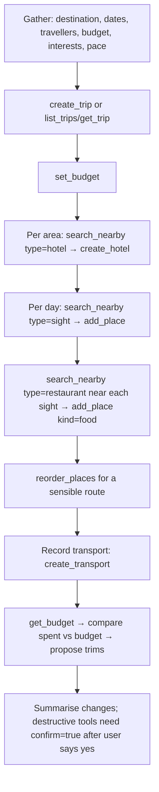

# MCP Server + Bring-Your-Own-Agent Implementation Plan [TP-0035]

> **Revision 2026-10-20 (TP-0046, after TP-0045 removed Google Places).**
> 1. `search_nearby` cannot run as written. TP-0045 removed Google Places (it is back only behind `MAPS_PROVIDER=google`, autocomplete + details, with daily caps), and `lib/places/search.ts` is text autocomplete with no location or category input. It needs a redesign, for example Geoapify Places API categories with a circle. That is out of scope here. A text-search tool over `searchPlaces` (`GET /api/v1/places/search?q=`) is a cheap first step. E10/E11 and the Google Places env/type-mapping steps below are stale.
> 2. New tool: `resolve_place({ name: string, address?: string, googleMapsUrl?: string })`. It builds `{ kind: 'sight', name, address, … all other fields null }`, calls `applyPlaceLink` with a fresh `LinkBudget(userId)`, and returns `{ lat, lng, placeIdExternal, address, warnings }`. It writes nothing.
> 3. `placeShape` gains `googleMapsUrl`, and the server `instructions` carry the "Place location" copy below.
>
> > **Place location.**
> > 1. Always send `name`, plus `address` (or at least the city). If you send no coordinates but do send an `address`, the server tries to geocode `name, address`. This is best-effort and capped, and never applies to `transit`. A place with only a name gets no pin.
> > 2. If you found a real Google Maps link (`maps.app.goo.gl/…` or `google.com/maps/place/…`), send it as `googleMapsUrl`. It gives an exact pin. Do not build one yourself.
> > 3. Never invent `query_place_id`, a CID, `placeIdExternal` or coordinates.
> > 4. Check `warnings[]` in the response. `coords_approx`, `coords_mismatch` and `url_unresolved` mean the pin may be wrong. To move a pin, `PATCH` the place with `lat`/`lng` and **without** `googleMapsUrl`.


> **For agentic workers:** REQUIRED SUB-SKILL: Use superpowers:subagent-driven-development (recommended) or superpowers:executing-plans to implement this plan task-by-task. Steps use checkbox (`- [ ]`) syntax for tracking.

**Goal:** Expose the existing agent API (`/api/v1`) as an MCP server at `/api/mcp` so any MCP client, authenticated with a user's personal access token, can plan a trip end-to-end: trips/days/places, nearby hotel/restaurant/sight search, hotel + transport bookings, and budget.

**Architecture:** One Next.js route handler built with `mcp-handler` 2.x. Every tool is a thin adapter over the **existing service layer** (`app/src/lib/services/*`), which already does authz (`requireTripAccess`), `touchTrip` and `writeAudit`. The token check reuses the PAT store (`lib/api-tokens.ts`), and the rate limit reuses `consumeRateLimit`. The REST v1 API stays live. MCP is an extra surface, not a replacement, until a later deprecation ticket.

**Tech Stack:** Next.js 16.2.4 App Router, Drizzle + Neon Postgres, vitest 3, `mcp-handler@^2.1.1`, `@modelcontextprotocol/server@^2.0.0`, `zod@^4.2.0`, Google Places API (New) Nearby Search (server-side).

**Spec:** Ticket TP-0035 (`pm task get --id TP-0035`). This plan also serves as the design doc. The §0 evidence table records the facts it relies on.

## Global Constraints

- Package manager: **pnpm** (`app/pnpm-lock.yaml` exists).
- Run all commands from `app/`. Tests: `pnpm test` (vitest, `src/**/*.test.ts`). Integration tests run only when `TEST_DATABASE_URL` is set.
- Any route that touches `dbNode` (postgres-js) must set `export const runtime = 'nodejs'` (precedent: `app/src/app/api/v1/trips/import/route.ts:10`).
- Error envelope for tool failures: `ServiceError.code` + message. Never leak stack traces.
- Comments: rare, only for a non-obvious WHY (`AGENTS.md` Conventions).
- If an entity shape changes, update `REQUIREMENTS.md` §4 in the same PR (`AGENTS.md` Conventions).
- Coding happens in a worktree from fresh `origin/main` (user global rule).

---

## 0. Evidence (facts this plan depends on)

| # | Fact | Evidence |
|---|---|---|
| E1 | The agent API today is REST `/api/v1` with 18 route files (trips, days, places, hotels, transport, expenses, notes, me, import) | `find app/src/app/api/v1 -name route.ts` |
| E2 | Auth is a PAT bearer token `tp_…`, stored as a SHA-256 hash, with scope `read` or `read-write` | `app/src/lib/api-tokens.ts:15,95-122`; schema `app/src/db/schema.ts:608-627` |
| E3 | REST wrapper order: auth → per-token rate limit → only `read-write` may use non-GET methods | `app/src/lib/api/http.ts:13-38` |
| E4 | Services own authz + touchTrip + audit; routes only parse | `app/src/lib/services/booking-service.ts:1-2,52-60`; `place-service.ts:62-96` |
| E5 | Trip access roles are `owner/editor/viewer`; a trip in the trash returns 404 | `app/src/lib/services/access.ts:30-56` |
| E6 | Idempotency is keyed on the `Idempotency-Key` header plus a fingerprint of method, URL path and body, so it needs a `Request` | `app/src/lib/api/idempotency.ts:29-39,112-121`; `idempotency-atomic.ts:32-38` |
| E7 | **No reorder endpoint exists in REST**, but `reorderPlaces` exists in the service layer | `grep -rn reorder app/src/app/api` → empty; `place-service.ts:184` |
| E8 | **No budget-target API/service exists.** Budget is set only by the FormData server action; the resolved budget (per_person/per_day) is computed inline in the page | `app/src/app/actions/budget.ts:19-121`; `app/src/app/trip/[id]/budget/page.tsx:81-109` |
| E9 | Spend summary `loadBudgetForTrip(tripId, currency)` exists | `app/src/lib/expense-queries.ts:215` |
| E10 | **No server-side place search exists.** Places run only in the browser (`AutocompleteSuggestion`), and the server key is restricted to Maps Static | `docs/ops/maps-cost-guardrails.md` §1–2; `AGENTS.md` Google Maps section |
| E11 | Nearby Search (New): `POST https://places.googleapis.com/v1/places:searchNearby`, headers `X-Goog-Api-Key` + `X-Goog-FieldMask`, body `locationRestriction.circle` (radius 0–50000 m), `includedTypes` (e.g. `restaurant`, `hotel`, `tourist_attraction`), `maxResultCount` 1–20, `rankPreference` POPULARITY/DISTANCE | https://developers.google.com/maps/documentation/places/web-service/nearby-search (fetched 2026-09-17) |
| E12 | `audit_log` has `userId` but **no client/token column**, and `writeAudit` gets no client context | `schema.ts:578-598`; `app/src/lib/audit.ts:22-30` |
| E13 | Latest `mcp-handler` is 2.1.1. Peer deps: `@modelcontextprotocol/server ^2.0.0`, `next >=13`. It serves spec 2026-07-28 natively and falls back to stateless Streamable HTTP for 2025-era clients | `npm view mcp-handler version peerDependencies`; package README |
| E14 | `@modelcontextprotocol/server` 2.0.0 requires `zod ^4.2.0` | `npm view @modelcontextprotocol/server dependencies` |
| E15 | `withMcpAuth(handler, verifyToken(req, bearer) → AuthInfo \| undefined, { required, requiredScopes, resourceUrl })`. It sets `req.auth` and answers 401 with an RFC 9728 `WWW-Authenticate` header | `mcp-handler/dist/index.d.ts:69-90` |
| E16 | `AuthInfo = { token, clientId, scopes, expiresAt?, resource?, extra? }`. Tools read it via `ctx.http?.authInfo` | `@modelcontextprotocol/server` `createMcpHandler-*.d.mts:751-776`; README "Migrating from 1.x" |
| E17 | zod and the MCP SDK are **not** installed today | `app/package.json` dependencies |
| E18 | The ticket's "OAuth 2.1" item needs an authorization server. The app has Auth.js (`next-auth` 5 beta), which is a sign-in library, not an OAuth AS. No AS code exists | `app/package.json`; `ls app/src/app/api` (only `auth/[...nextauth]`, `internal`, `me`, `v1`) |

## 1. Scope decisions (with reasons)

- **In scope (this plan):** MCP server over PAT auth, a tool catalogue at parity with REST v1, plus reorder (E7), a budget get/set service (E8), nearby search (E10/E11), a planning-workflow prompt and trip resource, per-token audit attribution (E12), `confirm` on destructive tools, and docs.
- **Out of scope → follow-up ticket:** an OAuth 2.1 authorization server / CIMD (E18). It is its own subsystem (consent UI, code+PKCE, token issuance, metadata), and PAT auth already works with any client that can send a static `Authorization` header. This plan does **not** claim that any specific hosted connector (e.g. claude.ai, ChatGPT) works without OAuth. That is unverified and belongs to the follow-up.
- **Out of scope:** deprecating REST v1, and real booking against third parties. "Manage booking" here means recording hotel/transport bookings that already exist in the data model (E4).

## 2. File structure

| File | Responsibility |
|---|---|
| Create `app/src/app/api/mcp/route.ts` | Mount: auth wrapper → rate limit → MCP handler |
| Create `app/src/lib/mcp/auth.ts` | `verifyMcpToken`: PAT → `AuthInfo` |
| Create `app/src/lib/mcp/actor.ts` | `actorFrom(ctx)`, `requireWrite(actor)` |
| Create `app/src/lib/mcp/result.ts` | `toolOk(data)`, `runTool(fn)`: ServiceError → `isError` result |
| Create `app/src/lib/mcp/idempotent.ts` | `runIdempotent`: bridges optional `idempotencyKey` arg to `withIdempotencyAtomic` |
| Create `app/src/lib/mcp/server.ts` | `registerAll(server)`: calls each tools module |
| Create `app/src/lib/mcp/tools/{trips,days,places,bookings,expenses,notes,budget,search}.ts` | Tool registrations per domain |
| Create `app/src/lib/mcp/prompts.ts` | `plan_trip` prompt + `trip://{tripId}` resource |
| Create `app/src/lib/services/budget-service.ts` | `resolveBudgetAmount` (pure), `getTripBudget`, `setTripBudget` |
| Create `app/src/lib/places-nearby.ts` | `searchNearby` over Places API (New) |
| Create `app/src/lib/actor-context.ts` | AsyncLocalStorage carrying `apiTokenId` for audit |
| Modify `app/src/lib/audit.ts` | Stamp `apiTokenId` from the actor context |
| Modify `app/src/db/schema.ts:578-598` | `audit_log.api_token_id` nullable FK |
| Modify `app/src/app/actions/budget.ts` | Delegate the write to `setTripBudget` |
| Modify `app/src/app/trip/[id]/budget/page.tsx:99-109` | Use `resolveBudgetAmount` |
| Modify `app/src/lib/api/http.ts` | Run the REST handler inside the actor context too |
| Docs: `API.md`, `agent-skill/travel-planner-api/SKILL.md`, `REQUIREMENTS.md`, `AGENTS-INDEX.md`, `docs/ops/maps-cost-guardrails.md`, `app/.env.example` | Connect guide, tool list, new env + SKU |

## 3. Planning workflow (what the `plan_trip` prompt encodes)



---

### Task 0: Workspace + ticket status

- [ ] `git fetch origin && git worktree add ../travel-planner-v2-mcp -b feat/tp-0035-mcp-server origin/main`. Report the path.
- [ ] `pm status list --project travel-planner-v2`, then step TP-0035 to `doing` one legal edge at a time (e.g. `backlog → todo → doing`).
- [ ] At the end (after Task 9), `pm task move --id TP-0035 --status completed`.

---

### Task 1: Dependencies, auth, and a live `/api/mcp` with `whoami`

**Files:**
- Modify: `app/package.json` (via pnpm)
- Create: `app/src/lib/mcp/auth.ts`, `app/src/lib/mcp/actor.ts`, `app/src/lib/mcp/result.ts`, `app/src/lib/mcp/server.ts`, `app/src/app/api/mcp/route.ts`
- Test: `app/src/lib/mcp/auth.test.ts`, `app/src/lib/mcp/result.test.ts`, `app/src/app/api/mcp/route.test.ts`

**Interfaces:**
- Produces: `verifyMcpToken(req: Request, bearer?: string): Promise<AuthInfo | undefined>`. `AuthInfo.extra = { userId: string; tokenId: string; scope: ApiTokenScope }`. `scopes` is `['read']` or `['read','write']`.
- Produces: `type Actor = { userId: string; tokenId: string; scope: ApiTokenScope }`, `actorFrom(ctx: { http?: { authInfo?: AuthInfo } }): Actor`, `requireWrite(a: Actor): void` (throws `ServiceError('forbidden','Token lacks write scope')`, same text as `http.ts:34`).
- Produces: `toolOk(data: unknown): CallToolResult`, `runTool(fn: () => Promise<unknown>): Promise<CallToolResult>`.
- Produces: `registerAll(server: McpServer): void`.

- [ ] **Step 1: Install**

```bash
cd app && pnpm add mcp-handler@^2.1.1 @modelcontextprotocol/server@^2.0.0 zod@^4.2.0
```
Expected: `package.json` lists all three, and `pnpm typecheck` still passes.

- [ ] **Step 2: Spike the wire format and write it down (no guessing)**

Create a throwaway `app/scripts/mcp-spike.ts` that builds `createMcpHandler((s) => s.registerTool('ping', {description:'p', inputSchema: z.object({})}, async () => ({content:[{type:'text',text:'pong'}]})))`. Call it with a `Request` for a legacy (2025-era) client: `initialize`, then `tools/list`, then `tools/call`. Send `Accept: application/json, text/event-stream` and print status, content-type and body. Run it with `pnpm tsx scripts/mcp-spike.ts`. Copy the **observed** request/response shapes into a helper, `app/test/mcp-client.ts` (below), then delete the spike. Later tests use only this helper, so the exact wire format is recorded in one place.

```ts
// app/test/mcp-client.ts — in-process MCP caller for route tests.
// Shapes below were captured from the Task 1 spike; update here only.
export type Handler = (req: Request) => Promise<Response>;

let nextId = 1;
export async function rpc(
  handler: Handler,
  method: string,
  params: unknown,
  token?: string,
): Promise<{ status: number; json: any }> {
  const res = await handler(
    new Request('http://localhost/api/mcp', {
      method: 'POST',
      headers: {
        'content-type': 'application/json',
        accept: 'application/json, text/event-stream',
        ...(token ? { authorization: `Bearer ${token}` } : {}),
      },
      body: JSON.stringify({ jsonrpc: '2.0', id: nextId++, method, params }),
    }),
  );
  const text = await res.text();
  // If the spike shows SSE framing, parse the `data:` line here instead.
  const json = text ? JSON.parse(text.replace(/^data: /m, '').trim()) : null;
  return { status: res.status, json };
}
```

If the spike shows that a legacy client must `initialize` before `tools/call`, add an `initialize(handler, token)` helper here and call it in every test's `beforeEach`.

- [ ] **Step 3: Failing unit tests for auth + result mapping**

```ts
// app/src/lib/mcp/auth.test.ts
import { describe, it, expect, vi } from 'vitest';
vi.mock('@/lib/api-tokens', () => ({
  resolveApiToken: vi.fn(async (t: string) =>
    t === 'tp_good' ? { tokenId: 'tok1', userId: 'u1', scope: 'read' } : null),
}));
import { verifyMcpToken } from './auth';

describe('verifyMcpToken', () => {
  const req = new Request('http://localhost/api/mcp');
  it('returns undefined without a bearer', async () => {
    expect(await verifyMcpToken(req, undefined)).toBeUndefined();
  });
  it('returns undefined for an unknown token', async () => {
    expect(await verifyMcpToken(req, 'tp_bad')).toBeUndefined();
  });
  it('maps a read token to read scope + actor extra', async () => {
    const info = await verifyMcpToken(req, 'tp_good');
    expect(info).toMatchObject({
      clientId: 'tok1',
      scopes: ['read'],
      extra: { userId: 'u1', tokenId: 'tok1', scope: 'read' },
    });
  });
});
```

```ts
// app/src/lib/mcp/result.test.ts
import { describe, it, expect } from 'vitest';
import { ServiceError } from '@/lib/services/service-error';
import { runTool } from './result';

describe('runTool', () => {
  it('wraps data as JSON text + structuredContent', async () => {
    const r = await runTool(async () => ({ a: 1 }));
    expect(r.isError).toBeUndefined();
    expect(r.structuredContent).toEqual({ a: 1 });
    expect(JSON.parse((r.content[0] as { text: string }).text)).toEqual({ a: 1 });
  });
  it('maps ServiceError to isError with code', async () => {
    const r = await runTool(async () => { throw new ServiceError('forbidden', 'nope'); });
    expect(r.isError).toBe(true);
    expect((r.content[0] as { text: string }).text).toBe('forbidden: nope');
  });
  it('hides unknown errors', async () => {
    const r = await runTool(async () => { throw new Error('db password=x'); });
    expect((r.content[0] as { text: string }).text).toBe('internal_error: Unexpected error');
  });
});
```

Run: `pnpm test src/lib/mcp` → FAIL (modules missing).

- [ ] **Step 4: Implement**

```ts
// app/src/lib/mcp/auth.ts
import 'server-only';
import type { AuthInfo } from '@modelcontextprotocol/server';
import { resolveApiToken } from '@/lib/api-tokens';

export async function verifyMcpToken(
  _req: Request,
  bearer?: string,
): Promise<AuthInfo | undefined> {
  if (!bearer) return undefined;
  const t = await resolveApiToken(bearer);
  if (!t) return undefined;
  return {
    token: bearer,
    clientId: t.tokenId,
    scopes: t.scope === 'read-write' ? ['read', 'write'] : ['read'],
    extra: { userId: t.userId, tokenId: t.tokenId, scope: t.scope },
  };
}
```

```ts
// app/src/lib/mcp/actor.ts
import type { AuthInfo } from '@modelcontextprotocol/server';
import type { ApiTokenScope } from '@/lib/api-tokens';
import { ServiceError } from '@/lib/services/service-error';

export type Actor = { userId: string; tokenId: string; scope: ApiTokenScope };

export function actorFrom(ctx: { http?: { authInfo?: AuthInfo } }): Actor {
  const extra = ctx.http?.authInfo?.extra as Actor | undefined;
  if (!extra?.userId) throw new ServiceError('unauthorized', 'Missing bearer token');
  return extra;
}

// Fail closed like http.ts: anything but read-write is read-only.
export function requireWrite(a: Actor): void {
  if (a.scope !== 'read-write') {
    throw new ServiceError('forbidden', 'Token lacks write scope');
  }
}
```

```ts
// app/src/lib/mcp/result.ts
import { ServiceError } from '@/lib/services/service-error';

export type ToolResult = {
  content: { type: 'text'; text: string }[];
  structuredContent?: Record<string, unknown>;
  isError?: true;
};

export function toolOk(data: unknown): ToolResult {
  const structured =
    data !== null && typeof data === 'object' && !Array.isArray(data)
      ? (data as Record<string, unknown>)
      : { result: data };
  return { content: [{ type: 'text', text: JSON.stringify(data) }], structuredContent: structured };
}

export async function runTool(fn: () => Promise<unknown>): Promise<ToolResult> {
  try {
    return toolOk(await fn());
  } catch (err) {
    const text =
      err instanceof ServiceError
        ? `${err.code}: ${err.message}`
        : 'internal_error: Unexpected error';
    if (!(err instanceof ServiceError)) console.error('[mcp] tool error', err);
    return { content: [{ type: 'text', text }], isError: true };
  }
}
```

If `tsc` rejects `ToolResult` as a tool return type, import `CallToolResult` from `@modelcontextprotocol/server` and use it instead. Confirm the export name with `grep -n "CallToolResult" node_modules/@modelcontextprotocol/server/dist/index.d.mts`.

```ts
// app/src/lib/mcp/server.ts
import 'server-only';
import type { McpServer } from '@modelcontextprotocol/server';
import { z } from 'zod';
import { db } from '@/db';
import { users } from '@/db/schema';
import { eq } from 'drizzle-orm';
import { actorFrom } from './actor';
import { runTool } from './result';

export function registerAll(server: McpServer): void {
  server.registerTool(
    'whoami',
    {
      title: 'Who am I',
      description: 'Return the Travel Planner user this token acts as, and whether it can write.',
      inputSchema: z.object({}),
      annotations: { readOnlyHint: true },
    },
    async (_args, ctx) =>
      runTool(async () => {
        const a = actorFrom(ctx);
        const [u] = await db
          .select({ id: users.id, name: users.name, email: users.email })
          .from(users)
          .where(eq(users.id, a.userId))
          .limit(1);
        return { user: u ?? null, scope: a.scope };
      }),
  );
  // Later tasks append: registerTripTools(server); ... registerPrompts(server);
}
```

```ts
// app/src/app/api/mcp/route.ts
import { createMcpHandler, withMcpAuth } from 'mcp-handler';
import { NextResponse } from 'next/server';
import { registerAll } from '@/lib/mcp/server';
import { verifyMcpToken } from '@/lib/mcp/auth';
import { consumeRateLimit } from '@/lib/api/rate-limit';
import { apiRateLimited } from '@/lib/api-response';

// importPlan and runIdempotent use dbNode (postgres-js), which cannot run on Edge.
export const runtime = 'nodejs';

const mcp = createMcpHandler(registerAll, {
  serverInfo: { name: 'travel-planner', version: '1.0.0' },
  // instructions: the "Place location" copy from the Revision 2026-10-20 note at the top (check the exact option key first)
});

const authed = withMcpAuth(
  async (req: Request) => {
    const tokenId = (req.auth?.extra as { tokenId: string }).tokenId;
    const rl = await consumeRateLimit(tokenId);
    if (!rl.ok) {
      return apiRateLimited(
        rl.retryAfter,
        `Rate limit exceeded (${rl.limit} requests/min). Retry after ${rl.retryAfter}s.`,
      );
    }
    return mcp(req);
  },
  verifyMcpToken,
  { required: true },
);

export { authed as GET, authed as POST, authed as DELETE };
export function OPTIONS() {
  return new NextResponse(null, { status: 204 });
}
```

Grep the exact `McpHandlerOptions` keys (`grep -n "serverInfo" node_modules/mcp-handler/dist/index.d.ts`) before relying on `serverInfo`. E13's README lists it.

- [ ] **Step 5: Route test (auth + whoami)**

```ts
// app/src/app/api/mcp/route.test.ts
import { describe, it, expect, vi } from 'vitest';
vi.mock('@/lib/api-tokens', () => ({
  resolveApiToken: vi.fn(async (t: string) =>
    t === 'tp_rw' ? { tokenId: 'tok', userId: 'u1', scope: 'read-write' } : null),
}));
vi.mock('@/lib/api/rate-limit', () => ({
  consumeRateLimit: vi.fn(async () => ({ ok: true })),
}));
vi.mock('@/db', () => ({
  db: { select: () => ({ from: () => ({ where: () => ({ limit: async () => [{ id: 'u1', name: 'A', email: 'a@x' }] }) }) }) },
}));
import { POST } from './route';
import { rpc } from '../../../../test/mcp-client';

describe('/api/mcp', () => {
  it('401 without token, with WWW-Authenticate', async () => {
    const res = await POST(new Request('http://localhost/api/mcp', { method: 'POST', body: '{}' }));
    expect(res.status).toBe(401);
    expect(res.headers.get('www-authenticate')).toBeTruthy();
  });
  it('lists whoami and calls it', async () => {
    const list = await rpc(POST, 'tools/list', {}, 'tp_rw');
    expect(list.json.result.tools.map((t: { name: string }) => t.name)).toContain('whoami');
    const call = await rpc(POST, 'tools/call', { name: 'whoami', arguments: {} }, 'tp_rw');
    expect(call.json.result.structuredContent).toEqual({
      user: { id: 'u1', name: 'A', email: 'a@x' }, scope: 'read-write',
    });
  });
});
```

Run: `pnpm test src/lib/mcp src/app/api/mcp` → PASS. Then `pnpm typecheck && pnpm lint`.

- [ ] **Step 6: Manual smoke against dev**

`pnpm dev`. Mint a token in Settings → API access, then run `npx @modelcontextprotocol/inspector`, connect to `http://localhost:3210/api/mcp` (port from `package.json` `dev`) with header `Authorization: Bearer tp_…`, and call `whoami`. Record the result in the PR description.

- [ ] **Step 7: Commit** `feat(mcp): mount /api/mcp with PAT auth, rate limit, whoami [TP-0035]`

---

### Task 2: Idempotency bridge + trip/day tools

**Files:**
- Create: `app/src/lib/mcp/idempotent.ts`, `app/src/lib/mcp/tools/trips.ts`, `app/src/lib/mcp/tools/days.ts`
- Modify: `app/src/lib/mcp/server.ts` (register)
- Test: `app/src/lib/mcp/idempotent.test.ts`, `app/src/lib/mcp/tools/trips.test.ts`

**Interfaces:**
- Consumes: `withIdempotencyAtomic(userId, req, body, run)` (E6), `importTripIdempotent(userId, req, body)` (`app/src/lib/api/import-orchestrator.ts`), `createTrip/updateTrip/deleteTrip`, `loadTripsForUser`, `loadApiTrip`, `requireTripAccess`, `addDay/removeDay`, `parseImportPlan`.
- Produces: `runIdempotent(userId: string, tool: string, key: string | undefined, args: unknown, run: (tx: IdemExecutor) => Promise<{status:number; body:unknown}>): Promise<unknown>` returns the body, and throws `ServiceError` mapped from a non-2xx body `{error,message}`.
- Produces: `const confirmField = z.literal(true).describe(...)`, exported from `trips.ts` for other tool modules.

Tools: `list_trips`, `get_trip`, `create_trip`, `update_trip`, `delete_trip` (confirm), `import_trip`, `add_day`, `remove_day` (confirm).

- [ ] **Step 1: Failing test for the bridge**

```ts
// app/src/lib/mcp/idempotent.test.ts
import { describe, it, expect, vi } from 'vitest';
const seen: Request[] = [];
vi.mock('@/lib/api/idempotency-atomic', () => ({
  withIdempotencyAtomic: vi.fn(async (_u: string, req: Request, _b: unknown, run: any) => {
    seen.push(req);
    const r = await run({});
    return new Response(JSON.stringify(r.body), { status: r.status });
  }),
}));
import { runIdempotent } from './idempotent';

describe('runIdempotent', () => {
  it('forwards key as header and tool name as path', async () => {
    const out = await runIdempotent('u1', 'create_trip', 'k-1', { a: 1 }, async () => ({ status: 201, body: { ok: 1 } }));
    expect(out).toEqual({ ok: 1 });
    expect(seen[0].headers.get('idempotency-key')).toBe('k-1');
    expect(new URL(seen[0].url).pathname).toBe('/mcp/tools/create_trip');
    expect(seen[0].method).toBe('POST');
  });
  it('omits header without key', async () => {
    await runIdempotent('u1', 'create_trip', undefined, {}, async () => ({ status: 201, body: {} }));
    expect(seen[1].headers.get('idempotency-key')).toBeNull();
  });
  it('throws ServiceError on error body', async () => {
    await expect(
      runIdempotent('u1', 't', 'k', {}, async () => ({ status: 409, body: { error: 'conflict', message: 'reused' } })),
    ).rejects.toMatchObject({ code: 'conflict', message: 'reused' });
  });
});
```

- [ ] **Step 2: Implement**

```ts
// app/src/lib/mcp/idempotent.ts
import 'server-only';
import type { IdemExecutor } from '@/lib/api/idempotency';
import { withIdempotencyAtomic, type AtomicRunResult } from '@/lib/api/idempotency-atomic';
import { ServiceError, type ServiceErrorCode } from '@/lib/services/service-error';

// The idempotency store fingerprints method + path + body (idempotency.ts:34).
// A per-tool synthetic path keeps an MCP key from colliding with a REST key.
export function idemRequest(tool: string, key: string | undefined): Request {
  return new Request(`http://mcp.local/mcp/tools/${tool}`, {
    method: 'POST',
    headers: key ? { 'idempotency-key': key } : {},
  });
}

const CODES: ServiceErrorCode[] = ['bad_request', 'unauthorized', 'not_found', 'forbidden', 'conflict'];

export async function unwrap(res: Response): Promise<unknown> {
  const body = (await res.json()) as { error?: string; message?: string };
  if (res.status >= 200 && res.status < 300) return body;
  const code = CODES.includes(body.error as ServiceErrorCode) ? (body.error as ServiceErrorCode) : 'bad_request';
  throw new ServiceError(code, body.message ?? 'Request failed');
}

export async function runIdempotent(
  userId: string,
  tool: string,
  key: string | undefined,
  args: unknown,
  run: (tx: IdemExecutor) => Promise<AtomicRunResult>,
): Promise<unknown> {
  return unwrap(await withIdempotencyAtomic(userId, idemRequest(tool, key), args, run));
}
```

The `args` passed must **exclude** `idempotencyKey`. Otherwise every retry fingerprints identically anyway, but a key reused with different args would still be caught. Keep this behavior and test it in Step 4.

- [ ] **Step 3: Trip + day tools**

```ts
// app/src/lib/mcp/tools/trips.ts
import 'server-only';
import type { McpServer } from '@modelcontextprotocol/server';
import { z } from 'zod';
import { eq } from 'drizzle-orm';
import { trips as tripsTable } from '@/db/schema';
import { loadTripsForUser, loadApiTrip, loadTripBasic } from '@/lib/trip-queries';
import { createTrip, updateTrip, deleteTrip } from '@/lib/services/trip-service';
import { requireTripAccess } from '@/lib/services/access';
import { ServiceError } from '@/lib/services/service-error';
import { importTripIdempotent } from '@/lib/api/import-orchestrator';
import { actorFrom, requireWrite } from '../actor';
import { runTool } from '../result';
import { runIdempotent, idemRequest, unwrap } from '../idempotent';

export const isoDate = z.string().regex(/^\d{4}-\d{2}-\d{2}$/, 'YYYY-MM-DD');
export const idemKey = z.string().min(1).max(200).optional()
  .describe('Optional. Reuse the same value when retrying the same create to avoid duplicates.');
export const confirmField = z.literal(true)
  .describe('Must be true. Only set after the user explicitly approved this destructive change.');

export function registerTripTools(server: McpServer): void {
  server.registerTool('list_trips', {
    description: 'List trips the user owns or is a member of.',
    inputSchema: z.object({}),
    annotations: { readOnlyHint: true },
  }, async (_a, ctx) => runTool(async () => ({ trips: await loadTripsForUser(actorFrom(ctx).userId) })));

  server.registerTool('get_trip', {
    description: 'Full trip: days with places and segments, plus hotels. Call before editing.',
    inputSchema: z.object({ tripId: z.string() }),
    annotations: { readOnlyHint: true },
  }, async ({ tripId }, ctx) => runTool(async () => {
    await requireTripAccess(actorFrom(ctx).userId, tripId, 'read');
    const trip = await loadApiTrip(tripId);
    if (!trip) throw new ServiceError('not_found', 'Trip not found');
    return { trip };
  }));

  server.registerTool('create_trip', {
    description: 'Create a trip. With startDate+endDate, one day per date is created automatically.',
    inputSchema: z.object({
      title: z.string().min(1), subtitle: z.string().optional(),
      startDate: isoDate.optional(), endDate: isoDate.optional(), idempotencyKey: idemKey,
    }),
  }, async ({ idempotencyKey, ...input }, ctx) => runTool(async () => {
    const a = actorFrom(ctx); requireWrite(a);
    return runIdempotent(a.userId, 'create_trip', idempotencyKey, input, async (tx) => {
      const { id } = await createTrip(a.userId, input, tx);
      const [trip] = await tx.select().from(tripsTable).where(eq(tripsTable.id, id)).limit(1);
      return { status: 201, body: { trip } };
    });
  }));

  server.registerTool('update_trip', {
    description: 'Patch trip header fields. Only provided fields change.',
    inputSchema: z.object({
      tripId: z.string(), title: z.string().min(1).optional(), subtitle: z.string().nullable().optional(),
      startDate: isoDate.nullable().optional(), endDate: isoDate.nullable().optional(),
    }),
  }, async ({ tripId, ...input }, ctx) => runTool(async () => {
    const a = actorFrom(ctx); requireWrite(a);
    await requireTripAccess(a.userId, tripId, 'write');
    await updateTrip(a.userId, tripId, input);
    return { trip: await loadTripBasic(tripId) };
  }));

  server.registerTool('delete_trip', {
    description: 'Move a trip to trash (owner only). Ask the user first.',
    inputSchema: z.object({ tripId: z.string(), confirm: confirmField }),
    annotations: { destructiveHint: true },
  }, async ({ tripId }, ctx) => runTool(async () => {
    const a = actorFrom(ctx); requireWrite(a);
    await requireTripAccess(a.userId, tripId, 'owner');
    await deleteTrip(a.userId, tripId);
    return { ok: true };
  }));

  server.registerTool('import_trip', {
    description: 'Create a whole trip (days, places, hotels) in one atomic call. Same body as REST POST /api/v1/trips/import (see API.md).',
    inputSchema: z.object({ plan: z.record(z.string(), z.unknown()), idempotencyKey: idemKey }),
  }, async ({ plan, idempotencyKey }, ctx) => runTool(async () => {
    const a = actorFrom(ctx); requireWrite(a);
    return unwrap(await importTripIdempotent(a.userId, idemRequest('import_trip', idempotencyKey), plan));
  }));
}
```

`importTripIdempotent(userId, req, body: Record<string, unknown>, deps) → Promise<NextResponse>` (verified at `import-orchestrator.ts:48-53`), so passing `plan` as the body is correct.

**Replace the `z.record` plan input** with a zod mirror of `ParsedImportPlan` (`app/src/lib/api/import-input.ts:18-76`). Read that type and copy its fields. Put the limits `MAX_DAYS=60`, `MAX_PLACES_PER_DAY=100` and `MAX_HOTELS=50` in `.describe()`. An MCP agent cannot read API.md. `parseImportPlan` stays the authoritative validator.

```ts
// app/src/lib/mcp/tools/days.ts
import 'server-only';
import type { McpServer } from '@modelcontextprotocol/server';
import { z } from 'zod';
import { addDay, removeDay } from '@/lib/services/day-service';
import { actorFrom, requireWrite } from '../actor';
import { runTool } from '../result';
import { runIdempotent } from '../idempotent';
import { confirmField, idemKey } from './trips';

export function registerDayTools(server: McpServer): void {
  server.registerTool('add_day', {
    description: 'Append one day at the end of a trip.',
    inputSchema: z.object({ tripId: z.string(), idempotencyKey: idemKey }),
  }, async ({ tripId, idempotencyKey }, ctx) => runTool(async () => {
    const a = actorFrom(ctx); requireWrite(a);
    return runIdempotent(a.userId, 'add_day', idempotencyKey, { tripId }, async (tx) => ({
      status: 201, body: { day: await addDay(a.userId, tripId, tx) },
    }));
  }));

  server.registerTool('remove_day', {
    description: 'Remove a day and its places. Ask the user first.',
    inputSchema: z.object({ dayId: z.string(), confirm: confirmField }),
    annotations: { destructiveHint: true },
  }, async ({ dayId }, ctx) => runTool(async () => {
    const a = actorFrom(ctx); requireWrite(a);
    return removeDay(a.userId, dayId);
  }));
}
```

Add `registerTripTools(server); registerDayTools(server);` to `registerAll`.

**Confirmation for destructive tools.** `confirm: z.literal(true)` only checks the input's shape. A model can set it without asking the user. For clients that support elicitation, use the SDK's `inputRequired.elicit` flow (example at `@modelcontextprotocol/server` `createMcpHandler-*.d.mts:1432-1444`) and treat `confirm: true` as the fallback. Document `confirm` as advisory in API.md. Put the logic in one helper, `confirmDestructive(ctx, message)` in `lib/mcp/confirm.ts`, and have every `delete_*`/`remove_*` call it. Test: when the client declines, the service is never called.

- [ ] **Step 4: Route-level tests** in `trips.test.ts`, using `rpc` with the service modules mocked:
  1. A `read` token calling `create_trip` gets `isError` with text `forbidden: Token lacks write scope`, and `createTrip` is never called.
  2. `delete_trip` without `confirm` returns a schema validation error (record the observed error form from the spike) and `deleteTrip` is never called.
  3. `get_trip` where `requireTripAccess` throws `ServiceError('forbidden')` gets `isError` `forbidden: …`.
  4. `create_trip` passes `input` to `createTrip` **without** `idempotencyKey`.

Run: `pnpm test src/lib/mcp` → PASS.

- [ ] **Step 5: Integration test (DB)** `app/src/lib/mcp/idempotent.integration.test.ts`. Follow the `TEST_DATABASE_URL` skip pattern in `rate-limit.integration.test.ts:15-16`. Call `runIdempotent` twice with the same key and the real `createTrip`, then assert one trip row and equal bodies. Call it a third time with the same key and a different title, and assert it rejects with `code: 'conflict'`. Seed the user the way that file seeds tokens.

- [ ] **Step 6: Commit** `feat(mcp): trip and day tools with idempotent creates [TP-0035]`

---

### Task 3: Place tools (add, update, reorder, remove)

**Files:** Create `app/src/lib/mcp/tools/places.ts`; test `places.test.ts`; register in `server.ts`.

**Interfaces:**
- Consumes: `parsePlaceFields(body)` (`app/src/lib/api/place-input.ts`), `addPlace(userId, dayId, fields, exec)`, `updatePlace(userId, placeId, fields)` (full replace, `places/[placeId]/route.ts:2`), `removePlace(userId, placeId)`, `reorderPlaces(userId, dayId, order)` (E7).

Place input fields: pass the object through `parsePlaceFields`, which is the single validator (it throws `ServiceError('bad_request')`). The zod schema only documents the fields to the agent, and `.passthrough()` keeps unknown keys for the parser to reject or ignore. Before writing the schema, read `place-input.ts:36-80` for the full field list and copy each field name exactly.

```ts
// app/src/lib/mcp/tools/places.ts
import 'server-only';
import type { McpServer } from '@modelcontextprotocol/server';
import { z } from 'zod';
import { eq } from 'drizzle-orm';
import { places } from '@/db/schema';
import { addPlace, updatePlace, removePlace, reorderPlaces } from '@/lib/services/place-service';
import { parsePlaceFields } from '@/lib/api/place-input';
import { actorFrom, requireWrite } from '../actor';
import { runTool } from '../result';
import { runIdempotent } from '../idempotent';
import { confirmField, idemKey } from './trips';

// Documentation for the agent; parsePlaceFields is the real validator.
const placeShape = z.object({
  kind: z.enum(['hotel', 'food', 'sight', 'transit']),
  name: z.string().min(1),
  lat: z.number().optional(), lng: z.number().optional(),
  address: z.string().optional(), rating: z.number().optional(), reviews: z.number().optional(),
  time: z.string().optional().describe('Planned start time, e.g. "09:30"'),
  duration: z.string().optional(), price: z.string().optional(), category: z.string().optional(),
  phone: z.string().optional(), website: z.string().optional(), tags: z.array(z.string()).optional(),
  googleMapsUrl: z.string().optional().describe('A real Google Maps link you found (maps.app.goo.gl or /maps/place/). Never build or invent one.'),
}).passthrough();

export function registerPlaceTools(server: McpServer): void {
  server.registerTool('add_place', {
    description: 'Append a place (sight, food, hotel, transit) to the end of a day. Use search_nearby results for lat/lng/rating.',
    inputSchema: z.object({ dayId: z.string(), place: placeShape, idempotencyKey: idemKey }),
  }, async ({ dayId, place, idempotencyKey }, ctx) => runTool(async () => {
    const a = actorFrom(ctx); requireWrite(a);
    const fields = parsePlaceFields(place as Record<string, unknown>);
    return runIdempotent(a.userId, 'add_place', idempotencyKey, { dayId, place }, async (tx) => {
      const { id } = await addPlace(a.userId, dayId, fields, tx);
      const [row] = await tx.select().from(places).where(eq(places.id, id)).limit(1);
      return { status: 201, body: { place: row } };
    });
  }));

  server.registerTool('update_place', {
    description: 'Replace ALL fields of a place (full replace, not patch). Read it via get_trip first and resend unchanged fields.',
    inputSchema: z.object({ placeId: z.string(), place: placeShape }),
  }, async ({ placeId, place }, ctx) => runTool(async () => {
    const a = actorFrom(ctx); requireWrite(a);
    return updatePlace(a.userId, placeId, parsePlaceFields(place as Record<string, unknown>));
  }));

  server.registerTool('reorder_places', {
    description: 'Set the visiting order of every place in a day. order = all place ids of that day, in the new order.',
    inputSchema: z.object({ dayId: z.string(), order: z.array(z.string()).min(1) }),
  }, async ({ dayId, order }, ctx) => runTool(async () => {
    const a = actorFrom(ctx); requireWrite(a);
    return (await reorderPlaces(a.userId, dayId, order)) ?? { tripId: null };
  }));

  server.registerTool('remove_place', {
    description: 'Remove a place from its day. Ask the user first.',
    inputSchema: z.object({ placeId: z.string(), confirm: confirmField }),
    annotations: { destructiveHint: true },
  }, async ({ placeId }, ctx) => runTool(async () => {
    const a = actorFrom(ctx); requireWrite(a);
    return removePlace(a.userId, placeId);
  }));
}
```

> **Note (2026-10-23, [Maps Google switch Stage A](2026-10-23-maps-google-switch-stage-a.md) Task 5b):** if Stage A has merged, `add_place` must return `{ place: apiPlaceView(row, new Date()) }` **inside** the `runIdempotent` callback (as `/api/v1/days/:dayId/places` does), so neither the response nor a replay exposes `googleSnapshot` / `*SyncedAt`.

- [ ] **Step 1 (required): Fix `reorderPlaces` before exposing it.** Verified at `place-service.ts:196-205`: it adds +1,000,000 to *every* place in the day, then resets only the ids listed in `order`, with no set check, over neon-http `db`, which has no transaction. A partial list strands places at idx ≥ 1,000,000, and a mid-loop failure leaves the day half-shuffled. Changes:
  - Reject with `ServiceError('bad_request', 'order must list every place in the day exactly once')` unless the set of ids in `order` equals the day's place ids (no duplicates).
  - Run the bump and rewrite inside `dbNode.transaction`.

  Integration tests (TEST_DATABASE_URL):
  - A partial order rejects and the idx values are unchanged.
  - A duplicate id rejects.
  - A valid order yields 0..n-1.

  The web action `reorderPlacesAction` (`app/src/app/actions/places.ts:132`) gets the same protection.
- [ ] **Step 2: Tool tests** with mocked services: `add_place` with `kind:'boat'` returns `isError` `bad_request: "kind" must be one of…`, and a read token cannot call `reorder_places`.
- [ ] **Step 3:** `pnpm test src/lib/mcp src/lib/services && pnpm typecheck` → PASS.
- [ ] **Step 4: Commit** `feat(mcp): place tools incl. reorder [TP-0035]`

---

### Task 4: Booking, expense, and note tools

**Files:** Create `app/src/lib/mcp/tools/bookings.ts`, `expenses.ts`, `notes.ts` with tests; register them.

**Interfaces (consumed, from E4 and the service signatures):**
- `listHotels(userId, tripId)`, `createHotel(userId, tripId, body, exec)`, `updateHotel(userId, id, body)`, `removeHotel(userId, id)`, and the same set for Transport.
- `listExpenses`, `createExpense`, `updateExpense`, `removeExpense`.
- `listNotes`, `createNote`, `updateNote`, `removeNote`, `addChecklistItem(userId, noteId, body, exec)`, `updateChecklistItem`, `removeChecklistItem`.

The services already whitelist fields (`HOTEL_FIELDS`, `TRANSPORT_FIELDS` at `booking-service.ts:17-30`, `EXPENSE_FIELDS` at `expense-service.ts:19-21`). The zod schemas **list exactly these keys** as optional fields for agent documentation. Types: dates `isoDate`, times `z.string()`, `costAmount` and `amount` `z.number()`, and `category` `z.enum(EXPENSE_CATEGORIES)` imported from `@/db/schema` (`schema.ts:387`). Before typing each field, read the column types in `schema.ts` for `hotelBookings` and `transportBookings`, and the transport `type` enum. Do not guess.

Use one generic registrar for the four CRUD families, so each family is data rather than repeated code:

```ts
// app/src/lib/mcp/tools/crud.ts
import 'server-only';
import type { McpServer } from '@modelcontextprotocol/server';
import { z, type ZodObject, type ZodRawShape } from 'zod';
import type { IdemExecutor } from '@/lib/api/idempotency';
import { actorFrom, requireWrite } from '../actor';
import { runTool } from '../result';
import { runIdempotent } from '../idempotent';
import { confirmField, idemKey } from './trips';

type Body = Record<string, unknown>;
export type CrudSpec<S extends ZodRawShape> = {
  entity: string;           // 'hotel' → tools list_hotels/create_hotel/update_hotel/remove_hotel
  plural: string;           // 'hotels'
  parent: 'tripId' | 'noteId';
  fields: ZodObject<S>;     // all optional; create adds .required() per `requiredOnCreate`
  requiredOnCreate: (keyof S)[];
  describe: string;
  list?: (userId: string, parentId: string) => Promise<unknown>;
  create: (userId: string, parentId: string, body: Body, tx: IdemExecutor) => Promise<unknown>;
  update: (userId: string, id: string, body: Body) => Promise<unknown>;
  remove: (userId: string, id: string) => Promise<unknown>;
};

export function registerCrud<S extends ZodRawShape>(server: McpServer, s: CrudSpec<S>): void {
  const parentShape = { [s.parent]: z.string() } as Record<string, z.ZodString>;
  if (s.list) {
    server.registerTool(`list_${s.plural}`, {
      description: `List ${s.plural}. ${s.describe}`,
      inputSchema: z.object(parentShape),
      annotations: { readOnlyHint: true },
    }, async (args, ctx) => runTool(async () => ({
      [s.plural]: await s.list!(actorFrom(ctx).userId, (args as Body)[s.parent] as string),
    })));
  }
  const createFields = s.fields.partial().required(
    Object.fromEntries(s.requiredOnCreate.map((k) => [k, true])) as never,
  );
  server.registerTool(`create_${s.entity}`, {
    description: `Create a ${s.entity}. ${s.describe}`,
    inputSchema: z.object({ ...parentShape, data: createFields, idempotencyKey: idemKey }),
  }, async (args, ctx) => runTool(async () => {
    const a = actorFrom(ctx); requireWrite(a);
    const { idempotencyKey, data } = args as { idempotencyKey?: string; data: Body };
    const parentId = (args as Body)[s.parent] as string;
    return runIdempotent(a.userId, `create_${s.entity}`, idempotencyKey, { parentId, data }, async (tx) => ({
      status: 201, body: { [s.entity]: await s.create(a.userId, parentId, data, tx) },
    }));
  }));
  server.registerTool(`update_${s.entity}`, {
    description: `Patch a ${s.entity}; only provided fields change.`,
    inputSchema: z.object({ id: z.string(), data: s.fields.partial() }),
  }, async ({ id, data }, ctx) => runTool(async () => {
    const a = actorFrom(ctx); requireWrite(a);
    return { [s.entity]: await s.update(a.userId, id, data as Body) };
  }));
  server.registerTool(`remove_${s.entity}`, {
    description: `Delete a ${s.entity}. Ask the user first.`,
    inputSchema: z.object({ id: z.string(), confirm: confirmField }),
    annotations: { destructiveHint: true },
  }, async ({ id }, ctx) => runTool(async () => {
    const a = actorFrom(ctx); requireWrite(a);
    await s.remove(a.userId, id);
    return { ok: true };
  }));
}
```

- [ ] **Step 1: Confirm PATCH semantics before claiming "patch".** `updateHotel` is verified as a patch (`booking-service.ts:83-101` picks only the keys present). Still read `updateTransport` (`:163-187`), `updateExpense`, `updateNote` and `updateChecklistItem`. If any of them does a full replace (as `updatePlace` does), change that entity's `update_*` description to say "full replace". The test for that entity must assert the real behavior.
- [ ] **Step 2: Failing tests** for `crud.ts`. Use a fake spec with mocked create/update/remove and assert:
  - The tool names are generated.
  - `create_x` without a required field fails validation.
  - `remove_x` without `confirm` fails.
  - A read token is forbidden on create, update and remove, but allowed on list.
- [ ] **Step 3: Implement** `crud.ts`, then `bookings.ts` with `registerCrud(server, { entity:'hotel', plural:'hotels', parent:'tripId', ... })` and the same for transport, `expenses.ts`, and `notes.ts` (note + `checklist_item` with `parent:'noteId'` and no `list`).
- [ ] **Step 4:** If `z.partial().required(mask)` does not type-check under zod 4, build `createFields` with `s.fields.partial().extend(Object.fromEntries(requiredOnCreate.map(k => [k, s.fields.shape[k]])))`. Run `pnpm test src/lib/mcp && pnpm typecheck`.
- [ ] **Step 5: Commit** `feat(mcp): booking, expense, note tools [TP-0035]`

---

### Task 5: Budget service (extract) + `get_budget` / `set_budget`

**Files:**
- Create: `app/src/lib/services/budget-service.ts`, test `app/src/lib/services/budget-service.test.ts`
- Modify: `app/src/app/actions/budget.ts:83-121` (delegate), `app/src/app/trip/[id]/budget/page.tsx:99-109` (use the pure resolver)
- Create: `app/src/lib/mcp/tools/budget.ts`

**Interfaces:**
- Produces: `resolveBudgetAmount(cfg: TripBudgetConfig | null, travelers: number, days: number): number | null`, a pure function moved verbatim from `page.tsx:100-109`.
- Produces: `validateBudgetConfig(input: { amount: number | null; basis: BudgetBasis; caps?: Partial<Record<ExpenseCategory, number>> }): TripBudgetConfig | null`, with the same rules as `parseBudgetConfig` (`lib/budget-config.ts:42-51`): a negative amount throws, amount 0 means null, and an unknown cap key throws. Errors are `ServiceError('bad_request')`.
- Currency: `normalizeCurrencyRequired(v: unknown, fallback)` (`lib/currency.ts:43-47`) accepts a plain string. Pass `currency` straight in with `await loadTripCurrency(tripId, trip.currency)` as the fallback, the same pattern as `actions/budget.ts:52`.
- Produces: `setTripBudget(userId, tripId, { currency?: string; config: TripBudgetConfig | null; relabelCurrency?: boolean }): Promise<void>`. It holds the exact transaction body from `actions/budget.ts:83-121` and calls `requireTripAccess(userId, tripId, 'write')` first.
- Produces: `getTripBudget(userId, tripId)`. **It must call `requireTripAccess(userId, tripId, 'read')` first.** `loadBudgetForTrip` (`expense-queries.ts:215`) and the count queries take only a tripId and check nothing. Test: when the access check throws `forbidden`, no budget query runs. Signature: `Promise<{ currency; config; resolvedBudget; totalSpent; remaining; overBy; byCategory; excluded; missingCost; travelers; days }>`, which reuses `loadTripCurrency` and `loadBudgetForTrip` (E9) plus the traveler and day counts from `page.tsx:55-85`.

- [ ] **Step 1: Failing pure tests**

```ts
// app/src/lib/services/budget-service.test.ts
import { describe, it, expect } from 'vitest';
import { resolveBudgetAmount, validateBudgetConfig } from './budget-service';

describe('resolveBudgetAmount', () => {
  it('null config → null', () => expect(resolveBudgetAmount(null, 2, 3)).toBeNull());
  it('total', () => expect(resolveBudgetAmount({ amount: 900, basis: 'total' }, 2, 3)).toBe(900));
  it('per_person', () => expect(resolveBudgetAmount({ amount: 100, basis: 'per_person' }, 3, 5)).toBe(300));
  it('per_day', () => expect(resolveBudgetAmount({ amount: 50, basis: 'per_day' }, 1, 4)).toBe(200));
  it('per_day with no days → null', () => expect(resolveBudgetAmount({ amount: 50, basis: 'per_day' }, 1, 0)).toBeNull());
  it('caps only → null amount', () => expect(resolveBudgetAmount({ amount: null, basis: 'total', caps: { food: 10 } }, 1, 1)).toBeNull());
});

describe('validateBudgetConfig', () => {
  it('rejects negative', () => expect(() => validateBudgetConfig({ amount: -1, basis: 'total' })).toThrow(/positive/));
  it('rejects unknown cap', () => expect(() => validateBudgetConfig({ amount: 1, basis: 'total', caps: { hotel: 5 } as never })).toThrow(/Unknown budget category/));
  it('clears when nothing set', () => expect(validateBudgetConfig({ amount: 0, basis: 'total' })).toBeNull());
  it('keeps caps without amount', () =>
    expect(validateBudgetConfig({ amount: null, basis: 'total', caps: { food: 10 } })).toEqual({ amount: null, basis: 'total', caps: { food: 10 } }));
});
```

- [ ] **Step 2: Implement.** Move the code exactly and keep the M11 invariant comment (`actions/budget.ts:63-69`: never write `startDate`, name columns explicitly). The action becomes: parse FormData → `setTripBudget` → `revalidatePath` (unchanged). It maps `ServiceError` to its existing user-facing messages. Before refactoring, write a regression test for the action's two error branches (`actions/budget.ts:25-35`, `:52-58`).
- [ ] **Step 3: MCP tools.** `get_budget({tripId})` is read-only. `set_budget({tripId, currency?, amount: number|null, basis, caps?, relabelCurrency?: boolean})` needs write access. Its description says: "relabelCurrency changes the currency LABEL on existing rows without converting amounts. Only use when the user confirms the amounts were already in the new currency." That wording comes from `actions/budget.ts:77-79`.
- [ ] **Step 4:** `pnpm test && pnpm typecheck`. Manual check: open `/trip/<id>/budget` in dev and confirm the budget bar shows the same numbers as before the refactor. Compare screenshots before and after.
- [ ] **Step 5: Commit** `refactor(budget): extract budget service; feat(mcp): get/set budget [TP-0035]`

---

### Task 6: Nearby search (hotel / restaurant / famous spot)

**Files:**
- Create: `app/src/lib/places-nearby.ts`, `app/src/lib/places-nearby.test.ts`, `app/src/lib/mcp/tools/search.ts`
- Modify: `app/.env.example`, `docs/ops/maps-cost-guardrails.md` §1 table + §3 caps, `ARCHITECTURE.md` env vars

**Interfaces:**
- Produces: `type NearbyKind = 'hotel' | 'restaurant' | 'sight'`, `searchNearby({ lat, lng, radiusM, kind, max, rank }, fetchImpl = fetch): Promise<NearbyPlace[]>`
- `NearbyPlace = { placeId; name; lat; lng; address: string|null; rating: number|null; reviews: number|null; priceLevel: string|null; types: string[]; googleMapsUri: string|null }`
- Env: `GOOGLE_PLACES_SERVER_KEY`, a new server-only key restricted to "Places API (New)". **Do not** widen `GOOGLE_MAPS_API_KEY`, which the runbook restricts to Static only (E10).

Type mapping (E11 example types): hotel → `['hotel','lodging']`, restaurant → `['restaurant']`, sight → `['tourist_attraction']`. Before adding `lodging`, check it against Google's Table A: https://developers.google.com/maps/documentation/places/web-service/place-types. If it is not listed, use `['hotel']` only.

Field mask (the SKU tier depends on the fields requested): `places.id,places.displayName,places.location,places.formattedAddress,places.rating,places.userRatingCount,places.priceLevel,places.types,places.googleMapsUri`. Before merging, look up which Nearby Search SKU this mask bills under on the pricing page (https://developers.google.com/maps/billing-and-pricing/pricing). Record that SKU and the daily cap in the runbook. If rating/price push it into a tier the owner does not want, drop them.

- [ ] **Step 1: Failing test** (fetch injected, no network)

```ts
// app/src/lib/places-nearby.test.ts
import { describe, it, expect, vi, beforeEach } from 'vitest';
import { searchNearby } from './places-nearby';

beforeEach(() => { process.env.GOOGLE_PLACES_SERVER_KEY = 'k'; });

describe('searchNearby', () => {
  it('builds the documented request and maps results', async () => {
    const fetchImpl = vi.fn(async () => new Response(JSON.stringify({
      places: [{ id: 'p1', displayName: { text: 'Ichiran' }, location: { latitude: 1, longitude: 2 },
        formattedAddress: 'X', rating: 4.5, userRatingCount: 10, priceLevel: 'PRICE_LEVEL_MODERATE',
        types: ['restaurant'], googleMapsUri: 'https://maps.google.com/?cid=1' }],
    }), { status: 200 }));
    const out = await searchNearby({ lat: 35, lng: 135, radiusM: 800, kind: 'restaurant', max: 5, rank: 'POPULARITY' }, fetchImpl);
    const [url, init] = fetchImpl.mock.calls[0] as [string, RequestInit];
    expect(url).toBe('https://places.googleapis.com/v1/places:searchNearby');
    const h = new Headers(init.headers);
    expect(h.get('X-Goog-Api-Key')).toBe('k');
    expect(h.get('X-Goog-FieldMask')).toContain('places.displayName');
    expect(JSON.parse(init.body as string)).toEqual({
      includedTypes: ['restaurant'], maxResultCount: 5, rankPreference: 'POPULARITY',
      locationRestriction: { circle: { center: { latitude: 35, longitude: 135 }, radius: 800 } },
    });
    expect(out[0]).toEqual({ placeId: 'p1', name: 'Ichiran', lat: 1, lng: 2, address: 'X', rating: 4.5,
      reviews: 10, priceLevel: 'PRICE_LEVEL_MODERATE', types: ['restaurant'], googleMapsUri: 'https://maps.google.com/?cid=1' });
  });
  it('clamps radius to 50000 and max to 20', async () => {
    const fetchImpl = vi.fn(async () => new Response('{}', { status: 200 }));
    await searchNearby({ lat: 0, lng: 0, radiusM: 99999, kind: 'sight', max: 99, rank: 'DISTANCE' }, fetchImpl);
    const body = JSON.parse((fetchImpl.mock.calls[0] as [string, RequestInit])[1].body as string);
    expect(body.locationRestriction.circle.radius).toBe(50000);
    expect(body.maxResultCount).toBe(20);
  });
  it('missing key → ServiceError bad_request, no fetch', async () => {
    delete process.env.GOOGLE_PLACES_SERVER_KEY;
    const fetchImpl = vi.fn();
    await expect(searchNearby({ lat: 0, lng: 0, radiusM: 1, kind: 'hotel', max: 1, rank: 'DISTANCE' }, fetchImpl))
      .rejects.toMatchObject({ code: 'bad_request' });
    expect(fetchImpl).not.toHaveBeenCalled();
  });
  it('upstream error → ServiceError without echoing the key', async () => {
    const fetchImpl = vi.fn(async () => new Response('quota', { status: 429 }));
    await expect(searchNearby({ lat: 0, lng: 0, radiusM: 1, kind: 'hotel', max: 1, rank: 'DISTANCE' }, fetchImpl))
      .rejects.toThrow('Place search failed (429)');
  });
});
```

- [ ] **Step 2: Implement**

```ts
// app/src/lib/places-nearby.ts
import 'server-only';
import { ServiceError } from '@/lib/services/service-error';

export type NearbyKind = 'hotel' | 'restaurant' | 'sight';
export type NearbyPlace = {
  placeId: string; name: string; lat: number; lng: number; address: string | null;
  rating: number | null; reviews: number | null; priceLevel: string | null;
  types: string[]; googleMapsUri: string | null;
};

const TYPES: Record<NearbyKind, string[]> = {
  hotel: ['hotel', 'lodging'], // verify 'lodging' in Table A (plan Task 6)
  restaurant: ['restaurant'],
  sight: ['tourist_attraction'],
};
const FIELD_MASK = [
  'places.id', 'places.displayName', 'places.location', 'places.formattedAddress', 'places.rating',
  'places.userRatingCount', 'places.priceLevel', 'places.types', 'places.googleMapsUri',
].join(',');

type Raw = {
  id: string; displayName?: { text?: string }; location?: { latitude: number; longitude: number };
  formattedAddress?: string; rating?: number; userRatingCount?: number; priceLevel?: string;
  types?: string[]; googleMapsUri?: string;
};

export async function searchNearby(
  q: { lat: number; lng: number; radiusM: number; kind: NearbyKind; max: number; rank: 'POPULARITY' | 'DISTANCE' },
  fetchImpl: typeof fetch = fetch,
): Promise<NearbyPlace[]> {
  const key = process.env.GOOGLE_PLACES_SERVER_KEY;
  if (!key) throw new ServiceError('bad_request', 'Place search is not configured on this server');
  const res = await fetchImpl('https://places.googleapis.com/v1/places:searchNearby', {
    method: 'POST',
    headers: { 'Content-Type': 'application/json', 'X-Goog-Api-Key': key, 'X-Goog-FieldMask': FIELD_MASK },
    body: JSON.stringify({
      includedTypes: TYPES[q.kind],
      maxResultCount: Math.min(20, Math.max(1, Math.round(q.max))),
      rankPreference: q.rank,
      locationRestriction: {
        circle: { center: { latitude: q.lat, longitude: q.lng }, radius: Math.min(50000, Math.max(1, q.radiusM)) },
      },
    }),
  });
  if (!res.ok) throw new ServiceError('bad_request', `Place search failed (${res.status})`);
  const json = (await res.json()) as { places?: Raw[] };
  return (json.places ?? []).map((p) => ({
    placeId: p.id, name: p.displayName?.text ?? '', lat: p.location?.latitude ?? 0, lng: p.location?.longitude ?? 0,
    address: p.formattedAddress ?? null, rating: p.rating ?? null, reviews: p.userRatingCount ?? null,
    priceLevel: p.priceLevel ?? null, types: p.types ?? [], googleMapsUri: p.googleMapsUri ?? null,
  }));
}
```

`ServiceErrorCode` has no 502, so an upstream failure maps to `bad_request`. That is acceptable for a tool result. Do **not** add a new code without also updating `api-response.ts:8-14`.

- [ ] **Step 3: Tool.** `search_nearby({ kind, lat?, lng?, placeId?, radiusM = 1500, max = 10, rank = 'POPULARITY' })` needs read scope.
  - If `placeId` is given, resolve lat/lng from the `places` row. First check read access on its trip (join `days` as in `access.ts:80-89`, then call `requireTripAccess(…,'read')`).
  - If there is neither `placeId` nor lat+lng, return `bad_request`.
  - `places.lat`/`lng` are nullable (`schema.ts:227`, legacy rows per the comment at `:226`). A place with a null lat/lng returns `bad_request 'Place has no coordinates'`.
  - In `searchNearby`, **drop** results that have no `location` instead of mapping them to 0,0. Update the mapper (`.filter(p => p.location)`) and add a test.
  - Rate cost: each call spends one unit of the token's shared 60/min budget (E3). Add a separate per-user daily cap with `consumeRateLimitKey(\`nearby:${userId}\`, NEARBY_DAILY_MAX, 86400)` (`rate-limit.ts:69`). Set `NEARBY_DAILY_MAX = posIntEnv('MCP_NEARBY_DAILY_MAX', 200)` (`rate-limit-policy.ts:9`). When over the cap, return `isError` `rate_limited: …`.
  - Description: "Results come from Google Places; show the name and Google Maps link to the user." Before merging, read the Places API policies page (https://developers.google.com/maps/documentation/places/web-service/policies) and copy any required attribution text into the tool description. Do not assume what it says. On the same page, check the **caching / storage** rules for fields that `add_place` persists (rating, reviews, address). The web UI already stores these from Place Details (`lib/place-details.ts:14-33`), so this is existing practice, but it is unverified. Record the finding in the maps runbook.
- [ ] **Step 4: Tool test.** Mock `searchNearby` and `consumeRateLimitKey`, then assert: missing location → `bad_request`; over the cap → `rate_limited`; a `placeId` the user can't read → `forbidden`.
- [ ] **Step 5: Runbook.** Add a row to `docs/ops/maps-cost-guardrails.md` §1 (call site `lib/places-nearby.ts`, key `GOOGLE_PLACES_SERVER_KEY`) and a daily cap in §3, both taken from the pricing page lookup in Step 1. Add the key to `app/.env.example` with a comment.
- [ ] **Step 6: Commit** `feat(mcp): search_nearby via Places API (New) with daily cap [TP-0035]`

---

### Task 7: Audit attribution per token (which client made the change)

**Files:**
- Create: `app/src/lib/actor-context.ts`, test `app/src/lib/audit.test.ts`
- Modify: `app/src/db/schema.ts:578-598`, `app/src/lib/audit.ts`, `app/src/app/api/mcp/route.ts`, `app/src/lib/api/http.ts:18-38`
- Generate: a migration via `pnpm db:generate` (drizzle-kit)
- Docs: `REQUIREMENTS.md` §4 AuditLog table

**Interfaces:**
- Produces: `runWithActor<T>(actor: { apiTokenId: string }, fn: () => Promise<T>): Promise<T>`, `currentApiTokenId(): string | null`.

Why AsyncLocalStorage: `writeAudit` is called deep inside ~7 services (see `grep -rln writeAudit app/src/lib/services`). Threading a parameter through every service signature is a much larger diff. ALS is Node-only, which is fine because `/api/mcp` is `runtime='nodejs'`. No `/api/v1` route declares Edge (verified: `grep -rn runtime app/src/app/api/v1` finds only `import/route.ts:10` = `nodejs`), so ALS in `http.ts` is safe.

- [ ] **Step 1: Failing test**

```ts
// app/src/lib/audit.test.ts
import { describe, it, expect, vi } from 'vitest';
const values = vi.fn(async () => {});
vi.mock('@/db', () => ({ db: { insert: () => ({ values }) } }));
import { writeAudit } from './audit';
import { runWithActor } from './actor-context';

describe('writeAudit attribution', () => {
  it('null token outside a request (web UI)', async () => {
    await writeAudit({ tripId: 't', userId: 'u', action: 'add', entityType: 'place' });
    expect(values.mock.calls[0][0]).toMatchObject({ apiTokenId: null });
  });
  it('stamps token id inside runWithActor', async () => {
    await runWithActor({ apiTokenId: 'tok' }, () =>
      writeAudit({ tripId: 't', userId: 'u', action: 'add', entityType: 'place' }));
    expect(values.mock.calls[1][0]).toMatchObject({ apiTokenId: 'tok' });
  });
});
```

- [ ] **Step 2: Implement**

```ts
// app/src/lib/actor-context.ts
import 'server-only';
import { AsyncLocalStorage } from 'node:async_hooks';

const store = new AsyncLocalStorage<{ apiTokenId: string }>();
export function runWithActor<T>(actor: { apiTokenId: string }, fn: () => Promise<T>): Promise<T> {
  return store.run(actor, fn);
}
export function currentApiTokenId(): string | null {
  return store.getStore()?.apiTokenId ?? null;
}
```

Schema: add `apiTokenId: text('api_token_id').references(() => apiTokens.id, { onDelete: 'set null' })` to `auditLog`. `apiTokens` is declared later in the file (line 608). Drizzle's `references` takes a thunk, so the forward reference is fine, and `audit_log.userId → users` already uses the same form. In `writeAudit`, add `apiTokenId: currentApiTokenId()` to `.values`.

Route: in `route.ts`, wrap `return mcp(req)` as `return runWithActor({ apiTokenId: tokenId }, () => mcp(req))`. In `http.ts`, wrap `return await handler(userId)` the same way. **Verify** that ALS context survives into the tool callback: add a route test in which a mocked service calls `currentApiTokenId()` and returns the value, then assert it equals the token id. If mcp-handler dispatches outside the async chain, the test fails. In that case, pass `tokenId` explicitly from `actorFrom(ctx)` by wrapping each tool body in `runWithActor` inside `runTool`: `runTool(fn, actor?)`.

- [ ] **Step 3:** `pnpm db:generate`, then inspect the generated SQL. It must contain exactly one `ALTER TABLE "audit_log" ADD COLUMN "api_token_id" text` plus the FK. Run `pnpm db:migrate` against the dev DB. Production migrates in `vercel-build` (`package.json` scripts).
- [ ] **Step 4:** `pnpm test && pnpm typecheck`. Commit `feat(audit): attribute API/MCP changes to the token [TP-0035]`

---

### Task 8: Planning prompt + trip resource

**Files:** Create `app/src/lib/mcp/prompts.ts`, test `prompts.test.ts`; register in `server.ts`.

- `registerPrompt('plan_trip', { argsSchema: z.object({ destination: z.string(), startDate: isoDate.optional(), endDate: isoDate.optional(), travelers: z.string().optional(), budget: z.string().optional(), interests: z.string().optional(), pace: z.enum(['relaxed','balanced','packed']).optional() }) }, args => ({ messages: [{ role: 'user', content: { type: 'text', text: planTripText(args) } }] }))`
- `planTripText` is a pure, exported function. Its text is the §3 flowchart as numbered steps and names only tools that exist in `tools/list`.
- Rules in the prompt text:
  - Call `get_trip` before editing.
  - Pass an `idempotencyKey` on creates and reuse it on retry.
  - Summarise planned changes and wait for user approval before any `remove_*`, `delete_trip` or `set_budget` with `relabelCurrency`.
  - Never invent prices. Budget numbers come only from `get_budget`.
- `registerResource('trip', new ResourceTemplate('trip://{tripId}', { list: undefined }), …)` returns the `get_trip` JSON. Find `ResourceTemplate`'s export and its constructor signature with `grep -n "class ResourceTemplate" -A 20 node_modules/@modelcontextprotocol/server/dist/*.d.mts`. If the v2 signature differs, follow it and note that in the commit.

- [ ] **Step 1: Failing test.** Write tool names in the prompt text inside backticks. For every name matched by ``/`([a-z]+_[a-z_]+)`/g`` (a bare word regex would false-match `per_person` or `tourist_attraction`) in `planTripText({destination:'Kyoto'})`, the name must be registered. Get the registered set from `tools/list` through `rpc`. This makes prompt/tool drift a test failure.
- [ ] **Step 2: Implement → PASS → commit** `feat(mcp): plan_trip prompt and trip resource [TP-0035]`

---

### Task 9: Docs, agent skill, and end-to-end verification

**Files:** `API.md` (new "MCP server" section before the REST quickstart), `agent-skill/travel-planner-api/SKILL.md` (add an MCP-first setup and keep REST as a fallback), `REQUIREMENTS.md` (API section near line 219 and AuditLog §4), `AGENTS-INDEX.md` (`lib/mcp/*`, `places-nearby.ts`, `budget-service.ts`), `ARCHITECTURE.md` (env var).

- [ ] **Step 1: Connect guide.** Only document client configs that you have **run**. For each client you test (at minimum MCP Inspector and Claude Code), paste the exact config you used, e.g. `claude mcp add --transport http travel-planner https://<host>/api/mcp --header "Authorization: Bearer tp_…"`. Verify the flags with `claude mcp add --help` before pasting. Put untested clients under a "should work with any client that supports Streamable HTTP + custom headers" note, with no specific claims.
- [ ] **Step 2: E2E script** `app/scripts/mcp-e2e.ts` (manual, not CI). It takes `MCP_URL` and `MCP_TOKEN` and runs through the `rpc` helper:
  1. `create_trip` (2 dates)
  2. `get_trip`
  3. `search_nearby` sight near a fixed lat/lng
  4. `add_place` with the first result
  5. `search_nearby` restaurant near it → `add_place` food
  6. `reorder_places`
  7. `create_hotel`
  8. `create_transport`
  9. `create_expense`
  10. `set_budget`
  11. `get_budget`
  12. `delete_trip confirm:true`

  It asserts each result has no `isError`. Run it against dev and paste the output into the PR.
- [ ] **Step 3: UI freshness check.** While step 2 runs, keep `/trip/<id>` open in a browser and reload after it finishes. Record whether the added places, hotel and budget appear. REST writes call no `revalidatePath` today (only `app/actions/*` do), so if stale data shows, report it as a finding and open a ticket. Do **not** claim the ticket's "edits appear in the web UI" DoD without this observation.
- [ ] **Step 3b: Rate-limit overhead.** Count the HTTP requests `consumeRateLimit` sees during the Step 2 run, including the 2025-era handshake (`initialize`, `notifications/initialized`, `tools/list`). Document the count in API.md. If handshake traffic is significant against 60/min (`rate-limit-policy.ts:18`), open a follow-up to exempt those methods.
- [ ] **Step 4: Full gate:** `pnpm lint && pnpm typecheck && pnpm test && pnpm build`. Record the tail of each command's output in the PR.
- [ ] **Step 5: Commit** `docs(mcp): connect guide, skill, requirements [TP-0035]`

---

## 4. Follow-up tickets to file (not this plan)

1. **OAuth 2.1 authorization server for MCP (CIMD, PKCE, consent screen)**, so clients that cannot set custom headers can connect (E18). It needs its own design and threat model.
2. **REST v1 deprecation policy** after MCP adoption.
3. **Web UI freshness for API/MCP writes**, if Task 9 Step 3 observes stale pages.

## 5. Self-review

- **Ticket coverage:**

  | Ticket item | Task |
  |---|---|
  | MCP server | 1 |
  | BYO agent auth (PAT; OAuth deferred with reason) | 1, §1 |
  | Scopes | 1 (read / read-write only, matching E2; finer scopes need a schema change and go to the OAuth follow-up) |
  | Honor sharing | services' `requireTripAccess` (E5), tested in 2 |
  | Settings page | already exists (`app/src/app/settings/page.tsx:124`); listing clients = token list with `lastUsedAt` (E2) |
  | Tools: trips, days, items | 2, 3 |
  | Nearby search | 6 |
  | Bookings | 4 |
  | Budget | 5 |
  | Notes | 4 |
  | Resources/prompts | 8 |
  | Workflow | §3, 8 |
  | Rate limits | 1, 6 |
  | Audit per client | 7 |
  | Destructive confirm | 2–4 |
  | Docs | 9 |
  | Tests | every task |

- **Deviations from the ticket, stated plainly:** OAuth is deferred. Scopes stay two-level. "Connected clients" means tokens, not OAuth clients.
- **Unverified points turned into explicit check steps:** MCP wire format (T1 S2), `serverInfo` option (T1 S4), import orchestrator signature (T2 S3), reorder guard (T3 S1), patch vs replace (T4 S1), zod 4 partial/required (T4 S4), `lodging` type, SKU tier and attribution (T6), ALS propagation (T7 S2), `ResourceTemplate` v2 signature (T8), UI freshness (T9 S3).
