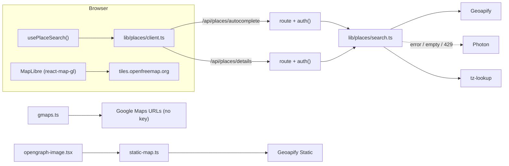

# ย้ายแผนที่และการค้นหาสถานที่ออกจาก Google Maps Platform — Implementation Plan

> **For agentic workers:** REQUIRED SUB-SKILL: Use superpowers:subagent-driven-development (recommended) or superpowers:executing-plans to implement this plan task-by-task. Steps use checkbox (`- [ ]`) syntax for tracking.

**Goal:** เลิกใช้ Google Maps Platform ทุกตัวที่ต้องใช้ billing (Maps JS, Places, Static Maps) แล้วเปลี่ยนไปใช้ Stack A จากรายงาน research ซึ่งไม่มีค่าใช้จ่ายและไม่ต้องใช้บัตร โดยที่ทุกหน้าที่มีแผนที่และช่องค้นหายังใช้งานได้เหมือนเดิม

**Architecture:**
- **ค้นหาสถานที่:** browser ไม่เรียก provider ตรงอีกต่อไป เรียกผ่าน route ของเราเอง `/api/places/*` ฝั่ง server เรียก **Geoapify** เป็นหลัก ถ้า Geoapify ล่ม โควตาหมด หรือค้นไม่เจอ ให้ fallback ไป **Photon** (ข้อมูล OSM)
- **Timezone:** server คำนวณให้ด้วย `@photostructure/tz-lookup`
- **แผนที่:** เปลี่ยนเป็น **MapLibre** (`react-map-gl/maplibre`) ใช้ tiles จาก **OpenFreeMap**
- **รูปแผนที่สำหรับ OG:** เปลี่ยนไปใช้ **Geoapify Static Maps**
- **ปุ่ม "เปิดใน Google Maps":** ใช้ Google Maps URLs ต่อเหมือนเดิม แต่จะส่ง `place_id` ให้ Google เฉพาะแถวที่เป็น Google place ID จริงเท่านั้น
- **แยก provider ของ place ID:** ใช้ prefix ใน `placeIdExternal` แทนการเพิ่มคอลัมน์ จึงไม่ต้อง migrate DB
  - ไม่มี prefix = Google (ข้อมูลเก่า)
  - `geoapify:<id>`
  - `osm:<N|W|R><id>`

**Tech Stack:** Next.js 16.2.4 App Router · React 19 · vitest 3 · pnpm · `maplibre-gl` · `react-map-gl` (v8, path `react-map-gl/maplibre`) · `@photostructure/tz-lookup` · Geoapify Geocoding Autocomplete v1 / Place Details v2 / Static Maps v1 · Photon (`photon.komoot.io`)

**Spec:** [docs/research/2026-10-15-maps-provider-alternatives.md](../../research/2026-10-15-maps-provider-alternatives.md), ใช้ §1 Stack A, §2 สิ่งที่แอปใช้อยู่ และ §7 ผลกระทบต่อ codebase

## การตัดสินใจที่ใช้ในแผนนี้ (ผู้ใช้สั่งว่า "ทำตามที่แนะนำ")

| # | เรื่อง | ตัดสินใจ | เหตุผล |
|---|---|---|---|
| D1 | วิธีแยก provider ของ place ID | ใช้ **prefix** ใน `placeIdExternal` | Google place ID ไม่มีเครื่องหมาย `:` อยู่แล้ว จึงไม่ต้อง migrate DB และ API v1 กับ MCP ไม่ต้องเปลี่ยน |
| D2 | แถวเก่าที่มาจาก Google | **เก็บไว้ตามเดิม** | ไม่ re-geocode ใหม่ ความเสี่ยงด้าน ToS ต่ำมาก (§7.8) และยังทำทีหลังได้ |
| D3 | rating / reviews | สถานที่ที่เพิ่มใหม่จะเป็น `null` | OSM ไม่มีข้อมูลนี้ และคอลัมน์ใน DB เป็น nullable อยู่แล้ว |
| D4 | รูปแบบ opening hours | เก็บ string `opening_hours` ของ OSM ตรงๆ | OSM คั่นแต่ละช่วงด้วย `; ` อยู่แล้ว ตรงกับรูปแบบที่คอลัมน์ `hours` ใช้ |
| D5 | ภาษาของผลค้นหา | query มีตัวอักษรไทย → `lang=th` ไม่มี → `lang=en` | ค่าเดียวใช้กับทริปไทยและญี่ปุ่นได้ไม่ดี |
| D6 | bias ของผลค้นหา | `bias=countrycode:th` แบบคงที่ | เป็นแค่ bias ไม่ใช่ filter ประเทศอื่นยังค้นเจอ ส่วนการ bias ตามตำแหน่งของทริปเก็บไว้เป็นงานต่อ |
| D7 | timezone | server คำนวณ IANA zone จาก lat/lng ส่วน client แปลงเป็น offset ด้วย `Intl` | ไม่ต้องส่งข้อมูล tz ขนาด 88 KB ไปที่ browser |
| D8 | key ของ Geoapify | ใช้ฝั่ง server อย่างเดียว ชื่อ `GEOAPIFY_API_KEY` | key ไม่หลุดไปที่ browser และ route ของเราตรวจ session ก่อนเรียกทุกครั้ง |
| D9 | ไม่อยู่ในแผนนี้ | Overture (A+), การวางลิงก์ Google Maps, คำนวณ routing อัตโนมัติ, แผน MCP TP-0035 | แยกเป็น ticket ต่อ ดู §ท้ายแผน |

## Global Constraints

- **รันคำสั่ง:**
  - Package manager คือ **pnpm** ทุกคำสั่งรันจาก `app/`
  - Test: `pnpm test` · Typecheck: `pnpm typecheck` · Lint: `pnpm lint` · Build: `pnpm build`
  - ตอน verify ให้ดูแค่ 3 บรรทัดสุดท้ายของ output
- **Worktree:** เขียนโค้ดใน worktree ที่แตกมาจาก `origin/main` ล่าสุด `git worktree add ../travel-planner-v2-maps-off-google -b feat/maps-off-google origin/main`
- **PM ticket:** สร้าง ticket ก่อนเริ่มเขียนโค้ด ด้วย `pm` ในโปรเจกต์ `MgX5zmszbzrL` ใส่ path ของแผนนี้ใน ticket แล้วใส่เลข `TP-xxxx` ในทุก commit
- **Route handler:** ทุก route ที่ใช้ `@/lib/auth` ต้องตั้ง `export const runtime = 'nodejs'`
- **Comment:** เขียนน้อย ใส่เฉพาะเหตุผลที่อ่านจากโค้ดไม่ออก (ตาม Conventions ใน `AGENTS.md`)
- **REQUIREMENTS.md:** ถ้า shape ของ entity เปลี่ยน ต้องแก้ §4 ใน PR เดียวกัน ในแผนนี้ความหมายของ `place_id_external` เปลี่ยน
- **การเรียก upstream:** ทุกครั้งที่เรียก Geoapify หรือ Photon ต้องมี `AbortSignal.timeout(4000)` และต้องไม่ throw ออกไปถึง UI
- **Attribution:** แผนที่ต้องแสดง attribution ของ OSM/OpenFreeMap ซึ่ง control ของ MapLibre ใส่ให้อยู่แล้ว ห้ามปิด dropdown ผลค้นหาต้องมีบรรทัด "Powered by Geoapify" เพราะเป็นเงื่อนไขของ free plan

## Review Focus

1. **พิมพ์ไทยปนอังกฤษ** เช่น "ร้าน Ristr8to": มีตัวอักษรไทยจึงต้องได้ `lang=th` และผลต้องไม่ว่าง ทดสอบใน Task 4
2. **Geoapify ตอบ 429 หรือโควตาหมด:** dropdown ต้องยังมีผลจาก Photon และไม่มี error หลุดไปถึงผู้ใช้ ทดสอบใน Task 4
3. **แถวเก่าที่เป็น Google ID เทียบกับแถวใหม่:** แถวเก่าต้องได้ `query_place_id` แถวใหม่ (`geoapify:`/`osm:`) ต้องไม่ได้ และต้องใช้ `lat,lng` แทน ทดสอบใน Task 1
4. **พิมพ์เร็วแล้ว response กลับมาไม่ตามลำดับ:** ผลของคำค้นเก่าต้องไม่ทับผลของคำค้นใหม่ ป้องกันด้วย AbortController ทดสอบใน Task 6
5. **แผนที่ถูกซ่อน (`display:none`) ตอนออกจากหน้า itinerary แล้วกลับมา:** แผนที่ต้องเต็มกรอบ ไม่ใช่ขนาด 0×0 ตรวจด้วยมือใน Task 8 และ Task 11

---

## 0. Evidence

| # | ข้อเท็จจริง | หลักฐาน |
|---|---|---|
| E1 | ไม่มีการใช้ Routes API แล้ว และไฟล์ `lib/routes-server.ts` ไม่มีอยู่ | `ls app/src/lib/routes-server.ts` → not found |
| E2 | ส่ง `placeIdExternal` เป็น `query_place_id`/`origin_place_id` ทุกกรณี | `app/src/lib/gmaps.ts:27-38,61-63` |
| E3 | มี 5 picker ที่เรียก Google Places ตรงจาก browser | `place-search-picker.tsx:72`, `place-autocomplete.tsx:102`, `hotel-place-picker.tsx:79`, `hotel-search-picker.tsx:60`, `transport-place-picker.tsx:87` |
| E4 | มีแผนที่สำหรับคลิกปักหมุด 3 จุดที่โค้ดซ้ำกัน | `place-manual-form.tsx:188-214`, `hotel-manual-form.tsx:181-206`, `hotel-edit-modal.tsx:251-276` |
| E5 | มีการห่อ `MapsProvider` ไว้ใน form | `hotel-form-client.tsx:217,518`, `transport-form-client.tsx:249,481` |
| E6 | static map มีฟังก์ชันเดียว คือ `fetchStaticMapDataUri(points)` | `app/trip/[id]/opengraph-image.tsx:134` |
| E7 | ไม่มีการตั้ง CSP ไว้ จึงไม่ต้องเพิ่ม host ของ tiles | `app/next.config.ts` |
| E8 | ใช้ `utc_offset_minutes` คำนวณเวลาถึงที่หมายข้าม timezone | `transport-form-client.tsx:195-218` |
| E9 | OpenFreeMap ไม่ต้องใช้ key และมี style liberty/dark | research §4 [1] |
| E10 | Geoapify ฟรี 3,000 credits/วัน, ToS อนุญาตให้ cache และเก็บผลถาวร, free plan ต้องแสดง attribution | research §4 [15][18] |

## File Structure

**สร้างใหม่ (`app/src/`)**

| ไฟล์ | หน้าที่ |
|---|---|
| `lib/places/types.ts` | `Kind`, `PlaceSuggestion`, `PlaceDetail` |
| `lib/places/place-id.ts` | `placeProvider()`, `isGooglePlaceId()` |
| `lib/places/lang.ts` | `queryLang()` |
| `lib/places/kind.ts` | `kindFromCategories()` (Geoapify), `kindFromOsm()` (Photon) |
| `lib/places/utc-offset.ts` | `utcOffsetMinutes(tz, at)` ใช้ `Intl` ใช้ได้ทั้ง client และ server |
| `lib/places/tz-lookup.ts` | `timeZoneAt(lat, lng)` ใช้ฝั่ง server เท่านั้น |
| `lib/places/geoapify.ts` | parser และฟังก์ชันเรียก autocomplete/details |
| `lib/places/photon.ts` | parser และฟังก์ชันเรียก Photon |
| `lib/places/search.ts` | `searchPlaces()`, `getPlaceDetail()` รวม fallback และเติม tz (server) |
| `lib/places/client.ts` | `fetchSuggestions()`, `resolvePlace()` (browser) |
| `components/use-place-search.ts` | hook ที่จัดการ debounce, abort และเก็บ state ของผลค้นหา |
| `components/search-attribution.tsx` | บรรทัด "Powered by Geoapify" |
| `app/api/places/autocomplete/route.ts` | `GET ?q=` |
| `app/api/places/details/route.ts` | `GET ?id=&lang=` |
| `lib/map-style.ts` | `mapStyleUrl(theme)` |
| `components/pin-picker-map.tsx` | แผนที่คลิกปักหมุด ใช้ร่วมกันทั้ง 3 ฟอร์ม |

**แก้:** `lib/gmaps.ts`, `lib/static-map.ts`, `lib/map-helpers.ts`, `components/{real-map-canvas,map-active-focus,persistent-map,place-search-picker,place-autocomplete,hotel-place-picker,hotel-search-picker,transport-place-picker,place-preview-modal,hotel-preview-modal,place-manual-form,hotel-manual-form,hotel-edit-modal,hotel-form-client,transport-form-client,place-form}.tsx`, `app/.env.example`, docs

**ลบ:** `components/maps-provider.tsx`, `lib/maps-config.ts`, `lib/place-details.ts`, `lib/places-adapter.ts`, `lib/places-adapter.test.ts`



---

### Task 0: เตรียมงาน

- [ ] **Step 1: สร้าง worktree**

```bash
cd ~/development/travel-planner-v2
git fetch origin
git worktree add ../travel-planner-v2-maps-off-google -b feat/maps-off-google origin/main
cd ../travel-planner-v2-maps-off-google/app && pnpm install
```

- [ ] **Step 2: สร้าง PM ticket** ใช้ skill `project-manager-cli`
  - ชื่อ: "Move maps + place search off Google Maps Platform"
  - ใส่ link ของแผนนี้
  - assignee `Claude`
  - ย้าย ticket ไปที่ `doing`
  - จดเลข `TP-xxxx` ไว้ใช้ใน commit

- [ ] **Step 3: ติดตั้ง dependency** (pin เวอร์ชันที่ได้ตอนติดตั้งจริง)

```bash
pnpm add maplibre-gl react-map-gl @photostructure/tz-lookup
```

- [ ] **Step 4: ขอ Geoapify key** (ผู้ใช้ทำเอง เพราะ agent ห้ามสมัครบริการ)
  1. ผู้ใช้สมัครที่ https://myprojects.geoapify.com แล้วสร้าง project ใหม่ (ไม่ต้องใส่บัตร)
  2. ใส่ key ใน `app/.env.local`: `GEOAPIFY_API_KEY="..."`

- [ ] **Step 5: เก็บ response จริงไว้ตรวจ parser** (ต้องมี key)

```bash
mkdir -p src/lib/places/__fixtures__
K=$(grep GEOAPIFY_API_KEY .env.local | cut -d'"' -f2)
curl -s "https://api.geoapify.com/v1/geocode/autocomplete?text=%E0%B8%95%E0%B8%A5%E0%B8%B2%E0%B8%94%E0%B8%99%E0%B9%89%E0%B8%B3%E0%B8%AD%E0%B8%B1%E0%B8%A1%E0%B8%9E%E0%B8%A7%E0%B8%B2&lang=th&limit=5&format=json&bias=countrycode:th&apiKey=$K" > src/lib/places/__fixtures__/geoapify-autocomplete.json
ID=$(node -e "console.log(require('./src/lib/places/__fixtures__/geoapify-autocomplete.json').results[0].place_id)")
curl -s "https://api.geoapify.com/v2/place-details?id=$ID&features=details&lang=th&apiKey=$K" > src/lib/places/__fixtures__/geoapify-details.json
curl -s "https://photon.komoot.io/api/?q=Ristr8to&limit=5" > src/lib/places/__fixtures__/photon.json
```

  เปิดไฟล์ทั้งสามแล้วตรวจชื่อ field ที่ parser ใน Task 3 ใช้ ได้แก่ `results[].place_id/name/address_line2/formatted/lat/lon/category/categories/timezone.name`, `features[].properties.{feature_type,categories,contact.phone,website,opening_hours}` และ `features[].properties.{osm_type,osm_id,osm_key,osm_value}` ถ้าชื่อไม่ตรง ให้แก้ type ใน Task 3 ตามของจริง แล้วจดไว้ใน PR

---

### Task 1: แยก provider ของ place ID + ทำให้ `gmaps.ts` เลือกส่ง place_id ตาม provider

**Files:**
- Create: `app/src/lib/places/place-id.ts`, `app/src/lib/places/types.ts`
- Modify: `app/src/lib/gmaps.ts`
- Test: `app/src/lib/places/place-id.test.ts`, `app/src/lib/gmaps.test.ts`

**Interfaces:**
- Produces: `type PlaceProvider = 'google' | 'geoapify' | 'osm'`; `placeProvider(id: string | null | undefined): PlaceProvider | null`; `isGooglePlaceId(id): boolean`; `type Kind`, `type PlaceSuggestion`, `type PlaceDetail`

- [ ] **Step 1: เขียน types** (ยังไม่มี test)

```ts
// app/src/lib/places/types.ts
export type Kind = 'hotel' | 'food' | 'sight' | 'transit';

export type PlaceSuggestion = {
  id: string; // provider-prefixed, see place-id.ts
  name: string;
  secondary: string | null;
  address: string | null;
  lat: number;
  lng: number;
  kind: Kind;
  timeZone: string | null; // IANA
};

export type PlaceDetail = PlaceSuggestion & {
  phone: string | null;
  website: string | null;
  hours: string | null;
};
```

- [ ] **Step 2: เขียน test ที่ยังไม่ผ่าน**

```ts
// app/src/lib/places/place-id.test.ts
import { describe, expect, it } from 'vitest';
import { isGooglePlaceId, placeProvider } from './place-id';

describe('placeProvider', () => {
  it('treats a bare id as a legacy Google place_id', () => {
    expect(placeProvider('ChIJN1t_tDeuEmsRUsoyG83frY4')).toBe('google');
  });
  it('reads known prefixes', () => {
    expect(placeProvider('geoapify:51a1b2')).toBe('geoapify');
    expect(placeProvider('osm:N123456')).toBe('osm');
  });
  it('returns null for empty or unknown prefixes', () => {
    expect(placeProvider(null)).toBeNull();
    expect(placeProvider('')).toBeNull();
    expect(placeProvider('here:abc')).toBeNull();
  });
  it('isGooglePlaceId', () => {
    expect(isGooglePlaceId('ChIJabc')).toBe(true);
    expect(isGooglePlaceId('geoapify:abc')).toBe(false);
    expect(isGooglePlaceId(undefined)).toBe(false);
  });
});
```

```ts
// app/src/lib/gmaps.test.ts
import { describe, expect, it } from 'vitest';
import { gmapsDirectionsUrl, gmapsSearchUrl } from './gmaps';

const legacy = { name: 'Wat Pho', lat: 13.7465, lng: 100.4927, placeIdExternal: 'ChIJabc' };
const geo = { name: 'Ristr8to', lat: 18.7999, lng: 98.9676, placeIdExternal: 'geoapify:51ff' };
const manual = { name: 'Pin', lat: 13.1, lng: 100.2, placeIdExternal: null };

describe('gmapsSearchUrl', () => {
  it('passes query_place_id for legacy Google ids', () => {
    expect(gmapsSearchUrl(legacy)).toContain('query_place_id=ChIJabc');
  });
  it('uses coordinates and no place id for non-Google ids', () => {
    const u = gmapsSearchUrl(geo);
    expect(u).not.toContain('query_place_id');
    expect(u).toContain(`query=${encodeURIComponent('18.7999,98.9676')}`);
  });
  it('uses coordinates for manual pins', () => {
    expect(gmapsSearchUrl(manual)).toContain(encodeURIComponent('13.1,100.2'));
  });
});

describe('gmapsDirectionsUrl', () => {
  it('only sends place ids that are Google ids', () => {
    const u = gmapsDirectionsUrl([legacy, geo]);
    expect(u).toContain('origin_place_id=ChIJabc');
    expect(u).not.toContain('destination_place_id');
    expect(u).toContain(`destination=${encodeURIComponent('18.7999,98.9676')}`);
  });
  it('omits waypoint_place_ids when any waypoint is non-Google', () => {
    const u = gmapsDirectionsUrl([legacy, geo, legacy]);
    expect(u).not.toContain('waypoint_place_ids');
  });
});
```

- [ ] **Step 3: รัน test ให้เห็นว่าไม่ผ่าน**: `pnpm test src/lib/places/place-id.test.ts src/lib/gmaps.test.ts` ต้อง FAIL เพราะยังไม่มี `./place-id` และ gmaps ยังส่ง `geoapify:51ff` เป็น place id

- [ ] **Step 4: เขียนโค้ดให้ผ่าน**

```ts
// app/src/lib/places/place-id.ts
export type PlaceProvider = 'google' | 'geoapify' | 'osm';

// Legacy rows hold bare Google place_ids (which never contain ':'); every
// other provider is stored as "<provider>:<id>" so deep links can tell them apart.
export function placeProvider(id: string | null | undefined): PlaceProvider | null {
  if (!id) return null;
  const i = id.indexOf(':');
  if (i === -1) return 'google';
  const p = id.slice(0, i);
  return p === 'geoapify' || p === 'osm' ? p : null;
}

export function isGooglePlaceId(id: string | null | undefined): boolean {
  return placeProvider(id) === 'google';
}
```

ใน `app/src/lib/gmaps.ts`:
- เพิ่ม `import { isGooglePlaceId } from './places/place-id';`
- เพิ่ม helper `const googleId = (p: Place) => (isGooglePlaceId(p.placeIdExternal) ? p.placeIdExternal! : null);`
- ใน `enc`: เปลี่ยน `!p.placeIdExternal && p.lat != null && p.lng != null` เป็น `!googleId(p) && p.lat != null && p.lng != null`
- `placeIdOf`: เปลี่ยนเป็น `const id = googleId(p); return id ? encodeURIComponent(id) : null;`
- ใน `gmapsSearchUrl`: `const gid = googleId(p);` แล้วใช้ `!gid && hasCoords` และ `if (gid) url += \`&query_place_id=${encodeURIComponent(gid)}\``
- แก้ doc comment ให้บอกว่า place_id ใช้เฉพาะ id ของ Google

- [ ] **Step 5: รัน test ให้ผ่าน**: `pnpm test src/lib/places/place-id.test.ts src/lib/gmaps.test.ts` → PASS

- [ ] **Step 6: Commit** `feat(places): provider-prefixed place ids; deep links send place_id only for Google ids [TP-xxxx]`

---

### Task 2: utility ด้านภาษา, kind และ timezone

**Files:**
- Create: `app/src/lib/places/{lang,kind,utc-offset,tz-lookup}.ts`
- Test: `app/src/lib/places/{lang,kind,utc-offset,tz-lookup}.test.ts`

**Interfaces:**
- Produces:
  - `queryLang(q: string): 'th' | 'en'`
  - `kindFromCategories(cats: readonly string[]): Kind`
  - `kindFromOsm(key?: string, value?: string): Kind`
  - `utcOffsetMinutes(timeZone: string, at?: Date): number | null`
  - `timeZoneAt(lat: number, lng: number): string | null`

- [ ] **Step 1: เขียน test ที่ยังไม่ผ่าน**

```ts
// app/src/lib/places/lang.test.ts
import { describe, expect, it } from 'vitest';
import { queryLang } from './lang';

describe('queryLang', () => {
  it('th when any Thai character is present', () => {
    expect(queryLang('ตลาดน้ำอัมพวา')).toBe('th');
    expect(queryLang('ร้าน Ristr8to')).toBe('th');
  });
  it('en otherwise', () => {
    expect(queryLang('Senso-ji')).toBe('en');
    expect(queryLang('浅草寺')).toBe('en');
  });
});
```

```ts
// app/src/lib/places/kind.test.ts
import { describe, expect, it } from 'vitest';
import { kindFromCategories, kindFromOsm } from './kind';

describe('kindFromCategories', () => {
  it.each([
    [['accommodation.hotel'], 'hotel'],
    [['catering.cafe'], 'food'],
    [['catering'], 'food'],
    [['airport'], 'transit'],
    [['public_transport.train'], 'transit'],
    [['tourism.sights', 'religion.place_of_worship'], 'sight'],
    [[], 'sight'],
  ])('%j → %s', (cats, kind) => {
    expect(kindFromCategories(cats)).toBe(kind);
  });
  it('does not match a prefix inside another word', () => {
    expect(kindFromCategories(['cateringx'])).toBe('sight');
  });
});

describe('kindFromOsm', () => {
  it.each([
    ['tourism', 'hotel', 'hotel'],
    ['tourism', 'guest_house', 'hotel'],
    ['amenity', 'cafe', 'food'],
    ['shop', 'bakery', 'food'],
    ['aeroway', 'aerodrome', 'transit'],
    ['railway', 'station', 'transit'],
    ['amenity', 'bus_station', 'transit'],
    ['historic', 'temple', 'sight'],
    [undefined, undefined, 'sight'],
  ])('%s=%s → %s', (k, v, kind) => {
    expect(kindFromOsm(k, v)).toBe(kind);
  });
});
```

```ts
// app/src/lib/places/utc-offset.test.ts
import { describe, expect, it } from 'vitest';
import { utcOffsetMinutes } from './utc-offset';

describe('utcOffsetMinutes', () => {
  it('fixed-offset zones', () => {
    expect(utcOffsetMinutes('Asia/Bangkok')).toBe(420);
    expect(utcOffsetMinutes('Asia/Tokyo')).toBe(540);
    expect(utcOffsetMinutes('Asia/Kolkata')).toBe(330);
    expect(utcOffsetMinutes('UTC')).toBe(0);
  });
  it('honours DST at the given instant', () => {
    expect(utcOffsetMinutes('America/New_York', new Date('2026-01-15T12:00:00Z'))).toBe(-300);
    expect(utcOffsetMinutes('America/New_York', new Date('2026-07-15T12:00:00Z'))).toBe(-240);
  });
  it('null for an unknown zone', () => {
    expect(utcOffsetMinutes('Not/AZone')).toBeNull();
  });
});
```

```ts
// app/src/lib/places/tz-lookup.test.ts
import { describe, expect, it } from 'vitest';
import { timeZoneAt } from './tz-lookup';

describe('timeZoneAt', () => {
  it('resolves airports', () => {
    expect(timeZoneAt(13.69, 100.75)).toBe('Asia/Bangkok'); // BKK
    expect(timeZoneAt(35.55, 139.78)).toBe('Asia/Tokyo'); // HND
  });
  it('null for invalid coordinates', () => {
    expect(timeZoneAt(999, 0)).toBeNull();
  });
});
```

- [ ] **Step 2: รัน test ให้เห็นว่าไม่ผ่าน**: `pnpm test src/lib/places` ต้อง FAIL เพราะยังไม่มี module เหล่านี้

- [ ] **Step 3: เขียนโค้ดให้ผ่าน**

```ts
// app/src/lib/places/lang.ts
const THAI = /[฀-๿]/;

export function queryLang(q: string): 'th' | 'en' {
  return THAI.test(q) ? 'th' : 'en';
}
```

```ts
// app/src/lib/places/kind.ts
import type { Kind } from './types';

export function kindFromCategories(cats: readonly string[]): Kind {
  const has = (root: string) => cats.some((c) => c === root || c.startsWith(`${root}.`));
  if (has('accommodation')) return 'hotel';
  if (has('catering')) return 'food';
  if (has('airport') || has('public_transport')) return 'transit';
  return 'sight';
}

const HOTEL = new Set(['hotel', 'hostel', 'guest_house', 'motel', 'apartment', 'resort', 'chalet']);
const FOOD = new Set(['restaurant', 'cafe', 'bar', 'pub', 'fast_food', 'food_court', 'ice_cream', 'bakery']);
const TRANSIT_KEYS = new Set(['aeroway', 'railway', 'public_transport']);
const TRANSIT_VALUES = new Set(['aerodrome', 'terminal', 'station', 'halt', 'bus_station', 'ferry_terminal']);

export function kindFromOsm(key?: string, value?: string): Kind {
  if (!key || !value) return 'sight';
  if (key === 'tourism' && HOTEL.has(value)) return 'hotel';
  if ((key === 'amenity' || key === 'shop') && FOOD.has(value)) return 'food';
  if (TRANSIT_VALUES.has(value) && (TRANSIT_KEYS.has(key) || key === 'amenity')) return 'transit';
  return 'sight';
}
```

```ts
// app/src/lib/places/utc-offset.ts
const OFFSET = /^GMT([+-])(\d{2}):(\d{2})$/;

export function utcOffsetMinutes(timeZone: string, at: Date = new Date()): number | null {
  try {
    const name = new Intl.DateTimeFormat('en-US', { timeZone, timeZoneName: 'longOffset' })
      .formatToParts(at)
      .find((p) => p.type === 'timeZoneName')?.value;
    if (!name) return null;
    if (name === 'GMT') return 0;
    const m = OFFSET.exec(name);
    if (!m) return null;
    const mins = Number(m[2]) * 60 + Number(m[3]);
    return m[1] === '-' ? -mins : mins;
  } catch {
    return null;
  }
}
```

```ts
// app/src/lib/places/tz-lookup.ts
import 'server-only';
import tzlookup from '@photostructure/tz-lookup';

export function timeZoneAt(lat: number, lng: number): string | null {
  try {
    return tzlookup(lat, lng);
  } catch {
    return null;
  }
}
```

- [ ] **Step 4: รัน test ให้ผ่าน**: `pnpm test src/lib/places` → PASS

- [ ] **Step 5: Commit** `feat(places): lang, kind and timezone helpers [TP-xxxx]`

---

### Task 3: parser และฟังก์ชันเรียก Geoapify และ Photon

**Files:**
- Create: `app/src/lib/places/geoapify.ts`, `app/src/lib/places/photon.ts`
- Test: `app/src/lib/places/geoapify.test.ts`, `app/src/lib/places/photon.test.ts`

**Interfaces:**
- Consumes: `kindFromCategories`, `kindFromOsm`, `PlaceSuggestion`, `PlaceDetail`
- Produces:
  - `parseGeoapifyAutocomplete(json: unknown): PlaceSuggestion[]`
  - `parseGeoapifyDetails(json: unknown): PlaceDetail | null`
  - `geoapifyAutocomplete(text, { key, lang, fetchImpl?, limit? }): Promise<PlaceSuggestion[]>`
  - `geoapifyDetails(rawId, { key, lang, fetchImpl? }): Promise<PlaceDetail | null>`
  - `parsePhoton(json: unknown): PlaceSuggestion[]`
  - `photonSearch(q, { fetchImpl?, limit? }): Promise<PlaceSuggestion[]>`
  - ทุกฟังก์ชันที่เรียก upstream **throw เมื่อได้ status ที่ไม่ใช่ 2xx** แล้วให้ `search.ts` เป็นตัวจัดการ

- [ ] **Step 1: เขียน test ที่ยังไม่ผ่าน**

```ts
// app/src/lib/places/geoapify.test.ts
import { readFileSync, existsSync } from 'node:fs';
import { describe, expect, it, vi } from 'vitest';
import { geoapifyAutocomplete, parseGeoapifyAutocomplete, parseGeoapifyDetails } from './geoapify';

const auto = {
  results: [
    {
      place_id: '51abc', name: 'ตลาดน้ำอัมพวา', address_line1: 'ตลาดน้ำอัมพวา',
      address_line2: 'อัมพวา, สมุทรสงคราม, ประเทศไทย', formatted: 'ตลาดน้ำอัมพวา, อัมพวา, สมุทรสงคราม',
      lat: 13.4253, lon: 99.9553, category: 'commercial.marketplace', timezone: { name: 'Asia/Bangkok' },
    },
    { place_id: '51def', formatted: 'Amphawa, Samut Songkhram', address_line1: 'Amphawa', lat: 13.42, lon: 99.95 },
    { place_id: 'bad', name: 'no coords' },
  ],
};

describe('parseGeoapifyAutocomplete', () => {
  it('maps results, prefixes ids, drops rows without coordinates', () => {
    const r = parseGeoapifyAutocomplete(auto);
    expect(r).toHaveLength(2);
    expect(r[0]).toEqual({
      id: 'geoapify:51abc', name: 'ตลาดน้ำอัมพวา', secondary: 'อัมพวา, สมุทรสงคราม, ประเทศไทย',
      address: 'ตลาดน้ำอัมพวา, อัมพวา, สมุทรสงคราม', lat: 13.4253, lng: 99.9553, kind: 'sight',
      timeZone: 'Asia/Bangkok',
    });
    expect(r[1].name).toBe('Amphawa');
    expect(r[1].timeZone).toBeNull();
  });
  it('tolerates garbage', () => {
    expect(parseGeoapifyAutocomplete(null)).toEqual([]);
    expect(parseGeoapifyAutocomplete({ results: 'x' })).toEqual([]);
  });
});

describe('parseGeoapifyDetails', () => {
  it('reads the details feature', () => {
    const d = parseGeoapifyDetails({
      features: [
        { properties: { feature_type: 'building', place_id: 'zzz', lat: 1, lon: 1 } },
        {
          properties: {
            feature_type: 'details', place_id: '51abc', name: 'Ristr8to', formatted: 'Nimman, Chiang Mai',
            address_line2: 'Chiang Mai', lat: 18.8, lon: 98.97, categories: ['catering.cafe'],
            website: 'https://ristr8to.com', contact: { phone: '+66 53 215 278' },
            opening_hours: 'Mo-Su 07:00-18:00', timezone: { name: 'Asia/Bangkok' },
          },
        },
      ],
    });
    expect(d).toMatchObject({
      id: 'geoapify:51abc', name: 'Ristr8to', kind: 'food', phone: '+66 53 215 278',
      website: 'https://ristr8to.com', hours: 'Mo-Su 07:00-18:00', lat: 18.8, lng: 98.97,
    });
  });
  it('null when nothing usable', () => {
    expect(parseGeoapifyDetails({ features: [] })).toBeNull();
  });
});

describe('geoapifyAutocomplete', () => {
  it('sends lang, bias and key; throws on non-2xx', async () => {
    const fetchImpl = vi.fn(async () => new Response(JSON.stringify(auto)));
    await geoapifyAutocomplete('อัมพวา', { key: 'K', lang: 'th', fetchImpl });
    const url = new URL(String(fetchImpl.mock.calls[0][0]));
    expect(url.origin + url.pathname).toBe('https://api.geoapify.com/v1/geocode/autocomplete');
    expect(url.searchParams.get('lang')).toBe('th');
    expect(url.searchParams.get('bias')).toBe('countrycode:th');
    expect(url.searchParams.get('format')).toBe('json');
    expect(url.searchParams.get('apiKey')).toBe('K');

    const failing = vi.fn(async () => new Response('quota', { status: 429 }));
    await expect(geoapifyAutocomplete('x', { key: 'K', lang: 'en', fetchImpl: failing })).rejects.toThrow('429');
  });
});

// Real captured responses (Task 0 Step 5). Structural only — content drifts.
const fx = (f: string) => new URL(`./__fixtures__/${f}`, import.meta.url);
describe.runIf(existsSync(fx('geoapify-autocomplete.json')))('live fixtures', () => {
  it('autocomplete fixture parses to usable rows', () => {
    const r = parseGeoapifyAutocomplete(JSON.parse(readFileSync(fx('geoapify-autocomplete.json'), 'utf8')));
    expect(r.length).toBeGreaterThan(0);
    for (const s of r) expect(Number.isFinite(s.lat) && s.id.startsWith('geoapify:')).toBe(true);
  });
  it('details fixture parses', () => {
    expect(parseGeoapifyDetails(JSON.parse(readFileSync(fx('geoapify-details.json'), 'utf8')))).not.toBeNull();
  });
});
```

```ts
// app/src/lib/places/photon.test.ts
import { readFileSync, existsSync } from 'node:fs';
import { describe, expect, it, vi } from 'vitest';
import { parsePhoton, photonSearch } from './photon';

const sample = {
  features: [
    {
      geometry: { coordinates: [98.9676, 18.7999] },
      properties: {
        osm_type: 'N', osm_id: 123, osm_key: 'amenity', osm_value: 'cafe', name: 'Ristr8to',
        street: 'Nimmanahaeminda Road', city: 'Chiang Mai', country: 'Thailand',
      },
    },
    { geometry: { coordinates: [1, 1] }, properties: { osm_type: 'W', osm_id: 9 } },
  ],
};

describe('parsePhoton', () => {
  it('maps named features with osm ids', () => {
    const r = parsePhoton(sample);
    expect(r).toEqual([
      {
        id: 'osm:N123', name: 'Ristr8to', secondary: 'Nimmanahaeminda Road, Chiang Mai, Thailand',
        address: 'Ristr8to, Nimmanahaeminda Road, Chiang Mai, Thailand', lat: 18.7999, lng: 98.9676,
        kind: 'food', timeZone: null,
      },
    ]);
  });
  it('tolerates garbage', () => {
    expect(parsePhoton(undefined)).toEqual([]);
  });
});

describe('photonSearch', () => {
  it('throws on non-2xx', async () => {
    const fetchImpl = vi.fn(async () => new Response('', { status: 503 }));
    await expect(photonSearch('x', { fetchImpl })).rejects.toThrow('503');
  });
});

const fx = new URL('./__fixtures__/photon.json', import.meta.url);
describe.runIf(existsSync(fx))('live fixture', () => {
  it('parses', () => {
    expect(parsePhoton(JSON.parse(readFileSync(fx, 'utf8'))).length).toBeGreaterThan(0);
  });
});
```

- [ ] **Step 2: รัน test ให้เห็นว่าไม่ผ่าน**: `pnpm test src/lib/places/geoapify.test.ts src/lib/places/photon.test.ts` ต้อง FAIL

- [ ] **Step 3: เขียนโค้ดให้ผ่าน**

```ts
// app/src/lib/places/geoapify.ts
import { kindFromCategories } from './kind';
import type { PlaceDetail, PlaceSuggestion } from './types';

const BASE = 'https://api.geoapify.com';
// Results are allowed to be cached/stored (Geoapify Places FAQ); a month of
// Next data-cache keeps repeat searches off the 3k/day free credits.
const CACHE = { next: { revalidate: 60 * 60 * 24 * 30 } };

type Props = {
  place_id?: string;
  name?: string;
  formatted?: string;
  address_line1?: string;
  address_line2?: string;
  lat?: number;
  lon?: number;
  category?: string;
  categories?: string[];
  timezone?: { name?: string };
  feature_type?: string;
  website?: string;
  contact?: { phone?: string };
  opening_hours?: string;
};

function toSuggestion(r: Props): PlaceSuggestion | null {
  if (!r.place_id || !Number.isFinite(r.lat) || !Number.isFinite(r.lon)) return null;
  const name = r.name ?? r.address_line1 ?? r.formatted;
  if (!name) return null;
  const cats = [...(r.categories ?? []), ...(r.category ? [r.category] : [])];
  return {
    id: `geoapify:${r.place_id}`,
    name,
    secondary: r.address_line2 ?? null,
    address: r.formatted ?? null,
    lat: r.lat!,
    lng: r.lon!,
    kind: kindFromCategories(cats),
    timeZone: r.timezone?.name ?? null,
  };
}

export function parseGeoapifyAutocomplete(json: unknown): PlaceSuggestion[] {
  const results = (json as { results?: unknown } | null)?.results;
  if (!Array.isArray(results)) return [];
  return results.map((r) => toSuggestion(r as Props)).filter((s): s is PlaceSuggestion => s !== null);
}

export function parseGeoapifyDetails(json: unknown): PlaceDetail | null {
  const features = (json as { features?: unknown } | null)?.features;
  if (!Array.isArray(features) || features.length === 0) return null;
  const props = features.map((f) => (f as { properties?: Props }).properties ?? {});
  const p = props.find((x) => x.feature_type === 'details') ?? props[0];
  const base = toSuggestion(p);
  if (!base) return null;
  return {
    ...base,
    phone: p.contact?.phone ?? null,
    website: p.website ?? null,
    hours: p.opening_hours ?? null,
  };
}

type Opts = { key: string; lang: 'th' | 'en'; fetchImpl?: typeof fetch };

async function getJson(url: URL, fetchImpl: typeof fetch): Promise<unknown> {
  const res = await fetchImpl(url, { signal: AbortSignal.timeout(4000), ...CACHE } as RequestInit);
  if (!res.ok) throw new Error(`geoapify ${res.status}`);
  return res.json();
}

export async function geoapifyAutocomplete(
  text: string,
  { key, lang, fetchImpl = fetch, limit = 8 }: Opts & { limit?: number },
): Promise<PlaceSuggestion[]> {
  const url = new URL(`${BASE}/v1/geocode/autocomplete`);
  url.search = new URLSearchParams({
    text, lang, limit: String(limit), format: 'json', bias: 'countrycode:th', apiKey: key,
  }).toString();
  return parseGeoapifyAutocomplete(await getJson(url, fetchImpl));
}

export async function geoapifyDetails(
  rawId: string,
  { key, lang, fetchImpl = fetch }: Opts,
): Promise<PlaceDetail | null> {
  const url = new URL(`${BASE}/v2/place-details`);
  url.search = new URLSearchParams({ id: rawId, features: 'details', lang, apiKey: key }).toString();
  return parseGeoapifyDetails(await getJson(url, fetchImpl));
}
```

```ts
// app/src/lib/places/photon.ts
import { kindFromOsm } from './kind';
import type { PlaceSuggestion } from './types';

type Feature = {
  geometry?: { coordinates?: [number, number] };
  properties?: {
    osm_type?: string; osm_id?: number; osm_key?: string; osm_value?: string; name?: string;
    housenumber?: string; street?: string; district?: string; city?: string; state?: string; country?: string;
  };
};

export function parsePhoton(json: unknown): PlaceSuggestion[] {
  const features = (json as { features?: unknown } | null)?.features;
  if (!Array.isArray(features)) return [];
  const out: PlaceSuggestion[] = [];
  for (const f of features as Feature[]) {
    const p = f.properties ?? {};
    const [lng, lat] = f.geometry?.coordinates ?? [];
    if (!p.name || !p.osm_type || p.osm_id == null || !Number.isFinite(lat) || !Number.isFinite(lng)) continue;
    const street = [p.street, p.housenumber].filter(Boolean).join(' ');
    const secondary = [street, p.district, p.city, p.state, p.country].filter(Boolean).join(', ') || null;
    out.push({
      id: `osm:${p.osm_type}${p.osm_id}`,
      name: p.name,
      secondary,
      address: secondary ? `${p.name}, ${secondary}` : p.name,
      lat: lat!,
      lng: lng!,
      kind: kindFromOsm(p.osm_key, p.osm_value),
      timeZone: null,
    });
  }
  return out;
}

export async function photonSearch(
  q: string,
  { fetchImpl = fetch, limit = 8 }: { fetchImpl?: typeof fetch; limit?: number } = {},
): Promise<PlaceSuggestion[]> {
  const url = new URL('https://photon.komoot.io/api/');
  url.search = new URLSearchParams({ q, limit: String(limit) }).toString();
  const res = await fetchImpl(url, {
    signal: AbortSignal.timeout(4000),
    headers: { 'User-Agent': 'travel-planner-v2' },
    next: { revalidate: 60 * 60 * 24 * 30 },
  } as RequestInit);
  if (!res.ok) throw new Error(`photon ${res.status}`);
  return parsePhoton(await res.json());
}
```

- [ ] **Step 4: รัน test ให้ผ่าน**: `pnpm test src/lib/places` → PASS รวม live fixtures ด้วย ถ้า fixture ไม่ผ่าน ให้แก้ `Props`/`Feature` ตามของจริง แล้วรันใหม่

- [ ] **Step 5: Commit** `feat(places): Geoapify + Photon clients and parsers [TP-xxxx]`
  - commit fixture ไปด้วย ก่อน commit ให้ตรวจว่าใน fixture ไม่มี `apiKey` ติดอยู่: `grep -l apiKey src/lib/places/__fixtures__/*` ต้องไม่เจอไฟล์ไหนเลย

---

### Task 4: service ฝั่ง server ที่รวม fallback และเติม timezone

**Files:**
- Create: `app/src/lib/places/search.ts`
- Test: `app/src/lib/places/search.test.ts`

**Interfaces:**
- Consumes: Task 2 และ Task 3
- Produces:
  - `searchPlaces(q: string, deps?: { key?: string; fetchImpl?: typeof fetch }): Promise<PlaceSuggestion[]>` (ไม่ throw)
  - `getPlaceDetail(id: string, lang: 'th' | 'en', deps?): Promise<PlaceDetail | null>` (ไม่ throw)

- [ ] **Step 1: เขียน test ที่ยังไม่ผ่าน**

```ts
// app/src/lib/places/search.test.ts
import { describe, expect, it, vi } from 'vitest';
import { getPlaceDetail, searchPlaces } from './search';

const geo = { results: [{ place_id: 'g1', name: 'Wat Arun', lat: 13.7437, lon: 100.4888 }] };
const photon = {
  features: [{ geometry: { coordinates: [100.4888, 13.7437] }, properties: { osm_type: 'W', osm_id: 7, name: 'Wat Arun' } }],
};

function router(handlers: { geoapify?: () => Response; photon?: () => Response }) {
  return vi.fn(async (input: URL | RequestInfo) => {
    const u = String(input);
    if (u.includes('geoapify')) return handlers.geoapify?.() ?? new Response('{}');
    if (u.includes('photon')) return handlers.photon?.() ?? new Response('{}');
    throw new Error(`unexpected ${u}`);
  });
}

describe('searchPlaces', () => {
  it('uses Geoapify and fills timezone from coordinates', async () => {
    const fetchImpl = router({ geoapify: () => new Response(JSON.stringify(geo)) });
    const r = await searchPlaces('Wat Arun', { key: 'K', fetchImpl });
    expect(r[0]).toMatchObject({ id: 'geoapify:g1', timeZone: 'Asia/Bangkok' });
    expect(fetchImpl).toHaveBeenCalledTimes(1);
  });
  it('mixed Thai/Latin query asks Geoapify in Thai', async () => {
    const fetchImpl = router({ geoapify: () => new Response(JSON.stringify(geo)) });
    await searchPlaces('ร้าน Ristr8to', { key: 'K', fetchImpl });
    expect(new URL(String(fetchImpl.mock.calls[0][0])).searchParams.get('lang')).toBe('th');
  });
  it('falls back to Photon on 429', async () => {
    const fetchImpl = router({
      geoapify: () => new Response('quota', { status: 429 }),
      photon: () => new Response(JSON.stringify(photon)),
    });
    const r = await searchPlaces('Wat Arun', { key: 'K', fetchImpl });
    expect(r[0].id).toBe('osm:W7');
  });
  it('falls back to Photon when Geoapify finds nothing', async () => {
    const fetchImpl = router({
      geoapify: () => new Response(JSON.stringify({ results: [] })),
      photon: () => new Response(JSON.stringify(photon)),
    });
    expect((await searchPlaces('Wat Arun', { key: 'K', fetchImpl }))[0].id).toBe('osm:W7');
  });
  it('skips Geoapify without a key', async () => {
    const fetchImpl = router({ photon: () => new Response(JSON.stringify(photon)) });
    await searchPlaces('Wat Arun', { key: '', fetchImpl });
    expect(fetchImpl.mock.calls.every((c) => String(c[0]).includes('photon'))).toBe(true);
  });
  it('returns [] when both fail', async () => {
    const fetchImpl = vi.fn(async () => { throw new Error('down'); });
    expect(await searchPlaces('x', { key: 'K', fetchImpl })).toEqual([]);
  });
});

describe('getPlaceDetail', () => {
  it('null for non-Geoapify ids without calling out', async () => {
    const fetchImpl = vi.fn();
    expect(await getPlaceDetail('osm:N1', 'en', { key: 'K', fetchImpl })).toBeNull();
    expect(fetchImpl).not.toHaveBeenCalled();
  });
  it('strips the prefix and returns null on upstream failure', async () => {
    const fetchImpl = vi.fn(async () => new Response('', { status: 500 }));
    expect(await getPlaceDetail('geoapify:abc', 'th', { key: 'K', fetchImpl })).toBeNull();
    expect(new URL(String(fetchImpl.mock.calls[0][0])).searchParams.get('id')).toBe('abc');
  });
});
```

- [ ] **Step 2: รัน test ให้เห็นว่าไม่ผ่าน**: `pnpm test src/lib/places/search.test.ts` ต้อง FAIL

- [ ] **Step 3: เขียนโค้ดให้ผ่าน**

```ts
// app/src/lib/places/search.ts
import 'server-only';
import { geoapifyAutocomplete, geoapifyDetails } from './geoapify';
import { queryLang } from './lang';
import { photonSearch } from './photon';
import { placeProvider } from './place-id';
import { timeZoneAt } from './tz-lookup';
import type { PlaceDetail, PlaceSuggestion } from './types';

type Deps = { key?: string; fetchImpl?: typeof fetch };

const withTz = <T extends PlaceSuggestion>(p: T): T =>
  p.timeZone ? p : { ...p, timeZone: timeZoneAt(p.lat, p.lng) };

export async function searchPlaces(q: string, deps: Deps = {}): Promise<PlaceSuggestion[]> {
  const key = deps.key ?? process.env.GEOAPIFY_API_KEY ?? '';
  const fetchImpl = deps.fetchImpl ?? fetch;
  let results: PlaceSuggestion[] = [];
  if (key) {
    results = await geoapifyAutocomplete(q, { key, lang: queryLang(q), fetchImpl }).catch(() => []);
  }
  // Photon covers Geoapify outages, the daily credit cap (429) and misses.
  if (results.length === 0) results = await photonSearch(q, { fetchImpl }).catch(() => []);
  return results.map(withTz);
}

export async function getPlaceDetail(
  id: string,
  lang: 'th' | 'en',
  deps: Deps = {},
): Promise<PlaceDetail | null> {
  const key = deps.key ?? process.env.GEOAPIFY_API_KEY ?? '';
  if (!key || placeProvider(id) !== 'geoapify') return null;
  const d = await geoapifyDetails(id.slice('geoapify:'.length), {
    key, lang, fetchImpl: deps.fetchImpl ?? fetch,
  }).catch(() => null);
  return d ? withTz(d) : null;
}
```

- [ ] **Step 4: รัน test ให้ผ่าน**: `pnpm test src/lib/places` → PASS

- [ ] **Step 5: Commit** `feat(places): server search service with Photon fallback [TP-xxxx]`

---

### Task 5: API routes

**Files:**
- Create: `app/src/app/api/places/autocomplete/route.ts`, `app/src/app/api/places/details/route.ts`

**Interfaces:**
- Produces:
  - `GET /api/places/autocomplete?q=` → `{ results: PlaceSuggestion[] }`
  - `GET /api/places/details?id=&lang=` → `{ place: PlaceDetail | null }`
  - ถ้าไม่ได้ login ทั้งสองตัวตอบ 401

- [ ] **Step 1: เขียน route**

```ts
// app/src/app/api/places/autocomplete/route.ts
import { NextResponse, type NextRequest } from 'next/server';
import { auth } from '@/lib/auth';
import { searchPlaces } from '@/lib/places/search';

export const runtime = 'nodejs';

export async function GET(req: NextRequest) {
  const session = await auth();
  if (!session?.user) return NextResponse.json({ error: 'unauthorized' }, { status: 401 });
  const q = (req.nextUrl.searchParams.get('q') ?? '').trim().slice(0, 120);
  if (q.length < 2) return NextResponse.json({ results: [] });
  return NextResponse.json({ results: await searchPlaces(q) });
}
```

```ts
// app/src/app/api/places/details/route.ts
import { NextResponse, type NextRequest } from 'next/server';
import { auth } from '@/lib/auth';
import { getPlaceDetail } from '@/lib/places/search';

export const runtime = 'nodejs';

export async function GET(req: NextRequest) {
  const session = await auth();
  if (!session?.user) return NextResponse.json({ error: 'unauthorized' }, { status: 401 });
  const id = req.nextUrl.searchParams.get('id') ?? '';
  const lang = req.nextUrl.searchParams.get('lang') === 'th' ? 'th' : 'en';
  return NextResponse.json({ place: id ? await getPlaceDetail(id, lang) : null });
}
```

- [ ] **Step 2: ตรวจด้วยมือ** รัน `pnpm dev` แล้วตรวจสองกรณี
  1. ยังไม่ login: `curl -s -o /dev/null -w '%{http_code}' 'localhost:3210/api/places/autocomplete?q=wat'` ต้องได้ `401` ถ้าได้ redirect หรือ 200 ให้ดูว่า `middleware`/`proxy` matcher ปล่อย `/api/places` ผ่านหรือเปล่า
  2. login แล้ว: เปิด `http://localhost:3210/api/places/autocomplete?q=ตลาดน้ำอัมพวา` ใน browser ต้องได้ JSON ที่มี `timeZone: "Asia/Bangkok"`

- [ ] **Step 3: Commit** `feat(places): /api/places autocomplete + details routes [TP-xxxx]`

---

### Task 6: ฝั่ง client ได้แก่ `client.ts`, `usePlaceSearch` และ attribution

**Files:**
- Create: `app/src/lib/places/client.ts`, `app/src/components/use-place-search.ts`, `app/src/components/search-attribution.tsx`
- Test: `app/src/lib/places/client.test.ts`

**Interfaces:**
- Consumes: routes จาก Task 5
- Produces:
  - `fetchSuggestions(q: string, signal?: AbortSignal): Promise<PlaceSuggestion[]>` (ไม่ throw ยกเว้นตอนถูก abort)
  - `resolvePlace(s: PlaceSuggestion): Promise<PlaceDetail>` (ไม่ throw ถ้าเรียก details ไม่สำเร็จจะคืนข้อมูลจาก suggestion)
  - `usePlaceSearch({ minChars?, limit?, debounceMs? })` → `{ query, results, onQueryChange(v), reset() }`
  - `<SearchAttribution />`

- [ ] **Step 1: เขียน test ที่ยังไม่ผ่าน**

```ts
// app/src/lib/places/client.test.ts
import { afterEach, describe, expect, it, vi } from 'vitest';
import { fetchSuggestions, resolvePlace } from './client';
import type { PlaceSuggestion } from './types';

const s: PlaceSuggestion = {
  id: 'geoapify:g1', name: 'Ristr8to', secondary: 'Chiang Mai', address: 'Nimman, Chiang Mai',
  lat: 18.8, lng: 98.97, kind: 'food', timeZone: 'Asia/Bangkok',
};

afterEach(() => vi.unstubAllGlobals());

describe('resolvePlace', () => {
  it('merges details over the suggestion', async () => {
    vi.stubGlobal('fetch', vi.fn(async () =>
      new Response(JSON.stringify({ place: { ...s, phone: '053', website: null, hours: 'Mo-Su 07:00-18:00' } }))));
    expect(await resolvePlace(s)).toMatchObject({ name: 'Ristr8to', phone: '053', hours: 'Mo-Su 07:00-18:00' });
  });
  it('falls back to suggestion data when details fail', async () => {
    vi.stubGlobal('fetch', vi.fn(async () => new Response('', { status: 500 })));
    expect(await resolvePlace(s)).toEqual({ ...s, phone: null, website: null, hours: null });
  });
  it('does not call details for osm ids', async () => {
    const f = vi.fn();
    vi.stubGlobal('fetch', f);
    await resolvePlace({ ...s, id: 'osm:N1' });
    expect(f).not.toHaveBeenCalled();
  });
});

describe('fetchSuggestions', () => {
  it('[] on non-2xx', async () => {
    vi.stubGlobal('fetch', vi.fn(async () => new Response('', { status: 401 })));
    expect(await fetchSuggestions('wat')).toEqual([]);
  });
});
```

- [ ] **Step 2: รัน test ให้เห็นว่าไม่ผ่าน**: `pnpm test src/lib/places/client.test.ts` ต้อง FAIL

- [ ] **Step 3: เขียนโค้ดให้ผ่าน**

```ts
// app/src/lib/places/client.ts
import { queryLang } from './lang';
import { placeProvider } from './place-id';
import type { PlaceDetail, PlaceSuggestion } from './types';

export async function fetchSuggestions(q: string, signal?: AbortSignal): Promise<PlaceSuggestion[]> {
  const res = await fetch(`/api/places/autocomplete?q=${encodeURIComponent(q)}`, { signal });
  if (!res.ok) return [];
  return ((await res.json()) as { results?: PlaceSuggestion[] }).results ?? [];
}

export async function resolvePlace(s: PlaceSuggestion): Promise<PlaceDetail> {
  const base: PlaceDetail = { ...s, phone: null, website: null, hours: null };
  if (placeProvider(s.id) !== 'geoapify') return base;
  try {
    const res = await fetch(
      `/api/places/details?id=${encodeURIComponent(s.id)}&lang=${queryLang(s.name)}`,
    );
    if (!res.ok) return base;
    const { place } = (await res.json()) as { place: PlaceDetail | null };
    return place ? { ...base, ...place, name: place.name || s.name } : base;
  } catch {
    return base;
  }
}
```

```ts
// app/src/components/use-place-search.ts
'use client';

import { useCallback, useEffect, useRef, useState } from 'react';
import { fetchSuggestions } from '@/lib/places/client';
import type { PlaceSuggestion } from '@/lib/places/types';

export function usePlaceSearch({ minChars = 2, limit = 8, debounceMs = 350 } = {}) {
  const [query, setQuery] = useState('');
  const [results, setResults] = useState<PlaceSuggestion[]>([]);
  const timer = useRef<number | null>(null);
  const inflight = useRef<AbortController | null>(null);

  const cancel = useCallback(() => {
    if (timer.current) window.clearTimeout(timer.current);
    inflight.current?.abort();
  }, []);

  useEffect(() => cancel, [cancel]);

  const onQueryChange = useCallback(
    (v: string) => {
      setQuery(v);
      cancel();
      if (v.trim().length < minChars) {
        setResults([]);
        return;
      }
      timer.current = window.setTimeout(async () => {
        const ctrl = new AbortController();
        inflight.current = ctrl;
        try {
          const r = await fetchSuggestions(v, ctrl.signal);
          if (!ctrl.signal.aborted) setResults(r.slice(0, limit));
        } catch {
          if (!ctrl.signal.aborted) setResults([]);
        }
      }, debounceMs);
    },
    [cancel, minChars, limit, debounceMs],
  );

  const reset = useCallback(() => {
    cancel();
    setQuery('');
    setResults([]);
  }, [cancel]);

  return { query, results, onQueryChange, reset };
}
```

```tsx
// app/src/components/search-attribution.tsx
export function SearchAttribution() {
  return (
    <div style={{ fontSize: 10, color: '#86868b', padding: '4px 10px', textAlign: 'right' }}>
      Powered by{' '}
      <a href="https://www.geoapify.com/" target="_blank" rel="noreferrer noopener">Geoapify</a>
      {' '}· © OpenStreetMap
    </div>
  );
}
```

- [ ] **Step 4: รัน test ให้ผ่าน**: `pnpm test src/lib/places` → PASS

- [ ] **Step 5: Commit** `feat(places): browser client + usePlaceSearch hook [TP-xxxx]`

---

### Task 7: ย้าย picker ทั้ง 5 ตัวและ preview modal ทั้ง 2 ตัว

**Files (Modify):** `components/place-search-picker.tsx`, `place-autocomplete.tsx`, `hotel-place-picker.tsx`, `hotel-search-picker.tsx`, `transport-place-picker.tsx`, `place-preview-modal.tsx`, `hotel-preview-modal.tsx`, `hotel-form-client.tsx`, `transport-form-client.tsx`, `place-form.tsx`

**Interfaces:**
- Consumes: `usePlaceSearch`, `resolvePlace`, `PlaceSuggestion`, `utcOffsetMinutes`, `gmapsSearchUrl`, `SearchAttribution`
- Props ภายนอกของทุก picker และ type `HotelSelection` / `PlaceSelection` / `Selection` **ต้องไม่เปลี่ยน**

**กฎที่ใช้กับทุกไฟล์:**

| ของเดิม | ของใหม่ |
|---|---|
| `useMapsLibrary('places')`, `placesLib`, `sessionTokenRef`, `debounceRef`, `fetchPredictions` | `const { query, results, onQueryChange, reset } = usePlaceSearch({ limit: N })` โดยให้ N เท่ากับ `.slice(0, N)` เดิม |
| `inputVal` / `setInputVal(v)` ใน onChange | `query` / `onQueryChange(v)` |
| `predictions`, `setPredictions([])` | `results` / `reset()` |
| `Prediction` | `PlaceSuggestion` |
| `p.place_id` | `p.id` |
| `p.structured_formatting.main_text` | `p.name` |
| `p.structured_formatting.secondary_text` | `p.secondary` |
| `kindFromTypes(p.types)` | `p.kind` |
| `if (!placesLib) return;` | ลบทิ้ง |
| `<MapsProvider>…</MapsProvider>` | ลบตัวห่อออก เหลือแค่ children |
| เงื่อนไข `GOOGLE_MAPS_API_KEY` และ UI สำหรับกรณี "no key" | ลบทิ้ง เพราะมี Photon ใช้ได้เสมอ |

ใต้ `<ul>` ของผลค้นหาทุกตัว ให้วาง `<SearchAttribution />` ไว้ เฉพาะตอน `results.length > 0`

- [ ] **Step 1: `place-search-picker.tsx`**
  - ลบ `PlaceSearchPicker` ตัวเดิมที่เป็น wrapper ตรวจ key แล้วเปลี่ยนชื่อ `PickerInner` เป็น `export function PlaceSearchPicker`
  - แก้ `submitPlace` และ `pick` ตามนี้

```ts
const submitPlace = useCallback(
  (place: PlaceDetail) => {
    const fd = new FormData();
    fd.set('dayId', dayId);
    fd.set('kind', place.kind);
    fd.set('name', place.name);
    fd.set('address', place.address ?? '');
    fd.set('lat', String(place.lat));
    fd.set('lng', String(place.lng));
    fd.set('placeIdExternal', place.id);
    fd.set('phone', place.phone ?? '');
    fd.set('website', place.website ?? '');
    fd.set('hours', place.hours ?? '');
    startTransition(async () => {
      /* body unchanged, but in `finally` replace setInputVal('')/setPredictions([]) with reset() */
    });
  },
  [addAction, dayId, reset, router, toast],
);

const pick = useCallback(
  async (s: PlaceSuggestion) => {
    setPendingId(s.id);
    setError(null);
    submitPlace(await resolvePlace(s));
  },
  [submitPlace],
);
```

  ข้อความ error `'Could not fetch place details…'` ไม่ต้องใช้แล้ว เพราะ `resolvePlace` ไม่ throw ส่วนบรรทัด `{preview && placesLib ? …}` ให้เปลี่ยนเป็น `{preview ? …}`

- [ ] **Step 2: `place-autocomplete.tsx`**
  - ลบ wrapper ที่ห่อ `MapsProvider` และเงื่อนไข key ออก แล้ว export ตัว inner ออกไปตรงๆ
  - ใน `pickPrediction(s)` ให้เรียก `const place = await resolvePlace(s);` แล้วตั้งค่าตามนี้
    - `name = place.name`
    - `addr = place.address`
    - `latVal = place.lat`
    - `lngVal = place.lng`
    - `pid = place.id`
    - `phone = place.phone`
    - `website = place.website`
    - `hours = place.hours`
  - `inputVal` ของไฟล์นี้ยังต้องเก็บไว้ เพราะเป็นค่าของ input `name` ที่ฟอร์ม submit (`inputName`) ให้เพิ่มการเรียก `onQueryChange(v)` ใน onChange คู่กับ `setInputVal(v)` และใช้ `reset()` แทน `setPredictions([])`

- [ ] **Step 3: `hotel-place-picker.tsx`** ไม่ต้องเรียก details

```ts
const pick = useCallback(
  (s: PlaceSuggestion) => {
    const sel: HotelSelection = { name: s.name, address: s.address ?? s.secondary, lat: s.lat, lng: s.lng, placeId: s.id };
    setSelected(sel);
    reset();
    setIsOpen(false);
    setActiveIdx(-1);
    onChange(sel);
  },
  [onChange, reset],
);
```

- [ ] **Step 4: `hotel-search-picker.tsx`**
  - เปลี่ยน state `datesFor` เป็น `PlaceSuggestion | null`
  - `pick(s)` ให้ทำแค่ `setDatesFor(s)` โดยไม่ต้อง fetch ก่อน
  - ใน `submitHotel(s: PlaceSuggestion, dates)` ใช้ `fd.set('name', s.name); fd.set('address', s.address ?? ''); fd.set('lat', String(s.lat)); fd.set('lng', String(s.lng)); fd.set('placeIdExternal', s.id);`
  - ลบ wrapper ที่ตรวจ key ออก

- [ ] **Step 5: `transport-place-picker.tsx`**
  - แก้ comment บนสุดให้บอกว่าไม่ต้อง render ใน MapsProvider อีกแล้ว
  - แก้ `pick` ตามนี้

```ts
const pick = useCallback(
  (s: PlaceSuggestion) => {
    const sel: PlaceSelection = {
      name: s.name,
      code: deriveCode(s.name),
      secondary: s.secondary,
      lat: s.lat,
      lng: s.lng,
      placeId: s.id,
      utcOffsetMinutes: s.timeZone ? utcOffsetMinutes(s.timeZone) : null,
    };
    setSelected(sel);
    reset();
    setIsOpen(false);
    setActiveIdx(-1);
    onChange(sel);
  },
  [onChange, reset],
);
```

  ใน onChange ของ input: `onQueryChange(v)` แล้วตามด้วย `setIsOpen(v.trim().length >= 2)` ส่วน `isOpen` ให้แสดงเมื่อ `isOpen && results.length > 0`

- [ ] **Step 6: preview modal ทั้งสองไฟล์** เปลี่ยน prop เป็น `prediction: PlaceSuggestion` แล้วแก้ link ตามนี้

```tsx
href={gmapsSearchUrl({ name: prediction.name, address: prediction.secondary, lat: prediction.lat, lng: prediction.lng })}
```

  ตัวแปร `name` ให้ใช้ `prediction.name` และ `address` ให้ใช้ `prediction.secondary`

- [ ] **Step 7: ลบ `MapsProvider` ออกจาก form**
  - `hotel-form-client.tsx`: ลบ `<MapsProvider>` ที่บรรทัด 217/518 และ import ของมัน, เปลี่ยน `useState(!GOOGLE_MAPS_API_KEY)` เป็น `useState(false)`, ส่วนบรรทัด 282 `{GOOGLE_MAPS_API_KEY && (` ให้เหลือแค่เนื้อใน
  - `transport-form-client.tsx`: ลบ `<MapsProvider>` ที่บรรทัด 249/481 และ import ของมัน
  - `place-form.tsx:109`: แก้ comment ที่อ้างถึง `NEXT_PUBLIC_GOOGLE_MAPS_API_KEY`

- [ ] **Step 8: ตรวจ type และ lint**: `pnpm typecheck && pnpm lint` ต้องไม่มี error ใน 10 ไฟล์นี้ ตอนนี้ map component ยัง import `MapsProvider` อยู่ ซึ่งยังโอเค เพราะจะลบใน Task 9

- [ ] **Step 9: ตรวจด้วยมือ** รัน `pnpm dev` แล้วลองทีละข้อ
  1. เพิ่มสถานที่ด้วยคำค้น "ตลาดน้ำอัมพวา" ต้องได้แถวใหม่ที่ `placeIdExternal` ขึ้นต้นด้วย `geoapify:`
  2. เพิ่มโรงแรมจากหน้า hotels ด้วยคำค้น "Kata" ต้องได้ผลค้นหา
  3. เพิ่ม transport ด้วยคำค้น "Suvarnabhumi" ไปยัง "Haneda" แล้วตั้งเวลาออก ต้องได้เวลาถึงที่บวก 2 ชั่วโมงตาม timezone
  4. พิมพ์ "wat" เร็วๆ แล้วลบอักษร ผลของคำค้นเก่าต้องไม่ขึ้นมาทับผลของคำค้นใหม่

- [ ] **Step 10: Commit** `feat(places): move all pickers to /api/places [TP-xxxx]`

---

### Task 8: แผนที่หลักเปลี่ยนเป็น MapLibre

**Files:**
- Create: `app/src/lib/map-style.ts`
- Modify: `components/real-map-canvas.tsx`, `components/map-active-focus.tsx`, `components/persistent-map.tsx`
- Test: `app/src/lib/map-style.test.ts`

**Interfaces:**
- Produces: `mapStyleUrl(theme: string): string`

- [ ] **Step 1: เขียน test ที่ยังไม่ผ่าน**

```ts
// app/src/lib/map-style.test.ts
import { describe, expect, it } from 'vitest';
import { mapStyleUrl } from './map-style';

describe('mapStyleUrl', () => {
  it('dark vs light', () => {
    expect(mapStyleUrl('dark')).toBe('https://tiles.openfreemap.org/styles/dark');
    expect(mapStyleUrl('light')).toBe('https://tiles.openfreemap.org/styles/liberty');
  });
});
```

- [ ] **Step 2: รัน test ให้เห็นว่าไม่ผ่าน แล้วเขียนโค้ดให้ผ่าน**

```ts
// app/src/lib/map-style.ts
const BASE = 'https://tiles.openfreemap.org/styles';

export function mapStyleUrl(theme: string): string {
  return `${BASE}/${theme === 'dark' ? 'dark' : 'liberty'}`;
}
```

  ก่อน commit ให้ตรวจว่า URL ใช้ได้จริง: `curl -s -o /dev/null -w '%{http_code}' https://tiles.openfreemap.org/styles/dark` ต้องได้ `200`

- [ ] **Step 3: `map-active-focus.tsx`**

```tsx
'use client';

import { useEffect } from 'react';
import { useMap } from 'react-map-gl/maplibre';
import { centroid, deriveZoom, type Pin } from '@/lib/map-helpers';

export function ActiveFocus({ activePin, pins, pinsSig }: { activePin: Pin | null; pins: Pin[]; pinsSig: string }) {
  const { current: map } = useMap();

  // Persistent map: initialViewState only applies at mount, so this keeps the
  // view in sync as the day (pin set) changes without a remount.
  useEffect(() => {
    if (!map) return;
    if (activePin) {
      map.easeTo({ center: [activePin.lng, activePin.lat] });
      return;
    }
    if (pins.length === 0) return;
    const c = centroid(pins);
    map.jumpTo({ center: [c.lng, c.lat], zoom: deriveZoom(pins) });
    // eslint-disable-next-line react-hooks/exhaustive-deps
  }, [map, activePin, pinsSig]);

  return null;
}
```

  ตัวจัดการ `window.resize` เดิมไม่ต้องใช้แล้ว เพราะ MapLibre ใช้ `ResizeObserver` คอยดูขนาด container เอง (`trackResize` เปิดเป็นค่า default) การเปลี่ยนจาก `display:none` เป็น `block` จึงทำให้แผนที่ resize เอง ต้องตรวจข้อนี้ใน Step 6

- [ ] **Step 4: `real-map-canvas.tsx`** แก้ import และส่วน `<Map>` ส่วน overlay กับ zoom chip ไม่ต้องแก้

```tsx
import 'maplibre-gl/dist/maplibre-gl.css';
import { useRef, useState } from 'react';
import Map, { Marker, Popup, type MapRef } from 'react-map-gl/maplibre';
import { mapStyleUrl } from '@/lib/map-style';
// …other imports unchanged; drop MAP_ID, ColorScheme, AdvancedMarker, InfoWindow, useMap

  const mapRef = useRef<MapRef>(null);
  const zoomBy = (delta: number) => {
    const m = mapRef.current;
    if (m) m.zoomTo(m.getZoom() + delta);
  };

      <Map
        ref={mapRef}
        id="trip-map"
        style={{ width: '100%', height: '100%' }}
        initialViewState={{ longitude: center.lng, latitude: center.lat, zoom }}
        mapStyle={mapStyleUrl(theme)}
      >
        <ActiveFocus … unchanged … />
        {pins.map((pin) => (
          <Marker
            key={pin.id}
            longitude={pin.lng}
            latitude={pin.lat}
            onClick={(e) => {
              e.originalEvent.stopPropagation();
              onActivate?.(pin.id);
            }}
          >
            <div onMouseEnter={() => setHoveredPlaceId(pin.id)} onMouseLeave={() => setHoveredPlaceId(null)}>
              <PinBadge idx={pin.idx} kind={pin.kind} active={pin.id === activePlaceId} />
            </div>
          </Marker>
        ))}
        {popupPin ? (
          <Popup
            longitude={popupPin.lng}
            latitude={popupPin.lat}
            anchor="bottom"
            offset={18}
            closeButton={false}
            closeOnClick={false}
          >
            {/* same inner <div> as the old InfoWindow */}
          </Popup>
        ) : null}
      </Map>
```

- [ ] **Step 5: `persistent-map.tsx`**
  - ลบ import ของ `GOOGLE_MAPS_API_KEY` และ `MapsProvider`
  - เปลี่ยนเงื่อนไขเป็น `const canRenderMap = !!day && day.pins.length > 0;`
  - ลบตัวห่อ `<MapsProvider>` ออก
  - โหลด canvas แบบ client-only เพราะ maplibre-gl ต้องใช้ `window`:

```tsx
import dynamic from 'next/dynamic';
const RealMapCanvas = dynamic(() => import('./real-map-canvas'), { ssr: false });
```

  แก้ comment ที่พูดถึง "one billed Dynamic Maps load" ให้บอกเหตุผลใหม่แทน คือไม่ต้อง init WebGL ใหม่ทุกครั้งที่ navigate

- [ ] **Step 6: ตรวจด้วยมือ** รัน `pnpm dev` แล้วเปิดทริปที่มีหมุดหลายวัน ตรวจทีละข้อ
  1. ตรวจหมุด: หมุดต้องมีเลขและสีตาม kind
  2. ตรวจ popup: hover หรือคลิกหมุดแล้วต้องขึ้น popup และ URL ต้องได้ `placeId`
  3. ตรวจการเปลี่ยนวัน: เปลี่ยนวันแล้วกล้องต้องย้ายไปที่หมุดของวันนั้น
  4. ตรวจปุ่มซูม: ปุ่ม +/− ต้องใช้ได้
  5. ตรวจ dark mode: สลับ dark/light แล้ว style ต้องเปลี่ยนตาม โดยหมุดไม่หาย
  6. ตรวจ Review Focus ข้อ 5: ไปหน้า hotels แล้วกลับมาหน้า itinerary แผนที่ต้องเต็มกรอบ
  7. ตรวจ attribution: ต้องเห็น "© OpenStreetMap" ที่มุมแผนที่

- [ ] **Step 7: Commit** `feat(map): MapLibre + OpenFreeMap for the trip map [TP-xxxx]`

---

### Task 9: แผนที่คลิกปักหมุดที่ใช้ร่วมกัน + ฟอร์มกรอกเอง 3 ตัว

**Files:**
- Create: `app/src/components/pin-picker-map.tsx`
- Modify: `components/place-manual-form.tsx`, `components/hotel-manual-form.tsx`, `components/hotel-edit-modal.tsx`

**Interfaces:**
- Produces: `default export PinPickerMap({ center, value, onPick, zoom? })` โดย `center` และ `value` เป็น `{ lat: number; lng: number }` (`value` เป็น `null` ได้) และ `onPick(p)` รับ `{ lat, lng }`

- [ ] **Step 1: เขียน component**

```tsx
// app/src/components/pin-picker-map.tsx
'use client';

import 'maplibre-gl/dist/maplibre-gl.css';
import Map, { Marker, NavigationControl } from 'react-map-gl/maplibre';
import { mapStyleUrl } from '@/lib/map-style';
import { useTheme } from '@/lib/use-theme';

type LatLng = { lat: number; lng: number };

export default function PinPickerMap({
  center,
  value,
  onPick,
  zoom = 12,
}: {
  center: LatLng;
  value: LatLng | null;
  onPick: (p: LatLng) => void;
  zoom?: number;
}) {
  const theme = useTheme();
  return (
    <Map
      style={{ width: '100%', height: '100%' }}
      initialViewState={{ longitude: center.lng, latitude: center.lat, zoom }}
      mapStyle={mapStyleUrl(theme)}
      cursor="crosshair"
      onClick={(e) => onPick({ lat: e.lngLat.lat, lng: e.lngLat.lng })}
    >
      <NavigationControl position="top-right" showCompass={false} />
      {value ? (
        <Marker longitude={value.lng} latitude={value.lat}>
          <div
            style={{
              width: 28, height: 28, borderRadius: '50%', background: '#0071e3',
              border: '2px solid #fff', boxShadow: '0 4px 12px rgba(0,113,227,0.5)',
            }}
          />
        </Marker>
      ) : null}
    </Map>
  );
}
```

- [ ] **Step 2: แก้ฟอร์มทั้ง 3 ตัว**
  - ลบ import ของ `@vis.gl/react-google-maps`, `GOOGLE_MAPS_API_KEY`, `MapsProvider` และ `MAP_ID`
  - ลบ callback `onMapClick` ออก และลบ type `MapMouseEvent` ด้วย
  - เพิ่ม `const PinPickerMap = dynamic(() => import('./pin-picker-map'), { ssr: false });` (import `dynamic` จาก `next/dynamic`)
  - เปลี่ยนบล็อก `{GOOGLE_MAPS_API_KEY ? (<MapsProvider><Map …>…</Map></MapsProvider>) : (<div>…key not set…</div>)}` ทั้งบล็อก เป็น `<PinPickerMap center={center} value={pos} onPick={setPos} />` ถ้าฟอร์มนั้นตั้งชื่อตัวแปร center หรือ pos ต่างออกไป ให้ใช้ชื่อเดิมของฟอร์มนั้น และใส่ `zoom` ให้ตรงกับ `defaultZoom` เดิม

- [ ] **Step 3: ตรวจด้วยมือ** ลองเพิ่มสถานที่แบบกรอกเอง เพิ่มโรงแรมแบบกรอกเอง และแก้ไขโรงแรม ทั้ง 3 จุดต้องคลิกแผนที่แล้วหมุดย้ายตาม พิกัดที่ hint ต้องเปลี่ยนตาม และบันทึกแล้วได้ lat/lng ที่ถูกต้อง

- [ ] **Step 4: Commit** `feat(map): shared MapLibre pin picker for manual forms [TP-xxxx]`

---

### Task 10: OG static map เปลี่ยนเป็น Geoapify

**Files:**
- Modify: `app/src/lib/static-map.ts`, `app/src/lib/static-map.test.ts`

**Interfaces:**
- signature ของ `buildStaticMapUrl(points, opts)` และ `fetchStaticMapDataUri(points, opts)` ต้องเหมือนเดิม ส่วน `opts` ให้เอา `mapType` ออก และ `markerColor` เปลี่ยนเป็นรูปแบบ `#RRGGBB`

- [ ] **Step 1: เขียน test ใหม่ทั้งไฟล์ (ยังไม่ผ่าน)**

```ts
// app/src/lib/static-map.test.ts
import { afterEach, beforeEach, describe, expect, it } from 'vitest';
import { buildStaticMapUrl } from './static-map';

describe('buildStaticMapUrl', () => {
  const original = process.env.GEOAPIFY_API_KEY;
  beforeEach(() => { process.env.GEOAPIFY_API_KEY = 'test-key'; });
  afterEach(() => {
    if (original === undefined) delete process.env.GEOAPIFY_API_KEY;
    else process.env.GEOAPIFY_API_KEY = original;
  });

  it('null without a key', () => {
    delete process.env.GEOAPIFY_API_KEY;
    expect(buildStaticMapUrl([{ lat: 13.7, lng: 100.5 }])).toBeNull();
  });

  it('null without usable points', () => {
    expect(buildStaticMapUrl([{ lat: 0, lng: 0 }, { lat: 999, lng: 1 }])).toBeNull();
  });

  it('builds a Geoapify URL with lon,lat markers', () => {
    const u = new URL(buildStaticMapUrl([{ lat: 13.7, lng: 100.5 }, { lat: 18.8, lng: 98.97 }])!);
    expect(u.origin + u.pathname).toBe('https://maps.geoapify.com/v1/staticmap');
    expect(u.searchParams.get('width')).toBe('600');
    expect(u.searchParams.get('height')).toBe('315');
    expect(u.searchParams.get('scaleFactor')).toBe('2');
    expect(u.searchParams.get('apiKey')).toBe('test-key');
    const markers = u.searchParams.get('marker')!.split('|');
    expect(markers).toHaveLength(2);
    expect(markers[0]).toBe('lonlat:100.50000,13.70000;type:circle;color:#e4572e;size:small');
  });

  it('caps markers at 12, keeping first and last', () => {
    const pts = Array.from({ length: 30 }, (_, i) => ({ lat: 13 + i * 0.01, lng: 100 }));
    const markers = new URL(buildStaticMapUrl(pts)!).searchParams.get('marker')!.split('|');
    expect(markers).toHaveLength(12);
    expect(markers[0]).toContain('13.00000');
    expect(markers[11]).toContain('13.29000');
  });
});
```

- [ ] **Step 2: รัน test ให้เห็นว่าไม่ผ่าน**: `pnpm test src/lib/static-map.test.ts` ต้อง FAIL

- [ ] **Step 3: เขียนโค้ดให้ผ่าน** เขียน `static-map.ts` ใหม่ โดยเก็บ `isValidPoint`, `sample`, `OG_MAP_SIZE`, `MAX_MARKERS` และ `fetchStaticMapDataUri` ไว้เหมือนเดิม แต่ลบ `crypto`, `sign` และ `serverKey` เดิมทิ้ง

```ts
// Geoapify Static Maps (OG image). Server-only key; the URL is fetched from
// opengraph-image.tsx and inlined as a data URI, so the key never reaches the
// browser. Without center/zoom the API fits the view to the markers.
const BASE = 'https://maps.geoapify.com/v1/staticmap';

export type StaticMapOptions = {
  width?: number;
  height?: number;
  scale?: 1 | 2;
  /** `#RRGGBB` */
  markerColor?: string;
};

export function buildStaticMapUrl(points: LatLng[], opts: StaticMapOptions = {}): string | null {
  const key = process.env.GEOAPIFY_API_KEY ?? '';
  if (!key) return null;
  const usable = sample(points.filter(isValidPoint), MAX_MARKERS);
  if (usable.length === 0) return null;
  const {
    width = OG_MAP_SIZE.width,
    height = OG_MAP_SIZE.height,
    scale = OG_MAP_SIZE.scale,
    markerColor = '#e4572e',
  } = opts;
  const params = new URLSearchParams({
    style: 'osm-bright',
    width: String(width),
    height: String(height),
    scaleFactor: String(scale),
    format: 'png',
  });
  params.set(
    'marker',
    usable
      .map((p) => `lonlat:${p.lng.toFixed(5)},${p.lat.toFixed(5)};type:circle;color:${markerColor};size:small`)
      .join('|'),
  );
  params.set('apiKey', key);
  return `${BASE}?${params}`;
}
```

- [ ] **Step 4: รัน test ให้ผ่าน**: `pnpm test src/lib/static-map.test.ts` → PASS

- [ ] **Step 5: ตรวจด้วยมือ**
  1. รัน `pnpm dev` แล้วเปิด `http://localhost:3210/trip/<id>/opengraph-image` ของทริปที่มีหมุด
  2. รูปต้องมีแผนที่จริงที่ fit กับหมุดทุกจุด
  3. ถ้า Geoapify ไม่ fit ให้อัตโนมัติ ให้เพิ่ม `area=rect:minLon,minLat,maxLon,maxLat` (คำนวณจาก `usable`) แล้วเพิ่ม test ให้ครอบกรณีนี้

- [ ] **Step 6: Commit** `feat(og): Geoapify static map for trip OG image [TP-xxxx]`

---

### Task 11: ลบ Google ออกทั้งหมด แก้ env และ docs แล้ว verify ทั้งหมด

**Files:**
- Delete: `components/maps-provider.tsx`, `lib/maps-config.ts`, `lib/place-details.ts`, `lib/places-adapter.ts`, `lib/places-adapter.test.ts`
- Modify: `lib/map-helpers.ts` (ลบ `toGoogleMode`, `RestTravelMode`, `toRestTravelMode` และ comment ที่เกี่ยวกับสองตัวนี้), `app/.env.example`, `AGENTS.md`, `AGENTS-INDEX.md`, `ARCHITECTURE.md`, `REQUIREMENTS.md`, `docs/ops/maps-cost-guardrails.md`

- [ ] **Step 1: ลบไฟล์และ dependency**

```bash
git rm src/components/maps-provider.tsx src/lib/maps-config.ts src/lib/place-details.ts src/lib/places-adapter.ts src/lib/places-adapter.test.ts
pnpm remove @vis.gl/react-google-maps @types/google.maps
grep -rnE "react-google-maps|google\.maps|maps-config|place-details|places-adapter|NEXT_PUBLIC_GOOGLE_MAPS|GOOGLE_MAPS_API_KEY|GOOGLE_MAPS_URL_SIGNING" src
```

  grep ต้องไม่เจออะไรเลย ถ้ายังเจอ ให้แก้ทุกจุดที่เจอ

- [ ] **Step 2: แก้ env**
  - `app/.env.example`: ลบ `GOOGLE_MAPS_API_KEY`, `NEXT_PUBLIC_GOOGLE_MAPS_API_KEY`, `GOOGLE_MAPS_URL_SIGNING_SECRET`, `NEXT_PUBLIC_GOOGLE_MAPS_MAP_ID` และ comment ที่เกี่ยวข้อง (ราวบรรทัด 31-61) แล้วเพิ่มบล็อกนี้

```bash
# Geoapify (place search, place details, OG static map). Server-only — never
# prefix with NEXT_PUBLIC_. Free plan: 3,000 credits/day, no card. Without it,
# search falls back to Photon and the OG image renders without a map.
GEOAPIFY_API_KEY=""
```

  - **อย่าลบ** `GOOGLE_CLIENT_ID` / `GOOGLE_CLIENT_SECRET` เพราะยังใช้กับ OAuth sign-in

- [ ] **Step 3: แก้ docs**
  - `AGENTS.md:42-43`: เปลี่ยนเนื้อหาเรื่อง key ของ Google ทั้งสองตัว เป็นเรื่อง `GEOAPIFY_API_KEY` (ใช้ฝั่ง server เท่านั้น) + OpenFreeMap (ไม่ต้องมี key) + Photon fallback
  - `AGENTS-INDEX.md`:
    - บรรทัด 13: เปลี่ยน stack จาก `@vis.gl/react-google-maps` เป็น `react-map-gl/maplibre`
    - บรรทัด 30: แก้รายการ env ที่ต้องมี โดยเอา `NEXT_PUBLIC_GOOGLE_MAPS_API_KEY` ออก และเพิ่ม `GEOAPIFY_API_KEY` เป็นตัว optional
    - บรรทัด 276 และ 346: ลบแถว `maps-config.ts` ออก แล้วเพิ่มแถวของไฟล์ใน `lib/places/*`, `map-style.ts` และ `pin-picker-map.tsx`
  - `ARCHITECTURE.md:63`: เปลี่ยนแถว env จาก Google เป็น Geoapify
  - `REQUIREMENTS.md:78`: เปลี่ยนคำอธิบาย `place_id_external` เป็น "Provider place ID — bare = Google (legacy rows), `geoapify:<id>`, `osm:<N|W|R><id>`"
  - `docs/ops/maps-cost-guardrails.md`: เขียนใหม่ให้สั้น ครอบคลุมเรื่องต่อไปนี้
    - โควตาของ Geoapify (3,000 credits/วัน) และคิด credit เท่าไรต่อการเรียกหนึ่งครั้ง
    - การ cache ใน Next data cache ไว้ 30 วัน
    - เมื่อเจอ 429 จะ fallback ไป Photon
    - ดูจำนวนการใช้ได้ที่ myprojects.geoapify.com
    - OpenFreeMap ไม่มี SLA ถ้าล่มให้เปลี่ยน URL ใน `lib/map-style.ts`

- [ ] **Step 4: verify ทั้งหมด** (ดูแค่ 3 บรรทัดสุดท้ายของแต่ละคำสั่ง)

```bash
pnpm typecheck | tail -3
pnpm lint | tail -3
pnpm test | tail -3
pnpm build | tail -3
```

  ทั้ง 4 คำสั่งต้องผ่าน ถ้า build เจอ `window is not defined` แปลว่ามีที่ import `maplibre-gl` โดยไม่ได้ผ่าน `dynamic(..., { ssr: false })` ให้ตามแก้จุดนั้น

- [ ] **Step 5: ทดสอบทั้งระบบใน browser** ใช้ skill `run` หรือ chrome devtools แล้วเก็บ console ไว้ด้วย
  1. ทำ Task 7 Step 9 ซ้ำ
  2. ทำ Task 8 Step 6 ซ้ำ
  3. ทำ Task 9 Step 3 ซ้ำ
  4. ทำ Task 10 Step 5 ซ้ำ
  5. ทริปเก่าที่ยังมี Google place ID: กด "Open in Google Maps" แล้ว URL ต้องมี `query_place_id`
  6. Console ต้องไม่มี error จาก Google และ network ต้องไม่มี request ไปที่ `maps.googleapis.com`

- [ ] **Step 6: Commit** `chore(maps): remove Google Maps Platform deps, env and docs [TP-xxxx]`

- [ ] **Step 7: Rollout** ทำหลังผู้ใช้อนุมัติ PR แล้วเท่านั้น
  1. Vercel → Settings → Environment Variables: เพิ่ม `GEOAPIFY_API_KEY` ใน Production และ Preview
  2. หลัง deploy เสร็จและตรวจบน production แล้ว ค่อยลบ env ของ Google Maps ทั้ง 4 ตัวออก
  3. ลบ Maps key เก่าใน Google Cloud Console ได้ แต่**ห้ามลบโปรเจกต์** เพราะ OAuth client ของ Google sign-in อยู่ในโปรเจกต์นั้น

---

## งานต่อที่แยกเป็น ticket ใหม่

| งาน | เหตุผล |
|---|---|
| **A+: Overture places ของไทยลง Postgres** เป็นแหล่งค้นหาที่สอง | เพื่อให้ค้นเจอร้านเล็กและคาเฟ่ที่ OSM ไม่มี (research §5) |
| **วางลิงก์ Google Maps แล้ว parse เอาพิกัด** | เป็นทางสำรองเมื่อค้นไม่เจอ (research §6.2) ต้องตรวจรูปแบบ URL ก่อน |
| **bias การค้นหาตามตำแหน่งของทริป** (`bias=proximity:lon,lat`) | จะช่วยทริปญี่ปุ่นและทริปต่างประเทศ |
| **แผน MCP TP-0035** (`docs/superpowers/plans/2026-09-17-mcp-server-byo-agent.md` Task 6) | แผนนี้ใช้ Google Places Nearby Search ซึ่งใช้ไม่ได้แล้ว ต้องเปลี่ยนไปใช้ Geoapify Places API (`/v2/places?categories=…&filter=circle:…`) ก่อนเริ่มทำ |
| **re-geocode แถวเก่าที่เป็น Google** | ทำเฉพาะถ้าต้องการให้ข้อมูลเป็นไปตาม ToS ของ Google แบบเคร่งครัด (D2) |
