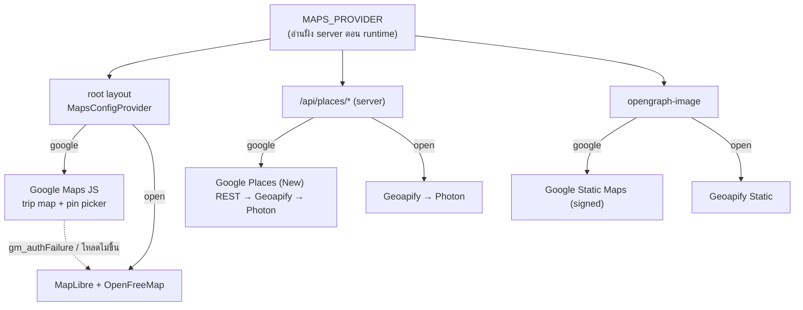
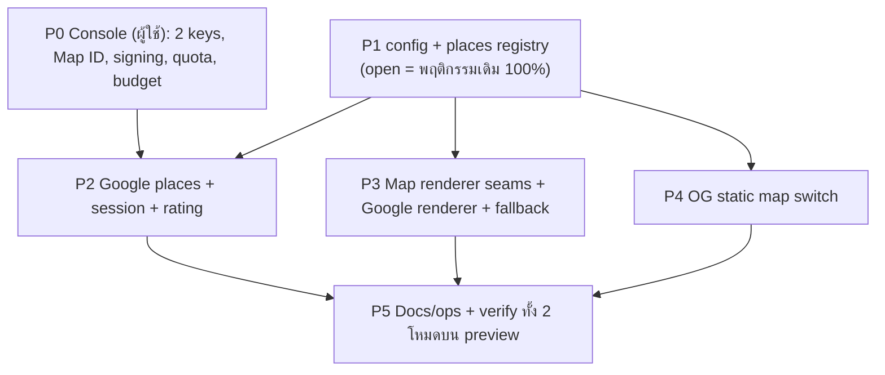

# Maps: สลับ Google ↔ non-Google ด้วย ENV — แผน

**วันที่:** 2026-10-22 (rev 2 หลังผู้ใช้ตอบคำถาม) · **ต่อจาก:** `f093d91` feat(maps): move off Google Maps Platform [TP-0045] (#57)

---

## 1. สรุปสิ่งที่ตัดสินใจแล้ว

| เรื่อง | ตัดสินใจ |
|---|---|
| วิธี | **ไม่ revert** ใช้ ENV ตัวเดียว `MAPS_PROVIDER=google\|open` สลับทั้งชุด |
| `google` | ค้นหา, รายละเอียดสถานที่, **แผนที่ (Google Maps JS)**, OG map ใช้ Google ทั้งหมด |
| `open` | เหมือนตอนนี้ทุกอย่าง (Geoapify/Photon + MapLibre/OpenFreeMap + Geoapify static) ซึ่งเป็น default ถ้าไม่ได้ตั้งค่า |
| Rating/reviews | เอากลับมา **เฉพาะ place picker** เพราะไม่ทำให้ค่า API เพิ่ม (ดูข้อ 4) |
| OG map | ใช้ Google เมื่ออยู่ในโหมด `google` (อยู่ใน free cap) |

### คำตอบข้อ 1 ที่ถามว่า "เกี่ยวกับข้อ 2 ไหม"

**เกี่ยว** การที่อยากเห็นแผนที่เป็นของ Google แปลว่าต้องเลือกทางเลือก **B** (มี renderer 2 ตัวสลับกัน) ผลที่ตามมาคือ
- ต้องมี **browser key** อีกตัว เพราะ Google Maps JS ต้องโหลดใน browser ซึ่งไม่มีทางเลี่ยง ป้องกันได้ด้วย HTTP referrer restriction และเปิดให้ key นี้ใช้แค่ Maps JavaScript API
- ส่วนการค้นหายังทำฝั่ง server ด้วย **server key** แยกต่างหาก ดังนั้นต่อให้ browser key รั่วก็ใช้เรียก Places ไม่ได้

## 2. หน้าตาของโหมด



- **Fallback อัตโนมัติ** ในโหมด `google` ถ้า Google ตอบ 403 (billing) หรือ 429 search จะข้ามไป Geoapify/Photon เอง และถ้า Maps JS โหลดไม่ขึ้น แผนที่จะสลับไป MapLibre เอง ผู้ใช้จะไม่เจอหน้าพังแบบรอบที่แล้ว
- client ไม่ได้อ่าน ENV เอง server เป็นคนส่งค่าลงมาผ่าน provider ใน layout ดังนั้นถ้าจะสลับโหมด แค่แก้ ENV แล้ว redeploy โดยไม่ต้องแก้โค้ด

## 3. ENV vars

```bash
# google | open  (default: open = เหมือนตอนนี้)
MAPS_PROVIDER="open"

# ── ใช้เมื่อ MAPS_PROVIDER=google ──
# Server key: Places API (New) + Maps Static API เท่านั้น ห้ามใส่ NEXT_PUBLIC_
GOOGLE_MAPS_API_KEY=""
GOOGLE_MAPS_URL_SIGNING_SECRET=""     # สำหรับ Static Maps
# Browser key: Maps JavaScript API เท่านั้น + HTTP referrer = โดเมนของแอป
# (server ส่งค่าลงไปให้ client ตอน runtime จึงไม่ต้องใช้ prefix NEXT_PUBLIC_)
GOOGLE_MAPS_BROWSER_KEY=""
GOOGLE_MAPS_MAP_ID=""                 # Map ID สำหรับ vector map + AdvancedMarker

# ── ใช้ทั้งสองโหมด (เป็นตัว fallback) ──
GEOAPIFY_API_KEY=""
```

ถ้าตั้ง `MAPS_PROVIDER=google` แต่ไม่มี key ตัวที่ต้องใช้ ส่วนนั้นจะ fallback ไปใช้ของ `open` แล้ว log warn ครั้งเดียว โดยไม่ crash

## 4. ค่าใช้จ่าย (เช็คจาก docs ของ Google แล้ว 2026-10-22)

**Field → SKU** ของ Place Details (New) ([docs](https://developers.google.com/maps/documentation/places/web-service/place-details)) Google คิดเงินตาม SKU ที่แพงที่สุดใน field mask

| Field | SKU |
|---|---|
| `location`, `formattedAddress`, `types` | Essentials |
| `displayName`, `utcOffsetMinutes` | Pro |
| `rating`, `userRatingCount`, `regularOpeningHours`, `websiteUri`, `nationalPhoneNumber` | **Enterprise** |

**ทำไม rating ไม่ทำให้แพงขึ้น:** place picker ใช้ phone, website และ hours อยู่แล้ว (`place-search-picker.tsx:63-65` และโค้ด Google เดิมก็ขอ field พวกนี้) field ทั้งสามเป็น Enterprise อยู่แล้ว การขอ `rating` และ `userRatingCount` เพิ่มจึงไม่เปลี่ยน SKU ส่วน hotel/transport picker ขอแค่ชื่อ ที่อยู่ และพิกัด เลยอยู่ที่ Pro และ**ไม่ต้อง**เพิ่ม rating ให้ (ถ้าเพิ่มจะกลายเป็น Enterprise)

| การใช้ (โหมด google) | SKU | Free ต่อเดือน* | ปริมาณที่คาด |
|---|---|---|---|
| โหลด trip map / pin picker | Dynamic Maps | 10,000 loads | map mount ครั้งเดียวต่อการเปิดทริป (อยู่รอด client nav) |
| พิมพ์ค้นหา (autocomplete) | Autocomplete | ถ้าจบ session ด้วย details ที่มี field ระดับ Pro ขึ้นไป autocomplete ทุก request ฟรี ถ้าจบด้วย Essentials request ที่ 1–12 คิดเงิน | ส่ง session token ทุกครั้ง |
| เลือกสถานที่ (place picker) | Details Enterprise | **1,000** | ตัวที่จะชน cap ก่อน |
| เลือกโรงแรม/การเดินทาง | Details **Essentials** (mask ไม่มี `displayName`) | ต้องเช็ค | rev 2026-10-23 |
| OG image | Static Maps | 10,000 | cache 24 ชม. ต่อทริป จึงแทบเป็น 0 |

\* ตัวเลขมาจาก [pricing](https://developers.google.com/maps/billing-and-pricing/pricing) และ [pricing categories](https://developers.google.com/maps/billing-and-pricing/pricing-categories) ช่อง Pro ยังยืนยันไม่ได้ ให้เช็คอีกรอบตอนตั้ง quota

**OG map คืออะไร:** เป็นรูป preview ที่ขึ้นตอนแชร์ลิงก์ทริปใน LINE, Facebook, Messenger หรือ iMessage (`app/trip/[id]/opengraph-image.tsx`) รูปจะถูกสร้างเมื่อมีคนแชร์หรือ crawler มาดึง แล้ว cache ไว้ต่อทริป 24 ชม. ปริมาณจึงต่ำมากและอยู่ใน free cap ของ Google Static Maps → **ใช้ของ Google**

## 5. Google Cloud Console (ผู้ใช้ทำเอง ก่อนเขียนโค้ด)

> **ขั้นตอนเต็มย้ายไปอยู่ที่ [docs/ops/google-maps-setup.md](../../ops/google-maps-setup.md)** (rev 3, project ใหม่) รายการด้านล่างเป็นแค่สรุป มีเรื่องที่เพิ่มเข้ามา 3 ข้อ:
> - เช็ค OAuth login: ถ้า OAuth client อยู่ใน project ที่ลบไป login ด้วย Google จะพัง
> - Preview deployments ใช้ `MAPS_PROVIDER=open` เพราะ browser key ใส่ wildcard ของ preview URL ไม่ได้
> - P2 เพิ่ม daily cap ในโค้ด (`GOOGLE_PLACES_DETAILS_FULL_DAILY_CAP` 30, `GOOGLE_PLACES_DETAILS_BASIC_DAILY_CAP` 80, `GOOGLE_PLACES_AUTOCOMPLETE_DAILY_CAP` 300 ผ่าน `consumeRateLimitKey`) ไว้เป็นตัวกันชั้นที่สอง เผื่อ Places API (New) มีแค่ quota แบบ per-minute

1. **ลบหรือ rotate key เก่าทั้งหมด** เพราะ key `NEXT_PUBLIC_` เดิมเคยอยู่ใน JS bundle ให้ถือว่ารั่วแล้ว
2. **Server key** เปิดแค่ API: Places API (New) + Maps Static API (บน Vercel ล็อค IP ไม่ได้)
3. **Browser key** เปิดแค่ API: Maps JavaScript API และตั้ง HTTP referrer เป็นโดเมน production, preview (`*.vercel.app` ของโปรเจกต์) และ `localhost:3210`
4. **Map ID** (Map Management) ชนิด JavaScript/vector
5. **URL signing secret** สำหรับ Static Maps
6. **Quota cap ต่อวัน** ให้ Place Details ≈ 30/วัน (ราว 1k/เดือน) และ Dynamic Maps ≈ 300/วัน ตัวนี้เป็นตัวกันบิลบานตัวจริง และถ้าเกิน cap แอปจะ fallback ไป `open` เอง
7. **Budget alert** ที่ 50/90/100%
8. ใส่ค่าใน Vercel ด้วย `vercel env add …` และใส่ใน `app/.env` ของ local

## 6. Design ของโค้ด

### 6.1 Config (`lib/maps/config.ts` — ใหม่, server-only)

`getMapsConfig()` → `{ provider, places: ProviderId[], staticMap, browser: { key, mapId } | null }` อ่าน ENV ครั้งเดียว และ fallback ทีละส่วนเมื่อไม่มี key ส่วน root layout ส่ง `browser` และ `provider` ลงไปให้ `MapsConfigProvider` (client context)

### 6.2 Search (`lib/places/*`)

- `providers.ts` สร้าง registry ของ `{ id, enabled(), autocomplete(), details?() }` แล้วให้ `searchPlaces()` วนตาม chain ที่ได้จาก config
- `google.ts` ทำงานฝั่ง server ผ่าน REST
  - `POST /v1/places:autocomplete` และ `GET /v1/places/{id}` ส่ง `sessionToken` และ `languageCode`
  - **field mask แยกตาม picker** โดยส่ง `fields=basic|full` ไปที่ `/api/places/details` แล้ว server map เป็น mask ใน allowlist (client ส่ง field เองไม่ได้)
    - `basic` = id, formattedAddress, location, types → **Essentials** (rev 2026-10-23: ถ้ามี field ระดับ Pro ขึ้นไป details ที่ปิด session จะถูกคิดเป็น Enterprise + Atmosphere)
    - `full` = basic + phone, website, hours, rating, userRatingCount → **Enterprise**
  - **ห้าม cache** (Google ToS ห้าม cache เนื้อหา Places) จึงใช้ `cache: 'no-store'` ต่างจาก Geoapify ที่ cache ไว้ 30 วัน
  - **Circuit breaker:** ถ้าเจอ 403 หรือ 429 ให้ข้าม Google 10 นาทีต่อ instance
- Google autocomplete **ไม่คืนพิกัด** จึงต้องให้ `PlaceSuggestion.lat/lng` เป็น optional และให้ `resolvePlace()` เรียก details ทุกครั้งที่เป็น Google id (details ปิด session อยู่แล้ว จึงไม่เพิ่มค่า API) แล้วตรวจทุก picker ที่อ่าน `s.lat` ก่อน resolve
- `use-place-search.ts` สร้าง UUID เป็น session token ต่อรอบค้นหา และสร้างใหม่หลังเลือกสถานที่หรือปิด picker
- `kindFromTypes()` ดึงกลับมาจาก `places-adapter.ts` เดิม (git `f093d91^`) แล้วย้ายไปไว้ใน `kind.ts`
- Id ของ Google เก็บแบบไม่มี prefix (`ChIJ…`) ตาม scheme เดิม ทำให้ `gmaps.ts` ใส่ `query_place_id` ได้เลย
- Rating: `PlaceDetail` เพิ่ม `rating?` และ `reviews?` แล้ว `place-search-picker` เขียน `fd.set('rating' | 'reviews')` เหมือนโค้ดเดิม (`app/actions/places.ts:45` ยังอ่าน field นี้อยู่)

### 6.3 Map view — จุดเสียบ 2 จุด

| Seam | open (มีอยู่แล้ว) | google (ดึงกลับจาก git `f093d91^` แล้วปรับ) |
|---|---|---|
| Trip map | `real-map-canvas.tsx` + `map-active-focus.tsx` | `real-map-canvas-google.tsx` + `map-active-focus-google.tsx` |
| Pin picker (manual forms 3 ตัว) | `pin-picker-map.tsx` | `pin-picker-map-google.tsx` |

- เปลี่ยนชื่อไฟล์ MapLibre เดิมเป็น `*-maplibre.tsx` แล้วให้ไฟล์ชื่อเดิมเป็นตัวเลือก renderer ที่อ่าน context ทำให้ call site (`persistent-map.tsx` และ manual forms) **ไม่ต้องแก้**
- ทั้งสอง renderer ใช้ props เดียวกัน (`Pin[]`, `activePlaceId`, `onActivate` / `value`, `onChange`)
- โหลดแบบ `next/dynamic` แยกกัน ในโหมด `open` จะไม่โหลด bundle ของ Google เลย และในโหมด `google` ก็จะไม่โหลด maplibre-gl จนกว่าจะต้อง fallback
- `MapsProvider` (`APIProvider` เดิม) ห่อเฉพาะ renderer Google และรับ key กับ mapId มาจาก context แทน `NEXT_PUBLIC_`
- fallback ใช้ `window.gm_authFailure` หรือ error ตอนโหลด แล้วตั้ง state `degraded` ใน context เพื่อให้ทุก seam สลับไป MapLibre
- dark theme: Google ใช้ `colorScheme` ตาม `useTheme()` ส่วน MapLibre ใช้ `mapStyleUrl` เหมือนเดิม

### 6.4 OG (`lib/static-map.ts`)

แยกเป็น `buildGoogleStaticMapUrl` (ดึงกลับจาก git เดิม พร้อม HMAC signing) และ `buildGeoapifyStaticMapUrl` แล้วเลือกตาม config ถ้าไม่มี key ให้คืน `null` เหมือนเดิม

## 7. ลำดับงาน



| Phase | ไฟล์หลัก | Test / verify | ขนาด |
|---|---|---|---|
| **P1** | `lib/maps/config.ts`, `lib/places/providers.ts`, `search.ts` | config: default `open`, `google` ที่ไม่มี key → fallback ทีละส่วน; chain ทำงานถูก; test เดิมผ่านทั้งหมด | S |
| **P2** | `lib/places/google.ts` (+fixtures จาก key จริง), `types.ts`, `kind.ts`, `client.ts`, `use-place-search.ts`, routes ทั้ง 2 (`session`, `fields`), pickers ทั้ง 5 | parser; session token เดียวกันทั้ง autocomplete และ details; mask `basic` ไม่มี field Enterprise; 403/429 → breaker → Geoapify; `no-store` | M |
| **P3** | `MapsConfigProvider`, `maps-provider.tsx`, renderer Google ×2 + selector ×2 | `pnpm build` ทั้ง 2 โหมด; ตรวจในเบราว์เซอร์: pins, active focus, hover popup, pin picker, dark mode; key ผิด → fallback MapLibre | M-L |
| **P4** | `lib/static-map.ts` (+test) | เลือกถูก, signing, ไม่มี key → `null` | S |
| **P5** | `.env.example`, `docs/ops/maps-cost-guardrails.md`, `ARCHITECTURE.md`, `AGENTS-INDEX.md`, `.gitignore` (`.env`) | สลับ ENV บน Vercel preview แล้วลองทั้ง 2 โหมด | S |

ทำตาม convention ของ repo: สร้าง `pm` ticket ก่อน แล้วทำใน worktree ใหม่ที่แตกจาก `origin/main` ทำทีละ phase ต่อ commit แล้วรวมเป็น PR เดียว

## 8. ผลกับงานอื่น

- **`2026-10-20-google-maps-links.md`** (ยังไม่ implement): ต้องแก้ Global Constraint "No Google APIs" เป็น "ต้องทำงานได้ในโหมด `open`"
  - ในโหมด `google` ถ้าลิงก์ให้ `ChIJ…` มา ให้เรียก details ตรง ๆ ได้
  - ควรทำ**หลัง** P1/P2
- Place id ของทริปเดิมเป็นแบบผสม (`geoapify:`/`osm:`/`ChIJ`) ใช้ต่อได้ทั้ง 2 โหมดโดยไม่ต้อง migrate เพราะ deep link กับพิกัดอยู่ใน DB แล้ว

## 9. คำถามที่เหลือ

ไม่มีข้อที่ต้องตัดสินใจเพิ่มก่อนเริ่ม P1 ส่วน P2 ถึง P4 ต้องรอผู้ใช้ทำ P0 (keys) ให้เสร็จก่อน
