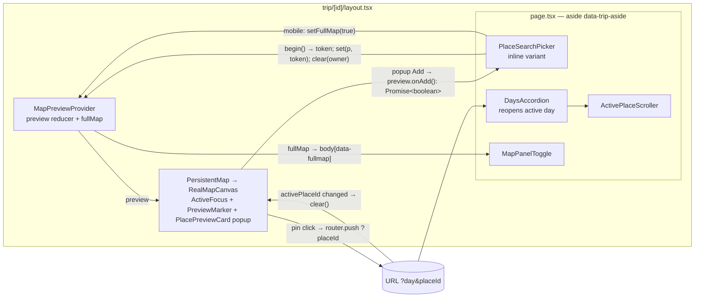

# Trip day ↔ Maps view: search-result preview + pin-click scroll — Implementation Plan

> **For agentic workers:** REQUIRED SUB-SKILL: Use superpowers:subagent-driven-development (recommended) or superpowers:executing-plans to implement this plan task-by-task. Steps use checkbox (`- [ ]`) syntax for tracking.

Status: **plan rev 6** — user decisions + 3 `/scrutinize` passes applied (see *Revision log*). Traced against local `main` `a6f2b89`. · Ticket: **TP-0062** (TP-0063 merged in, soft-deleted)

**Goal:** (A) Clicking a place search result on the trip day page shows a temporary preview pin **with the preview-modal details** (photo when Google has one, name, address, Google Maps link, Close, Add to Day N) on the Maps view — desktop on click, mobile via a "View on map" button that opens the map. (B) Clicking a numbered pin on the map activates it (existing) **and** scrolls the itinerary list to that row (desktop).

**Architecture:** The map (`PersistentMap`, in `trip/[id]/layout.tsx`) and the search (`PlaceSearchPicker`, in the page's `<aside>`) are flex siblings with **no shared React state** — the only channel today is the URL. A preview is ephemeral and must not touch the URL/history, so add one client context, `MapPreviewProvider`, in the layout around both. It owns (1) the preview, driven by a pure, unit-tested reducer that enforces ownership + request ordering, and (2) the mobile full-map flag (replacing `MapPanelToggle`'s local state). Both canvases render a preview marker + a popup that reuses the modal's card. Part B is a small client component that scrolls the matching `[data-place-id]` row; `DaysAccordion` reopens the active day if the user had closed it.

**Tech Stack:** Next.js 16 App Router · React 19 · `react-map-gl/maplibre` · `@vis.gl/react-google-maps` · Vitest (node env, `src/**/*.test.ts` only).

**Spec:** ticket TP-0062 (`pm task get --id TP-0062`) + *Decisions* below.

## Decisions (user-confirmed 2026-10-28)

1. **Desktop row click → map preview, no modal.** The modal's content is **preserved on the map** as a popup on the preview pin: name, address, "Full details load once you add…" note, **View on Google Maps**, **Close (✕)**, **Add to day**. The card markup is shared by modal and popup. **Mobile:** row tap still opens the modal (unchanged); a new "View on map" button opens the map with the same popup (add straight from the map).
2. **No "unfocus" dismissal.** Clicking empty space, panning, zooming, or switching List/Map on mobile **must not** clear the preview. It exits **only** on:
   - picking another place — another search result (replaces it), or activating a place (map pin **or** list row → `activePlaceId` changes)
   - **Esc** (anywhere while a preview is shown)
   - a **new search** (query edited)
   - the place being **added** (row "+", modal, or popup)
   - the popup's **Close ✕** (the modal's "Close" carried over)
   - the picker unmounting (day collapsed / left the itinerary) — structural
3. **Google coords: cheapest call, once, without spending the session, and capped separately.** See *Cost & UX*.
4. **Preview shows regardless of which open day's picker produced it.** The popup button says **"Add to Day N"** with the picker's own day, so the target is never ambiguous.

## Cost & UX (Decision 3)

**Baseline:** today a preview costs **nothing** — the modal renders from the suggestion alone (`place-preview-modal.tsx:7-8`); the only details call is the add (`full`, Enterprise), which also carries the autocomplete session token (`place-search-picker.tsx:86-91`). Under Places API (New) session pricing, a session ended by a **Pro/Enterprise** details call makes its autocomplete requests free; one ended by an **Essentials** call bills up to 12 autocomplete requests individually ([session pricing](https://developers.google.com/maps/documentation/places/web-service/session-pricing)).

**List prices (Places API New, 0–100k tier):** Details Essentials **$5 / 1k, 10,000 free/month**; Pro $17 / 1k (5,000 free); Enterprise $20 / 1k (1,000 free); Autocomplete Requests $2.83 / 1k (10,000 free) ([pricing](https://developers.google.com/maps/billing-and-pricing/pricing)). With the 150/day preview cap the ceiling is ≈4,500 previews/month — inside the Essentials free tier, so **$0 at current scale** (worst case past the free tier: $0.005 per preview).

**Real delta of this feature:** + 1 × Place Details **Essentials** (`GOOGLE_MASKS.basic` = `id,formattedAddress,location,types`, `lib/places/google.ts:8`) per **distinct Google suggestion previewed**. Nothing else changes.

| Choice | Why |
|---|---|
| Preview calls `ensureCoords(s, null, 'preview')` — **never takes the session token** | The token stays for `pick`'s Enterprise call, so typing stays free exactly as today. Taking it on the Essentials preview would bill the keystrokes. |
| **Own `preview` details tier** — bucket `gplaces:details:preview` (env `GOOGLE_PLACES_DETAILS_PREVIEW_DAILY_CAP`, default **150**); exhausting it **does not** trip the global Google-off latch | Today any exhausted details bucket switches Google off for search + add (`lib/places/search.ts:181-188`); `basic` is only 80/day shared with hotel/transport pickers (`lib/maps/config.ts:41`). Browsing must never block adding. |
| **Zero calls** for suggestions that already carry coords (Geoapify, Photon, pasted links) | `ensureCoords` passes them through; pin is instant. |
| Per-picker coords cache + in-flight dedupe, surviving new queries | Re-click / re-search of the same place never refetches; double-click → one request. |
| **No hover / keyboard prefetch** | Would bill places never looked at. |
| Preview-cap exhausted / details failed → error line + the **modal fallback** (desktop opens the old modal) | User still sees name/address/Google link; nothing breaks. |
| **Photo:** `photos` ref rides in the same Essentials call for free; the image itself is one Place Details Photos request ($7 / 1k, **1,000 free/month**) via `/api/places/photo`, capped `GOOGLE_PLACES_PHOTO_DAILY_CAP` = **30/day**, non-latching; loaded only when the popup renders, `loading="lazy"`, browser-cached 1 h; cap hit / error → card without image | User asked for photos; the cap keeps it inside the free tier. Geoapify/Photon results have no photo. |
| Spinner on the row / mobile map button while resolving; popup shows the resolved `formattedAddress` | Feedback for the ~200–400 ms round-trip; better address for free. |

## Global Constraints

- Run all commands from `app/`: `pnpm test`, `pnpm typecheck`, `pnpm lint`, `pnpm dev` (port 3210).
- Both renderers must behave the same: `real-map-canvas-maplibre.tsx` and `real-map-canvas-google.tsx` (select with `MAPS_PROVIDER`).
- Preview is client state only — **no DB writes, no URL change, no history entry**.
- At most **one** preview pin on the map at a time.
- Preview only from the `variant="inline"` picker (day page). `variant="page"` (`/day/[dayId]/place/new`) keeps the modal.
- Desktop = `matchMedia('(min-width: 768px)')` (Tailwind `md`; on the itinerary the map is always shown at md+, `persistent-map.tsx:64`).
- `MapPreviewProvider` renders **no DOM element** — the mobile full-map CSS relies on `body > div > div:not([data-map-toggle])` (`globals.css:220-224`).
- Tests: vitest is node-only, no jsdom — push logic into pure `lib/*.ts` helpers with `.test.ts`; verify UI in the browser (repo convention, cf. `use-dirty-form.ts`).
- Commit messages end with `[TP-0062]`.

## Review Focus

1. **Late async results** — a slow Google lookup landing after an exit (new query, Esc, add, ✕) or after a newer click in **another day's picker** must not resurrect / overwrite the preview. → Task 1 reducer tests (`token`), Task 5.
2. **Add failure from the popup** — resolve null, network error, or a superseded pick must reset "Adding…" and show a **toast** (the aside error line is invisible in mobile full-map, `globals.css:217`). → Task 5 + Task 8 forced-failure check.
3. **Empty day** — preview must render the map; adding from the popup must **not** unmount/remount the canvas while `router.refresh()` is in flight. → Task 4.
4. **Google map hidden at preview time (mobile)** — the preview pan must defer while the map div is 0×0. → Task 4.
5. **Closed active day** — user collapsed the `?day=` day, then clicks its pin: the day reopens and the row scrolls into view. → Task 7.

---

### Task 1: Pure helpers — preview reducer, focus, coords resolver

**Files:**
- Create: `app/src/lib/map-preview.ts`, `app/src/lib/map-preview.test.ts`

**Interfaces — Produces:**
- `type MapPreviewData = { id: string; name: string; address: string | null; lat: number; lng: number; kind: Kind; gmapsUrl: string; photo: { src: string; attributions: { name: string; uri: string | null }[] } | null }`
- `toMapPreviewData(l: Located): MapPreviewData` — `photo = l.photo ? { src: photoSrc(l.photo), attributions: l.photo.attributions } : null`; `address = l.address || l.secondary || null`; `gmapsUrl = gmapsSearchUrl({ name: l.name, address: l.secondary, lat: l.lat, lng: l.lng, placeIdExternal: l.id })` (the modal's args today).
- `type MapPreview = MapPreviewData & { ownerId: string; dayLabel: string; onAdd: () => Promise<boolean>; onClose: () => void }`
- `type PreviewState = { preview: MapPreview | null; latest: number }`
- `type PreviewAction = { type: 'begin' } | { type: 'set'; preview: MapPreview; token: number } | { type: 'clear'; ownerId?: string }`
- `previewReducer(s: PreviewState, a: PreviewAction): PreviewState`:
  - `begin` → `latest + 1` (the caller reads the new `latest` as its token)
  - `set` → applied only if `token === latest`, else state unchanged
  - `clear` with `ownerId` → only if `preview?.ownerId === ownerId`; without → always; **both bump `latest`** (kills in-flight requests)
- `type MapFocus = { kind: 'preview' | 'active'; lat: number; lng: number } | { kind: 'fit' }`
- `mapFocus(preview: { lat: number; lng: number } | null, activePin: Pin | null, activeChanged: boolean): MapFocus` — `activeChanged && activePin` → `active` (a fresh selection beats a preview that is about to be cleared); else preview → `preview`; else activePin → `active`; else `fit`.
- `PREVIEW_ZOOM = FIT_MAX_ZOOM` (14).
- `createCoordsResolver(fetchCoords: (s: PlaceSuggestion) => Promise<Located | null>): (s: PlaceSuggestion) => Promise<Located | null>` — cache hit → cached; in-flight → same promise; `null` not cached.

- [ ] **Step 1: Write failing tests** (`map-preview.test.ts`):
  - reducer: `set` with the current token applies; `set` with an older token (after another `begin`) is ignored; `clear('a')` on a preview owned by `'b'` keeps it; `clear()` clears; after `clear`, a `set` with the pre-clear token is ignored; `latest` strictly increases on `begin` and `clear`.
  - `mapFocus(null, null, false)` → `fit`; `(null, pin, false)` → `active`; `(prev, pin, false)` → `preview`; `(prev, pin, true)` → `active`.
  - `toMapPreviewData` with id `'google:ChIJabc'` (not a `cid` id — those yield `maps.google.com/?cid=`, `lib/gmaps.ts:62-63`), `address: '2 Sanam Chai Rd'`, `secondary: 'Bangkok'` → `address === '2 Sanam Chai Rd'`; `address: ''` → `'Bangkok'`; `gmapsUrl` starts with `https://www.google.com/maps/search/?api=1`.
  - resolver: two concurrent calls for one id → `fetchCoords` once, same object; call after resolve → still once; fetch → `null` then later call → fetched twice.
- [ ] **Step 2:** `pnpm test src/lib/map-preview.test.ts` → FAIL (module missing).
- [ ] **Step 3:** Implement per the signatures.
- [ ] **Step 4:** `pnpm test src/lib/map-preview.test.ts` → PASS; `pnpm typecheck` → clean.
- [ ] **Step 5:** Commit `feat(map): preview reducer, focus + coords helpers [TP-0062]`.

### Task 2: `preview` details tier — own cap, photo reference (server)

**Files:**
- Modify: `app/src/lib/places/types.ts` (`Fields`, `PlacePhoto`, `PlaceDetail.photo`), `app/src/lib/places/google.ts` (`GOOGLE_MASKS.preview`, photo parse), `app/src/lib/places/search.ts` (`googlePlaceDetail` non-latching for preview), `app/src/lib/places/session.ts` (`parseFieldsParam`), `app/src/lib/maps/config.ts` (`caps.preview`), `app/src/lib/places/google-fake.ts` (photos in the fake details)
- Test: `app/src/lib/places/google.test.ts`, `search.test.ts`, `session.test.ts`, `app/src/lib/maps/config.test.ts`
- Docs: `app/.env.example`, `docs/ops/maps-cost-guardrails.md`

**Interfaces — Produces:**
- `type Fields = 'basic' | 'full' | 'preview'`
- `GOOGLE_MASKS.preview = 'id,formattedAddress,location,types,photos'` — `photos` is in the **Essentials (IDs Only)** tier, so the call stays **Essentials** ([data fields](https://developers.google.com/maps/documentation/places/web-service/data-fields)).
- `type PlacePhoto = { name: string; attributions: { name: string; uri: string | null }[] }`; `PlaceDetail.photo?: PlacePhoto | null` — first photo only, set only for `fields === 'preview'`.
- `caps.preview = cap(env.GOOGLE_PLACES_DETAILS_PREVIEW_DAILY_CAP, 150)`; bucket `gplaces:details:preview` (falls out of the existing `` `gplaces:details:${fields}` `` template).
- `googlePlaceDetail`: a denied **preview** consume returns `null` **without** setting `budgetExhaustedUntil`.
- `parseFieldsParam('preview') → 'preview'`.
- Client: preview calls `ensureCoords(s, null, 'preview')` → `ensureCoords(s, session, fields: Fields = 'basic')`, and `Located` gains `photo?: PlacePhoto | null` copied from the detail.

- [ ] **Step 1: Failing tests:** `googleDetails(…, fields: 'preview')` sends the preview mask and maps `photos[0].name` + `authorAttributions[].{displayName,uri}`; no `photos` → `photo: null`; `basic`/`full` results have no `photo`. `googlePlaceDetail` preview denial → `null`, and a following `basic` call still reaches Google (latch not set). `parseFieldsParam('preview')` → `'preview'`, unknown → `'basic'`. Config: `caps.preview` defaults to 150 and reads the env var.
- [ ] **Step 2:** run those test files → FAIL.
- [ ] **Step 3:** Implement; add the env var next to `GOOGLE_PLACES_DETAILS_BASIC_DAILY_CAP` in both docs files.
- [ ] **Step 4:** `pnpm test && pnpm typecheck` → clean.
- [ ] **Step 5:** Commit `feat(places): preview details tier with its own cap and a photo ref [TP-0062]`.

### Task 2b: Place photo proxy route

**Files:**
- Create: `app/src/app/api/places/photo/route.ts`
- Modify: `app/src/lib/places/google.ts` (`googlePhotoUri`), `app/src/lib/places/search.ts` (`getPlacePhotoUri`), `app/src/lib/maps/config.ts` (`caps.photo`)
- Test: `app/src/lib/places/google.test.ts`, `search.test.ts`, `config.test.ts`

**Interfaces — Produces:**
- `isValidPhotoName(name: string): boolean` — `^places/[A-Za-z0-9_-]+/photos/[A-Za-z0-9_-]+$`.
- `googlePhotoUri(name, { key, maxWidthPx, fetchImpl }): Promise<string | null>` — `GET https://places.googleapis.com/v1/{name}/media?maxWidthPx=480&skipHttpRedirect=true` with `X-Goog-Api-Key` → `photoUri`.
- `getPlacePhotoUri(name, deps): Promise<string | null>` — Google off / tripped / invalid name / fake mode → `null`; consumes `gplaces:photo` with `caps.photo = cap(env.GOOGLE_PLACES_PHOTO_DAILY_CAP, 30)` (30/day ≈ the **1,000/month free** Place Details Photos tier; list price $7 / 1k); denial → `null`, **non-latching**.
- `GET /api/places/photo?name=…` — session required (401), `allowPlacesRequest` per user; `null` → `404`; else `302` to `photoUri` with `Cache-Control: private, max-age=3600`. The API key never reaches the browser.
- Client: `photoSrc(p: PlacePhoto): string` → `/api/places/photo?name=${encodeURIComponent(p.name)}` (in `lib/map-preview.ts`); `MapPreviewData.photo: { src: string; attributions: PlacePhoto['attributions'] } | null`.

- [ ] **Step 1: Failing tests:** `isValidPhotoName` accepts `places/ChIJ1/photos/AbC_-9`, rejects `../x`, `places/a/photos/b/media`, `https://…`; `googlePhotoUri` hits the media URL with `skipHttpRedirect=true` and returns `photoUri`; `getPlacePhotoUri` denial → `null` and does not stop a following details call.
- [ ] **Step 2:** run → FAIL.
- [ ] **Step 3:** Implement route + helpers; add `GOOGLE_PLACES_PHOTO_DAILY_CAP` to both docs files.
- [ ] **Step 4:** `pnpm test && pnpm typecheck && pnpm lint` → clean.
- [ ] **Step 5:** Commit `feat(places): photo proxy route with its own daily cap [TP-0062]`.

### Task 3: Extract `PlacePreviewCard` from the modal

**Files:**
- Create: `app/src/components/place-preview-card.tsx`
- Modify: `app/src/components/place-preview-modal.tsx`

**Interfaces — Produces:**
- `PlacePreviewCard({ name, address, gmapsUrl, photo, addLabel, adding, onClose, onAdd, compact }: { name: string; address: string | null; gmapsUrl: string; photo?: MapPreviewData['photo']; addLabel?: string; adding: boolean; onClose: () => void; onAdd: () => void; compact?: boolean })` — today's content and copy (`<h2>` name, address, "Full details load once you add this place to your day.", "View on Google Maps", "Close", `addLabel ?? 'Add to day'` / "Adding…"). `compact` (map popup): smaller padding/heading, max-width ≈260px, Close as an ✕ icon button (`aria-label="Close preview"`), buttons stack. With `photo`: `` 100% × 120px `object-fit: cover` on top, hidden `onError`, plus an attribution line "Photo: <a href={uri}>{name}</a>" (Google requires author attribution).

- [ ] **Step 1:** Move the modal's inner markup into the card; the modal keeps its backdrop + Esc handler and passes `onConfirm` as `onAdd`.
- [ ] **Step 2:** `pnpm typecheck && pnpm lint` → clean.
- [ ] **Step 3:** Commit `refactor(places): extract PlacePreviewCard from the preview modal [TP-0062]`.

### Task 4: Preview context + map rendering (both renderers)

**Files:**
- Create: `app/src/components/map-preview-context.tsx`, `app/src/components/map-preview-marker.tsx`
- Modify: `app/src/app/trip/[id]/layout.tsx:74-77`, `app/src/components/persistent-map.tsx`, `map-renderer-props.ts`
- Modify: `real-map-canvas-maplibre.tsx`, `real-map-canvas-google.tsx`, `map-active-focus-maplibre.tsx`, `map-active-focus-google.tsx`

**Interfaces:**
- Consumes: Task 1 (`previewReducer`, `MapPreview`, `mapFocus`, `PREVIEW_ZOOM`), Task 3 (`PlacePreviewCard`).
- Produces:
  - `MapPreviewProvider({ children })` — `useReducer(previewReducer, { preview: null, latest: 0 })` + `const [fullMap, setFullMap] = useState(false)` with an effect mirroring it to `document.body.dataset.fullmap` (`'1'` / delete). Renders no DOM.
  - `useMapPreview(): { preview: MapPreview | null; begin(): number; setPreview(p: MapPreview, token: number): void; clearPreview(ownerId?: string): void; fullMap: boolean; setFullMap(on: boolean): void }` — all functions **stable** (`useCallback` over `dispatch`); `begin` returns the new token (keep `latest` in a ref updated with the dispatch). Outside a provider: no-op value.
  - `RealMapCanvasProps.preview?: MapPreview | null`
  - `PreviewMarker({ name }: { name: string })` — unnumbered pin visibly distinct from `PinBadge` (≈34px brand-coloured ring/teardrop, soft pulse), `aria-label={\`Preview: ${name}\`}`; clicking it does nothing.

- [ ] **Step 1:** Wrap `{children}<PersistentMap …/>` in `layout.tsx` with `<MapPreviewProvider>`.
- [ ] **Step 2: `persistent-map.tsx`**
  - effect: `activePlaceId` **changed at all** (prev in a ref, skip first render; includes toggling off → `null`) → `clearPreview()`.
  - `canRenderMap = !!day && (day.pins.length > 0 || preview != null || shownForDay === dayIdx)` where `shownForDay` latches `dayIdx` when a preview renders and resets on day change — the canvas stays mounted through the add → `router.refresh()` gap on an empty day (Review Focus 3).
  - pass `preview` to `<RealMapCanvas>`.
- [ ] **Step 3: Both canvases** when `preview` is set:
  - marker: MapLibre `<Marker>` / Google `<AdvancedMarker anchorPoint={CENTER}>` (gated by `overlays`) with `<PreviewMarker>`.
  - popup always open: MapLibre `<Popup closeButton={false} closeOnClick={false} offset={22}>`; Google `<InfoWindow headerDisabled disableAutoPan pixelOffset={[0,-22]}>`. Content: `
` → `<PlacePreviewCard compact addLabel={\`Add to ${preview.dayLabel}\`} adding={adding} onClose={preview.onClose} onAdd={…} />`. No focus trap, no auto-focus.
  - popup-local `const [adding, setAdding] = useState(false)` reset when `preview.id` changes; `onAdd`: `setAdding(true); const ok = await preview.onAdd(); if (!ok) setAdding(false)` (success clears the preview anyway).
  - `closeOnClick={false}` is required (Decision 2). The existing hover/active popup is suppressed while a preview popup shows.
- [ ] **Step 4: Both `ActiveFocus*`** take `preview`; track `prevActiveId` in a ref; `const f = mapFocus(preview, activePin, activePin?.id !== prevActiveId.current)`; deps add `preview?.id`.
  - `preview`: on entry save `{ zoom }` in a ref (only if none saved); MapLibre `easeTo({ center, zoom: Math.max(map.getZoom(), PREVIEW_ZOOM) })`; Google `panTo` + `setZoom(Math.max(getZoom() ?? 0, PREVIEW_ZOOM))`, **deferred to the ResizeObserver's first non-zero width if `getDiv().offsetWidth === 0`** (Review Focus 4).
  - `active`: today's pan, plus restore the saved zoom if one exists (then drop it).
  - `fit`: today's behaviour (drop any saved zoom).
- [ ] **Step 5:** `pnpm typecheck && pnpm lint && pnpm test` → clean.
- [ ] **Step 6:** Commit `feat(map): render a search preview pin with its detail card [TP-0062]`.

### Task 5: Search picker publishes and exits the preview

**Files:**
- Modify: `app/src/components/place-search-picker.tsx`, `place-search-picker.module.css` (`.itemPreviewed`, `.mapBtn`)
- Modify: `app/src/components/days-accordion.tsx:306-317` (pass `dayLabel`)

**Interfaces:**
- Consumes: `useMapPreview` (Task 4); `toMapPreviewData`, `createCoordsResolver` (Task 1); `ensureCoords(s, null, 'preview')` (Task 2).
- New picker prop: `dayLabel?: string` (e.g. `"Day 3"`; `DaysAccordion` passes it).

- [ ] **Step 1: Wiring** — top-level `const ownerId = useId()`; rename the picker's modal state `preview`/`setPreview` → `modalPlace`/`setModalPlace` (name clash with the context); `const map = useMapPreview()`; `previewId = map.preview?.ownerId === ownerId ? map.preview.id : null` (derived, no local state); `const resolveCoords = useMemo(() => createCoordsResolver((s) => ensureCoords(s, null, 'preview')), [])`.
- [ ] **Step 2: `showOnMap(s, openMap: boolean)`** (inline only): `const token = map.begin()`; `setResolvingId(s.id)`; `const l = await resolveCoords(s)`; `setResolvingId(null)`; `l == null` → `setError("Couldn't show that place on the map.")` + desktop fallback `setModalPlace(s)`; else `map.setPreview({ ...toMapPreviewData(l), ownerId, dayLabel: dayLabel ?? 'day', onAdd: () => pick(s), onClose: exitPreview }, token)`; `if (openMap) map.setFullMap(true)`. (The reducer drops stale tokens — no local seq.)
- [ ] **Step 3: `pick` returns `Promise<boolean>`** — `false` when `busy` (guards popup double-add), on resolve null/throw/stale; `true` once `submitPlace` starts. On the resolve-failure paths also `toast({ variant: 'error', title: "Couldn't add place" })` (Review Focus 2). Callers that ignore the result are unaffected.
- [ ] **Step 4: Row click** — inline + desktop → `showOnMap(p, false)`; otherwise `setModalPlace(p)`. Previewed row: `styles.itemPreviewed` plus a visually-hidden "Shown on map" label (keep `aria-selected` for the keyboard highlight). **Enter on a highlighted row = the same action as a click** (`handleKeyDown` Enter branch calls the row-click handler instead of `pick`, `place-search-picker.tsx:117-119`). Adding by keyboard: Tab to the row's "+" or the popup's "Add to Day N".
- [ ] **Step 5: Mobile "View on map" button** — inline only, before "+", hidden at md+ (CSS-module media query), `MapPin` icon / spinner while `resolvingId === p.id`, `aria-label={\`View ${p.name} on map\`}`, `e.stopPropagation(); showOnMap(p, true)`, disabled while `busy`.
- [ ] **Step 6: Exits** — `exitPreview()` = `map.clearPreview(ownerId)`, called from **exactly**: `onInputChange`; the input's `Escape` branch **and** a `window` `keydown` Esc listener attached only while `previewId != null`; `submitPlace` `finally`; popup ✕; unmount cleanup. **Not** on outside clicks, blur, pan/zoom, or the List/Map toggle. Another result → `showOnMap` overwrites; another place activated → Task 4 Step 2.
- [ ] **Step 7:** `pnpm typecheck && pnpm lint` → clean.
- [ ] **Step 8:** Commit `feat(places): preview search results on the trip map [TP-0062]`.

### Task 6: Mobile toggle reads full-map state from the context

**Files:** Modify `app/src/components/map-panel-toggle.tsx`

**Interfaces — Consumes:** `useMapPreview().fullMap / setFullMap` (Task 4).

- [ ] **Step 1:** Replace `useState(full)` + its dataset effect with the context values (the provider now writes `body[data-fullmap]`); keep an unmount effect calling `setFullMap(false)` (leaving the itinerary returns to list mode, as today). `use-trip-map-visible.ts` is unchanged — it still observes the attribute. Update the header comment.
- [ ] **Step 2:** `pnpm typecheck && pnpm lint` → clean.
- [ ] **Step 3:** Commit `refactor(map): mobile map toggle state lives in MapPreviewProvider [TP-0062]`.

### Task 7: Pin click scrolls the list to the row (desktop)

**Files:**
- Create: `app/src/components/active-place-scroller.tsx`
- Modify: `app/src/app/trip/[id]/page.tsx` (render `<ActivePlaceScroller />` inside `<aside data-trip-aside>`)
- Modify: `app/src/components/days-accordion.tsx:100-110`

**Interfaces — Produces:** `ActivePlaceScroller(): null` (`'use client'`).

- [ ] **Step 1: Reopen the active day** — in `DaysAccordion`, extend the existing render-time "adjust state on prop change" block: when `activePlaceId` changes to non-null and `primaryDayId` is closed → add it to `openIds` (Review Focus 5).
- [ ] **Step 2: Scroller** — `const placeId = useSearchParams().get('placeId')`; effect on `placeId`: bail if null or not desktop; `requestAnimationFrame` → `document.querySelector(\`[data-trip-aside] [data-place-id="${CSS.escape(placeId)}"]\`)?.scrollIntoView({ block: 'nearest', behavior: 'smooth' })`.
  - On this dynamic route the new search params commit **together with** the RSC payload, so the reopened day and the row land in the same commit; the rAF runs after it. No `<Suspense>` needed (`PersistentMap` already uses `useSearchParams` in the layout).
  - `block: 'nearest'` → no movement when the row is visible.
  - Hotel pins (`hotel-<id>-<pos>`) match their synthetic hotel row (`day-augment.ts:72`, `place-row.tsx:73`) → those scroll too, which is correct (the hotel is part of the day). Ride pins have no row → no-op.
- [ ] **Step 3:** `pnpm typecheck && pnpm lint` → clean.
- [ ] **Step 4:** Commit `feat(map): scroll the itinerary to a place when its pin is clicked [TP-0062]`.

### Task 8: Browser verification (both renderers) + docs

**Files:** Modify `AGENTS-INDEX.md` (Map section + Place row: `map-preview-context.tsx`, `map-preview-marker.tsx`, `place-preview-card.tsx`, `active-place-scroller.tsx`, `lib/map-preview.ts`; the new env var)

- [ ] **Step 1:** `pnpm dev`; a trip with ≥2 days, one with ≥6 places, one empty day. Run every check with MapLibre **and** `MAPS_PROVIDER=google`, DevTools Network open:
  - Desktop click → pan + preview pin + popup (name, address, Google Maps link, ✕, "Add to Day N"). Arrow-key highlight + **Enter** → same preview (no add).
  - Empty-map click, pan, zoom, rail/header click → **preview stays**.
  - Exits: another result (one pin), Esc with focus on the map, edit query, ✕, row "+", popup "Add to Day N", numbered pin, list row → each clears; camera returns to the active pin **at its prior zoom** / day fit; pin click while previewing moves the camera **once**.
  - Late result: throttle to Slow 3G, click a Google result, immediately edit the query → no preview appears later.
  - Photo: Google result → popup shows the image + attribution; one `/api/places/photo` request (302); Geoapify result → no image, no request.
  - Cost: preview request is `/api/places/details?…fields=preview` with **no `session=`**; the add request carries `session=`; same result clicked 3× → one preview request; Geoapify/Photon → zero.
  - Failure: block `/api/places/details` → popup "Add" returns from "Adding…" and a toast shows; preview failure on desktop falls back to the modal.
  - Empty day: preview renders the map; "Add to Day N" from the popup → map stays mounted, numbered pin appears.
  - Two open days: preview from day 2's picker → popup says "Add to Day 2" and adds there.
  - Mobile 375px: row tap → modal (unchanged); "View on map" → map opens, toggle shows "Map", pin + popup centred (Google too); add from popup works; "List" → preview kept, "Map" → still there.
  - Part B desktop: off-screen row's pin → row active + smooth-scrolled; visible pin → no jump; hotel pin → scrolls to the hotel row; collapse the active day, click one of its pins → day reopens + scroll. Mobile pin click unchanged.
- [ ] **Step 2:** `pnpm test && pnpm typecheck && pnpm lint` → clean (tail -3).
- [ ] **Step 3:** Update `AGENTS-INDEX.md`; commit `docs(index): map preview + pin scroll files [TP-0062]`.
- [ ] **Step 4:** Move TP-0062 `doing → completed`; open the PR.

## Notes for the implementer

- Fresh worktree off `origin/main`; move TP-0062 to `doing` first.
- **Overlap:** TP-0061 (`2026-10-28-place-search-proximity-bias.md`) also touches `persistent-map.tsx` / `use-place-search.ts` / the places server; rebase whichever lands second.

## Revision log

- **rev 2** — user decisions 1–4 (modal details on the map popup; explicit exits only; Google cost/UX optimisation).
- **rev 3** (`/scrutinize` #1) — derive `previewId` from context; drop `adding` from context; clear on any `activePlaceId` change.
- **rev 6** — place photo in the popup (Task 2b, user request); `purpose=preview` replaced by a `preview` `Fields` tier (smaller change: bucket name falls out of the existing template).
- **rev 5** — Enter on a highlighted result = click (preview), not add; list prices in *Cost & UX*.
- **rev 4** (`/scrutinize` #2 + #3) — preview **no longer takes the session token** (Essentials-ended sessions bill keystrokes); separate non-latching `details:preview` cap; honest cost baseline; pure `previewReducer` with request tokens (late results across exits and pickers); `pick → Promise<boolean>` + toast so "Adding…" can't stick; full-map state moved into the provider (dropped `full-map-store.ts`); empty-day mount latch through `router.refresh()`; zoom restore + single camera move on pin click; accordion reopens a collapsed active day; hotel pins scroll to their row; "Add to Day N" label; popup `role="dialog"`; `useId` at top level + `modalPlace` rename; provider renders no DOM; non-`cid` test fixture.
