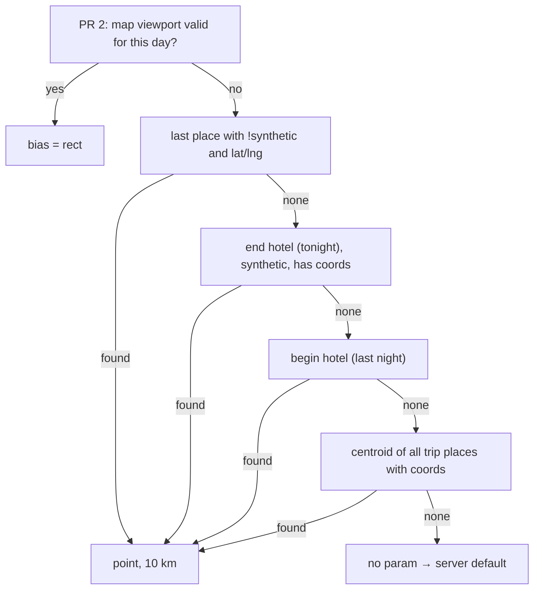
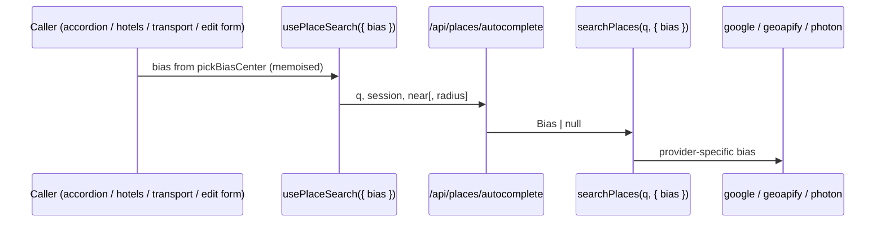

# Place search: bias results toward where the user is planning (TP-0061)

Status: **plan, verified against code at `dd55f19` + provider docs, ready to hand off** · Ticket: TP-0061

Implementer: work in a fresh worktree off `origin/main`. Move TP-0061 to `doing` first. Ship as **two PRs** (see Scope).

## Problem

Place search always leans toward **Bangkok**, wherever the trip is:

| Provider | Today | File |
|---|---|---|
| Google autocomplete | `locationBias.circle` 13.75,100.5 r=50 km (`GOOGLE_BIAS`) | `app/src/lib/places/google.ts:16,73-75` |
| Geoapify (fallback) | `bias=countrycode:th` | `app/src/lib/places/geoapify.ts:86` |
| Photon (last resort) | `lat=13.75&lon=100.5` | `app/src/lib/places/photon.ts:42` |

So "Lawson" on a Tokyo trip ranks Bangkok branches first. On a Thai trip, results near the hotel or the next stop don't win either.

## Goal

Rank results near the place being planned first. This **biases** results only (it never uses `locationRestriction` / `filter`), so a distant name typed in full is still found. It makes no extra provider calls and has no quota impact.

## Scope

- **PR 1:** context-based bias (steps 1–7 below). It has no map code.
- **PR 2:** map-viewport bias (step 8). It touches both map renderers.

## Choosing the center (pure function, client side)

`pickBiasCenter(...)` lives in `app/src/lib/places/bias-center.ts`. It has no React, so Vitest (node env) can unit-test it.

### Day picker (`days-accordion.tsx` → `PlaceSearchPicker`)

`day.places` is **already augmented** with synthetic hotel rows: begin hotels, then real places, then end hotels (`trip/[id]/page.tsx:206-213`, `day-augment.ts:60-83`, `synthetic: true`, they carry hotel lat/lng). So do **not** use "the last item":



Synthetic hotel rows exist only when the trip has a `startDate` (`splitHotelsForDay`). Without one, the chain skips to the trip centroid.

### Other pickers

| Picker | Where | Center |
|---|---|---|
| `PlaceSearchPicker` page variant | `day/[dayId]/place/new/page.tsx:53` | Gets no day data today. Have the page pass the day's places (server-side) and reuse the same chain. If that's awkward, use the trip centroid. |
| `HotelSearchPicker` | trip-level Hotels page (`hotels-view.tsx:148`) | Has **no day**. Use the centroid of the trip's existing hotels (the `hotels` prop has lat/lng), otherwise the trip centroid. |
| `HotelPlacePicker` | check its call site | Use the same rule as HotelSearchPicker, unless a day is available. |
| `TransportPlacePicker` | `transport-form-client.tsx` | `transport_booking` stores **no coordinates** (`db/schema.ts:343-353`). Use the other endpoint only if it was **just picked** in this form (`from`/`to` state, `:156-157`), otherwise use the trip centroid. |
| `PlaceAutocomplete` | trip-create form, **and** the place edit form (`place-form.tsx:120`) | Edit form: use `defaultLat`/`defaultLng`. Trip-create: no bias. |

Default point radius is **10 km** (a constant). The internal endpoint clamps it to [1 km, 50 km], and Google rejects anything over 50 000 m.

## Wire format: `GET /api/places/autocomplete`

Two optional params are added, used one or the other:

- `near=lat,lng` (+ optional `radius=<m>`)
- `bbox=south,west,north,east` (PR 2)

The internal endpoint **ignores** a malformed param (no bias, still 200). It must never break typing.

**Sharing the parser with v1 without changing v1.** `parseNear`/`parseRadius` live in `api/v1/places/search/route.ts:26-46` and throw 400 errors. v1 defaults the radius to 50 km with no lower bound (`text-search.ts:25,81`). Move the parsing into `lib/places/bias.ts` as functions that return `{ ok, value } | { ok: false, message }`. v1 wraps them and still throws `ServiceError('bad_request', …)`, with the same messages. The 1 km floor and 10 km default are applied **only** on the internal path. Then v1 behaviour and `API.md:188` stay unchanged. `v1/places/search/route.test.ts:58-62` must still pass.

```ts
type Bias =
  | { kind: 'point'; lat: number; lng: number; radius: number }
  | { kind: 'rect'; south: number; west: number; north: number; east: number };
```

**Rounding:**
- `near`: 3 decimals (~100 m).
- `bbox`: **2 decimals**.

Geoapify and Photon use the Next fetch cache keyed by URL, with a 30-day revalidate (`geoapify.ts:7,75`, `photon.ts:46`). The bias becomes part of the cache key automatically, but bboxes that aren't rounded would break up that cache.

## Mapping each provider

| Provider | point | rect | none |
|---|---|---|---|
| Google `places:autocomplete` | `locationBias.circle {center, radius}` | `locationBias.rectangle {low, high}` (both required) | current `GOOGLE_BIAS` |
| Geoapify | `bias=circle:lon,lat,radius\|countrycode:none` | `bias=rect:west,south,east,north\|countrycode:none` | `countrycode:th` (unchanged) |
| Photon | `lat`, `lon`. Optionally derive `zoom` from the radius; `location_bias_scale` defaults to 0.4 | center of the rect | 13.75 / 100.5 (unchanged) |

- **Geoapify `countrycode:none`.** When `countrycode` is dropped, Geoapify defaults to `auto`, which guesses the country from the **caller IP**, and that IP is Vercel's server, not the user. `|countrycode:none` stops that.
- **Don't add `origin` to Google yet.** The parser drops `distanceMeters` (`google.ts:86-100`). Add it only if we later show distances.
- **No antimeridian handling.** Google accepts rectangles that cross it. Treating a `west > east` bbox as "no bias" is a deliberate simplification.
- `google-fake.ts:29` ignores the request body, so the fake needs no change.
- Share one `toGoogleBias(bias)` helper between autocomplete and `text-search.ts:82`.

## Plumbing (PR 1)



1. `lib/places/bias.ts`: the `Bias` type, result-returning parsers, `toGoogleBias`, `toGeoapifyBias`, `toPhotonParams`. `lib/places/bias-center.ts`: `pickBiasCenter`.
2. `google.ts` / `geoapify.ts` / `photon.ts`: take an optional `bias` and fall back to today's constants.
3. `search.ts`: add `bias?: Bias` to `Deps` and thread it into `tryGoogle`, `geoapifyAutocomplete` and `photonSearch`.
   - `suggestFromLink`: when a link has a query but no coordinates, it calls `searchPlaces(text, deps)` (`search.ts:149`). **Passing the bias through there is intended.**
   - `lib/api/place-link.ts:164` (v1 place-link import) also calls `searchPlaces`. Leave it **unbiased**.
4. `api/places/autocomplete/route.ts`: parse the params and pass `bias` **only when present**, because `route.test.ts:33,40` asserts the exact `toHaveBeenCalledWith({ session })`.
5. `lib/places/client.ts` `fetchSuggestions(q, signal, session, bias?)`: append the params only when there is a bias (`client.test.ts:88-89` asserts exact URLs).
6. `components/use-place-search.ts`: add an optional `bias` option, read through a ref, so a bias change does not reset the debounce or the session token.
7. Callers: pass the result of `pickBiasCenter` for each picker, as in the table above.

## PR 2: map viewport

The Google `APIProvider` is local to the canvas (`real-map-canvas-google.tsx:36-40`), so pickers cannot use `useMap`. Add a tiny module-level store, `lib/maps/viewport-store.ts`, exposing `useMapViewport()`:

- **Write** it from the wrapper props:
  - Google: `onIdle` / `onCameraChanged` on the vis.gl `<Map>` (`real-map-canvas-google.tsx:77`). In a degraded Google session `idle` may never fire, so the store just stays empty.
  - MapLibre: `onMoveEnd` on the react-map-gl `<Map>` (`real-map-canvas-maplibre.tsx:47`).
- **Store** `{ tripId, dayId (URL ?day=), bbox, userMoved }`. `userMoved` is true only after a real pan or zoom, not after the initial fit-to-pins.
- **Use it only when:**
  - the user is on the itinerary route, since `persistent-map.tsx:29,64` keeps the map mounted with `display:none` elsewhere;
  - `tripId` matches;
  - the viewport is "live" for the picker: `isTripMapVisible` is `wide || fullmap==='1'` (`map-helpers.ts:67`), so on desktop it is always true;
  - and either `dayId` equals the picker's day, or `userMoved`.
- **Clear** it when the trip changes.

## Tests

Vitest runs in the `node` environment with `src/**/*.test.ts`, and testing-library is not installed, so there are **no component tests**. Test the pure functions instead.

- **New `bias.test.ts`:**
  - parsing: good, malformed and clamped values, plus the internal-vs-v1 defaults;
  - serialisation for each provider, including `|countrycode:none`.
- **New `bias-center.test.ts`:**
  - the day chain: real place → end hotel → begin hotel → trip centroid → none;
  - synthetic rows are skipped for "last place";
  - a trip with no `startDate`;
  - transport: just-picked endpoint vs trip centroid.
- **Update existing tests:**
  - `google.test.ts:34-40`, `geoapify.test.ts:73` and `photon.test.ts:39`: the defaults must be unchanged, and the biased variants added.
  - `search.test.ts`: the bias is threaded to all three providers and through `suggestFromLink`.
  - `autocomplete/route.test.ts`: `near` is forwarded; garbage still returns 200 with no bias.
  - `client.test.ts`: the URL with and without a bias.
  - `v1/places/search/route.test.ts`: unchanged, and still green.
- **Manual check:**
  - Tokyo trip with a startDate and a Shinjuku hotel: "Lawson" on Day 1 should rank Shinjuku first.
  - Bangkok trip with no places: results are the same as today.

## Done when

- [ ] PR 1 merged: every picker in the table sends the right bias, defaults are byte-identical when there is no bias, and all tests pass.
- [ ] PR 2 merged: the viewport bias applies only under the rules above.
- [ ] TP-0061 moved to `completed`.
