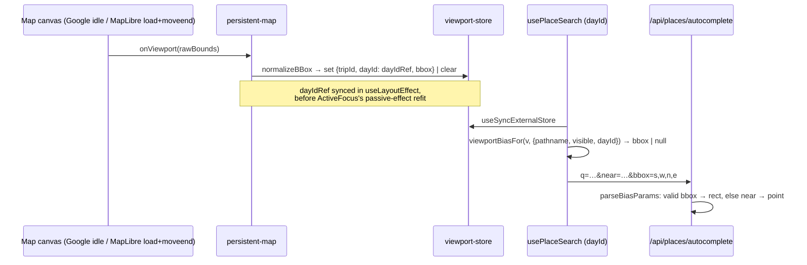

# Place search viewport bias — PR 2 Implementation Plan (TP-0061)

> **For agentic workers:** REQUIRED SUB-SKILL: Use superpowers:subagent-driven-development (recommended) or superpowers:executing-plans to implement this plan task-by-task. Steps use checkbox (`- [ ]`) syntax for tracking.

**Goal:** On the itinerary, the place search for the day shown on the map biases results toward **what the map is currently showing**: the bbox of the visible viewport. If the user has panned to Osaka, results come from Osaka. If the user hasn't moved the map, results come from the day's pin frame. In every other case the search keeps PR 1's day/trip center.

**Architecture:**
- **Canvases.** The two map canvases report the camera's bbox whenever the camera stops: Google on `idle`, MapLibre on `load` and `moveend`.
- **`persistent-map`.** It tags each report with `{tripId, dayId}` and writes it into a module-level store, `lib/maps/viewport-store.ts`.
- **`usePlaceSearch`.** It reads the store through a pure gate. The gate passes only when all of these are true:
  - the user is on the itinerary route of the same trip;
  - the map is visible;
  - the store's `dayId` equals the picker's `dayId`.

  When it passes, the hook sends `bbox=s,w,n,e` along with the existing `near=`.
- **Route.** It parses the `bbox` into a `rect` `Bias`. If the bbox is invalid, it falls back to the `point` bias.
- **Providers.** Each maps the `rect` onto its own rectangle parameter.

**Tech Stack:** Next.js App Router, React 19.2, react-map-gl 8 (MapLibre), @vis.gl/react-google-maps 1.8, TypeScript, Vitest (node env, no component tests), pnpm.

**Spec:** "PR 2: map viewport" in `docs/superpowers/plans/2026-10-28-place-search-proximity-bias.md`. PR 1 (#74 → `97cc7c5`) is merged and running in prod. Every file:line reference below was checked against `origin/main` = `97cc7c5`. The reasons this plan departs from the spec are in Decisions and the Scrutinize log.



## Global Constraints

- Everything from PR 1 still holds:
  - It is bias only. Never use `locationRestriction` or the Geoapify `filter`.
  - There are no extra provider calls.
  - A malformed param is **ignored**: the request runs with no bias and still returns 200. It never causes a 400.
  - With no bias, every provider request is byte-identical to today's.
- **Wire format:** `bbox=south,west,north,east`.
  - The client rounds each value **outward** to 2 decimals: floor south and west, ceil north and east. The rounded rect always contains the real viewport and is never smaller than 0.01°. Because it is part of the 30-day fetch-cache key for Geoapify and Photon, the rounding also stops near-identical pans from creating new keys.
  - Before each floor or ceil, guard against FP error with `Number((x * 100).toFixed(6))`. Without it, `Math.floor(0.29 * 100) / 100 === 0.28` and `Math.ceil(0.07 * 100) / 100 === 0.08` (verified with node).
- **A rect is invalid → no rect bias, fall back to `near`.** That covers all of these:
  - `west >= east`: the viewport crosses the antimeridian or has zero width;
  - `south >= north`;
  - any value that is out of range or not finite;
  - either span greater than **`MAX_RECT_SPAN_DEG = 20`**.

  The server re-validates with the same function, so a hand-made URL never reaches Google as an inverted or oversized rectangle.
- **Precedence:**
  1. An explicit `near` prop. `place-form` passes its own coordinates, and transport passes the other endpoint.
  2. The viewport.
  3. The context (day/trip).

  The viewport is read only when `near === undefined`. `near` is still sent alongside `bbox`, so the server always has a fallback.
- `lib/api/place-link.ts` and `/api/v1/places/search` are **not touched**.
- **Verify gate after each task:** `pnpm -C app typecheck && pnpm -C app lint && pnpm -C app test` (tail -3). **Report the real exit codes.** In PR 1, round 1 claimed lint was green while it was actually red.

## Decisions (deviations from the spec)

1. **No `userMoved`, and no "user vs programmatic" classification.** The spec's gate was `dayId === picker's day || userMoved`. This plan keeps only the day match.
   - **Why.** Telling a user move apart from a programmatic one is the riskiest part of the spec. Google has no `movestart` and no `originalEvent`; wheel and pinch zoom only fire `zoom_changed`. Any heuristic built on DOM events gets some cases wrong, and gets them wrong silently. (The first draft of this plan tried one. See Scrutinize log #1.)
   - **What is lost.** Only the case where the user pans on day A and then types into the picker for day B while day B is collapsed. The map is not showing day B, so day B's context center is the better bias there anyway.
   - **Programmatic camera moves are recorded too, and the result is acceptable in every case:**
     - fit-to-day: the rect of the day's pins, which beats the single point of the last place;
     - preview fly-to: a rect of at least about 1 km around the place the user is looking at;
     - pin-click pan: the area around a pin of that same day.
2. **The `dayId` tag is read from a ref synced in `useLayoutEffect`, inside `persistent-map`.** This avoids a real ordering hazard:
   - `ActiveFocus` (`map-active-focus-maplibre.tsx:61`) calls `fitBounds(..., {duration: 0})` in a **passive** effect, and that fires `moveend` *synchronously* during the commit that switches the day.
   - React runs every layout effect of a commit before any passive effect. So a ref synced in a layout effect already holds the new `dayId` by the time that `moveend` fires.
   - A ref synced in a passive effect would not be ready yet. The new day's frame would be tagged with the old day.
3. **`MapDay` gains `id`.** `persistent-map` only has `?day=` as an *index* (`persistent-map.tsx:39-44`), while `PlaceSearchPicker` knows the day *id* (`days-accordion.tsx:313`).
4. **Mobile gets no viewport bias, because the map must be visible.** On mobile the inline picker sits in the list, and the list is hidden whenever the map is visible (full-map mode). This follows the spec. See Open question 1.
5. **Large viewports fall back to `near`.** A span over 20° is a country or continent overview and says nothing about where the user is looking; the day center is better there. This also keeps the rect well inside Google's `rectangle` limits.

## Open questions (user decision; defaults applied)

1. **Mobile.** Should the viewport framed in full-map mode stay in effect after the user goes back to the list?
   - **Default: no**, following the spec. If the user can't see the map, a bias toward it would surprise them.
   - Changing it only touches the `visible` condition in `viewportBiasFor`.

## Review Focus

1. **Tag ordering.** On a day switch in MapLibre, the store must end up as `{dayId: <new day>}` and never `{dayId: <old day>, bbox: <new day frame>}`. Verify with a manual `console.log` in `onViewport` during QA.
2. **Stale store.** None of these may leave behind a bbox that the next picker uses:
   - a pan, then a click to an **empty** day (`canRenderMap` is false and the canvas unmounts; `persistent-map.tsx:74`);
   - a pan, then `/trip/X/hotels`;
   - a pan, then another trip.
3. **Antimeridian, world wrap, huge spans, and a hidden (0×0) Google map.** All of these must normalize to `null`, which clears the store. They must never be sent.

---

## Task 1: `rect` Bias + `BBox` + normalize/parse/format (`lib/places/bias.ts`)

**Files:** `app/src/lib/places/bias.ts`, `app/src/lib/places/bias.test.ts`

- [ ] Add the types and constant:
  ```ts
  export type BBox = { south: number; west: number; north: number; east: number };
  export type Bias =
    | { kind: 'point'; lat: number; lng: number; radius: number }
    | ({ kind: 'rect' } & BBox);
  export const MAX_RECT_SPAN_DEG = 20;
  ```
- [ ] Add `export function normalizeBBox(b: BBox): BBox | null`. Both the client and the server use it.
  - It rounds outward using `floor2 = (x) => Math.floor(Number((x * 100).toFixed(6))) / 100`, with `ceil2` the same but using `Math.ceil`.
  - It then clamps latitude to [-90, 90] and longitude to [-180, 180].
  - It returns `null` when any value is not finite, `south >= north`, `west >= east`, or either span is greater than `MAX_RECT_SPAN_DEG`. The span check runs **after** rounding.
- [ ] Update `parseBiasParams(sp)`:
  - If `sp.get('bbox')` has exactly 4 non-empty parts that pass `normalizeBBox`, return `{kind: 'rect', ...}`.
  - Otherwise use the existing `near` logic, **unchanged**.
  - It must never throw.
- [ ] Update `biasQuery(near, bbox?: BBox | null)`:
  - Keep `&near=` exactly as it is today.
  - If `normalizeBBox(bbox)` is non-null, append `&bbox=` with `encodeURIComponent` of the 4 values, each formatted with `toFixed(2)` and joined with `,`.
- [ ] Add the mappers:
  - `toGoogleBias(rect)` → `{ rectangle: { low: { latitude: south, longitude: west }, high: { latitude: north, longitude: east } } }`. Widen its return type to a union.
  - `toGeoapifyBias(rect)` → `` `rect:${west},${south},${east},${north}|countrycode:none` ``.
  - `toPhotonParams(rect)` → the center, `{ lat: String((s + n) / 2), lon: String((w + e) / 2) }`. Do not use Photon's `bbox`: it is a filter, not a bias.
- [ ] Add tests:
  - a valid bbox → rect;
  - a valid `bbox` beats `near`;
  - an invalid bbox plus a valid `near` → point;
  - `10,170,20,-170` (crosses the antimeridian) → point;
  - `south == north` → point;
  - `NaN`, `Infinity`, 3 parts, or out of range → point;
  - a 20.5° span → point, while `0,0,20,20` → rect;
  - outward rounding: `13.756,100.494,13.761,100.507` → `13.75,100.49,13.77,100.51`;
  - the FP guard: `0.29` floors to `0.29` and `0.07` ceils to `0.07`;
  - a sub-0.01° viewport stays non-empty;
  - all 3 mappers for a rect;
  - `biasQuery(near, bbox)` emits both parameters, `biasQuery(null, bbox)` emits only `bbox`, and `biasQuery(near, invalidBbox)` emits only `near`.
- [ ] Run the verify gate.

## Task 2: Providers + route accept `rect`

**Files:**
- `lib/places/google.ts:77`, `geoapify.ts:87`, `photon.ts:43` and their `*.test.ts`. Their logic should not need to change, since they already go through the mappers; only the types widen.
- `app/api/places/autocomplete/route.ts` should need no change either, since `parseBiasParams` already returns the union. Add tests to its test file only.

- [ ] Fix any type fallout from the union.
- [ ] Provider tests:
  - Google: the body has `locationBias.rectangle` with `low`/`high` in the right order.
  - Geoapify: the URL has `bias=rect%3A…%7Ccountrycode%3Anone`.
  - Photon: `lat`/`lon` sit at the rect center.
- [ ] Route tests:
  - `?q=x&bbox=1,2,3,4&near=5,6` → `searchPlaces` receives a rect.
  - `?q=x&bbox=1,170,3,-170&near=5,6` → it receives a point.
- [ ] Run the verify gate.

## Task 3: Client sends `bbox`

**Files:** `lib/places/client.ts:13`, `client.test.ts`

- [ ] Change the signature to `fetchSuggestions(q, signal?, session?, near?, bbox?: BBox | null)`, and use `biasQuery(near, bbox)`.
- [ ] Test: the URL carries both parameters when both are passed, and is unchanged when there is no `bbox`.
- [ ] Run the verify gate.

## Task 4: Viewport store + gate (`lib/maps/viewport-store.ts`)

**Files (new):** `app/src/lib/maps/viewport-store.ts`, `viewport-store.test.ts`

- [ ] Write the store with no framework dependency, in the same subscribe/getSnapshot style as `use-trip-map-visible.ts`:
  ```ts
  export type MapViewport = { tripId: string; dayId: string; bbox: BBox };
  export function getMapViewport(): MapViewport | null;
  export function subscribeMapViewport(fn: () => void): () => void;
  export function setMapViewport(v: MapViewport): void; // deep-equal → no-op, no notify
  export function clearMapViewport(): void;             // already null → no-op, no notify
  export function viewportBiasFor(
    v: MapViewport | null,
    o: { pathname: string; visible: boolean; dayId?: string },
  ): BBox | null;
  // → v && o.visible && o.dayId === v.dayId && o.pathname === `/trip/${v.tripId}` ? v.bbox : null
  ```
  The pathname check covers both "on the itinerary" and "same trip". It is the same predicate as `persistent-map.tsx:30`.
- [ ] Tests:
  - set/clear and the notify counts, including the no-op cases;
  - `viewportBiasFor` returns `null` for each of these: a different trip path, `/trip/X/hotels`, `visible: false`, a different `dayId`, an `undefined` `dayId`, and an empty store.
  - In every other case it returns the bbox.
- [ ] Run the verify gate.

## Task 5: `MapDay.id` + canvases report the camera

**Files:** `lib/day-augment.ts` (`MapDay` around line 144, `buildMapDays` around line 170), `map-renderer-props.ts`, `real-map-canvas-maplibre.tsx`, `real-map-canvas-google.tsx`

- [ ] Add `id: string` to `MapDay` and `id: d.id` in `buildMapDays`. If there is a test for `buildMapDays`, add an assertion there.
- [ ] Add `onViewport?: (b: BBox) => void` to `RealMapCanvasProps`, with this comment: "raw camera bounds whenever the camera settles; the owner normalizes/tags".
- [ ] **MapLibre** (`real-map-canvas-maplibre.tsx:50`): add `onLoad={report}` and `onMoveEnd={report}`, where:
  ```ts
  const report = (e: { target: maplibregl.Map }) => {
    const b = e.target.getBounds();
    onViewport?.({ south: b.getSouth(), west: b.getWest(), north: b.getNorth(), east: b.getEast() });
  };
  ```
  `onLoad` is needed because `initialViewState` fits the day without firing `moveend`.
- [ ] **Google** (`real-map-canvas-google.tsx:80`):
  ```ts
  onIdle={(e) => {
    if (degraded) return;
    const b = e.map.getBounds()?.toJSON();
    if (b) onViewport?.(b);
  }}
  ```
  In a degraded session `idle` may never fire, so the store stays empty, as the spec says.
  - `idle` also fires after the `FIT_MAX_ZOOM` clamp (`map-active-focus-google.tsx:78-81`). That only re-records the final frame, so no special handling is needed.
- [ ] Use the `onViewport` prop directly, without syncing it into a ref. `persistent-map` makes it stable (Task 6), so it can never be stale.
- [ ] Run the verify gate.

## Task 6: `persistent-map` tags + owns the lifecycle

**Files:** `app/src/components/persistent-map.tsx`

- [ ] Sync the `dayId` ref in a layout effect (Decision 2):
  ```ts
  const dayIdRef = useRef<string | null>(day?.id ?? null);
  // Layout, not passive: ActiveFocus's passive-effect refit fires a synchronous
  // moveend in the same commit, and it must be tagged with the NEW day.
  useLayoutEffect(() => {
    dayIdRef.current = day?.id ?? null;
  }, [day?.id]);

  const onViewport = useCallback(
    (raw: BBox) => {
      const bbox = normalizeBBox(raw);
      const dayId = dayIdRef.current;
      if (bbox && dayId) setMapViewport({ tripId, dayId, bbox });
      else clearMapViewport();
    },
    [tripId],
  );
  ```
  Pass `onViewport` to `<RealMapCanvas …>`.
- [ ] Add the clear effect:
  ```ts
  useEffect(() => {
    if (!(everOpened && canRenderMap)) clearMapViewport();
  }, [everOpened, canRenderMap]);
  useEffect(() => clearMapViewport, []); // layout unmount = left the trip
  ```
  - **Do not** clear on `dayIdx`. Parent effects run after child effects, so a clear there would wipe the new day's frame that ActiveFocus just recorded.
  - A day switch needs no clear anyway: the old tag no longer matches.
- [ ] Leaving the itinerary does **not** clear. The map stays mounted with `display:none`, and the route gate blocks the bias.
  - **Google:** when the map is shown again, `map-active-focus-google.tsx:87-91` refits → `idle` → it re-records the day frame.
  - **MapLibre:** the camera is unchanged, so the old frame is still what is on screen.
  - In both cases the store matches what the map shows.
- [ ] Run the verify gate.

## Task 7: `usePlaceSearch` precedence

**Files:** `app/src/components/use-place-search.ts`

- [ ] Add:
  ```ts
  const viewport = useSyncExternalStore(subscribeMapViewport, getMapViewport, () => null);
  const pathname = usePathname();
  const visible = useTripMapVisible();
  const bbox = near === undefined ? viewportBiasFor(viewport, { pathname, visible, dayId }) : null;
  ```
- [ ] Keep a `bboxRef` synced in `useEffect` the same way as `nearRef`. Call `fetchSuggestions(v, signal, session, nearRef.current, bboxRef.current)`.
- [ ] Don't reset the debounce or the session when the bbox changes (same rule as PR 1, Review Focus 3).
- [ ] Run the verify gate.

## Task 8: Verify + manual QA + PR

- [ ] Run the full gate and paste the real exit codes. Add `lib/maps/viewport-store.ts` to `AGENTS-INDEX.md`.
- [ ] **Manual QA in Google mode, run locally** (`MAPS_PROVIDER=google` + keys). Preview deployments are forced into open mode (`lib/maps/config.ts:64-67`). Check each step in the devtools Network tab, looking at `/api/places/autocomplete`.
  1. Tokyo trip, day 1, no pan: search "Lawson". The request has `bbox` = day 1's frame.
  2. Drag the map to Osaka and search again. The `bbox` is around Osaka, and so are the results.
  3. Collapse/expand so that day 2's picker is open while the map shows day 1, and search there. There is no `bbox`; the request uses day 2's `near`.
  4. Click to day 2 (which has pins) and search in day 2. The `bbox` is day 2's frame, and is **not** day 1's.
  5. Pan, then click to an empty day, then expand day 1's picker and search. No `bbox`.
  6. Pan, then go to the Hotels tab and search for a hotel. No `bbox`.
  7. Zoom out to world view and search. No `bbox`; it falls back to `near`.
  8. On a mobile viewport (no full-map mode), search. No `bbox`.
- [ ] Repeat steps 1, 2, 4 and 5 in open mode, on the Preview deployment with MapLibre. **Step 4 is the most important here:** it is the synchronous-`moveend` case from Decision 2.
- [ ] Open a PR `feat(places): viewport-bias place search [TP-0061]`. After it merges, move TP-0061 to `completed`.

---

## Scrutinize log

The review was run on the first draft, which used `userMoved` plus a DOM gesture classifier, matching the spec. Each finding below was applied to the plan above.

| # | Severity | Finding | Evidence | Applied |
|---|---|---|---|---|
| 1 | **Blocker (design)** | The first draft classified moves as "user" or "programmatic" with DOM gestures: `pointerdown`/`wheel`/`keydown` within 400 ms, plus a +/− flag. This was the weakest part of the plan. Because Google gives no signal of its own, the heuristic would misclassify cases such as double-click zoom, a long-press drag, or a `pointerup` swallowed by Google (which leaves `pointersDown` stuck, so every programmatic move afterwards would count as user, the fail-*unsafe* direction). These errors are silent and the tests cannot cover them. Tagging by `dayId` alone gives the same value at about half the code. | The trace through `map-active-focus-google.tsx:46-83`: every camera change is `setZoom`/`setCenter`/`fitBounds`/`moveCamera`, with no source metadata. `@vis.gl` `onCameraChanged`/`onIdle` carry only `map` and `detail`. | Decision 1: drop `userMoved`, `camera-gesture.ts` and `use-camera-gesture.ts`. Removes 2 files and the Google move state machine. |
| 2 | **Major** | The spec gated on `dayId`, but tagging it with a ref synced in a passive effect breaks: the new day's frame gets tagged with the old day. | `map-active-focus-maplibre.tsx:61`: `fitBounds(..., {duration: 0})` sits in the **child's passive** effect, and MapLibre fires `moveend` synchronously when the duration is 0. A parent passive effect runs after its children's. | Decision 2: sync `dayIdRef` in `useLayoutEffect` inside `persistent-map`. Task 8, step 4 tests it. |
| 3 | **Major** | Clearing the store on `dayIdx` change, which the first draft did in Task 6, would wipe the new day's frame that ActiveFocus had just recorded, by the same ordering rule. | Same trace as #2. `persistent-map` is an ancestor of ActiveFocus. | Task 6 clears only on `!canRenderMap` and on unmount, never on day change. |
| 4 | **Major** | The first draft's claim was wrong: "come back to itinerary → bbox again" is false for Google. `ActiveFocusGoogle` refits whenever the map goes from 0×0 to visible. | `map-active-focus-google.tsx:87-91`: `if (lastW === 0 && w > 0) fit()`. | Task 6 now states the per-renderer behaviour: in both, the store matches what the map shows. QA step 6 was rewritten. |
| 5 | **Minor** | 2-decimal rounding with plain `Math.floor`/`Math.ceil` drifts by FP error. Because the drift is outward, the result is still correct, but a test asserting exact values would fail. | node: `Math.floor(0.29*100)/100 = 0.28` and `Math.ceil(0.07*100)/100 = 0.08`. | Added the `toFixed(6)` guard and a test for it. |
| 6 | **Minor** | MapLibre never fires `moveend` for its initial `initialViewState` fit, so the store would stay empty until the user's first move. Google's first `idle` does fire, so the renderers would behave differently. | `real-map-canvas-maplibre.tsx:54-57`: `initialViewState` is applied in the constructor. | Task 5: also report on `onLoad`. |
| 7 | Minor | Rounding a sub-km viewport to 2 decimals in the normal (nearest) direction could collapse it to `south == north`, and it would be dropped. | A viewport of 13.7561–13.7589 rounds to 13.76–13.76. | Round **outward** (floor south/west, ceil north/east). The rect is then always at least 0.01°. |
| 8 | Nit | A hidden Google map (0×0) may fire `idle` with degenerate bounds. | `display:none` off-itinerary (`persistent-map.tsx:80`). | Normalizes to `null` → clear. Covered by Review Focus 3. No code needed. |

**Simpler-alternative pass:**
- **Skip PR 2 altogether.** Close TP-0061 now: PR 1 already biases by day/trip. The value PR 2 adds is limited to the inline itinerary picker, on desktop, when the map is showing something other than the day center — mostly after the user pans to a new area. That is the main "explore on the map, then add a place" flow, and it's in the ticket's scope, so the plan goes ahead. If the user wants to cut scope, closing the ticket after PR 1 is also a reasonable choice.
- **Pass the bbox through `PlaceBiasContext`** instead of a store. Rejected. `PersistentMap` is a sibling of `{children}` under the layout (`layout.tsx`), so a context would have to be lifted into the layout together with a setter. That re-renders the whole itinerary on every pan. The external store re-renders only the hooks that subscribe to it.

**Verdict:** fix-then-ship. All fixes have been applied above. The biggest reason was #1: replacing the gesture heuristic with a `dayId` tag removes a whole class of silent misclassification.
