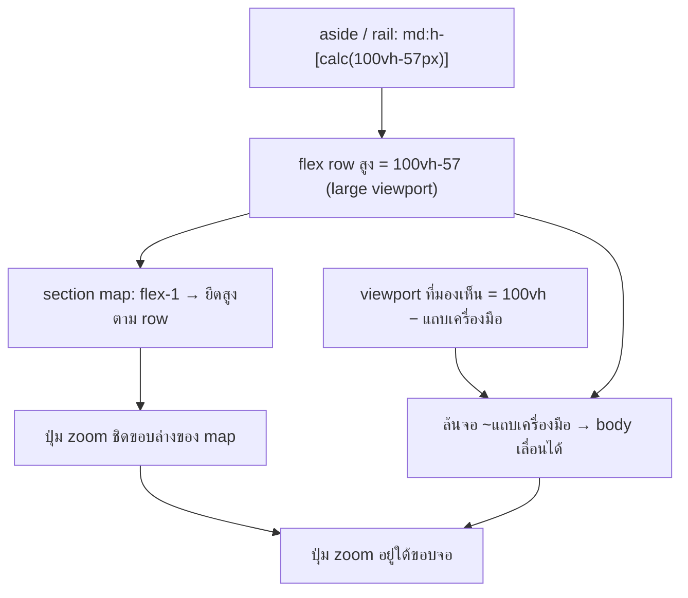

# แก้: หน้า trip (desktop layout) บนแท็บเล็ตต้อง scroll ถึงจะเห็นปุ่ม zoom ของ map

วันที่: 2026-10-28 · อุปกรณ์ที่เจอ: Galaxy Z Fold8 (กางจอ, Chrome Android) · ระดับ: bug เล็ก (แก้ 2 ไฟล์)

## อาการ

- จอกว้าง ≥ 768px → ได้ layout แบบ desktop (rail ซ้าย + รายการ + map)
- ทั้งหน้า (body) เลื่อนได้ประมาณ ~100 CSS px; ขอบล่างของ map รวมถึงปุ่ม zoom `+/−` และโลโก้ Google อยู่ต่ำกว่าขอบจอ
- ต้องเลื่อนทั้งหน้าลงก่อนถึงจะกด zoom ได้ (screenshot 2: header ยังติดอยู่ด้านบน ส่วน map กับรายการเลื่อนขึ้นไปทั้งก้อน)

## สาเหตุ

บน breakpoint `md:` คอลัมน์ต่าง ๆ กำหนดความสูงเป็น **`100vh`** ไม่ใช่ `100dvh`:

| ไฟล์ | class |
|---|---|
| `app/src/app/trip/[id]/page.tsx:95` (`<aside data-trip-aside>`) | `md:h-[calc(100vh-57px)]` |
| `app/src/components/trip-rail-frame.tsx:59` (rail ซ้าย) | `md:h-[calc(100vh-57px)]` |

บน Chrome Android (รวมถึงโหมดแท็บเล็ตที่มีแถบแท็บ + แถบ URL) ค่า `100vh` = **large viewport**
ซึ่งก็คือความสูงตอนที่แถบเครื่องมือของเบราว์เซอร์ถูกซ่อน ส่วนต่างจาก viewport ที่มองเห็นจริงคือความสูงของแถบเครื่องมือ
(~100px ซึ่งตรงกับระยะที่เลื่อนได้ใน screenshot)

ส่วน map (`persistent-map.tsx` `<section class="relative min-h-0 flex-1">`) ไม่ได้กำหนดความสูงเอง
แต่ยืดตาม flex row ของ layout (`app/src/app/trip/[id]/layout.tsx` `
`)
ซึ่งสูงเท่ากับลูกที่สูงที่สุด = `100vh − 57px` ผลคือขอบล่างของ map ตกขอบจอไป

ฝั่งมือถือ (`< md`) ใช้ `100dvh` อยู่แล้ว (`h-[calc(100dvh-57px-56px)]`) จึงไม่เจอปัญหานี้ เป็นแค่ breakpoint md ที่ตกหล่น
บน desktop จริงไม่เจอเพราะ `vh == dvh` (ไม่มีแถบเครื่องมือที่ยุบได้)

## วิธีแก้ (ทางที่แนะนำ: เปลี่ยนให้น้อยที่สุด)

1. `app/src/app/trip/[id]/page.tsx:95`: `md:h-[calc(100vh-57px)]` → `md:h-[calc(100dvh-57px)]`
2. `app/src/components/trip-rail-frame.tsx:59`: `md:h-[calc(100vh-57px)]` → `md:h-[calc(100dvh-57px)]`

แค่นี้พอ: เมื่อลูกทุกตัวใน row สูงไม่เกิน `100dvh − 57` ตัว row ก็ไม่เกิน → map ยืดสูงพอดีจอ → body ไม่ต้องเลื่อน
และเมื่อ body ไม่เลื่อน แถบเครื่องมือก็ไม่ยุบ ทำให้ค่า `dvh` คงที่ (map ไม่ resize ไปมาระหว่างใช้งาน)

ความเข้ากันได้: `dvh` ใช้ได้ใน Chrome 108+ / Safari 15.4+ / Firefox 101+ และโปรเจกต์นี้ก็ใช้ `dvh` อยู่แล้วหลายจุด (globals.css, modal, forms)

### หน้าย่อยอื่นที่ใช้ rail ร่วมกัน

rail (`trip-rail-frame`) ถูก render ในหน้า calendar / bookings / notes / budget / settings ด้วย
หน้าพวกนั้นให้ body เลื่อนได้ตามปกติ และ rail เป็น `md:sticky top-[57px]` อยู่แล้ว
การเปลี่ยนเป็น `dvh` ทำให้ rail เตี้ยลงเท่าแถบเครื่องมือเฉพาะบนแท็บเล็ต ซึ่งถูกต้องกว่าเดิม (เดิมไอคอนล่างสุด ⚙ ก็ล้นจอได้เหมือนกัน)
บน desktop ไม่มีอะไรเปลี่ยน

## ทางเลือกที่ไม่เลือก (ตอนนี้)

- **เปลี่ยน shell เป็น `h-dvh flex-col`** (header อยู่ใน flow, row ใช้ `flex-1 min-h-0`) เพื่อตัด magic number `57px` ทิ้ง
  ข้อดีคือทนกว่าถ้าวันหนึ่ง header สูงขึ้น (เช่น ชื่อ trip ยาวแล้วขึ้นบรรทัดใหม่)
  แต่ต้องแตะ layout + root body + กฎ full-map ใน `globals.css` (`body[data-fullmap] > div`) ทำให้ blast radius ใหญ่กว่าบั๊กนี้มาก
  → แยกเป็น ticket ต่อถ้าอยากทำ
- **ย้ายปุ่ม zoom ไปไว้ด้านบน**: แก้แค่อาการ ไม่ได้แก้สาเหตุ เพราะทั้งหน้ายังเลื่อนได้และโลโก้/attribution ยังตกขอบอยู่

## การทดสอบ

- [ ] **ก่อนแก้: ยืนยันสาเหตุบนเครื่องจริง** (DevTools device mode ใช้ไม่ได้ เพราะไม่มีแถบเครื่องมือของเบราว์เซอร์ ทำให้ `vh == dvh` และบั๊กไม่เกิด)
      ต่อ Z Fold ผ่าน USB → `chrome://inspect` → แล้วรันใน console บน `/trip/<id>`:
      `[innerHeight, document.documentElement.scrollHeight, document.querySelector('header').offsetHeight]`
      ผลที่คาดไว้คือ `scrollHeight − innerHeight` ≈ ความสูงของแถบเครื่องมือ (~100) และ header = 57
      ถ้าออกมาไม่ตรงนี้ แสดงว่าสาเหตุอื่นมีส่วนด้วย ให้หยุดแล้ว re-plan
- [ ] หลังแก้ (ทดสอบบนเครื่องจริงด้วย preview deploy): `scrollHeight === innerHeight`
- [ ] เครื่องจริง (Z Fold กางจอ): เห็นปุ่ม zoom ทันทีโดยไม่ต้องเลื่อน; ลองเลื่อนรายการแล้วเช็คว่า body ไม่เลื่อนตาม
- [ ] Desktop 1440×900: ไม่มีอะไรเปลี่ยน (vh == dvh)
- [ ] มือถือ < 768px: โหมด list และ full-map ยังเหมือนเดิม (ไม่มีอะไรถูกแตะ)
- [ ] หน้า calendar / bookings บนแท็บเล็ต: rail ไม่ล้นจอ ไอคอน ⚙ มองเห็นได้
- [ ] `pnpm lint && pnpm build` (tail -3)

## ขั้นตอน

1. สร้าง `pm` ticket (TP-xxxx) ตามธรรมเนียมของโปรเจกต์
2. สร้าง worktree จาก `origin/main`
3. แก้ 2 บรรทัด → ทดสอบตามรายการด้านบน → เปิด PR `fix(layout): use dvh for md+ trip columns so map fits tablet viewport [TP-xxxx]`
