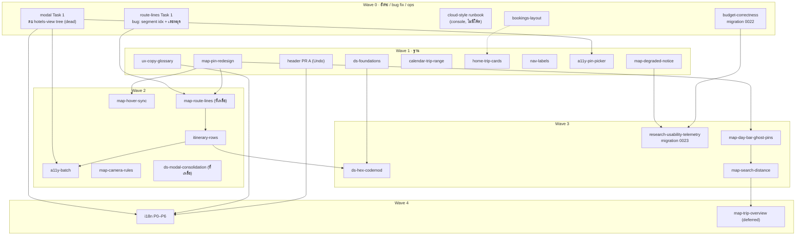

# Design roadmap — INDEX (แผนทั้งหมดจากรีวิว UI/UX)

> สร้าง 2026-10-29 · ต้นทาง: [รีวิว UI/UX](../../design-review/2026-10-28-ui-ux-review.md) · main ตอนวางแผน: `6f6f7a2`
> **สถานะ:** 24 แผน + runbook + เอกสาร research — **ผ่าน scrutiny ครบทุกแผน** (agent คนนอก ตรวจกับโค้ดจริง แก้แผนตามผลแล้ว) · แต่ละแผนมีไฟล์ `.scrutiny.md` คู่กัน
> ทำแล้ว: TP-0076 (carousel มือถือ, #89) · TP-0077 (แตะ POI → เพิ่ม, #90)
> **วิธีรันแบบหลาย agent:** [PLAYBOOK](2026-10-29-design-roadmap-PLAYBOOK.md) (บทบาท, lane, batch, prompt implementer/reviewer, ลูป merge)
> บันทึกดิบของ orchestrator: [`_plan-notes.md`](../../design-review/_plan-notes.md)

---

## 1. การตัดสินใจ (ตอบแล้ว 2026-10-29 — บันทึกไว้หัวแผนแต่ละไฟล์ใน "✅ Decisions answered")

| # | แผน | คำถาม | Default ที่แนะนำ | คำตอบ |
|---|---|---|---|---|
| D1 | nav-labels | หน้า Notes ทำเสร็จและใช้งานได้ (ถูกปิดใน `00dedec`) — เปิดกลับไหม? | **เปิดกลับ** (ถ้าไม่ได้ตั้งใจซ่อน) | ✅ **คงเดิม (ปุ่มเทา)** — ไม่ซ่อน ไม่เปิด |
| D2 | itinerary-rows | รูปแบบเวลา: ตามภาษา UI → ทุกคนเป็น 12 ชม. จนกว่า i18n P6 (โรงแรม/รถ `15:00` → `3:00 PM`) | **ตกลง** | ✅ ตามภาษา UI |
| D3 | map-route-lines | ป้ายเวลากลางเส้น — ไม่มีข้อมูลจริงตั้งแต่ตัด Routes API | **ตัดออก** เหลือเส้น + ลูกศร | ✅ ตัดป้ายออก |
| D4 | cloud-style | หมวด Retail/Shopping ซ่อนไหม (ซ่อนแล้วแตะตลาด/ถนนช้อปปิ้งไม่ได้) | **ซ่อน** | ✅ **แสดงปกติ (On)** |
| D5 | day-bar | แถบวันบนแผนที่เริ่มที่ 768px หรือ ≥1024px | **768px (md)** | ✅ 768px |
| D6 | search-distance | ความละเอียด origin ที่ส่ง Google (3 vs 4 ตำแหน่ง) · ซ่อน "≈ 0 m" | **3 ตำแหน่ง · ซ่อน 0** | ✅ 3 ตำแหน่ง · ซ่อน 0 |
| D7 | trip-overview | ทำโหมด "ทั้งทริป" ตอนนี้ไหม | **เลื่อนไว้** หลัง usability test รอบ 1 | ✅ เลื่อนไว้ |
| D8 | ds-hex-codemod | สีฟ้า Apple / ม่วงปุ่ม optimize → teal ของแบรนด์ (เห็นชัด) | **เปลี่ยน** | ✅ teal |
| D9 | ux-copy | ไทย "Itinerary" = "แผนเที่ยว" · ปุ่มถังขยะ "Remove … from this day" · kind "Stay" · หมวดงบ "Hotels"→"Stays" | **ตามนี้ทั้งหมด** | ✅ ตามนี้ทั้งหมด |
| D10 | header | PR B (Share/Export บน header) — Export มีอยู่แล้ว 3 หน้า, Share ใช้ได้แค่สมาชิก | **ทำแค่ PR A (Undo)** ก่อน | ✅ แค่ PR A |
| D11 | budget | แก้นับซ้ำแบบ "Merge into booking" (ลบ expense ซ้ำ) vs ผูก FK | **Merge** (ไม่มี schema change) | ✅ Merge |
| D12 | budget | จำนวนผู้เดินทางเก็บใน `budget_config` vs column ใหม่ | **budget_config** | ✅ budget_config |
| D13 | home | avatar บนการ์ดเป็นสมาชิกจริง | **follow-up** (แผนนี้แก้แค่ขนาด) | ✅ follow-up ticket |
| D14 | home | ลบ sort select · เพิ่ม quota Static Maps 200→400/วัน (สูงสุด ~$4/เดือน) · เปิด Maps Static API บน browser key | **ตกลง** | ⏸ **ข้ามไปก่อน** — ถามใหม่ก่อนทำ home-trip-cards |
| D15 | telemetry | เกณฑ์ ">2 toggles" นับทั้งสองทิศทาง | **นับทั้งสอง** (query รายงานทั้งคู่) | ⏸ **ข้ามไปก่อน** — ถามใหม่ก่อนทำ telemetry |

ข้อเปิดทางเทคนิค (ไม่ต้องตอบตอนนี้ — แผนมี fallback): i18n P6 ตั้ง cookie ใน Auth.js `signIn` callback ได้ไหม (fallback per-device)

---

## 2. ลำดับ PR (waves)

**กติกาที่ scrutiny ตกลงกันแล้ว (คนลงทีหลังเป็นคนปรับ):**
- `map-pin-redesign` ลบ `map-pin-badge.tsx` → hover-sync/day-bar/overview เพิ่ม prop บน `MapPin` (`highlight` / `label` / `color`) · z-order กลาง: ghost 1, route label 5, pin 10, cluster 15, hover 50, active 100, preview 1000
- `buildMapDays`: route-lines เป็นเจ้าของ (เลขหมุด + legs) · itinerary-rows เพิ่ม arg ที่ 4 `lang='en'`
- ฟอนต์ map / `--map-route-*`: คนลงก่อนกำหนด คนลงทีหลังตัดของตัวเอง
- Migrations: budget `0022` (data-only) ก่อน → telemetry `0023` (Preview DB ใช้ร่วมกัน — drizzle ข้าม migration ที่เลขเก่ากว่า)
- dead hotel tree: modal Task 1 ลบเป็น PR แรก → แผนอื่นตัด hunk ที่แตะไฟล์พวกนั้น
- test helpers (token/contrast) อยู่ที่ `app/test/` สร้างโดย ds-foundations
- en/th key-parity test: ux-copy สร้าง, i18n ขยาย
- `markDegraded` → `onDegrade(reason)` เป็นของ degraded-notice; telemetry แค่ `track()` ข้างใน
- เดสก์ท็อป: แถวบนของแผนที่ = day bar (ซ้าย) + ปุ่มค้นหา (ขวา); chip degraded อยู่ `top: 68px`
- `raw-color-baseline.json`: แผนที่ลงหลัง codemod ต้อง regenerate

---

## 3. แผนทั้งหมด

| Wave | แผน | เป้าหมาย (สั้น) | Verdict |
|---|---|---|---|
| 0 | [ds-modal-consolidation](2026-10-29-ds-modal-consolidation.md) Task 1 | ลบ hotels-view tree ที่ไม่มีใครใช้ (8 ไฟล์) | fix-then-ship |
| 0 | [map-route-lines](2026-10-29-map-route-lines.md) Task 1 | bug: โหมดผิด leg (`page.tsx:244`) + เลขหมุดไม่ตรงลิสต์ | fix-then-ship |
| 0 | [maps-cloud-style-runbook](2026-10-29-maps-cloud-style-runbook.md) → [runbook ไทย](../../ops/google-maps-cloud-style.md) | ตั้ง map style light/dark บน Map ID | ship |
| 0 | [bookings-layout](2026-10-29-bookings-layout.md) | timeline คอลัมน์เดียว, ปุ่ม Add ไม่ทับ | fix-then-ship |
| 0 | [budget-correctness](2026-10-29-budget-correctness.md) | จำนวนคนถูก, merge นับซ้ำ, <1%, banner กลาง, ลิงก์ 404 | fix-then-ship |
| 1 | [ds-foundations](2026-10-29-ds-foundations.md) | contrast token, ฟอนต์ map, Thai line-height, 12px, `lang`, `--header-h`, motion | fix-then-ship |
| 1 | [map-pin-redesign](2026-10-29-map-pin-redesign.md) | MapPin ใหม่ (§7.2), ชื่อหมุดสำหรับ SR, MapLibre focus ได้ | fix-then-ship |
| 1 | [ux-copy-glossary](2026-10-29-ux-copy-glossary.md) | glossary + copy EN/TH + key-parity test | fix-then-ship |
| 1 | [map-degraded-notice](2026-10-29-map-degraded-notice.md) | chip "แผนที่สำรอง" + log เหตุผล | fix-then-ship |
| 1 | [calendar-trip-range](2026-10-29-calendar-trip-range.md) | calendar เปิดที่ช่วงทริป | fix-then-ship |
| 1 | [home-trip-cards](2026-10-29-home-trip-cards.md) | ปก static map (signed URL, ไม่ cache), เมนู ⋯, จัดกลุ่ม | fix-then-ship |
| 1 | [nav-labels](2026-10-29-nav-labels.md) | ป้ายใต้ไอคอน, rail 72px, REQUIREMENTS §3 | ship |
| 1 | [a11y-pin-picker](2026-10-29-a11y-pin-picker.md) | ตั้งพิกัดด้วยคีย์บอร์ด/วางพิกัด/ลิงก์, cooperative | fix-then-ship |
| 1 | [header-share-export](2026-10-29-header-share-export.md) PR A | Undo บน toast "Booking deleted" + return URL ตอน sign-in | fix-then-ship |
| 2 | [map-route-lines](2026-10-29-map-route-lines.md) | เส้นประตามลำดับ สีตามโหมด + ลูกศร | fix-then-ship |
| 2 | [itinerary-rows](2026-10-29-itinerary-rows.md) | meta row, เวลาเดียว, รูปตอนกาง, เวลาเปิดของวันในทริป, Fix location | fix-then-ship |
| 2 | [a11y-batch](2026-10-29-a11y-batch.md) | popup roles, toggle `aria-pressed`, touch 44px, SR summary, error copy | fix-then-ship |
| 2 | [map-camera-rules](2026-10-29-map-camera-rules.md) | ไม่เสีย context, วันว่างไม่ไปโตเกียว, reduced-motion | fix-then-ship |
| 2 | [map-hover-sync](2026-10-29-map-hover-sync.md) | hover ลิสต์↔หมุด, tooltip ไม่ทับการ์ด | fix-then-ship |
| 2 | [ds-modal-consolidation](2026-10-29-ds-modal-consolidation.md) | dialog → Modal (+ scroll lock แบบนับ), Input invalid, Button loading | fix-then-ship |
| 3 | [ds-hex-codemod](2026-10-29-ds-hex-codemod.md) | hex → token ใน 3 module ใหญ่ + ratchet test | fix-then-ship |
| 3 | [map-day-bar-ghost-pins](2026-10-29-map-day-bar-ghost-pins.md) | แถบวันเดสก์ท็อป, หมุดวันอื่นจาง, หมุดซ้อน "1·4" | fix-then-ship |
| 3 | [map-search-distance](2026-10-29-map-search-distance.md) | ระยะในผลค้นหา (Google `origin` → `distanceMeters`), ปุ่ม `/` | fix-then-ship |
| 3 | [research-usability-telemetry](2026-10-29-research-usability-telemetry.md) + [protocol](../../research/2026-10-29-map-usability-test.md) | telemetry เบา (`ui_event`) + test 5 คน | fix-then-ship |
| 4 | [i18n-extraction](2026-10-29-i18n-extraction.md) | ~606 ข้อความ / 7+ PR, lint guard 5 selectors, P6 เปิดภาษาไทย | fix-then-ship |
| 4 | [map-trip-overview](2026-10-29-map-trip-overview.md) | โหมดทั้งทริป + supercluster | fix-then-ship · **defer** |
| — | [header-share-export](2026-10-29-header-share-export.md) PR B | Share/Export บน header | รอ D10 |

---

## 4. บั๊ก/ปัญหาที่เจอระหว่างวางแผน (ไม่อยู่ในรีวิวเดิม)

| ปัญหา | อยู่ในแผนไหน |
|---|---|
| โหมดเดินทางแสดงผิด leg (`page.tsx:244` หาจากตำแหน่ง ไม่ใช่ `segment.idx`) — แก้โหมดแล้วไปแก้ leg ผิดตัว | route-lines Task 1 |
| เลขหมุดบนแผนที่ไม่ตรงกับลิสต์เมื่อมีจุดไม่มีพิกัด | route-lines Task 1 |
| Budget นับคนจาก `collaborators` (seed เท่านั้น) / owner+editor → "ต่อคน" ผิด | budget-correctness |
| ลิงก์ "Set a budget" พา editor ไปหน้า 404 | budget-correctness |
| ปุ่ม "Split bills" ไม่ทำอะไร | ⚠️ ยังไม่มีแผน → ticket แยก |
| เมนูบัญชี "Invite collaborator" ไม่ทำอะไร | header-share-export (ลบออก) |
| ลบสถานที่คลิกเดียว ถาวร ไม่ถาม (`sortable-place-item.tsx:196`) | ⚠️ ยังไม่มีแผน → ticket แยก |
| dialog ที่ทำเอง: scrim อยู่ใต้ header (z 100 vs 1100), Enter ยืนยันแม้ focus อยู่ Cancel | ds-modal-consolidation |
| Modal ซ้อนกันปิดพร้อมกัน → หน้าเลื่อนไม่ได้ | ds-modal-consolidation |
| `isNavigationError` แบบ inline 6 จุดไม่รู้จัก digest `notFound()` ของ Next 16 | a11y-batch |
| Member ที่ยังไม่ sign-in เปิดลิงก์ทริป → หลุดไปหน้า home (ไม่มี return URL) | header-share-export |
| Settings ส่ง `lang='en'` แฝง → จะรีเซ็ตผู้ใช้ไทยเมื่อเลิกบังคับภาษา | i18n P6 |
| OG image cache Google Static Maps 24 ชม. ฝั่ง server — อาจผิด ToS §3.2.3 | ⚠️ ยังไม่มีแผน → ticket แยก |
| `AGENTS-INDEX.md` อ้าง `trip-nav.tsx` / `ModalShell` ที่ไม่มีจริง | nav-labels / ds-modal |
| "Today · …" ในเวลาเปิดเป็นข้อมูล seed ตรงๆ | itinerary-rows |
| ปุ่มย้อนกลับ/ชิปวันในลิสต์เปลี่ยนวันโดยไม่ล้าง search preview | ⚠️ follow-up เล็ก |

---

## 5. PM tickets (เปิด 2026-10-29 · project travel-planner-v2)

Wave 0 อยู่ `todo` ที่เหลือ `backlog` · ผูก `blocked-by` ตามกราฟ §2 แล้ว

| Ticket | งาน |
|---|---|
| TP-0078 | modal Task 1 — ลบ dead tree |
| TP-0079 | route-lines Task 1 — bug fix |
| TP-0080 | cloud-style runbook |
| TP-0081 | bookings-layout |
| TP-0082 | budget-correctness |
| TP-0083 | ds-foundations |
| TP-0084 | map-pin-redesign |
| TP-0085 | ux-copy-glossary |
| TP-0086 | map-degraded-notice |
| TP-0087 | calendar-trip-range |
| TP-0088 | home-trip-cards (D14 ⏸) |
| TP-0089 | nav-labels |
| TP-0090 | a11y-pin-picker |
| TP-0091 | header PR A (Undo) |
| TP-0092 | map-route-lines |
| TP-0093 | itinerary-rows |
| TP-0094 | a11y-batch |
| TP-0095 | map-camera-rules |
| TP-0096 | map-hover-sync |
| TP-0097 | ds-modal-consolidation (rest) |
| TP-0098 | ds-hex-codemod |
| TP-0099 | map-day-bar-ghost-pins |
| TP-0100 | map-search-distance |
| TP-0101 | research-usability-telemetry (D15 ⏸) |
| TP-0102 | i18n P0 |
| TP-0103 | i18n P1 |
| TP-0104 | i18n P2a |
| TP-0105 | i18n P2b |
| TP-0106 | i18n P3 |
| TP-0107 | i18n P4 |
| TP-0108 | i18n P5 |
| TP-0109 | i18n P6 |
| TP-0110 | map-trip-overview (deferred) |
| TP-0111 | Split bills no-op |
| TP-0112 | ลบสถานที่ไม่ถามยืนยัน |
| TP-0113 | OG image cache Static Maps (ToS) |
| TP-0114 | Back ไม่ล้าง search preview |
| TP-0115 | avatar สมาชิกจริงบน Home |

## 6. ขั้นถัดไป

1. ✅ ตอบ decisions (§1) — D14/D15 ค้าง: ถามก่อนเริ่ม TP-0088 / TP-0101
2. ✅ เปิด ticket (§5) — คำอธิบายแต่ละใบครบ: Goal · Scope · Read first · Decisions · Touches · Dependencies (blocked-by/blocks/lane/batch) · Execution · Acceptance
3. Step 0 ใน PLAYBOOK: docs PR ให้แผนทั้งหมดอยู่บน main (ต้องได้ OK จากผู้ใช้)
4. รัน Batch 1 ตาม PLAYBOOK §2 (TP-0078 · TP-0079 · TP-0081 · TP-0082 · TP-0087 · TP-0089) + ส่ง runbook TP-0080 ให้ผู้ใช้ทำใน console
