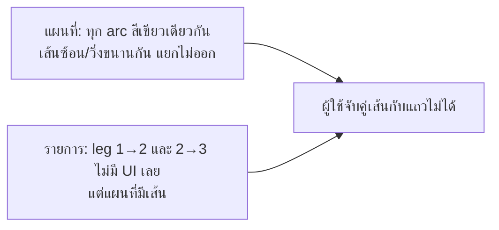

# สี leg บนแผนที่ ซิงก์กับ trip day — Implementation Plan

> **For agentic workers:** REQUIRED SUB-SKILL: Use superpowers:subagent-driven-development (recommended) or superpowers:executing-plans to implement this plan task-by-task. Steps use checkbox (`- [ ]`) syntax for tracking.

> **Origin:** owner ทดสอบบน prod, 2026-10-30: "วางแผนปรับ leg ใน map ให้มีหลากสีหรือแตกต่างกันเพื่อให้ user แยกออก (sync สี/ui กับ trip day)"
>
> **Scrutiny:** 4 รอบ ([บันทึก](2026-10-30-map-leg-colors.scrutiny.md)) แก้เข้าแผนนี้แล้ว
>
> **Ticket:** TP-0123

**Goal:** แต่ละ leg ของวันมีสีของตัวเอง และ leg เดียวกันในรายการ trip day ใช้สีเดียวกัน ผู้ใช้จึงจับคู่เส้นบนแผนที่กับช่องในรายการได้ (md+ เห็นพร้อมกัน; มือถือสลับมุมมองแล้วเทียบผ่านสีและหมายเลข pin)

**Architecture:** สีผูกกับ "ตำแหน่ง leg ในรายการที่แสดงของวันนั้น" (display index `i` = leg ระหว่างจุดที่ `i` และ `i+1`) ฟังก์ชันเดียว `legSlot()` ตัดสินทั้งฝั่งแผนที่และฝั่งรายการ จึงไม่มีทางไม่ตรงกัน ไม่แตะ DB และไม่เรียก API เพิ่ม

**Tech Stack:** Next.js 16, React 19, `@vis.gl/react-google-maps` (`Polyline`), `react-map-gl/maplibre` (data-driven paint), CSS custom properties, vitest, Playwright (`pnpm e2e:mobile`)

**Spec:** ไม่มี spec แยก ใช้ Decisions ด้านล่าง และแก้ `REQUIREMENTS.md:298` ใน Task 4

---

## ปัญหาที่เห็นจากภาพ



- ภาพ 1: arc 2→3 และ 4→5 วิ่งเกือบขนานกัน สีเดียวกันทั้งคู่
- ภาพ 2: leg 1→2 และ 2→3 **ไม่มีแถวในรายการ** เพราะวันนั้นไม่มี segment row (`DayLeg = null`, rows เป็น sparse — `app/src/lib/day-augment.ts:113`) สีจึงต้องอยู่ที่ช่องระหว่าง spot ไม่ใช่ที่แถว segment (D3)
- สีแยกตาม mode ใช้ไม่ได้: ทุก leg ของวันนี้เป็น drive หมด

## Decisions (เสนอ — รอ owner ยืนยัน)

| # | Decision | เหตุผล |
|---|----------|--------|
| D1 | **สีต่อ leg ภายในวัน** ไม่ใช่สีต่อวัน (แผนที่แสดงทีละวันอยู่แล้ว สีต่อวันจะไม่ช่วยแยกเส้นในวันเดียวกัน) และไม่ใช่สีต่อ mode | แก้ปัญหาตรงภาพ |
| D2 | วนชุด **10 สี** ตามลำดับ leg เริ่มใหม่ทุกวัน leg แรกเป็น teal ของแบรนด์ | owner ขอสีเพิ่ม วันละไม่เกิน 10 leg จะไม่มีสีซ้ำ |
| D3 | **แถบสีเต็มช่องระหว่าง spot** (owner เลือกแบบ C จาก mockup): แถบกว้าง 16px สี leg ผสมพื้น 75% จากกลาง pin ของจุดนี้ถึงกลาง pin ถัดไป ลากผ่านทุกอย่างในช่อง ใช้กับ leg ที่ไม่มี segment row ด้วย จึงไม่ต้องมี connector แยก | owner เลือก; 75% (จาก 45% ใน mockup แรก) ให้ contrast ≥ 3:1 บนพื้นแถวปกติและแถว active ทั้งสองธีม (แถว hover `--surface-2` ต่ำสุด 2.91 ยอมรับเพราะเป็นสถานะชั่วคราว) |
| D4 | Leg ที่ไม่มีเส้นบนแผนที่ (ไม่มีพิกัด หรือสั้นกว่า 10 ม.) คงเป็นสีกลาง | สีในรายการหมายถึง "มีเส้นนี้บนแผนที่" เสมอ |
| D5 | **ยกเลิก D-B ของ TP-0117 บางส่วน** ("one brand colour for every mode") รูปทรงโค้ง, ไม่มีประ/ลูกศร, badge กลางเส้น และ casing ขาวยังเหมือนเดิม | owner ขอใหม่ และ `REQUIREMENTS.md` ต้องเปลี่ยนตาม |
| D6 | สีที่ผูกกับ mode เดิม (`--map-route-walk/drive/transit`) ถูกลบ ไอคอน mode ของผู้ชมแบบอ่านอย่างเดียวใช้สี leg แทน | สีต้องมีความหมายเดียว |
| D8 | **เลขจุดในรายการใช้สีเดียวกับ pin บนแผนที่** (owner): วงกลมทึบสีตามประเภท (`KIND_COLOR`) เลขขาวและวงแหวนขาวนอกวง (`--map-pin-fg`) ทั้งสองธีม แทนวงกลมขอบ teal เดิม และ tile ไอคอนในแถวเป็นสีกลางทุกประเภท (ลบ tint `.placeThumb[data-kind]` ที่ `itinerary-list.module.css:194-203` เพราะ tile โรงแรมสีส้มขัดกับ pin stay สี navy และส้มบนแผนที่หมายถึง food) | จับคู่จุดกับ pin ได้ทันที; ขอบขาวทำให้สี navy/slate (1.71:1 บนพื้นมืด) ยังเห็นขอบเขต และเหมือน pin บนแผนที่ |
| D9 | **เลขบนการ์ด carousel (แผนที่เต็มจอบนมือถือ) ใช้หน้าตาเดียวกัน** (owner): สีตามประเภทตรงกับ pin อยู่แล้ว (`map-stop-carousel.tsx:173` ใช้ `KIND_COLOR`) ส่วนที่ขาดคือวงแหวนขาว navy/slate จึงกลืนกับการ์ดโหมดมืด (โหมดสว่างแทบไม่เปลี่ยน) ทำ `StopNumber` ใช้ร่วมกับรายการ | เลขมีแหล่งเดียว ไม่แยกกันเพี้ยนภายหลัง |
| D7 | สี leg ซ้ำหรือใกล้สี pin ได้ (slot 1 = sight, slot 7 = other, slot 2 ใกล้ food, slot 5 ใกล้ stay) ยอมรับ เพราะ pin เป็นรูปหยดน้ำมีไอคอนและหมายเลข ส่วน leg เป็นเส้นมี casing ขาว | ตัดสีออกจะเหลือสีน้อยลง และ leg แรกต้องเป็น teal ตาม D2 |

### ชุดสี

เลือก 10 สีและลำดับด้วยการคำนวณ คู่ที่ติดกัน (รวมคู่วนกลับ 10→1) ต่างกันอย่างน้อย ΔE(OKLab) 0.105 และคู่ที่เว้นหนึ่ง leg ต่างกันอย่างน้อย 0.072 ทั้งสายตาปกติ, deuteranopia และ protanopia (Machado 2009) ตัวเลขนี้ใช้กับชุดบนแผนที่ ชุดโหมดมืดในรายการผ่าน contrast แต่แยกสีได้น้อยกว่า (คู่ติดกัน 0.088) ซึ่งยอมรับได้เพราะในรายการตำแหน่งบอกอยู่แล้วว่าเป็น leg ไหน

**ข้อแลกเปลี่ยน:** ชุด 6 สีเดิมได้คู่ติดกัน 0.142 ยิ่งเพิ่มสี คู่ที่อยู่ห่างกันในลำดับยิ่งคล้ายกันสำหรับคนตาบอดสี (ต่ำสุด 0.011) ลำดับนี้กันไว้ให้เส้นที่อยู่ใกล้กันในลำดับยังแยกออก และ 12 สีให้ผลแย่ลงชัดเจน (คู่ติดกัน 0.079) จึงหยุดที่ 10

| Slot | `--map-leg-N` (บนแผนที่, ล็อกโหมดสว่าง) | vs ขาว | `--leg-N` โหมดมืด (ในรายการ) | vs `#18181b` / `#27272a` |
|---|---|---|---|---|
| 1 teal | `#0f766e` | 5.47 | `#2dd4bf` | 9.52 / 8.00 |
| 2 amber | `#b45309` | 5.02 | `#fbbf24` | 10.61 / 8.92 |
| 3 sky | `#0369a1` | 5.93 | `#38bdf8` | 8.27 / 6.95 |
| 4 magenta | `#be185d` | 6.04 | `#f472b6` | 6.69 / 5.62 |
| 5 blue | `#1e40af` | 8.72 | `#60a5fa` | 6.97 / 5.86 |
| 6 red | `#b91c1c` | 6.47 | `#f87171` | 6.40 / 5.38 |
| 7 slate | `#334155` | 10.35 | `#94a3b8` | 6.91 / 5.81 |
| 8 fuchsia | `#a21caf` | 6.32 | `#e879f9` | 7.20 / 6.05 |
| 9 green | `#15803d` | 5.02 | `#4ade80` | 10.17 / 8.55 |
| 10 violet | `#7c3aed` | 5.70 | `#a78bfa` | 6.51 / 5.47 |

สีไม่ใช่ตัวบอกเดียว: ปลายเส้นทั้งสองมีหมายเลข pin และแถวในรายการเรียงตามลำดับเดียวกัน

## Global Constraints

- ทำใน worktree จาก `origin/main` (local `main` ตามหลัง 2 commit: TP-0118, TP-0119 ซึ่งแก้ `globals.css` และ `map-helpers.ts` แต่ไม่แตะส่วนสี route เลขบรรทัดในแผนนี้อ้าง local HEAD `f9abe00`)
- Guards เดิมต้องผ่าน: raw-colour ratchet (`hex-ok` เฉพาะ mirror ที่มี parity test), i18n lint, 12px floor, `map-tokens.test.ts`
- `--map-*` ห้าม override ใน `[data-theme="dark"]` (มี test อยู่แล้ว) สีตามธีมจึงใช้ชื่อ `--leg-*`
- ไม่เพิ่มข้อความ UI ใหม่ ไม่แตะ schema ไม่เรียก API เพิ่ม
- ทดสอบ UI มือถือด้วย `pnpm e2e:mobile` เท่านั้น ห้ามใช้ desktop browser ย่อจอ

## Out of scope

- Hover แถวแล้วเน้นเส้นบนแผนที่ (และกลับกัน) — ทำแยกได้ภายหลังบน `legSlot` เดียวกัน
- เพิ่ม mode picker ให้ leg ที่ไม่มี segment row
- ใส่สี leg บนการ์ด carousel ในแผนที่เต็มจอของมือถือ (`map-stop-carousel.tsx`) ดูผลบนเครื่องจริงก่อน ค่อยทำเป็น ticket แยกถ้าจับคู่ยังยาก

## Review Focus

1. **จุดกลางวันไม่มีพิกัด** (1, 2 ไม่มีพิกัด, 3, 4): leg 3→4 ต้องได้ slot เดียวกันทั้งสองฝั่ง และ pin ไม่ถูกเลื่อน — Task 2
2. **วันที่ขึ้นต้นด้วยโรงแรม:** `segment.idx` ของ row จริงคือ `i - b` ไม่ใช่ display index ถ้าใช้ผิด สีจะเหลื่อม 1 ช่อง — Task 1, 2, 3 ใช้ display index เท่านั้น
3. **วันที่มีมากกว่า 10 leg:** leg ที่ 11 วนกลับ slot 0 และไม่ซ้ำกับ leg ก่อนหน้า — Task 1
4. **Out-and-back / จุดเดียวกัน (< 10 ม.):** ไม่มีเส้น รายการเป็นสีกลาง — Task 1, 3
5. **โหมดมืด:** rail และปุ่ม mode ที่เลือกต้องอ่านออกบนพื้นมืด — Task 1 (contrast test), Task 4 (screenshot)

6. **แถวโรงแรมหรือ transit บนการ์ดโหมดมืด:** เลข navy/slate ต้องเห็นวงแหวนขาว และ tile ไม่มีสีขัดกับเลข — Task 3 + Task 4 Step 3

---

### Task 1: Palette, tokens และ `legSlot`

**Files:**
- Modify: `app/src/app/globals.css:111-126` (comment + tokens), บล็อก dark
- Modify: `app/src/lib/map-helpers.ts:41-47`
- Modify: `app/src/lib/map-route.ts`
- Test: `app/src/lib/map-tokens.test.ts`, `app/src/lib/map-route.test.ts`

**Interfaces:**
- Produces (`map-helpers.ts`): `LEG_COLORS: readonly string[]` (10 hex, `hex-ok`) แทน `ROUTE_COLOR`; `ROUTE_CASING_COLOR` คงเดิม
- Produces (`map-route.ts`): `legSlot(i: number, a: MaybeLocated, b?: MaybeLocated | null): number | null` (`MaybeLocated = { lat?: number | null; lng?: number | null }`); `legStyle(slot: number): CSSProperties` คืน `{ '--leg': 'var(--leg-N)' } as CSSProperties` (แบบเดียวกับ `map-pin.tsx:52`); `MIN_LEG_METERS = 10` ย้ายมาจาก `day-augment.ts:148`

- [ ] **Step 1: เขียน test ที่ fail**

```ts
// map-tokens.test.ts
it('leg colours mirror the CSS tokens and hold >= 4.5:1 on white', () => {
  expect(LEG_COLORS).toHaveLength(10);
  LEG_COLORS.forEach((c, i) => {
    expect(c).toBe(root[`--map-leg-${i + 1}`]);
    expect(contrast(c, root['--leg-fg'])).toBeGreaterThanOrEqual(4.5);
    expect(contrast(c, root['--map-route-casing'])).toBeGreaterThanOrEqual(3);
  });
});

it('dark leg colours hold >= 4.5:1 on surface, surface-2 and leg-fg', () => {
  for (let n = 1; n <= 10; n++) {
    for (const bg of [dark['--surface'], dark['--surface-2'], dark['--leg-fg']]) {
      expect(contrast(dark[`--leg-${n}`], bg)).toBeGreaterThanOrEqual(4.5);
    }
  }
});

// map-route.test.ts
const P = { lat: 35, lng: 139 };
const Q = { lat: 35.01, lng: 139 };
it('legSlot cycles by display index', () => {
  expect([0, 1, 9, 10, 11].map((i) => legSlot(i, P, Q))).toEqual([0, 1, 9, 0, 1]);
});
it('legSlot is null when the map draws no line', () => {
  expect(legSlot(0, P, { lat: null, lng: null })).toBeNull();
  expect(legSlot(0, P, undefined)).toBeNull();
  expect(legSlot(0, P, { ...P })).toBeNull(); // < 10 m
});
```

- [ ] **Step 2: รันแล้วยืนยันว่า fail**

Run (ใน `app/`): `pnpm test src/lib/map-tokens.test.ts src/lib/map-route.test.ts`
Expected: FAIL (`LEG_COLORS`, `legSlot` ยังไม่มี)

- [ ] **Step 3: Implement**

ใน `:root` เพิ่ม `--map-leg-1..10` ตามตาราง, `--leg-N: var(--map-leg-N)`, `--leg-fg: #ffffff` ใน `[data-theme="dark"]` override `--leg-1..10` ตามตาราง และ `--leg-fg: #18181b` ลบ `--map-route` และ `ROUTE_COLOR` (ข้อ 'route mirror' เหลือตรวจแค่ casing; ลบข้อ 'route line >= 3:1' เพราะ test ใหม่ครอบแล้ว) ส่วน `--map-route-walk/drive/transit` ลบใน Task 3

- [ ] **Step 4: รัน test ให้ผ่าน** — คำสั่งเดิม Expected: PASS (ไฟล์ที่ยังอ้าง `ROUTE_COLOR` จะพัง typecheck จนจบ Task 2 ดังนั้น commit Task 1 และ 2 ติดกัน)

- [ ] **Step 5: Commit** `feat(map): leg colour palette and legSlot [TP-xxxx]`

### Task 2: แผนที่วาดเส้นตามสี leg

**Files:**
- Modify: `app/src/lib/day-augment.ts:146-168`, `app/src/lib/map-helpers.ts:20-26`, `app/src/lib/map-route.ts:72-109`
- Modify: `app/src/components/map-route-maplibre.tsx`, `map-route-google.tsx`, `map-route-badge.tsx`, `map-route-badge.module.css`
- Test: `app/src/lib/day-augment.test.ts`, `app/src/lib/map-route.test.ts`

**Interfaces:**
- Consumes: `legSlot`, `LEG_COLORS`
- Produces: `MapLeg.slot: number`; `RouteArc.color: string`; `RouteFeature.properties: { key: string; color: string }`; `RouteBadge({ mode, color })`

- [ ] **Step 1: เขียน test ที่ fail**

```ts
// day-augment.test.ts — slot = display index ไม่ใช่ลำดับเส้นที่วาด
it('a stop without coords leaves a slot gap', () => {
  const places = [at('a', 35, 139), { ...at('b', 35, 139), lat: null, lng: null }, at('c', 35.01, 139), at('d', 35.02, 139)];
  expect(buildMapLegs(places, [null, null, null]).map((l) => l.slot)).toEqual([2]);
});
// parity: map = list ในวันที่มีโรงแรมต้นวัน + จุดไม่มีพิกัด (import `displayPlacesForDay` เพิ่ม; `day`, `trip` สร้างในเคส; `hotel(...)` คือ helper ของไฟล์)
it('map slots equal the list slots on a hotel day', () => {
  const places = displayPlacesForDay(day, [hotel], trip.startDate);
  const listSlots = places.map((p, i) => legSlot(i, p, places[i + 1])).filter((n) => n != null);
  expect(buildMapDays(trip, [hotel], 'metric')[0].legs.map((l) => l.slot)).toEqual(listSlots);
  expect(listSlots.length).toBeGreaterThan(1);
});

// map-route.test.ts
it('routeArcs and legsGeoJSON carry the slot colour', () => {
  const pins = [pin('a', 35, 139), pin('b', 35.01, 139)];
  const arcs = routeArcs(pins, [{ from: 0, to: 1, mode: 'walk', slot: 2 }]);
  expect(arcs[0].color).toBe(LEG_COLORS[2]);
  expect(legsGeoJSON(arcs).features[0].properties.color).toBe(LEG_COLORS[2]);
});
```

ปรับ `toEqual` แบบตรงตัวที่ `day-augment.test.ts:146` และ `:176` ให้มี `slot` ตาม display index ของ leg นั้น และ legs ใน `map-route.test.ts` ให้มี `slot`

- [ ] **Step 2: รันแล้วยืนยันว่า fail** — `pnpm test src/lib/day-augment.test.ts src/lib/map-route.test.ts`

- [ ] **Step 3: Implement data** `buildMapLegs` เรียก `legSlot(i, a, z)`, null = `continue` (แทนเงื่อนไขพิกัด + ระยะ) และส่ง `slot` ต่อ `routeArcs` ตั้ง `color: LEG_COLORS[leg.slot]`

- [ ] **Step 4: Implement renderers**
  - MapLibre: `'line-color': ['get', 'color']` ที่ `tp-route-line`, casing ไม่เปลี่ยน
  - Google: `RouteArc` รับ `color` ส่งเข้า `strokeColor`
  - Badge: `style={{ '--badge': color } as CSSProperties}` แล้ว CSS ใช้ `border-color` / `color: var(--badge)` (ใส่ค่า hex ตรงๆ เพราะ marker ของ Google ถูก render นอก subtree ที่กำหนด `--leg`) พื้นหลังคง `--map-route-casing`

- [ ] **Step 5: รัน** `pnpm test && pnpm typecheck` Expected: PASS

- [ ] **Step 6: Commit** `feat(map): colour each route leg by its slot [TP-xxxx]`

### Task 3: รายการ trip day ใช้สีเดียวกัน

**Files:**
- Modify: `app/src/components/sortable-place-list.tsx:225,262` (ส่ง prop), `sortable-place-item.tsx` (`SortableItem` + `StaticItem`)
- Modify: `app/src/components/sortable-place-list.module.css`
- Create: `app/src/components/stop-number.tsx`, `stop-number.module.css`; Modify: `place-row.tsx`, `map-stop-carousel.tsx`
- Modify: `app/src/components/segment.tsx`, `segment-mode-picker.tsx`, `ui/segmented.tsx`, `itinerary-list.module.css`
- Modify: `app/src/app/globals.css` (ลบ `--map-route-walk/drive/transit`)

**Interfaces:**
- Consumes: `legSlot`, `legStyle`
- Produces: prop `legSlot: number | null` บน item; `<span className={styles.legRail} data-leg-slot={slot} data-sorting={isSorting || undefined} aria-hidden />`; `Segmented` prop `activeClassName?: string`

- [ ] **Step 1: ส่ง slot** ที่ `sortable-place-list.tsx` คำนวณ `legSlot(i, place, places[i + 1])` แล้วส่งเข้า item ทั้งสองแบบ **ห้ามใช้ `segment.idx`** (ดู Review Focus 2)

- [ ] **Step 1b: `StopNumber`** สร้าง `app/src/components/stop-number.tsx` + `stop-number.module.css`: `StopNumber({ kind, n, className, 'aria-hidden': ariaHidden }: { kind: Pin['kind']; n: number; className?: string; 'aria-hidden'?: boolean })` render `<span>` วงกลม 28px, `flex-shrink: 0`, พื้น `var(--pin-color)` (`KIND_COLOR[kind] ?? KIND_COLOR.sight` ผ่าน `style` แบบ `map-pin.tsx:52`), เลขสี `--map-pin-fg`, `box-shadow: 0 0 0 2px var(--map-pin-fg)` (ใช้ shadow ไม่ใช้ border เพื่อไม่ให้วงสีเล็กลงเหลือ 24px), ตัวอักษร 12px หนา 700 ใช้ที่ `place-row.tsx:112` (`className={styles.pin}`, screen reader ยังอ่านเลขเหมือนเดิม) และ `map-stop-carousel.tsx` (span เลขเดิม, `aria-hidden`, `n={pin.idx}`)

- [ ] **Step 2: Rail** ทั้งสอง variant: เมื่อ `legSlot != null` ใส่ `legStyle(legSlot)` ที่ `.row` (`SortableItem` ต้อง merge `{ ...style, ...legStyle(legSlot) }` ห้ามทับ transform ของ dnd) render `legRail` เป็นลูกตัวแรกของ `.row` และใน `SortableItem` ใส่ `data-sorting` จาก `isSorting` ของ `useSortable` (`DragOverlay` ไม่ได้ส่ง slot จึงไม่มี rail)

- [ ] **Step 3: CSS**
  - ใน `sortable-place-list.module.css` (ไฟล์ของ `.row` จริง และ `styles` ของ `sortable-place-item.tsx:25`): `.row { position: relative }`
  - ไฟล์เดียวกัน: `.legRail { position: absolute; left: 47px; width: 16px; border-radius: 8px; top: 35px; bottom: -35px; background: color-mix(in srgb, var(--leg) 75%, var(--surface)); z-index: 1; pointer-events: none }` (35px = กึ่งกลาง pin: border 1 + padding 10 + thumb 48/2; 55px = กึ่งกลางแนวนอน: handle 28 + border 1 + padding 12 + pin 28/2)
  - ใน `itinerary-list.module.css` (ไฟล์ของ `.pin`/`.placeHead` ห้ามวางผิดไฟล์ เพราะ CSS Modules hash คนละชื่อ): `.pin` เหลือแค่ `position: relative; z-index: 2` (หน้าตาย้ายไป `StopNumber`) พื้นทึบ จึงบังปลายแถบทั้งสองด้าน
  - ไฟล์เดียวกัน: `.placeHead > .pin { align-self: start; margin-top: 10px }` ตรึงกลาง pin ไว้ที่ 35px เสมอ แถว active ที่หัวสูงจะได้ไม่ทำให้ rail ขาดหรือโผล่เหนือ pin (แถวปกติหัว 48px ตำแหน่งเท่าเดิม)
  - ใน `sortable-place-list.module.css`: `.legRail[data-sorting] { visibility: hidden }` ซ่อน rail ระหว่างลาก เพราะ `transform` สร้าง stacking context ทำให้เส้นขาดหรือทับ pin และสีเป็นลำดับเก่าจนกว่าจะปล่อย (ซ่อนด้วย attribute จึงไม่กระทบ `.legActive`)
  - ที่เหลือใน `itinerary-list.module.css`: `.segment::before` คงเส้นประกลางเดิม เพิ่ม `[data-leg-slot] ~ .segment::before { display: none }` (Segment เป็น sibling ถัดจาก rail ใน `.row`)
  - `.segIcon { color: var(--leg, var(--muted)) }` ลบ `.segMode_*` และแก้ `segment.tsx:104` ให้เหลือ `styles.segChip` (ไม่งั้น DOM ได้ class `undefined` โดย typecheck ไม่จับ)
  - `.legActive { background: var(--foreground); color: var(--surface); }` เป็นค่ากลางเมื่อไม่มีเส้น (D4: `--brand` เท่ากับ slot 1 จึงใช้ไม่ได้) และ `[data-leg-slot] ~ .segment .legActive { background: var(--leg); color: var(--leg-fg); }`

- [ ] **Step 4: Picker** `Segmented` ใช้ `pressed ? (activeClassName ?? 'bg-brand text-brand-foreground') : …`; `SegmentModePicker` ส่ง `styles.legActive` ตัวเลือกอื่นของ `Segmented` (`day-mode-picker`, settings) ต้องไม่เปลี่ยน

- [ ] **Step 5: รัน** `pnpm test && pnpm typecheck && pnpm lint` Expected: PASS รวม raw-colour ratchet และ i18n guard

- [ ] **Step 6: Commit** `feat(itinerary): colour the gap between stops by leg [TP-xxxx]`

### Task 4: Docs และตรวจบนมือถือจริง

**Files:**
- Modify: `REQUIREMENTS.md:298`, `AGENTS-INDEX.md` (แถวใหม่ `stop-number`, แถว place-row/carousel, แถว `map-route-*`, `map-route-badge`, `map-helpers`, `routeArcs`, `map-route.ts`, map tokens; เลขบรรทัดเลื่อนบน origin/main ให้ grep), `app/src/components/ui/README.md` (`--map-route*`, `ROUTE_COLOR`)
- Modify (comment ค้าง): `app/src/lib/map-route.ts:5-6`, `app/src/components/map-route-google.tsx:11`, `map-route-badge.module.css:1-2`, `globals.css` comment บล็อก map
- Modify: `app/e2e/mobile-layout.spec.ts`

- [ ] **Step 1: เพิ่ม e2e** selector ไม่ขึ้นกับข้อความ

```ts
test('consecutive list legs carry different colour slots', async ({ page }) => {
  // findTrip ของไฟล์ + วนหาวันแรกที่มี list ซึ่งมี rail อย่างน้อย 2 เส้น; ถ้า seed ไม่มี ให้ test.skip พร้อมเหตุผล
  // scope ที่ list เดียว เพราะ accordion เปิดได้หลายวัน slot จึงเริ่ม 0 ใหม่
  const slots = await dayList.locator('[data-leg-slot]').evaluateAll((els) => els.map((e) => Number(e.getAttribute('data-leg-slot'))));
  expect(slots.length).toBeGreaterThan(1);
  for (let i = 1; i < slots.length; i++) expect(slots[i]).not.toBe(slots[i - 1]);
});
```

- [ ] **Step 2: รัน** `pnpm e2e:mobile` Expected: ผ่านทุก project (Pixel 7 / 390 / 360 / desktop × en, th) ต้องมี DB, Google key และ `AUTH_BYPASS`

- [ ] **Step 3: ตรวจด้วยตา** screenshot จาก Pixel 7 ทริป Okinawa วันที่ 1 ใน Google mode ตรวจ: เส้น 2→3 กับ 4→5 สีต่างกัน, เส้นสี amber/blue แยกจาก pin food/stay ได้, สีแถวตรงเส้น, ช่อง 1→2 และ 2→3 มี rail แถบสีตรงกลาง pin ทั้งบนและล่าง, เลขจุดในรายการและบนการ์ด carousel สีตรงกับ pin ทุกประเภทและเห็นชัดบนพื้นมืด และเปิดแถว active ที่ชื่อยาวบนจอ 360 ว่า rail ยังชน pin พอดี, โหมดมืดอ่านออก และดู MapLibre mode อีกหนึ่งครั้ง

- [ ] **Step 4: แก้ docs** `REQUIREMENTS.md:298` เปลี่ยน "in a single brand colour for every mode" เป็น "one colour per leg, cycling a 10-colour palette by the leg's position in the day; stop numbers in the list and on the mobile map carousel use the same filled kind colour as their map pin; the list fills the gap between the two stops with a wide band in that colour, and uses it for the leg's icon and selected mode" ปรับ index และ README ให้ตรงชื่อ token ใหม่

- [ ] **Step 5: Commit และเปิด PR** `docs: leg colours [TP-xxxx]`
