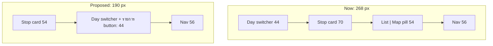

# Mobile map: compact the bottom controls — Critique + Plan

> **Ticket:** **TP-0122** · follows #127 (TP-0118), #128 (TP-0119)
> **Owner (prod, Android Chrome, 2026-10-30):** "บั้คหายไปแล้ว เหลือ ux โดยเฉพาะ mobile หน้า map view ปุ่ม floating ต่าง ๆ กินที่มาก บังแผนที่หมด วางแผนปรับปรุง"
> **Status:** plan only. Nothing is implemented until the owner says go.
> **Scrutinized 2026-10-30:** findings in [the scrutiny report](2026-10-30-mobile-map-compact-controls.scrutiny.md). Applied fixes are in the text below.

Before/after, on the real map (the "after" is CSS/DOM injected into a production build; nothing in the repo changed, and the map isn't refitted):

These two pre-date the review: they still show the old "วันที่" text and a switcher that doesn't fill its slot. The corrected layout (§3.2), same method, active stop selected, at 476 th, 360 th with `วัน 10 · พฤ 28`, 320 th, 320 en (the square in the button stands in for the real icon):

---

## 1. Measurements (production build, mobile emulation, Thai)

Stack = day switcher → stop card → List/Map pill → nav. `476×638` is the owner's phone, worked out from the screenshot.

| viewport | stack height now | % of screen | clear map above it | day-fit height (`section − 72 − 240`) |
|---|---|---|---|---|
| **476×638** | **268** | **42%** | 370 | 270 |
| 390×664 | 268 | 40% | 396 | 296 |
| 360×640 | 268 | 42% | 372 | 272 |
| 412×839 | 268 | 32% | 571 | 471 |

Breakdown of the 268: switcher 44 + 8 + card 70 + 12 + pill 54 + 24 + nav 56.

## 2. Critique (design:design-critique framework)

**Overall:** the route and pins are good, but the owner's real viewport is short. Four stacked layers take 42% of it, so the map gets a 370 px window, and the day is framed into only 270 px.

| Finding | Severity | Recommendation |
|---|---|---|
| Three floating rows above the nav, each its own line, though two are small controls with empty space on both sides | 🔴 | Put the two small controls (day switcher, List/Map) on **one row** |
| The List/Map pill is 213×54 for a control used rarely. Its pressed half (`แผนที่`) only tells you what you can already see | 🟡 | A **single button** naming the destination (`รายการ` on the map, `แผนที่` on the list): 98×44. Airbnb/Google Maps pattern |
| The stop card is 70 tall: `p-3` around a 44 px tap area | 🟡 | Tighten vertical padding to 54 (tap area stays 44; both text lines fit: Thai measures 22.4 + 19.2 = 41.6 px) |
| `fitPadding` bottom is 240, so a day is framed well above the controls | 🟡 | Follow the smaller stack (§3.4) |
| "วันที่ 2 · จ 13" here vs "วัน 2 · จ 13" on the desktop day bar | 🟢 | Use the existing `dayChip` text, which is shorter and consistent |

**Keep:** the bottom nav (the owner asked for consistency in #127), the card carousel, Back closes the map, and arcs/pins.

**Accessibility:** tap targets stay ≥ 44. The button's accessible name contains its visible word (WCAG 2.5.3).

## 3. Proposal

### 3.1 One button instead of the pill (`map-panel-toggle.tsx`), both modes

- One `<button>`: map icon + `แผนที่` in list mode, list icon + `รายการ` in map mode. No `aria-pressed` and no group.
- **Same place and same size in both modes** (keeps #127's rule): the `[data-map-toggle]` wrapper is `fixed inset-x-0 mx-auto flex justify-end pointer-events-none md:hidden`, `bottom: 84px` (nav 56 + 28), `width: CARD_WIDTH`, `z-[60]`; the button inside is `pointer-events-auto`. Centring a column-wide wrapper gives the same centre as the cards with no separate right-offset formula. `pointer-events-none` is required: the wrapper spans the column and must not swallow taps on the map or rows.
- Button: fixed `width: 98px` (not `min-width`), height 44, `px-3`. Widest label measures 91 px at `px-3` (`รายการ`); English is 73–77. A fixed width also keeps the switcher's width calculation (§3.2) true.
- Style: `bg-surface`, border, `shadow-[var(--shadow-md)]`, same as the day switcher. List mode benefits too: it covers 98×44 at the right instead of 213×54 in the middle of the rows.
- `Back` closes the map as today. All of `openFullMap` / `closeFullMap` / the reopen-on-mount effect stays. `onClick={full ? () => closeFullMap() : () => openFullMap()}`; both already guard repeat taps. One unkeyed `<button>`, so focus survives the switch.
- i18n: reuse `map_view_list` / `map_view_map` for the visible word. Add `map_toggle_to_list_aria` ("Show list" / "ดูรายการ") and `map_toggle_to_map_aria` ("Show map" / "ดูแผนที่"). Delete `map_view_aria`.

### 3.2 One column: cards above, controls below (`map-stop-carousel.tsx`)

- DOM order in the carousel: stop strip first, then the switcher row. Inside the carousel `Tab` follows what you see. The toggle stays earlier in the DOM (`page.tsx`, before the aside and the map), so overall the order is nav → toggle → map → cards → switcher, and a keyboard user passes every card before the switcher.
- Move `CARD_WIDTH` to `lib/map-carousel.ts` and add `MAP_TOGGLE_WIDTH = 98`, so the carousel and the toggle read the same values.
- The switcher row is `CARD_WIDTH` wide, centred, so the **switcher's left edge and the button's right edge line up with the active card's edges**. This keeps the alignment the owner asked for in #127.
- **The switcher fills its slot:** `width: calc(CARD_WIDTH − MAP_TOGGLE_WIDTH − 8px)`, `justify-between`, text centred. The gap to the button is always 8. A content-sized switcher would leave a gap of 8–60 px that changes from day to day, and the `›` would move under the thumb (up to 20 px, `วัน 2 · จ 13` vs `วัน 10 · พฤ 28`).
- Row gap: the `<ul>` keeps `pb-1` (it stops the active ring being clipped), so the row gets `mt-1` after the strip and `mt-2` after the empty-day `
`. Both give 8 px.
- Why the button isn't moved into the carousel: the carousel exists only in map mode, and the button must exist in list mode at the same pixel position.
- Switcher text: `dayChip(day, t, true)` ("วัน 2 · จ 13", "D2 · Mon 13"). Its width was 174 with the longer "วันที่" title.
- **Below 360 px, the text is `dayChip(day, t, false)` ("วัน 10", "D10"), with no date.** At 320 the slot holds 60 px and the full text needs 72–94, so it would truncate on every day, not just as a last resort. Two spans, `max-[359px]:hidden` and `min-[360px]:hidden`. `min-w-0 truncate` stays only as a safety net. Measured at 360: the longest cases (`วัน 10 · พฤ 28`, `D10 · Wed 28`) fit.

### 3.3 Compact card, new offsets

- Card: `p-3` → `px-3 py-1` (54 tall; prototype measured with 4 px block padding).
- `CAROUSEL_BOTTOM` 86 → **28**, with the arithmetic in a comment.
- **Why 28 and not lower:** Google's logo is 26 tall at the section's bottom-left (`logo` rect measured) and must stay visible under Google's terms. The row sits 2 px above it. The attribution text (14 tall) is also clear. Measured with `img[alt="Google"]` at 320–476 in Thai and English: no intersection.
- **MapLibre degrade:** it has no logo. Its attribution starts expanded (`maplibregl-compact-show`, 10–34 px above the section bottom, 10–54 at ≤ 360) and the row (28–72) overlaps it. Main's pill (24–78) overlaps it too, so this is not a regression. Once collapsed, the `i` button is still tappable (measured at 320 and 360).
- Resulting stack above the section bottom: 28 + 44 + 8 + 54 = **134**. (The `<ul>`'s `pb-1` is inside the 8.)

### 3.4 Camera (`lib/map-helpers.ts`)

- `fitPadding(true).bottom` 240 → **162** (stack 134 + 28). 28 is the headroom main has today (240 − 212). It is needed: an active drop's name label reaches 25.4 px below the coordinate, and a stay square, centred on its coordinate, reaches 20 px below it (measured). With only 16 of headroom the label and the square would both go under the card. An active stay's label (47.4 px) already reaches under the card on main and still does.
- `top` stays 72.
- Update `map-helpers.test.ts:71` and `map-camera.test.ts:71,82,96`.
- `previewPadding` then returns a frame from a 652 px section (370 + 162 + 120) instead of 730. The owner's 582 still gets the existing `null` fallback.

### 3.5 Expected result

| viewport | stack now → new | % of screen | clear map | day-fit height |
|---|---|---|---|---|
| **476×638** | 268 → **190** | 42% → **30%** | 370 → **448** (+21%) | 270 → **348** (+29%) |
| 390×664 | 268 → 190 | 40% → 29% | 396 → 474 (+20%) | 296 → 374 (+26%) |
| 360×640 | 268 → 190 | 42% → 30% | 372 → 450 (+21%) | 272 → 350 (+29%) |
| 412×839 | 268 → 190 | 32% → 23% | 571 → 649 (+14%) | 471 → 549 (+17%) |

## 4. Alternatives considered

| Option | Why not (now) |
|---|---|
| Keep the two-segment pill, on the same row as the switcher | Full size: 162 + 8 + 213 = 383 px, no fit. Even stripped of icons at `px-3` (137 th, 112 en): 162 + 8 + 137 = 307 misses the 296 column at 360, and D10 (182 + 8 + 137 = 327) misses the 320 column. It fits only in English or on short day text at ≥ 384 |
| Icon-only List/Map pill (≈ 96 px) | Fits, but loses the word, and the itinerary nav tab already uses the same map icon, so it reads as a duplicate |
| Day switcher at the top of the map | Same pixels, split into two places; the top is the only clear edge left |
| Hide the nav on the map | Reverses #127, which the owner asked for |
| **Show the card only after tapping a pin** (Google Maps style) | Saves 62 px more by default, but changes how stops are browsed, needs a dismiss gesture and refits. Phase 2 candidate |
| **Hide cards + controls while panning** (like the nav's hide-on-scroll) | Full map while exploring, but needs drag events on both renderers and adds motion. Phase 2 candidate |

**Phase 2 is a separate decision.** Ship §3, have the owner use it on the phone, then decide whether either candidate is still needed. Neither is in this plan's scope.

## 5. Risks

1. **Button discoverability in list mode:** a white 98×44 button on a white list is quieter than the teal pill. Check it on the phone; if it gets lost, fill it with brand teal in both modes (one class).
2. **Right-column overlap in list mode:** the button now sits over the rows' right side (time chip, trash icon) instead of their centre. `aside` has `pb-24`, so the last row can still scroll clear. Measured: at the end of the list the last content ends 24 px above the button (`pb-24` 96 − 72), with nothing covered. Mid-scroll the button can cover a row's note, edit and remove icons (at 360, x 230–328 vs icons at 219–339); main's pill covers two of them, and scrolling clears either.
3. **Very narrow phones (320):** the card is 256 wide. Below 360 the switcher drops the date (§3.2), which stays visible in the list. e2e adds a 320 project to prove nothing overlaps or truncates.
4. **Empty day:** the carousel shows a paragraph instead of the strip. Measured with the row below it: 48 tall, gap 8, edges aligned, stack 184 (under 190).
5. **Search "View on map" preview:** the preview popup's framing uses the same padding (§3.4). The card sits above its pin and the pin stays 162 above the section bottom, so it can't reach the stack. Check on the phone.
6. **Screen readers:** focus stays on the button but its name changes, and that change may not be announced (`aria-pressed` used to carry the state). Not tested with a real screen reader. See the scrutiny report for the owner decision.

## 6. Tests

**Update `e2e/mobile-layout.spec.ts`** (required gate, per AGENTS.md):
- `SEL`: `pill*` → one `toggle: '[data-map-toggle] button >> nth=-1'`. `openMap` taps it. `flow 1` and `flow 7` etc. follow. `nth=-1` matters: on main `[data-map-toggle] button` resolves to the inert List segment, so `openMap` would time out before any invariant ran.
- `SEL.daySwitcher` / `prevDay` / `nextDay` rely on `> div:first-child`, which matches nothing after the DOM reorder. Add `data-map-day-switcher` to the switcher and select on that.
- I3, I4, I6 and I7 use `expect.soft`, and run in a dedicated `flow 9: map stack invariants`. Otherwise flow 1 stops at the first failure and the later invariants are never shown failing.
- **I3:** the toggle rect is identical (±1 px on all four edges) in list and map modes, and its label changes.
- **I4 replaced:**
  - The switcher and toggle are on one row (same top and bottom ±1).
  - Switcher left = active card left (±1), toggle right = active card right (±1).
  - Gaps: card → row 8 (±2), switcher → toggle 8 (±1), row → nav 28 (±2).
  - The switcher and toggle don't intersect.
  - The day text isn't truncated (`scrollWidth ≤ clientWidth`) at any width, 320 included.
- **I6 new:** `.gm-style` must be present (the gate runs with `MAPS_PROVIDER=google`), then `.gm-style img[alt="Google"]` must exist, and neither the switcher nor the toggle may intersect it or any non-empty `.gm-style-cc`. No "when present" branch: a stale selector must fail, not pass silently.
- **I7 new:** on every phone project, viewport height − active card top ≤ 192, so the space gain can't regress silently. On main it is 268 everywhere, including at Pixel 7 where a 0.68 ratio would pass.
- **New projects:** `owner-phone` (476×638, the viewport all the headline numbers come from) and `tiny-320` (320×568). All invariants apply, including I4 in full.
- `tiny-320` needs `grepInvert: /flow 3|flow 6/`. At 320, `/calendar` (331), `/bookings` (359), `/budget` (400) and `/notes` (th 335, en 357) overflow; `knownOverflow` doesn't cover `/calendar` or Thai `/notes`, and flow 3 passes through Calendar. These are TP-0120's scope, so add the 320 numbers to that ticket.
- **New flow 8:** an empty day. `findTrip`'s first trip has none, so scan the home page's trips for a day with no cards (trip `917a10c7`, day index 3 has one today) and skip with a reason only if no trip does. Stack ≤ 190, gap 8, edges aligned, chrome on screen.
- Prove it: the updated suite fails on current main with I3 (label), I4 and I7 each named in the output (`expect.soft`, `nth=-1`), and passes on the branch. Report both counts and the failing assertion names, not just totals.

**Unit:** `fitPadding` / `map-camera` numbers; the carousel guard stays.

**Manual, on production build + emulation:** screenshots at 476×638, 360×640 and 320×568 in th and en, list and map, Day 1 and 2; the "View on map" preview; MapLibre degrade (block `maps.googleapis.com` and `maps.gstatic.com` in the context; chip top-right, attribution: `i` tappable when collapsed); an active stop at the bottom of the frame, drop and stay. The fixture has no D10, so check the longest day text with a trip of ≥ 10 days.

**After deploy:** the owner checks on the real phone (discoverability, risks 1–2).

## As built (2026-10-30)

**Owner decisions:** the owner approved the four recommendations ("ok เลย"): single button, white surface, the button's name change without an extra announcement for now, and MapLibre attribution left for separate review.

**Changes during implementation:**
- **Added beyond the plan:** the toggle's icon uses `text-brand`, matching the Bookings floating Add button (`bookings-view.module.css`), and it helps discoverability.
- **Added from review:** the switcher's visible text is `aria-hidden`, with an `sr-only` `dayTitle`, so a screen reader always hears the full day ("Day 2 · Sun 13"), also below 360 px. Breakpoint `max-[359.98px]` avoids both labels showing on fractional widths.
- **Added to the suite:** I8 (no pin under the controls after a day fit, and pins must exist) and a check that the toggle's wrapper doesn't take taps.
- **Empty-day stack limit at 320:** 204, not 190. The note wraps one line more there (measured 202).

**Results, production builds, mobile emulation (Pixel 7 / 476 / 390 / 360 / 320 / desktop × en, th):**

| build | passed | failed | skipped |
|---|---|---|---|
| main's UI (+ only the `data-map-day-switcher` test hook) | 110 | **30** | 24 |
| this branch | **140** | **0** | 24 |

- Main's 30 failures are flows 1, 8 and 9 × 5 phones × 2 languages. They name I4 (all six layout checks), I3 (`toggle label changes`) and I7.
- The main run predates two checks added after review (I8's pin-count poll, the wrapper check). They only make the suite stricter, and the branch passes them.
- Passed counts include the `test.fail()` TP-0120 cases.

**Manual checks at 476, 360 and 320:**
- No pin sits under the controls after a day fit or after selecting any card, on all 5 days. The day text fits at 360 with injected longest strings; the D10 text was not tested with a real ≥ 10-day trip.
- MapLibre degrade works; attribution overlaps the row while expanded, as main's pill did.
- "View on map": **the preview pin is now visible** (main hid it under the day switcher). The top of the preview card's photo is cut off on the 582 px section, **the same on main** (pin at the same position). Pre-existing, not fixed here.

**Mid-scroll in list mode:** the button can sit over a row's right-hand controls, as the plan's risk 2 says. Scrolling clears it.

**Not verified:** a real phone, a real screen reader, iOS Safari.

## 7. Files

`map-panel-toggle.tsx`, `map-stop-carousel.tsx`, `lib/map-carousel.ts` (`CARD_WIDTH`, `MAP_TOGGLE_WIDTH`, and the `dayTitle` comment), `lib/map-helpers.ts` (+ tests), `lib/map-camera.test.ts`, `messages/{en,th}.json`, `e2e/mobile-layout.spec.ts`, `playwright.config.ts`, `REQUIREMENTS.md` §10, `AGENTS.md` (project list in the gate), `AGENTS-INDEX.md`. No API, schema or env change.
