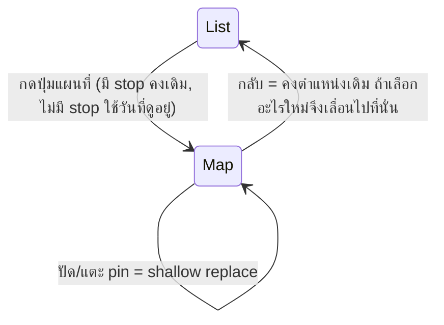

# แผน: แก้ UX รายการ + แผนที่บนมือถือ และทำให้ทั้งสองหน้า sync กัน

สถานะ: **กำลังทำ PR 1** (สั่งเริ่ม 2026-10-31)
ฐานโค้ด: `origin/main` @ `41bb7ae`
แผนนี้ปรับตามผล `/scrutinize` 2 รอบ: รอบแรก "rework" รอบสอง "fix-then-ship" และแก้ครบแล้ว (สรุปใน §10)

## 1. สรุปสั้น

แบ่งเป็น 2 PR: **PR 1** แก้ปัญหาที่เห็นตา ส่วน **PR 2** ทำ sync

| # | ปัญหาที่แจ้ง | สาเหตุ | ทางแก้ | PR |
|---|---|---|---|---|
| 1a | Pin number กระพริบตอนกด | `:active` ใส่ `transform` ทำให้ wrapper กลายเป็น stacking context แล้ว rail ทับเลข | งด press transform เฉพาะ wrapper นี้ | 1 |
| 1b | Leg ทับ body ของ card ที่เลือก | Rail อยู่นอก card, `z-index: 1` และยาวตลอดแถวที่ขยาย | ให้พื้น card เริ่มถัดจาก rail ทางขวา | 1 |
| 2 | ปุ่มลอยกองอยู่ทางขวา | ปุ่มชิดขวาตามคอลัมน์ของแผนที่ ซึ่งไม่มีในหน้ารายการ | ปุ่มกลมไอคอนที่มุมล่างขวา ทั้งสองหน้า | 1 |
| 3a | ขอบบนของ card ใน carousel หาย | Strip ไม่มี padding บน ทำให้ ring 2px ถูกตัด | เพิ่ม padding บน | 1 |
| 3b | ไม่มี guide ให้ปัด | มีแค่ peek | ป้ายนำจนกว่าจะปัดครั้งแรก + nudge ครั้งเดียว | 1 |
| 4 | Sync ไม่ครบ | ทุกการเลือกรอ server ราว 370-800ms และกลับจากแผนที่แล้วรายการไม่เลื่อนตาม | เปลี่ยนเป็น shallow URL และใช้ contract ใน §5 | 2 |

## 2. หลักฐาน

ทดสอบบน production build, Playwright `isMobile` + touch, 476×638, DPR 2.625 และ Google Maps จริง **ยังไม่ได้ทดสอบบนเครื่องจริง**

- **1a reproduce ได้:** `globals.css:411` ใส่ `translateY(1px)` กับ `[role='button']` ขณะ `:active` และ wrapper ที่ `sortable-place-item.tsx:205` ครอบทั้งแถว `z-index: 2` ของเลขจึงติดอยู่ใน wrapper ส่วน rail อยู่นอก wrapper และทับเลข ไม่ได้เกิดจาก remount หรือ dnd
- **1b เป็นผลจาก layout เดิม:** Rail มี `top: 35px; bottom: -35px` จึงพาดผ่าน card ที่เลือก
- **3a reproduce ได้:** ขอบบน strip 448, ขอบนอกของ ring 446 ขาด 2px (`map-stop-carousel.tsx:144`)
- **4:** เลือกแล้วต้องรอ RSC และหลัง Back URL ลงตัวช้าถึง 692-825ms บน localhost ทดลอง `history.replaceState` กับ carousel แล้ว ring ขยับใน **7ms โดยไม่มี RSC request** และ tag ของแผนที่ยังอยู่
- **ของเดิมที่ดีอยู่แล้ว:** Aside เก็บตำแหน่ง scroll ไว้ระหว่าง `display:none` (120→120)

## 3. PR 1: รายการ

### A1. เลิกกระพริบ

- เพิ่ม `:not([data-no-press])` ในกฎ global แล้วใส่ `data-no-press` ให้ wrapper ที่ `sortable-place-item.tsx:205` ใช้ class ใน module ทับไม่ได้ เพราะกฎนี้มี specificity (0,3,0)
- `.row:focus-within .handle` ทำให้จุดลากโผล่ทุกครั้งที่แตะ (เห็นในภาพที่แจ้ง) เปลี่ยนเป็นแสดงเมื่อ `:has(:focus-visible)` หรือ `:has([aria-current='true'])` บนมือถือจึงยังเห็นจุดลากในแถวที่เลือก ซึ่งเป็นทางเดียวที่บอกว่าลากเรียงได้

Spinner ของ `busy` ยังคงอยู่ใน PR 1 เพราะเป็น feedback เดียวหลังตัด press ออก และเอาออกใน PR 2

### A2. พื้น card ไม่ตัดกับ rail

Rail และเลขอยู่ที่เดิมเสมอ พื้น card เริ่มที่ x≈73 (เลขจบ 71, tile เริ่ม 79) ทดลองแล้วว่า paint order ถูกต้อง ทั้งแถวปกติและแถว hotel

```css
.place { background: transparent; }
.placeActive, .place.placeLinked { background: transparent; border-color: transparent; box-shadow: none; }
.placeActive::before, .place.placeLinked::before {
  content: ''; position: absolute; inset: -1px -1px -1px 44px;
  border-radius: 14px;
  /* placeActive: tint + --border-strong | placeLinked: surface-2 + --border */
}
.placeActive > *, .place.placeLinked > * { position: relative; }  /* ไม่ใส่ z-index */
```

- **Dark theme:** `.place` เป็น panel สี `#18181b` ทุกแถว rail จึงพาดทุกแถว ต้องทำ `.place` ให้โปร่งใส ไม่อย่างนั้นปัญหา 1b ยังอยู่ในแถวอื่น
- **Drag overlay:** ต้องใส่ `background: var(--surface)` ที่ wrapper ของ overlay เพราะเดิมอาศัยพื้นของ `.place` ไม่อย่างนั้นจะโปร่งใส
- **ต้องดูด้วยตา:** แถวที่ไม่ได้เลือกใน dark theme จะเข้มขึ้น (`#18181b` เป็น `#09090b`) และ hover ของ `.placeLinked` อาจเสีย transition
- **ข้อห้าม:** ห้ามใช้ `isolation`, `z-index` หรือ `transform` บน `.placeActive` และลูกของมัน

### A3. บอกสถานะที่เลข

เลขของจุดที่เลือกมีวงนอกสี kind 30% แบบ pin บนแผนที่ (`map-pin.module.css:82`) ใช้ `box-shadow`

### A4. ปุ่ม แผนที่

ตามที่เจ้าของงานเลือกจาก mockup: ปุ่มกลมไอคอนอย่างเดียว ตำแหน่งเดียวกันทั้งสองหน้า

| | หน้ารายการ | หน้าแผนที่ |
|---|---|---|
| ไอคอน | เข็มทิศ | รายการ |
| สี | พื้น `--brand` ไอคอนขาว | พื้นขาว ไอคอน `--brand` |

- ขนาด 44×44, `right: 16`, `bottom: 84` (nav 56 + 28) `--shadow-lg`, `aria-label` เดิม
- 12px ใช้ไม่ได้เพราะข้อความของ Google ที่มุมขวาสูงจาก nav ราว 26px
- Day switcher: ขอบซ้ายตรงกับ card, กว้าง `CARD_WIDTH` แต่ไม่เกินขอบซ้ายของปุ่มลบ 8px (476 → 320px, 320 → 220px) ปรับ `SWITCHER_WIDTH` ใน `map-stop-carousel.tsx` และ `MAP_TOGGLE_WIDTH`
- กติกาตำแหน่งเดียวกันและ I3 ยังใช้ได้ ปรับข้อความใน `REQUIREMENTS.md:302` เฉพาะส่วนที่บรรยายปุ่ม

**ข้อแลกเปลี่ยนที่ยอมรับแล้ว:** ปุ่มอาจบังถังขยะของแถวที่เลื่อนมาตรงนั้นชั่วคราว ถังขยะไม่มี confirm แต่เจ้าของงานยอมรับ เพราะเลื่อนออกได้และแถวสุดท้ายพ้นปุ่ม

## 4. PR 1: แผนที่

### B1. ขอบบนของ card

เพิ่ม `pt-2` ให้ strip ทดลองแล้ว card และ day switcher ไม่ขยับ แถบ 8px นี้รับการแตะแทนแผนที่ซึ่งยอมรับได้

### B2. Guide ให้ปัด

ทำเมื่อมี ≥2 จุด:

1. **ป้ายลอยเหนือ card:** `‹ ปัดเพื่อดูจุดอื่น ›` / `‹ Swipe for more stops ›` กลางจอ, `pointer-events: none` จึงไม่แย่งการแตะ และไม่บัง category/เวลาใน card หายถาวรเมื่อปัดครั้งแรก
2. **Nudge ครั้งเดียวตลอดการใช้งาน:** ทุก card ขยับ 24px ไปทางที่มี card ถัดไปแล้วกลับ ภายใน 700ms หลังเปิดแผนที่ 800ms
   - ใส่ `transform` ที่ `<li>` ทุกใบ ไม่ใช่ `<ul>` เพราะ clip ของ `<ul>` ขยับตามและไม่เผยอะไรเพิ่ม ทดลองแล้ว peek เพิ่มจาก 20 เป็น 44px ที่จอ 320, ไม่เกิด scroll event และ URL ไม่เปลี่ยน
   - ไม่เล่นเมื่อ `prefers-reduced-motion`

ตรวจการปัดจริงจาก `touchstart` บน strip ไม่ใช่ `onSettle` เพราะ `onSettle` ทำงานหลัง reflow ได้ด้วย เก็บสถานะใน `localStorage` ลด `gap-3` เป็น `gap-2` เพื่อให้เห็น card ถัดไปมากขึ้น

**เลิกใช้ตัวนับ `2/5`:** ข้อมูลจริงมีเลขข้าม เช่น badge 2 กับตัวนับ `1/6` ใน card เดียวกันซึ่งขัดกัน และตัวนับไม่ได้บอกว่าปัดได้

ไม่ใช้: dots (ล้นเมื่อ 30 จุด), ลูกศรที่กดได้ใน card (ซ้ำกับ ‹ › ของ day switcher), coachmark

## 5. PR 2: Contract ของการ sync

**Active stop คือ `(day, placeId)` ใน URL** และ `placeId` เป็น `null` ได้ ไม่เพิ่ม store ใหม่



| เหตุการณ์ | ผลลัพธ์ | สถานะ |
|---|---|---|
| แตะแถวในรายการ | Highlight และขยายทันที ไม่มี spinner | **ใหม่** C1 |
| เปิดแผนที่ มี stop | Card และกล้องอยู่ที่ stop นั้น | มีแล้ว |
| เปิดแผนที่ ไม่มี stop | ใช้วันที่ดูอยู่ ไม่เลือก stop ให้เอง | **ใหม่** C2 |
| ปัด carousel หรือแตะ pin | URL อัปเดตทันที ไม่เพิ่ม history | ปรับ C1 |
| แตะ pin ที่เลือกอยู่ | กลับเป็น `null` | มีแล้ว |
| กลับรายการ, `(day, placeId)` **ไม่เปลี่ยน** | **ตำแหน่ง scroll เดิม** | มีแล้ว |
| กลับรายการ, เปลี่ยนเป็น stop ใหม่ | เปิดวันนั้น, เลื่อนแถวขึ้นบนจอ | **ใหม่** C3 |
| กลับรายการ, เปลี่ยนวันโดยไม่มี stop | เปิดวันนั้น, เลื่อนหัววันขึ้นบนจอ | **ใหม่** C3 |
| เปลี่ยนวันบนแผนที่ | `placeId = null`, fit ทั้งวัน | มีแล้ว |

**ไม่ sync:** hover, ตำแหน่ง scroll กับกล้อง, วันอื่นที่กางอยู่, zoom/pan, สถานะลาก

### C0. Spike ก่อนเริ่ม (ประตูตัดสินใจ)

ทำ `selectStop()` เป็น helper เดียว ใช้ `window.history.replaceState` ตามที่ Next รองรับ โดย state ต้องคง tag ของแผนที่แต่ไม่ spread `__NA` (patch ของ Next จะข้ามการ sync URL) แล้วพิสูจน์ด้วย e2e ก่อนทำส่วนอื่น:

Back, reload, flow 3 (map → Calendar → Back → Back), การ revalidate หลังแก้ข้อมูล, `?placeId` ที่ลบไปแล้ว และลิงก์ที่เปิดตรงจากภายนอก

รอบ scrutiny ทำ prototype แล้ว กรณีเหล่านี้ส่วนใหญ่ผ่าน แต่ต้องแก้ 2 จุดนี้ใน helper:

- **Pathname guard:** `selectStop` ต้องไม่ทำอะไรถ้า `location.pathname` ไม่ตรงกับ href ไม่อย่างนั้น `scrollend` ตอนกดแท็บ Calendar จะเขียน URL ของรายการทับ (reproduce ได้ 6/6 ใน prototype และบน main เด้งกลับรายการเป็นบั๊กเดิม) ต้องตรวจ URL หลังจอนิ่งแล้วด้วย
- **`syncTo`:** ที่ `map-preview-context.tsx` ต้องเปลี่ยนจาก `router.replace` เป็น `selectStop` ไม่อย่างนั้นยังรอ network ราว 2.4 วินาทีเมื่อ RSC ช้า

**ถ้าผ่านไม่หมด: หยุดแล้วกลับมาถาม** ไม่สร้างทางแก้ด้วย timer

### C1. เลือก stop แบบ shallow

- `DaysAccordion` อ่าน `(day, placeId)` จาก `useSearchParams` แทน prop จึงไม่มีช่วงที่ขยายสองแถวพร้อมกัน และแตะเร็วๆ ก็คำนวณ toggle จากค่าล่าสุด เนื้อหาที่ขยายเป็นข้อมูลฝั่ง client อยู่แล้ว
- `page.tsx` ยังอ่าน `searchParams` เพื่อ render ครั้งแรก ฝั่ง client ต้องตรวจค่าแบบเดียวกัน (`placeId` ไม่มีจริง, `day=99`)
- เอา `useTransition`, spinner `busy` ออก
- มือถือใช้ `replace` ทำให้ Back ออกจากหน้าแทนการไล่ย้อนการเลือก (§9) ส่วน desktop ใช้ shallow `pushState` คงพฤติกรรมเดิม
- แก้บั๊กเดิมที่พบเพิ่ม: ปัดแล้วกด List เร็วๆ การเลือกหายเพราะ replace ที่ค้างอยู่ถูกทิ้ง

### C2. เปิดแผนที่จากวันที่ดูอยู่

ตอนกดปุ่มและไม่มี `placeId`: เลือกวันที่กางอยู่และ **กินพื้นที่ใน aside มากที่สุด** ไม่มีวันกางอยู่ให้ใช้วันใน URL เรียกจากปุ่มนี้เท่านั้น ไม่ใช่จาก "View on map"

ทดลองแล้วว่าไม่ชนกับ `pushState` ของ `openFullMap` และ Back ทำงานถูกต้อง

### C3. เลื่อนเมื่อกลับจากแผนที่

- จำ `(day, placeId)` ภายใน `openFullMap` หลัง replace ของ C2 แล้วเทียบตอนปิด เลื่อนเฉพาะเมื่อเปลี่ยน
- ถ้าเข้าแผนที่จาก entry ที่ tag ไว้แล้ว (reload หรือ Back จากแท็บอื่น) ไม่มีค่าเทียบ ให้เลื่อนเสมอ เพราะ aside ถูก remount และ `scrollTop` เป็น 0 แล้ว
- เลื่อนจาก effect เมื่อ `searchParams` ตรงกับ URL ของแผนที่ แล้วตามด้วย `requestAnimationFrame` เพราะ `data-fullmap` และ sync มาช้ากว่า effect ลูก
- บังคับเปิดวันที่ active เพราะวันที่พับอยู่ไม่มีแถวให้เลื่อนไปหา
- ค้นแถวภายใน `[data-day-id]` ของวันนั้น เพราะ hotel row มี id ซ้ำข้ามวัน ไม่พบแถว (ride pin) ให้เลื่อนหัววันแทน
- ระงับ hide-on-scroll ไม่อย่างนั้น nav จะหายตอนกลับ: ตั้ง `aside.dataset.silentScroll` ก่อนเลื่อน แล้ว `onScroll` ใน `trip-rail-frame.tsx:62-74` อัปเดต `lastY` ลบ flag แล้วออก ไม่ต้องมี global ใหม่
- `scrollTop` ของ aside ทำงานถูกต้อง ไม่ต้องใช้ `scroll-margin-top` ไม่ใช้ timer

### ขอบเขตของ viewer

ผู้ดูที่แก้ไม่ได้ใช้ `StaticItem` ซึ่งเลือกแถวไม่ได้ และไม่มี highlight หรือการขยายมาก่อน งานนี้ไม่เพิ่มให้ แต่ C3 ยังเลื่อนแถวให้เห็น รายการสถานะเลือกแล้วจึงใช้กับผู้แก้ไขได้เท่านั้น (§9)

## 6. การทดสอบ

ทุกข้อต้องเห็น **แดงบน main และเขียวหลังแก้** ยกเว้นข้อที่ระบุ ใน `app/e2e/mobile-layout.spec.ts` (`pnpm e2e:mobile`, production build)

| ทดสอบ | สิ่งที่ตรวจ | PR |
|---|---|---|
| T1 กดค้าง | `page.mouse.down` ค้าง แล้ว wrapper มี `transform: none` และ pixel ของเลขตรงกับตอนไม่กด (`elementFromPoint` ใช้ไม่ได้เพราะ rail มี `pointer-events: none`) | 1 |
| T2 Card ที่เลือก | Rect ของ parent + `left` ของ `::before` จาก computed style ≥ ขอบขวาของ rail แถวนี้และแถวก่อนหน้า | 1 |
| T3 ปุ่ม | ขอบขวาห่างจอ 16px, 44×44, ตำแหน่งเท่ากันทั้งสองหน้า ที่ 320, 360, 476, ไม่ทับ day switcher และ card, `elementFromPoint` กลางปุ่มได้ปุ่มเอง | 1 |
| T4 Ring | ขอบนอกของ ring อยู่ในกรอบ strip | 1 |
| T5 Guide | ป้ายแสดงก่อนปัด หายหลัง touch-swipe ไม่กลับมาหลัง reload ไม่แสดงเมื่อมีจุดเดียว, category/เวลายังอยู่ | 1 |
| T6 Nudge | เล่นครั้งเดียว peek ใหญ่ขึ้นระหว่างเล่น ไม่เปลี่ยน `placeId` ไม่เล่นเมื่อ reduced motion | 1 |
| T6b Drag | Overlay ตอนลากมีพื้นทึบ แถวที่เลือกเห็นจุดลากบน touch | 1 |
| T7 แตะแถว | Highlight ขึ้นโดยไม่รอ network (หน่วง RSC 1500ms ใน test) และไม่มีสองแถวขยายพร้อมกัน | 2 |
| T8 กลับ เปลี่ยน stop | แถวนั้นอยู่ในจอ, วันที่พับถูกเปิด, nav ไม่หาย | 2 |
| T9 กลับ ไม่เปลี่ยน | `scrollTop` ของ aside เท่าเดิม | 2 |
| T10 เปิดแผนที่ | กางวันอื่นตามกรณีใน §10 ข้อ 3: แผนที่แสดงวันนั้น ไม่มี `placeId` | 2 |
| T11 Back | เลือก 3 จุดแล้ว Back ครั้งเดียว: ออกจากหน้า | 2 |
| T12 ปัดแล้วกลับเร็ว | หน่วง RSC 1500ms: การเลือกไม่หาย | 2 |
| T13 ออกทางแท็บ | แตะ pin แล้วกด Calendar: URL หลังจอนิ่งยังเป็น `/calendar` (แดงบน main) | 2 |
| T14 กลับหลัง remount | map → Calendar → Back → Back: แถวที่เลือกอยู่ในจอ | 2 |

รัน flow เดิมทั้งหมดใน `en` และ `th` พร้อม `pnpm test` และ `pnpm build` ในทุก PR

**ข้อจำกัด:** ยังไม่มีเครื่องจริง ต้องให้คุณลองบน Android Chrome จาก preview deploy ของทั้งสอง PR

## 7. ลำดับงานและการแบ่ง agent

สร้าง `pm` ticket แล้วแตก worktree จาก `origin/main` ล่าสุดก่อนเริ่มแต่ละ PR

| ลำดับ | งาน | Agent | เหตุผล |
|---|---|---|---|
| **PR 1** | | | |
| 1 | เขียน T1-T6 ให้แดงบน main | Sonnet | ใช้ harness ที่มีแล้ว |
| 2 | A1, B1, A4 | Codex `gpt-5.6-luna` | งานเล็ก ขอบเขตชัด |
| 3 | A2, A3 | Sonnet | ระวัง stacking และ dark theme |
| 4 | B2 + คำแปล | Sonnet | มี state และ animation |
| 5 | แก้ `REQUIREMENTS.md`, `AGENTS-INDEX.md` | `agy` ถ้าอนุญาต (§9) ไม่อย่างนั้น Haiku | งานเอกสาร |
| 6 | `/scrutinize` diff | Opus ตัวใหม่ | อ่านแบบไม่ติดการตัดสินใจเดิม |
| **PR 2** | | | |
| 7 | C0 spike + e2e | Opus | เป็นประตูของ PR นี้ |
| 8 | C1-C3 + T7-T12 | Opus | แตะ history และ router |
| 9 | `/scrutinize` diff | Opus ตัวใหม่ | |

Session นี้เป็นผู้ควบคุม ตรวจผลและรันเทสต์เองทุกขั้น ไม่ merge จนกว่าคุณจะสั่ง

**หยุดและกลับมาถามเมื่อ:** A2 ทำไม่ได้โดยไม่เกิด stacking context, C0 ไม่ผ่าน, หรือ flow เดิมพังด้วยเหตุอื่นนอกจาก I3

## 8. ไม่ทำในงานนี้

Bottom sheet หรือ split view, dots, coachmark, store ฝั่ง client ที่ซ้ำกับ URL, เลือก stop แรกให้อัตโนมัติ, การเลือกแถวของ viewer, badge ซ้อนกันบนเส้น leg, ไอคอนทับ note ยาว

## 9. การตัดสินใจ (เจ้าของงานเห็นชอบแล้ว)

1. **ปุ่มแผนที่ (A4):** ตัดสินแล้ว: ปุ่มกลมตำแหน่งเดียวกันทั้งสองหน้า เข็มทิศ/รายการ สีแบบ B
2. **Back ในรายการ (C1):** ค่าเริ่มต้นคือออกจากหน้าเลย
3. **ป้ายและ nudge (B2):** ค่าเริ่มต้นคือทำทั้งสองอย่าง ป้ายบังแผนที่แถบเล็กๆ เหนือ card จนกว่าจะปัดครั้งแรก
4. **Viewer:** ค่าเริ่มต้นคือไม่เพิ่มการเลือกแถวในงานนี้
5. **`agy`:** รันแบบ headless ไม่ได้ถ้าไม่มี allow-rule ใน `settings.json` ค่าเริ่มต้นคือไม่แก้ settings และใช้ Haiku แทน

## 10. ผล `/scrutinize` รอบแรกและการแก้

| # | Finding | การแก้ในแผนนี้ |
|---|---|---|
| 1 | ช่วงรอ 600ms ของ C3 ใช้ไม่ได้: URL ลงตัวที่ 692-825ms | เปลี่ยนเป็น shallow และเลิกใช้ timer |
| 2 | เลื่อนทุกครั้งที่กลับ ทำให้เสียตำแหน่งที่อ่านอยู่ | เลื่อนเฉพาะเมื่อ `(day, placeId)` เปลี่ยน |
| 3 | เลือกวันจากกลางจอแล้วผิดวัน (กลางจอที่ 319 ตกช่องว่าง วันใหม่เริ่มที่ 368) | ใช้วันที่กินพื้นที่มากสุด |
| 4 | การเลื่อนทำให้ nav หาย | ระงับ hide-on-scroll |
| 5 | T1 แดงไม่ได้ | เปลี่ยนวิธีวัด |
| 6 | A4 ทำให้ flow 9 I3 แดงตามตั้งใจ และขัดกับ `REQUIREMENTS.md:302` | แก้พร้อมกัน, ระบุข้อแลกเปลี่ยนให้ครบ |
| 7 | ตัวนับขัดกับเลข badge และไม่ได้บอกว่าปัดได้ | เลิกใช้ เปลี่ยนเป็นข้อความ |
| 8 | Nudge card เดียวทับ card ข้างๆ | ขยับทั้ง strip |
| 9 | `useOptimistic` อยู่ผิดระดับ | เลิกใช้ อ่านจาก URL ที่ `DaysAccordion` |
| 10 | เหตุผลของ `replace` เดิมผิด | ให้เหตุผลใหม่เป็นพฤติกรรมของ Back |
| 11 | ยังมีจุดลากโผล่และ spinner ตอนแตะ | แก้ใน A1 และ C1 |
| 12 | ปัดแล้วกลับเร็วการเลือกหาย (บั๊กเดิม) | Shallow แก้ได้ เพิ่ม T12 |
| 13 | Viewer และวันที่พับอยู่นอก contract | ระบุขอบเขต, บังคับเปิดวัน |
| - | Dark theme ยังมี rail ทับแถวอื่น, effect order, `scroll-margin-top` เกินจำเป็น | แก้ใน A2, C3 |

แบ่งเป็น 2 PR ตามคำแนะนำ ข้อที่ยืนยันแล้วว่าใช้ได้: paint order ของ A2, B1, การไม่ชนกันของ C2

### รอบสอง: fix-then-ship

| # | Finding | การแก้ในแผนนี้ |
|---|---|---|
| 1 | ออกทางแท็บแล้ว URL เสีย | Pathname guard, T13 |
| 2 | `syncTo` ยังรอ network | ใช้ `selectStop` |
| 3 | Scroll อาจวิ่งก่อน sync | รอ `searchParams` ตรงก่อน |
| 4 | A1 ทำให้ไม่เห็นจุดลากบน touch | แสดงในแถวที่เลือก |
| 5 | ค่าเทียบของ C3 ผิดหลัง remount | จำใน `openFullMap`, ไม่มีค่าให้เลื่อนเสมอ, T14 |
| 6 | Drag overlay โปร่งใส | ใส่พื้นให้ overlay |
| 7 | Nudge ทั้ง `<ul>` ไม่เผยอะไร | ขยับ `<li>` |
| 8 | `onSettle` ใช้จับการปัดจริงไม่ได้ | ใช้ `touchstart`, ป้ายอยู่จนปัด, nudge ครั้งเดียว |
| 9 | ข้อความแทน meta ซ่อน category/เวลา | เปลี่ยนเป็นป้ายลอยเหนือ card |
| 10 | `lastY` ใช้ระงับ nav ไม่ได้ | ใช้ `dataset.silentScroll` |

รอบสองทดสอบด้วย prototype นอก repo, ยืนยันแล้ว: state ที่ไม่มี `__NA`, การ revalidate, Back ทั้งมือถือและ desktop, ปัดแล้วกลับเร็ว ป้ายลอยใน B2 เป็นทางแก้ที่ออกแบบหลังรอบสอง จึงยังไม่ถูกทดลอง
