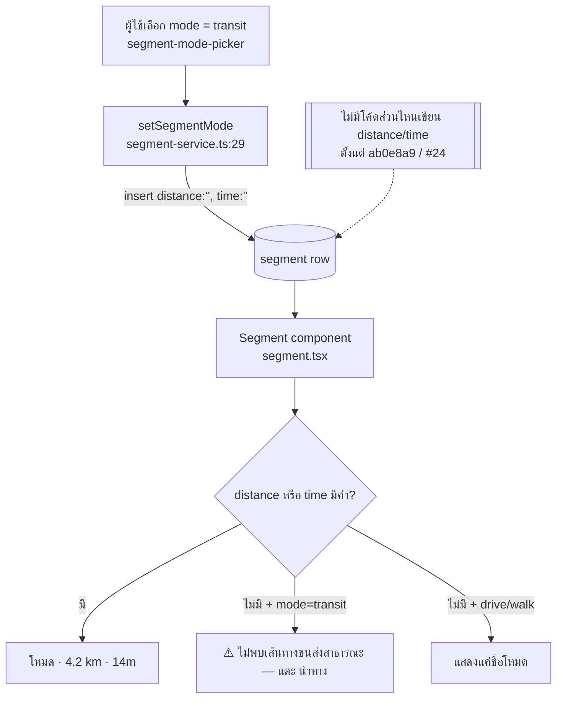

# Transit leg ขึ้น "ไม่พบเส้นทางขนส่งสาธารณะ" ทุกครั้ง — วิเคราะห์ + แผนแก้

> สถานะ: **อนุมัติทางเลือก A (ลบข้อความออก) · scrutiny แล้ว (§6) · กำลังลงมือ**
> รายงานจาก: prod `/trip/3af37921-…?day=0` — "Google Maps API บน prod detect method transit ไม่ได้"

## 1. สรุปสั้น

**Google ไม่ได้ "detect transit ไม่ได้"** ตอนนี้แอปไม่ได้เรียก Google เพื่อหาเส้นทางเลยไม่ว่าจะเป็น mode ไหน
ข้อความ *"ไม่พบเส้นทางขนส่งสาธารณะ — แตะ นำทาง"* เป็น **UI ที่ค้างมาจากสมัยที่ยังใช้ Routes API**
และตอนนี้มันขึ้นกับ **transit leg ทุกอันที่สร้างหลัง #24** ไม่ว่าจริง ๆ แล้วจะมีเส้นทางหรือไม่

## 2. สาเหตุ (ตรวจจากโค้ด)

| หลักฐาน | ตำแหน่ง |
|---|---|
| ถอด Routes API ออกทั้งหมดเพื่อลดค่าใช้จ่าย รวมทั้ง `persistSegmentLeg` ที่เคยเขียน distance/time กลับลง DB | commit `ab0e8a9` "perf(map): drop Routes API … (#24)" |
| leg ใหม่เก็บ `distance: ''`, `time: ''` เสมอ | `app/src/lib/services/segment-service.ts:29`, `place-service.ts:75` |
| ถ้าค่าว่างและเป็น transit จะขึ้น hint ว่า "no transit route" | `app/src/components/segment.tsx:120-131` |
| ข้อความนี้มีมาตั้งแต่ก่อนถอด Routes API (ตอนนั้นหมายถึง "Routes API ตอบ ZERO_RESULTS") | `3556227` → แยกเป็น i18n ใน `b86357f` |
| spec ยืนยันว่าไม่ใช้ Routes/Directions API ส่วน per-leg routing ให้ deep-link ไป Google Maps | `REQUIREMENTS.md:298`, `docs/ops/maps-cost-guardrails.md` |

ลิงก์ "นำทาง" ยัง**ทำงานถูก**: `gmapsDirectionsUrl([from,to], 'transit')` สร้าง `…/maps/dir/?api=1&…&travelmode=transit` (`app/src/lib/gmaps.ts:41`)
แอป Google Maps คำนวณเส้นทาง transit ฝั่งตัวเองได้ (ญี่ปุ่นก็ได้)

> ข้อจำกัด: trip นี้ต้อง login ผมเลยเปิดดูหน้า prod จริงไม่ได้ และ `app/.env` ในเครื่องไม่ใช่ DB ของ prod (query trip นี้แล้วได้ 0 row)
> ข้อสรุปข้างบนจึงมาจากการไล่ code path ล้วน ๆ ก่อนแก้ควรเปิดหน้าจริงดูเพื่อยืนยันว่าข้อความที่ผู้ใช้เห็นคือ hint ตัวนี้

## 3. ทางเลือก

| | ทางเลือก | ค่าใช้จ่าย | ข้อดี | ข้อเสีย |
|---|---|---|---|---|
| **A** | **แก้ copy / เอา hint ออก** transit แสดงเหมือน drive/walk (ชื่อโหมด + ปุ่มนำทาง) หรือเปลี่ยนเป็นข้อความกลาง ๆ เช่น "ดูเวลาใน Google Maps" | ไม่มี | ไม่ทำให้ผู้ใช้เข้าใจผิดอีก ตรงกับ spec ปัจจุบัน แก้แค่ 3 ไฟล์ | ไม่มีระยะทาง/เวลาให้เห็น (ซึ่งตอนนี้ drive/walk ก็ไม่มีอยู่แล้ว) |
| B | ประมาณระยะทางเป็นเส้นตรง (haversine) จาก coords มีฟังก์ชันอยู่แล้วที่ `lib/map-preview.ts:179` แสดงเป็น "~3.2 km" | ไม่มี | มีตัวเลขให้เห็นบ้าง | ไม่ใช่ระยะทางบนถนนจริง และ**ประมาณเวลาของ transit ไม่ได้** |
| C | กลับไปใช้ Routes API `computeRoutes` แบบเรียกตอนกดดู แล้ว cache ลง `segment.distance/time` | ต้องเสียเงินต่อครั้ง (SKU/ราคา transit ต้องเช็คในเอกสาร Google อีกที) | ได้เวลาจริง | ขัดกับมติลดค่าใช้จ่ายของ #24 และ **Routes/Directions API ไม่มีข้อมูล transit ในญี่ปุ่น** (ติดเรื่อง license) ถ้าเป็นทริปญี่ปุ่นก็จะได้ ZERO_RESULTS อยู่ดี ซึ่งอาจเป็นต้นเหตุของ hint นี้ตั้งแต่แรก |

**แนะนำ: A** (จะเสริมด้วย B ในภายหลังก็ได้ถ้าอยากเห็นตัวเลข) ไม่แนะนำ C
เพราะทั้งเพิ่มค่าใช้จ่าย และอาจใช้กับทริปที่มีปัญหาไม่ได้เลย

## 4. แผน (ทางเลือก A: ลบข้อความออก)

1. สร้าง pm ticket แล้วเปิด worktree จาก `origin/main` ชื่อ `../travel-planner-v2-transit-hint` branch `fix/transit-segment-hint`
2. `app/src/components/segment.tsx` ลบ branch `mode === 'transit' ? … itin_segment_no_transit` ออก
3. `app/src/messages/en.json`, `th.json` ลบ key `itin_segment_no_transit` ออก (`i18n-messages.test.ts` เช็คว่าทั้งสองภาษามี key ตรงกัน)
4. `itinerary-list.module.css:77` ลบ `.segHint` (ยืนยันแล้วว่าไม่มีที่อื่นใช้)
5. **ไม่เพิ่ม unit test** เพราะ repo นี้ไม่มี test infra สำหรับ React component (`vitest` ตั้ง `environment: 'node'` และไม่มีไฟล์ `*.test.tsx` สักไฟล์) ตัวที่กันไม่ให้ข้อความนี้กลับมาคือ type `MessageKey` ถ้าโค้ดไหนเรียก key ที่ลบไปแล้ว `pnpm typecheck` จะ fail
6. Verify: `pnpm typecheck` + `pnpm test` (vitest) + e2e ที่มีอยู่ `--grep "segment mode change"` บน `pixel-7` (build ครั้งเดียว ประมาณ 4 นาที)
7. หลัง deploy เปิด trip `3af37921…?day=0` บน prod แล้วเช็คว่าแถว transit ไม่มีข้อความนี้แล้ว และกดนำทางแล้วเปิด Google Maps ในโหมด transit

## 5. คำถามที่ต้องตัดสินใจ (ตอบแล้ว: A ลบข้อความออก)

1. เลือก A (เอาออกเฉย ๆ) หรือ A' (ข้อความกลาง ๆ ทุก mode) หรือ A+B?
2. trip นี้เป็นทริปญี่ปุ่นหรือเปล่า ถ้าใช่ ทางเลือก C ตกไปเลย
3. ช่วยยืนยันด้วยว่าสิ่งที่เห็นบน prod คือข้อความ *"ไม่พบเส้นทางขนส่งสาธารณะ — แตะ นำทาง"* ไม่ใช่ว่ากดนำทางแล้ว Google Maps เปิดขึ้นมาเป็นโหมดอื่น
   (ถ้าเป็นกรณีหลัง ต้องไล่ดู `travelmode` ใน URL จริง ซึ่งเป็นคนละเรื่องกัน)

## 6. Scrutiny (2026-11-03)

- **ทางที่ง่ายกว่านี้มีไหม:** ไม่มี การลบ branch เดียวคือ diff ที่เล็กที่สุด และตรงกับ spec (`REQUIREMENTS.md:298`)
- **Major, แก้แล้ว:** step 5 เดิมเขียนว่าจะทำ "RTL test ของ `Segment`" ซึ่งทำไม่ได้เพราะ repo ไม่มี DOM test env เลยใช้ typecheck (`MessageKey`) เป็นตัวกันแทน
- **ไล่ trace แล้ว:** มี `<Segment>` ใช้อยู่ 2 ที่ (`sortable-place-item.tsx:307` แถว leg ปกติ, `:413` leg ของโรงแรม) ทั้งสองที่ได้ผลเหมือนกัน คือ transit ที่ไม่มีข้อมูลจะแสดงแค่ picker/ชื่อโหมด + ปุ่มนำทาง เหมือน drive/walk ส่วน leg ที่ยังมี distance/time เก็บไว้ตั้งแต่ก่อน #24 ยังแสดงตัวเลขตามเดิม แผนที่และ carousel ไม่ได้ใช้ key นี้
- **ไม่มีอะไรเปลี่ยนเงียบ ๆ:** ไม่แตะ DB, API หรือ URL ของ Google Maps
