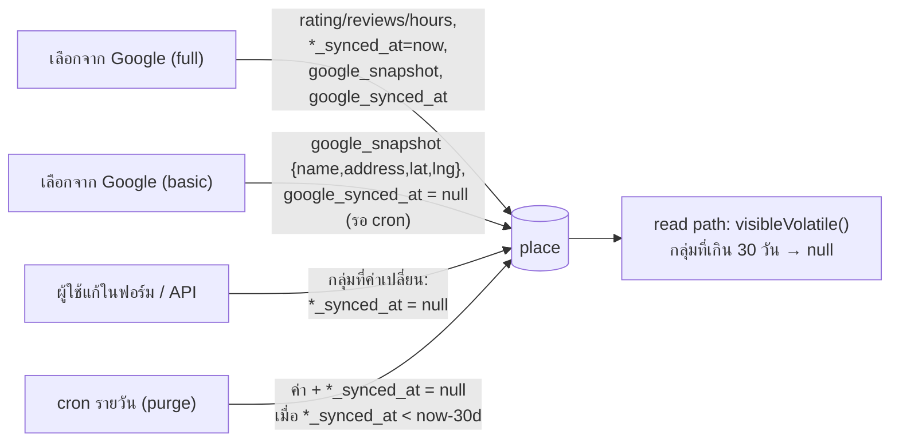

# Google place data: ข้อมูลที่มีอายุ (rating, เวลาเปิดปิด) + re-sync จาก Google — Design

**วันที่:** 2026-10-23 · **สถานะ:** adopted (ตัดสินใจครบแล้ว) · **ต่อจาก:** [Stage A plan](../plans/2026-10-23-maps-google-switch-stage-a.md) (Task 5b) · [Stage C plan](../plans/2026-10-23-maps-google-resync-stage-c.md) · [billing verification](../../research/2026-10-23-google-places-billing-verification.md)

## 0. สิ่งที่ผู้ใช้ตัดสินใจแล้ว (2026-10-23)

| เรื่อง | ตัดสินใจ |
|---|---|
| ToS 14.2: สถานที่ที่บันทึกจาก Google ไปโผล่บน MapLibre ตอนสลับกลับเป็น `open` หรือตอน fallback ไป MapLibre | **ยอมรับความเสี่ยง** |
| เก็บเนื้อหา Places ลง DB | **ชื่อ ที่อยู่ พิกัด เบอร์โทร เว็บไซต์ เก็บถาวร** (ยอมรับความเสี่ยง) · **rating/จำนวนรีวิว และเวลาเปิดปิด (`hours`) มีอายุ 30 วัน** · มี **re-sync จาก Google** |
| `hotel` | **ไม่รวม** ในรอบนี้ |

> อายุ 30 วันช่วยลดความเสี่ยง แต่ไม่ได้ทำให้ถูก ToS ทั้งหมด ToS อนุญาตให้ cache ได้แค่ lat/lng (30 วัน) กับ place_id

## 1. เป้าหมาย

1. rating, จำนวนรีวิว และเวลาเปิดปิดที่ได้จาก Google **หายไปเองหลัง 30 วัน** ถ้าไม่ได้ refresh
2. ทริปที่กำลังจะไปหรือกำลังเที่ยวอยู่ **ตรงกับ Google** ทั้งชื่อ ที่อยู่ พิกัด rating เวลาเปิดปิด และสถานะ "ปิดถาวร/ปิดชั่วคราว"
3. **ห้ามเขียนทับสิ่งที่ผู้ใช้แก้เอง**
4. อยู่ใน free tier และหยุดเองได้ถ้า Google มีปัญหา

## 2. Data model (migration เดียว + backfill)

ตาราง `place` เพิ่ม **5 คอลัมน์** ทั้งหมด nullable (ใช้ `timestamp` แบบเดียวกับคอลัมน์อื่นใน `schema.ts`):

| คอลัมน์ | ชนิด | ความหมาย |
|---|---|---|
| `rating_synced_at` | timestamp | ไม่ null = `rating`/`reviews` มาจาก Google ณ เวลานั้น · null = ของผู้ใช้ (ถาวร) หรือไม่มีค่า |
| `hours_synced_at` | timestamp | กติกาเดียวกัน ใช้กับ `hours` |
| `google_synced_at` | timestamp | เวลาที่ได้ข้อมูลจาก Google สำเร็จล่าสุด (ตอนเลือกหรือตอน refresh) |
| `google_snapshot` | jsonb | ค่าที่ Google ส่งมาล่าสุด `{name,address,lat,lng,phone?,website?}` ใช้ดูว่าผู้ใช้แก้ฟิลด์ไหนไปแล้ว |
| `google_status` | text | `OPERATIONAL` / `CLOSED_TEMPORARILY` / `CLOSED_PERMANENTLY` / `NOT_FOUND` / `INVALID` (id ใช้ไม่ได้, Google ตอบ 400 หรือไม่มี location — เขียนโดย Stage C) |

**ทำไมแยก `rating_synced_at` กับ `hours_synced_at` (ไม่รวมเป็นคอลัมน์เดียว):** ถ้าใช้คอลัมน์เดียว เมื่อผู้ใช้แก้แค่ `hours` คอลัมน์จะกลายเป็น null แล้ว rating จาก Google ก็จะกลายเป็น "ของผู้ใช้" และถูกเก็บถาวรไปด้วย สองคอลัมน์ใช้โค้ดเดียวกัน (วนตามกลุ่ม `VOLATILE_GROUPS = { rating: [rating, reviews], hours: [hours] }`) จึงไม่ซับซ้อนขึ้น

**`google_snapshot` ไม่มี `rating`/`reviews`/`hours`:** snapshot เก็บถาวร ถ้าใส่ข้อมูลที่มีอายุลงไปก็เท่ากับเก็บถาวร ฟิลด์ที่มีอายุใช้ `*_synced_at` เป็นตัวบอกความเป็นเจ้าของแทน

**Backfill ตอน migrate:** แถวที่ `place_id_external` เป็น Google id แบบไม่มี prefix (ไม่มี `:`):
- มี `rating` หรือ `reviews` → `rating_synced_at = '2000-01-01'`
- มี `hours` → `hours_synced_at = '2000-01-01'`

ค่าพวกนี้หมดอายุทันที ถูกซ่อนตั้งแต่ deploy และถูกลบในรอบ purge ถัดไป แลกกับการที่ค่าบางแถวที่ผู้ใช้เคยพิมพ์เองจะหายไปด้วย เพราะแยกไม่ออก (picker ก่อน #57 เขียน rating และ hours จาก Google)

## 3. ข้อมูลที่มีอายุ (TTL 30 วัน)



- **ตอนเขียน (เพิ่มใหม่):** เลือกแบบ `full` → ตั้ง `*_synced_at = now` ให้กลุ่มที่มีค่า, เขียน `google_snapshot`, `google_synced_at = now` · เลือกแบบ `basic` → เขียนแค่ snapshot `{name,address,lat,lng}` และตั้ง `google_synced_at = null` เพื่อให้ cron ของ Stage C (เรียง null มาก่อน) ดึงข้อมูลเต็มในคืนถัดไป (Enterprise 1 ครั้ง อยู่ใน cap 20/วัน) · ไม่ได้เลือกจาก Google (หรือมาจาก API) → ทุกคอลัมน์ null
- **ตอนผู้ใช้แก้:** เทียบค่าที่ส่งมากับ**ค่าที่ผู้ใช้เห็น** (`visibleVolatile(stored)`) ทีละกลุ่ม ถ้าต่าง → กลุ่มนั้น `*_synced_at = null` (กลายเป็นของผู้ใช้) ถ้าเท่า → ไม่แตะ (ถ้าค่าในกลุ่มเป็น null หมด ให้ `*_synced_at = null`)
- **ฟอร์มแก้ที่เปิดค้างไว้ (stale form):** หน้าแก้ place ส่ง hidden `formBase` = ค่าที่ฟอร์ม render ไว้ ฟิลด์/กลุ่มที่ผู้ใช้ไม่ได้แก้ในฟอร์มนี้ (ค่าที่ส่ง = `formBase`) **ไม่ถูกใส่ใน `SET` ของ UPDATE** (`untouchedUnits`) ค่าใน DB ตอนเขียนจึงอยู่ต่อ (ไม่ต้องอ่านเพิ่ม ไม่มี race) และไม่เปลี่ยนความเป็นเจ้าของ ถ้า cron refresh หรือ purge เกิดระหว่างที่ฟอร์มเปิดอยู่ ค่าใหม่จึงไม่ถูกเขียนทับด้วยค่าเก่า และไม่ถูกนับว่า "ผู้ใช้แก้" (API PATCH ไม่มี `formBase` เขียนทุกฟิลด์และใช้กติกาข้อบนตามเดิม) · ยอมรับ: ค่าที่แก้แล้วแก้กลับในฟอร์มเดียวแยกไม่ออกจาก "ไม่ได้แก้" (ไม่เสียหาย) และถ้า cron เปลี่ยน A → B ระหว่างที่ฟอร์มยังแสดง A ค่า B จะอยู่ต่อ (ผู้ใช้ไม่เคยเห็น B) · `formBase` ยาวเกิน 16,000 ตัวอักษร → ไม่ใช้ และ log warn ครั้งเดียวต่อ request
- **เลือกสถานที่ใหม่ในหน้าแก้:** การเลือกจะเขียนทับช่อง Address ที่มองเห็นด้วย ที่อยู่ที่บันทึกจึงตรงกับ snapshot ไม่ถูกนับว่าผู้ใช้แก้ · ถ้าเลือก**คนละที่** (id เปลี่ยน) กลุ่ม rating/hours ที่มาจาก Google (`*_synced_at` ไม่ null) และผู้ใช้ไม่ได้แก้ในฟอร์ม → ล้างเป็น null, เบอร์โทร/เว็บไซต์ที่ไม่ได้แก้และตรงกับ snapshot เดิม → ล้างเป็น null (ไม่ให้ข้อมูลของที่เดิมติดมากับที่ใหม่) · ถ้าเลือก**ที่เดิม** (id เดิม) → รวม snapshot ใหม่เข้ากับของเดิม (`phone`/`website` ใน snapshot เดิมยังอยู่) · `google_synced_at` ตามแบบการเลือกเหมือนตอนเพิ่ม: `full` → now, `basic` → null (รอ cron refresh)
- **API v1:** ส่ง `googleStatus` ออกไป แต่ตัด `googleSnapshot` และ `*_synced_at` ทิ้ง (`apiPlaceView` — ใน POST ทำภายใน callback ของ idempotency เพื่อให้ body ที่ replay ถูกตัดแล้วด้วย) — ยอมรับว่าการ export แล้ว import กลับผ่าน API จะทำให้ rating/hours ที่มองเห็นอยู่กลายเป็นค่าของผู้ใช้ถาวร
- **ยอมรับ (เพิ่มเติม):** แก้แค่ `rating` ทำให้ `reviews` จาก Google ในกลุ่มเดียวกันกลายเป็นของผู้ใช้ถาวรไปด้วย (กลุ่มมี `rating_synced_at` ตัวเดียว เปลี่ยนพร้อมกัน) · API agent ที่อ่าน rating ไว้ก่อน cron refresh แล้ว PATCH กลับด้วยค่าเก่า → ค่าเก่าต่างจากค่าที่ refresh แล้ว จึงกลายเป็นค่าของผู้ใช้ถาวร (กรณีเดียวกับ export/import)
- **`formBase` normalize:** `formBaseJson` ปรับค่าแบบเดียวกับที่ฟอร์มส่งกลับมา (ฟิลด์ text: ลบ `\r`/`\n` ทุกตัวเหมือนที่ browser ทำกับ `<input type="text">` แล้ว trim, `''` → null) ฟิลด์ที่ไม่ได้แก้จึงเท่ากันเสมอ
- **ตอนอ่าน:** `visibleVolatile(row, now)` คืนค่าในกลุ่มเป็น null เมื่อ `*_synced_at < now − 30d` ทุกที่ที่ส่ง place ออกไปต้องผ่านฟังก์ชันนี้ (รายการไฟล์อยู่ใน Stage A Task 5b)
- **purge:** cron รายวัน (`0 20 * * *` UTC = 03:00 เวลาไทย, Hobby ยิงภายในชั่วโมงนั้น) ตั้งค่าในกลุ่มและ `*_synced_at` เป็น null เมื่อหมดอายุ (รวมแถวที่ soft-delete) read path คอยกันช่วงไม่เกิน 24 ชม. ระหว่างรอบ
- **ทำงานทั้ง 2 โหมด:** ข้อมูลจาก Google ต้องหมดอายุแม้ตอนสลับกลับเป็น `open`

## 4. Re-sync จาก Google (Stage C)

### 4.1 ตัวที่สั่ง refresh

| Trigger | ขอบเขต | หมายเหตุ |
|---|---|---|
| **cron รายวัน** `/api/internal/google-resync` (`CRON_SECRET`, `0 19 * * *` UTC = 02:00 เวลาไทย) | place ที่มี Google id, ไม่ถูกลบ (place และ trip), `google_status` ไม่ใช่ `NOT_FOUND`/`INVALID`, อยู่ในทริปที่ `end_date ≥ today` และ `google_synced_at` เป็น null (รวมแถวที่เพิ่งเลือกแบบ `basic`) หรือเก่ากว่า **25 วัน** | เรียงทริปที่ `start_date` ใกล้สุดก่อน (null ไว้ท้าย) แล้วตาม `google_synced_at` เก่าสุดก่อน (null มาก่อน) ไม่เกิน cap ต่อวัน refresh ก่อนครบ 30 วัน ข้อมูลของทริปที่ยัง active จึงไม่ถูกซ่อน ลำดับระหว่าง cron นี้กับ purge ไม่มีผลต่อผลลัพธ์ |
| **ปุ่ม "Update from Google"** ในหน้าแก้ place | 1 place | **bucket แยก** `gplaces:refresh:manual` 5/วัน (cron แย่งโควตาปุ่มไม่ได้) + rate limit ต่อ user ที่มีอยู่แล้ว |

ทริปที่จบแล้วไม่ refresh ข้อมูลถาวรถูก freeze ส่วนข้อมูลที่มีอายุหมดอายุตามปกติ ทั้ง 2 ตัวไม่ทำอะไรถ้า `!MAPS_CONFIG.googlePlaces` ส่วน purge ทำงานเสมอ

### 4.2 การเรียก Google

- `GET /v1/places/{id}` **ไม่มี session token** จึงคิดตาม field ที่แพงสุดใน mask
- mask: `id,displayName,formattedAddress,location,businessStatus,nationalPhoneNumber,websiteUri,regularOpeningHours,rating,userRatingCount` → **Place Details Enterprise** ($20/1k, **ฟรี 1,000/เดือน** แยกจาก E+A ที่ใช้ตอนเลือก)
- cron: bucket `gplaces:refresh` cap **`GOOGLE_PLACES_REFRESH_DAILY_CAP` = 20/วัน** · ปุ่ม: bucket `gplaces:refresh:manual` cap **`GOOGLE_PLACES_REFRESH_MANUAL_DAILY_CAP` = 5/วัน** · รวม 25/วัน ≈ 750/เดือน < 1,000
- ใช้ state ของ breaker ตัวเดียวกับ search แต่ state อยู่ในหน่วยความจำ**ต่อ instance** ใน production cron มักรันคนละ instance จึงไม่ได้แชร์ข้าม route/invocation สิ่งที่กันไว้จริงคือ cron **หยุดรอบนั้นทันทีเมื่อเจอ 403, 429 หรือ timeout ครั้งแรกของตัวเอง**
- `404 NOT_FOUND` → `google_status='NOT_FOUND'` แล้วไม่ refresh แถวนี้อีก ข้อมูลเดิมยังอยู่
- ความผิดพลาดที่แน่นอน (id ไม่ผ่าน `isValidGoogleId`, Google ตอบ 400, หรือ 200 แต่ไม่มี `location`) → `google_status='INVALID'`, `google_synced_at=now()` ไม่ refresh อีก (กันคิวตัน) · ความผิดพลาดชั่วคราว (0/403/429/5xx) → ไม่เขียนอะไร ลองใหม่วันถัดไป
- เขียนแบบมีเงื่อนไข `WHERE id = $1 AND date_trunc('milliseconds', updated_at) = $2::timestamp` โดย `$2 = <updatedAt ที่อ่านมา>.toISOString()` (cron ไม่แตะ `updated_at` ส่วนการแก้ของผู้ใช้แตะ) ถ้าผู้ใช้บันทึกระหว่างนั้น → ไม่เขียน นับเป็น `skipped` · `date_trunc` เพราะ DB เก็บถึง µs แต่ JS `Date` มีแค่ ms · ต้องส่งเป็น string ISO + cast `::timestamp` ห้ามส่ง `Date` ตรง ๆ: ใน `sql` template Drizzle ไม่แปลงค่าให้ และปิด date serializer ของ postgres-js ส่วน neon-http แปลง `Date` เป็นเวลาท้องถิ่นพร้อม offset เทียบกับคอลัมน์ `timestamp` (ไม่มี tz, เก็บเวลา UTC) แล้วคลาดเท่า offset (7 ชม. บนเครื่อง dev ที่เป็น Asia/Bangkok) ทุกแถวจะกลายเป็น `skipped` · integration test รันด้วย `TZ=Asia/Bangkok` และ `updated_at` ที่มี µs

### 4.3 กติกา merge (ห้ามเขียนทับสิ่งที่ผู้ใช้แก้)

สำหรับฟิลด์ถาวร `f ∈ {name,address,phone,website}` และคู่ `lat/lng`:

```
old = snapshot?.[f]          // ค่าที่ Google ให้ครั้งก่อน (undefined ถ้าไม่มี snapshot หรือไม่มี key)
cur = row[f]
new = google[f]
if old === undefined:        // ไม่รู้ว่าผู้ใช้แก้หรือยัง
    if cur is null/empty: row[f] = new        // เติมเฉพาะช่องว่าง
elif cur equals old:         // ผู้ใช้ยังไม่แก้
    row[f] = new
# else: ผู้ใช้แก้แล้ว → เก็บค่าผู้ใช้
snapshot[f] = new            // จำค่าล่าสุดจาก Google เสมอ
```

- **lat/lng:** เทียบ `|cur − old| < 1e-7` ทั้งคู่ แล้วอัปเดตทั้งคู่พร้อมกันหรือไม่อัปเดตเลย ผู้ใช้ลากหมุดเองจะไม่ถูกย้ายกลับ
- **กลุ่มที่มีอายุ (rating/reviews, hours):** เขียนทับเมื่อ `*_synced_at != null` (มาจาก Google แม้หมดอายุแล้ว) หรือเมื่อค่าในกลุ่มเป็น null หมด แล้วตั้ง `*_synced_at = now` (null ถ้า Google ไม่ส่งค่ามา) ถ้าเป็นของผู้ใช้ (มีค่า และ `*_synced_at == null`) ห้ามแตะ
- **`google_status`:** เขียนทับเสมอ UI แสดงป้าย "Closed permanently" / "Temporarily closed" ใน place row (ภาษาตาม UI ปัจจุบันของ place row ซึ่งเป็นอังกฤษ)
- `name` ที่ได้มาว่าง → ข้ามฟิลด์นั้น
- `google_synced_at = now()` เมื่อ refresh สำเร็จ
- **แถวเก่า (snapshot เป็น null ตอน refresh ครั้งแรก):** ฟิลด์ที่ค่าในแถวต่างจากของ Google ตอน refresh ครั้งแรกจะถูกถือว่า "ผู้ใช้แก้" และ**เลิกตาม Google ไปตลอด** (refresh แรกเติมแค่ช่องว่าง แล้ว snapshot จำค่า Google ซึ่งต่างจากค่าในแถว) — ตั้งใจให้ระวังไว้ก่อน เพราะแยกไม่ออกว่าค่าเดิมมาจากผู้ใช้หรือ Google

### 4.4 ค่าใช้จ่ายรวม (โหมด google)

| ใช้ทำ | SKU | ฟรี/เดือน | cap ในแอป |
|---|---|---|---|
| เลือกสถานที่ (full) | Details E+A | 1,000 | 30/วัน |
| เลือกโรงแรม/การเดินทาง/ฟอร์ม (basic) | Details Essentials | 10,000 | 80/วัน |
| autocomplete ที่คิดเงิน | Autocomplete Requests | 10,000 | 300/วัน |
| **refresh (cron)** | **Details Enterprise** | **1,000** (ใช้ร่วมกับปุ่ม) | **20/วัน** |
| **refresh (ปุ่ม)** | **Details Enterprise** | (ร่วมกับ cron) | **5/วัน** |

คู่มือ console ข้อ 7: quota Place Details/day = **135** (30 + 80 + 20 + 5) — แก้แล้วใน `docs/ops/google-maps-setup.md` และ Stage A Task 6 ตรวจซ้ำ ช่วงก่อนมี Stage C cap ในแอปรวมแค่ 110 จึงเป็นตัวหยุดก่อน

## 5. แบ่งงานเข้า Stage

| งาน | Stage |
|---|---|
| migration 5 คอลัมน์ + backfill, เขียนคอลัมน์ sync ตอนเลือก (full/basic), กติกาผู้ใช้แก้, `visibleVolatile()` ใน read path, purge cron | **Stage A Task 5b** (ไม่เรียก Google ทดสอบได้โดยไม่มี key, purge ต้องรันทั้ง 2 โหมด) |
| refresh (cron + ปุ่ม), merge, ป้ายสถานะ | **Stage C** (หลัง B) — มีประโยชน์ก็ต่อเมื่อเปิดโหมด google ซึ่งรอ Stage B |

**ลำดับ:** A → B → เปิด `MAPS_PROVIDER=google` → C ระหว่างรอ C ข้อมูลที่มีอายุก็ยังถูกซ่อนและ purge ตามปกติ แค่ยังไม่ refresh

## 6. คำถามที่เหลือ — ปิดแล้ว (2026-10-23)

1. **`hours` มีอายุไหม:** **ใช่** → คอลัมน์ `hours_synced_at` แยก (§2) เบอร์โทรและเว็บไซต์ถาวร
2. **รวม `hotel`:** **ไม่**
