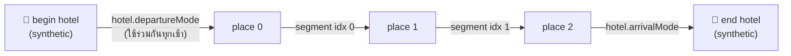
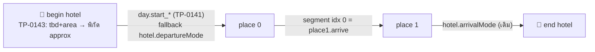

# AAUX2: ขาเดินทาง (`arrive`) + โรงแรมที่ยังไม่จอง (`tbd`) — design

> 2026-11-04 · Epic **TP-0138** · ครอบ **TP-0141** (legs) และ **TP-0143** (hotel tbd)
> สถานะ: **v2 · แก้ตาม scrutinize แล้ว (§7) · รอผู้ใช้อนุมัติก่อนเขียน plan** · ยังไม่มีโค้ด
> ที่มา: [รายงานทดสอบ E-city](../../reports/2026-11-04-api-agent-trip-building-findings.md) §1–§2
> ทั้งสอง ticket ใช้ contract ของ "ขาจากโรงแรม" ร่วมกัน จึงเขียนเป็น doc เดียว แต่**ทำแยก PR ขนานกันได้** (§4)
> การตัดสินใจที่ผมทำเองมีป้าย "ตัดสินเอง" กำกับไว้

## 0. สรุป

| | ปัญหา | ทางแก้ |
|---|---|---|
| TP-0141 | agent ใส่การเดินทางเป็น place `kind:"transit"` ที่ไม่มีพิกัด ทำให้เส้นบนแผนที่ขาด โน้ตการเดินทางอยู่ผิดที่ และนับเป็นจุดเกินมาหนึ่งจุด | place รับ `arrive: { mode, durationMin?, note? }` = ขาจากจุดก่อนหน้า ขาระหว่างจุดเก็บใน `segment` (เพิ่ม `note`, `duration_min`) ส่วนขาจากโรงแรมไปจุดแรกเก็บใน **day** (`start_*`) |
| TP-0143 | โรงแรมที่ยังไม่จองถูกใส่เป็นชื่อ placeholder ไม่มีพิกัด จึงวาดขาจากโรงแรมไม่ได้ | hotel มี `status: confirmed\|tbd`, `area` และ `coords_approx` และ resolve พิกัดผ่าน `place-link` ตัวเดียวกับ place |

**ที่เปลี่ยนจาก v1** หลัง scrutinize (รายละเอียดอยู่ใน §7):
- **ขาจากโรงแรมไปจุดแรก:** เลิกใช้ `segment.idx = -1` ย้ายไปเก็บเป็นคอลัมน์บน `day`
- **การจัด segment ใหม่ตอน reorder/remove:** เลิกจัดใหม่ตามคู่จุดทั้ง row ทุก row อยู่ที่ตำแหน่งเดิม และ mode ใช้ตามตำแหน่งเหมือนเดิม มีแค่ `note`/`durationMin` ที่ย้ายตามคู่จุด
- **หมุด approx:** ดูจากคอลัมน์ `coords_approx` ไม่ใช้ `status`

---

## 1. TP-0141 — ขาเดินทาง

### 1.1 สภาพตอนนี้ (ตรวจกับโค้ดแล้ว)



- **`segment`** (`db/schema.ts:262-277`): `id, day_id, idx, mode, distance, time` และ unique `(day_id, idx)`
  - `idx = i` คือขา place i → place i+1
  - REQUIREMENTS กำหนดให้มี `len = places.len − 1` (`REQUIREMENTS.md:57`) แต่ row จริงเป็นแบบ sparse:
    - import ไม่สร้าง row เลย
    - `addPlace` สร้างแค่ขาสุดท้าย
- **ขาที่ไม่มี row จะไม่ขึ้นใน UI เลย:** `dayLegs` (`day-augment.ts:139-140`) ได้ `null` แล้ว `sortable-place-item.tsx:306` ก็ไม่ render ทั้งตัวเลือก mode ลิงก์นำทาง และ hint "No location"
- **ขาที่เกี่ยวกับโรงแรมไม่ใช่ segment row:** ใช้ `hotel.departureMode`/`arrivalMode` แทน (`day-augment.ts:119-143`)
- **`reorderPlaces`:** ไม่แตะ segment เลย mode จึงติดกับตำแหน่ง
- **`removePlace`:** ลบ row ที่ idx = k แล้วขยับ row ที่สูงกว่าลงหนึ่ง ใช้ idx ติดลบเป็นที่พักชั่วคราว
- **v1 API:** เขียน segment ไม่ได้เลย (`API.md:298`, SKILL.md §8)

### 1.2 ความหมายของ `arrive`

**`arrive` บน place P = ขาที่มาถึง P จากจุดก่อนหน้าในวันเดียวกัน**

| P | ขา | เก็บที่ |
|---|---|---|
| place j (j ≥ 1) | place j-1 → place j | `segment(day, idx = j-1)` |
| place 0 | begin hotel → place 0 ("ออกจากที่พักเช้านี้") | **`day.start_mode` / `start_duration_min` / `start_note`** (ใหม่) |

- **ทำไมเก็บบน day:**
  - ขานี้เกิดวันละหนึ่งขา เหมือน `day.default_mode` ที่มีอยู่แล้ว
  - ไม่ต้องแตะ contract ของ segment
  - ไม่ชนกับ idx ติดลบที่ `removePlace` ใช้พักแถว จึงไม่มีความเสี่ยงตอน rollback หรือตอนใช้ Preview DB ร่วมกับ branch อื่น
- **ทำไมไม่ใช้ `hotel.departureMode`:** โรงแรม 2 คืนเป็น begin hotel ของ 2 เช้า note "ขับ 2.5 ชม. ไป Matsuyama" จะไปโผล่ทั้งสองวัน และขาที่ยาวที่สุดของ E-city เกือบทั้งหมดคือขานี้
- **mode ของขาจากโรงแรมใช้ตามลำดับ:** `day.start_mode` → `hotel.departureMode` (ข้อมูลเก่า) → `day.default_mode` → `'drive'`
- **ขอบเขต:**
  - start leg = ขาที่จบที่ place 0 จึงต้องมี place อย่างน้อย 1 จุด (`r > 0`)
  - ถ้า b ≥ 2 (booking ซ้อนกัน) ขาระหว่างโรงแรมด้วยกันยังใช้ `departureMode`
  - วันที่ไม่มี begin hotel: ยังเก็บ `start_*` ไว้แต่ไม่แสดง และ import ออก warning `arrive_without_origin`
  - ขาจากสนามบินไปจุดแรกเป็นงานของ TP-0142
- **Non-goal v1:**
  - ขาสุดท้ายของวันเข้าโรงแรม: ยังใช้ `hotel.arrivalMode` เหมือนเดิม และไม่มี note
  - วันที่ไม่มี place เลย (ย้ายจากโรงแรมไปโรงแรม): ใช้ transport ของ TP-0142

### 1.3 Schema (migration เดียว)

```sql
ALTER TABLE segment ADD COLUMN note text;            -- ≤ 500 (ตรวจที่ input)
ALTER TABLE segment ADD COLUMN duration_min integer; -- 0..2880
ALTER TABLE day ADD COLUMN start_mode segment_mode;  -- nullable
ALTER TABLE day ADD COLUMN start_duration_min integer;
ALTER TABLE day ADD COLUMN start_note text;
```

- `segment_mode` enum **ไม่เปลี่ยน** (ดู §1.6)
- `distance`/`time` เดิมไม่ต้องแตะ
- UI แสดง `time` ถ้ามีค่า ไม่อย่างนั้นใช้ `durationMin` ที่ format แล้ว

### 1.4 กติกาตอน reorder / remove (แก้ blocker)

**กติกา: row อยู่ที่ตำแหน่งเดิม `mode` ใช้ตามตำแหน่ง (เหมือนเดิมทุกอย่าง) มีแค่ `note`/`durationMin` ที่ย้ายตามคู่จุด**

- คู่ของขา = `(fromPlaceId, toPlaceId)` · ขาเริ่มของวันใช้ key `(START, place0Id)`
- **หลังเขียน `places.idx` ใหม่:**
  - ถ้าคู่ใหม่ของแต่ละขาเคยมีอยู่ก่อน ให้ copy `note`/`durationMin` ของคู่นั้นมา
  - ถ้าไม่เคยมี ให้ตั้งเป็น `null`
  - ใช้กติกาเดียวกันกับ `day.start_note`/`start_duration_min` เมื่อ place 0 เปลี่ยน
- **row ที่ยังอยู่ไม่เปลี่ยน** (id เดิม, mode ตามตำแหน่งเดิม) และ `removePlace` ยังขยับ idx แบบเดิม
  - **แก้โดย TP-0150 (2026-11-04):** reorder/remove จะคืนสภาพ invariant `rows = places − 1` ด้วย คือลบ row ที่ไม่มีขาแล้ว (เช่นหลังลบจุดสุดท้าย) และเติม row ที่ขาด (mode = `day.default_mode ?? 'drive'`) ความปลอดภัยเมื่อมี writer อื่นแทรก row พร้อมกันมาจาก `FOR UPDATE` บน row ของวัน ซึ่งชนกับ `FOR KEY SHARE` ที่ FK ของ segment ถือ จึงถูกเรียงคิวกัน ส่วน `ON CONFLICT DO NOTHING` เป็นแค่ safety net
  - `removePlace` จะ compact `places.idx` ให้ต่อเนื่องก่อนเริ่มเขียน ส่วน `reorderPlaces` จะ compact หลังเขียนสองเฟสเสร็จ (จุดที่ถูกพักไว้ที่ idx ≥ 1e6 ตอน reorder ด้วย list ไม่ครบจะถูกเรียงต่อท้าย)
  - ขาไหนเคยมีตัวเลือก mode ก็ยังมี และขาของวันเก่าที่ไม่มี row จะได้ตัวเลือก mode ด้วย (เปลี่ยนสิ่งที่ผู้ใช้เห็นโดยตั้งใจ)
- **ทำไมไม่ย้าย mode ตามคู่ด้วย:** การ reorder แล้ว mode ยังอยู่ที่ตำแหน่งเดิมเป็นพฤติกรรมที่ผู้ใช้เห็นอยู่แล้ว ไม่มีหลักฐานว่าเป็นปัญหา และไม่ใช่ขอบเขตของ ticket นี้ ส่วน note เป็นข้อมูลใหม่ที่ผูกกับคู่จุดโดยธรรมชาติ ("ทางด่วน Matsuyama")
- **Concurrency:**
  - reorder/remove/`arrive` upsert ทำใน `dbNode` transaction (`db` เป็น neon-http ไม่มี interactive tx, `db/index.ts:23`)
  - เริ่ม tx ด้วย `SELECT … FROM day WHERE id = $1 FOR UPDATE`
  - อ่านลำดับเก่าภายใน tx
  - **ลำดับใหม่ให้อ่านจาก DB หลังเขียนแล้ว** ห้ามใช้ list ที่ client ส่งมา เพราะ tab เก่าของผู้ร่วมทริปอาจส่ง list ไม่ครบ (`place-service.ts:259-269`)
  - `setSegmentMode` (neon-http, select-then-insert) ไม่ต้องย้าย เพราะไม่แตะ note และไม่ได้อ่านคู่จุด
- **Optimistic UI ตอนลาก:** ระหว่างลาก note ยังแสดงตามตำแหน่ง แล้วค่อยกระโดดไปตามคู่หลัง revalidate ยอมรับได้ (ตัดสินเอง)

### 1.5 ตัวเขียนอื่น

- **`setDayDefaultMode` (ค่าไม่ใช่ null):** ตั้ง `day.start_mode` ให้เป็นค่าเดียวกันด้วย ตรงกับความหมาย "ตั้งทุกขาของวัน" และคง note ไว้
- **UI ขาจากโรงแรมไปจุดแรก** (`app/trip/[id]/page.tsx:178-192`):
  - ทุกขาผูกกับ action ใหม่ที่เขียน `day.start_mode` แทน `setHotelLegModeAction('departure')`
  - **ตัดสินเอง · พฤติกรรมเปลี่ยน:** ตอนนี้เปลี่ยน mode ของเช้าหนึ่งแล้วจะเปลี่ยนทุกเช้าที่พักโรงแรมนั้น หลังแก้จะเปลี่ยนเฉพาะวันนั้น
  - `departureMode` เหลือเป็นแค่ fallback ของข้อมูลเก่า ไม่มีใครเขียนค่านี้อีก
- **ขาเข้าโรงแรม:** ยังใช้ `setHotelLegModeAction('arrival')` เหมือนเดิม

### 1.6 ทำไมยังไม่เพิ่ม mode `train`/`ferry`/`flight`

- ต้องแก้ union type มากกว่า 10 จุด ทั้ง picker, icons, i18n, `LEG_COLORS` และต้องเขียน `ALTER TYPE … ADD VALUE` เป็นตัวแรกของ repo
- `travelMode()` (`lib/gmaps.ts:13`) จะ map ไปเป็น `transit` อยู่ดี
- E-city ใช้ `transit` + note ได้ทุกขา ส่วนไฟลต์เป็นงานของ TP-0142
- ถ้าจะเพิ่มทีหลัง การเพิ่มค่าใน enum ไม่ breaking

### 1.7 API

**อ่าน** (`GET /trips/:id`):
- `days[].segments[]` เพิ่ม `note`, `durationMin`
- `days[].start = { mode, durationMin, note } | null`
- `days[].places[].arrive` แบบ derived = ข้อมูลของขาที่มาถึงจุดนั้น
  - place 0 อ่านจาก `day.start_*`
  - place อื่นอ่านจาก segment
  - ถ้าไม่มีข้อมูลให้เป็น `null` ไม่ใส่ค่า fallback ให้
- **ตัดสินเอง:** row ที่ระบบสร้างอัตโนมัติ (`ensureSegmentForAppendedPlace`) จะออกมาเป็น `{mode:'drive', note:null, durationMin:null}` แม้ agent ไม่เคยเขียน ยอมรับได้เพราะตรงกับที่ UI แสดง

**เขียน** (`ArriveInput = { mode: 'drive'|'walk'|'transit', durationMin?: int 0..2880, note?: string ≤500 }`, ค่าผิดตอบ 400):

| endpoint | พฤติกรรม |
|---|---|
| `POST /days/:dayId/places` | `arrive` ไม่บังคับ ถ้าส่งมาจะ upsert ขาที่มาถึงจุดนี้ (segment `nextIdx-1` หรือ `day.start_*` ถ้าเป็นจุดแรก) ใน tx เดียวกับการ insert place |
| `PATCH /places/:placeId` | ไม่ส่ง `arrive` = ไม่แตะ · `null` = ล้าง (segment: ล้าง note/duration แต่คง mode และ row · day: ล้าง `start_*`) · object = upsert · ให้ place update กับ arrive อยู่ใน `dbNode` tx เดียวกัน |
| `PUT /places/:placeId/arrive` **ใหม่** · `DELETE` | แก้ขาได้โดยไม่ต้องส่ง place ทั้งก้อน (PATCH ยังเป็น full-replace จนกว่า TP-0145) |
| `POST /trips/import` | `days[].places[].arrive` แล้ว import เขียน segment และ `start_*` ใน tx เดียวกัน · **import สร้าง segment row ครบ `places-1` ขาทุกวัน** (ตอนนี้ไม่สร้างเลย) เพื่อให้ทุกขามีตัวเลือก mode ตาม `REQUIREMENTS.md:57` · dryRun preview คืน `segments` และ `arrive` |

- idempotency ของ `POST place` ที่มี `arrive` ใช้กลไกเดิม (`withIdempotencyAtomic`)

**warning ใหม่** (shape เดิม `{ code, path, message }` แล้ว**เพิ่ม** `name`):
- `transit_as_place`: place `kind:"transit"` ที่ไม่มีพิกัด ไม่มีลิงก์ และไม่มี address · "ใช้ `arrive` บนจุดถัดไปแทน"
  - ไม่ reject · REST POST/PATCH place คืน warning นี้ด้วย
- `arrive_without_origin`: ดู §1.2

### 1.8 UI

- **`segment.tsx`:** แสดง note 1 บรรทัด (ตัดด้วย ellipsis แตะเพื่อขยาย) และ duration "~2h30m"
- **ขาจากโรงแรมไปจุดแรก:** ใช้ `day.start_*` (§1.5)
- **แผนที่:** ไม่ต้องแก้
- **Non-goal:** แก้ note หรือ duration ผ่านหน้าเว็บ (v1 แก้ได้ทาง API เท่านั้น)

---

## 2. TP-0143 — โรงแรมที่ยังไม่จอง

### 2.1 สภาพตอนนี้

- **`hotel_booking`** (`schema.ts:288-330`): มี `name` (notNull), `address`, `lat`/`lng`, `placeIdExternal` แต่ไม่มี status, area หรือ precision
- **REST:** ส่ง body เข้า `createHotel`/`updateHotel` ตรง ๆ ไม่มีการ resolve พิกัด
  - `POST` ทำงานใน `withIdempotencyAtomic` (`hotels/route.ts:21`)
- **import:** ไม่ geocode hotel
- **`applyPlaceLink`:** ผูกกับ `PlaceFields` และ return ทันทีเมื่อมี `lat`/`lng` อยู่แล้ว (`place-link.ts:155-158`)
  - ทุก geocode hit ติด `coords_approx` อยู่แล้ว (`:176`)
- **โรงแรมไม่มีพิกัด:** ไม่มีหมุด และขาที่ต่อกับโรงแรมนั้นไม่ถูกวาด
- **การใช้วันที่:** `splitHotelsForDay` ต้องมี checkIn/checkOut โรงแรมที่ไม่มีวันจึงไม่ไปอยู่ในวันไหนเลย

### 2.2 Schema (migration เดียว)

```sql
ALTER TABLE hotel_booking ADD COLUMN status text NOT NULL DEFAULT 'confirmed'; -- 'confirmed' | 'tbd'
ALTER TABLE hotel_booking ADD COLUMN area text;
ALTER TABLE hotel_booking ADD COLUMN coords_approx boolean NOT NULL DEFAULT false;
```

- **แยกสองเรื่องออกจากกัน:**
  - `status` = จองแล้วหรือยัง ใช้กับ badge
  - `coords_approx` = พิกัดแม่นแค่ไหน ใช้กับหมุด
- **ค่า `coords_approx`:**
  - `true` เมื่อพิกัดมาจาก geocode (`area`, `address`, `query`) หรือจากลิงก์แบบ viewport
  - `false` เมื่อมาจากลิงก์ที่มีพิกัดแน่นอน, `lat`/`lng` ที่ส่งมาตรง ๆ หรือการเลือกใน `hotel-place-picker`
- **`name` ยังเป็น notNull:**
  - ถ้าเป็น `tbd` และไม่ได้ส่ง `name` ให้ใช้ `area` แทน (ตัดสินเอง)
  - ถ้า PATCH `area` ใหม่ขณะที่ `name` ยังเท่ากับ `area` เดิม ให้อัปเดต `name` ตาม
  - ต้องมีอย่างน้อยหนึ่งในสองค่านี้ ไม่อย่างนั้นตอบ 400

### 2.3 การ resolve พิกัด

- **`resolveHotelLink`:** adapter บาง ๆ ครอบ `applyPlaceLink` ไม่ fork logic เพื่อให้ได้ตัวค้นหาใหม่จาก TP-0140 ไปด้วย
- **ลำดับ input:** `googleMapsUrl` → `lat`/`lng` → `query` (+`near`) → `area` → `[name, address]`
- **re-resolve ตอน PATCH:**
  - ทำเมื่อ body มี location input ใหม่ (`googleMapsUrl`/`query`/`area`/`address` ที่เปลี่ยน) และไม่ได้ส่ง `lat`/`lng`
  - เรียก adapter โดยตั้ง `lat`/`lng` เป็น null
  - **เขียนพิกัดใหม่ลง DB ก็ต่อเมื่อได้ผลกลับมาแล้วเท่านั้น** ถ้าการค้นถูกข้าม (budget, deadline, quota) หรือไม่เจอ ให้เก็บพิกัดเดิมไว้และตอบ warning
- **resolve ก่อนเข้า `withIdempotencyAtomic`:** ทำแบบเดียวกับ route ของ places
- **ใช้ใน:** POST hotel, PATCH hotel, import
  - **ใน import resolve hotel ก่อน place** เพราะมีจำนวนน้อยกว่าและสำคัญต่อขา จะได้ไม่โดน budget 50 lookup หมดก่อน
- **พฤติกรรมที่เปลี่ยนโดยตั้งใจ:**
  - POST/PATCH hotel ที่มีแค่ address จะ geocode ให้ (เสีย 1 lookup และช้าขึ้นเล็กน้อย) แลกกับการที่โรงแรมมีหมุด
  - จดเรื่องนี้ไว้ใน API.md

### 2.4 API ที่เปลี่ยน

- **ฟิลด์ที่เก็บลง DB:** `status`, `area`
  - `googleMapsUrl`/`query`/`near` ใช้แค่ตอน resolve ไม่เก็บ
  - `coordsApprox` เป็น read-only
- **`GET /trips/:id`:** เพิ่ม `tbdHotelCount` แยกออกมา `tbdCount` คงความหมายเดิม (นับ place)
- **warning:**
  - `hotel_without_location` (resolve แล้วยังไม่มีพิกัด) path `/hotels/i` คืนทั้งจาก import และ REST
  - `hotel_without_dates`: tbd hotel ที่ไม่มี checkIn/checkOut จะไม่แสดงในวันไหนเลย
- **ยืนยันการจอง:** `PATCH /hotels/:id { status:'confirmed', name, googleMapsUrl }` แล้วได้พิกัดแม่นยำ (`coords_approx = false`)

### 2.5 UI

- **badge "ยังไม่จอง":**
  - `booking-card-stay.tsx`
  - synthetic stop: `hotelToSyntheticPlace` ส่ง `status` ต่อไปด้วย แล้ว badge ของ `place-row` ทำงานเอง
- **หมุด approx:** ทำเป็นแบบโปร่งหรือเส้นประทั้งใน maplibre และ google
  - ใช้ค่า `coords_approx` (ส่งต่อผ่าน `DisplayPlace` และ `Pin` ใน `buildMapDays`, `day-augment.ts:242`)
  - ไม่ได้ใช้ `status`
- **ฟอร์มโรงแรม** (`hotel-form-client.tsx`):
  - เพิ่ม toggle "ยังไม่จอง / จองแล้ว"
  - การบันทึกฟอร์มต้องคงค่า `status` และ `area` ไว้
  - การเลือกโรงแรมใน picker ตั้ง `coords_approx = false` แต่ไม่เปลี่ยน status
- **Non-goal:** `candidates[]`, ปุ่ม "เลือกโรงแรม" ที่ bias ไปที่ area, แก้ `area` ผ่านฟอร์ม

---

## 3. Contract ที่ใช้ร่วมกัน



- **TP-0141 รับผิดชอบ:** `day.start_*`, segment `note`/`duration`, `arrive` และการย้าย note ตามคู่จุด
- **TP-0143 รับผิดชอบ:** ทำให้ synthetic hotel มีพิกัด และมี `coords_approx`
- **ไม่ต้องรอกัน**

## 4. การส่งงาน

- **แยก 2 PR** แต่ละตัวทำใน worktree ของตัวเองจาก `origin/main`
- **⚠️ migration:**
  - ทั้งคู่จะได้ `0023_…` ตัวที่ merge ทีหลังต้อง regenerate หลัง rebase
  - ทุกคอลัมน์ใหม่เป็นแบบ additive (nullable หรือมี default) ถ้า rollback code ไปเวอร์ชันเก่าแล้ว schema ใหม่ก็ยังใช้ได้ (Preview DB ใช้ร่วมกัน · TP-0050)
- **ชนกับ TP-0140:** ทั้ง TP-0140 และ TP-0143 แก้ `place-link.ts` แต่ TP-0143 แก้แค่ adapter กับลำดับใน `resolvePlanLinks` ให้ rebase ตามหลัง TP-0140
- **เอกสารที่ต้องอัปเดตในแต่ละ PR:**
  - `REQUIREMENTS.md`: ตาราง Day / Segment / HotelBooking (`:50-110`) และกติกา leg ของ itinerary (`:232-234`)
  - `API.md`: segment เขียนได้ผ่าน `arrive` และหมายเหตุเรื่อง hotel geocode
  - `SKILL.md`: `arrive`, hotel tbd/area และ warning ใหม่

## 5. การทดสอบ / DoD

| | TP-0141 | TP-0143 |
|---|---|---|
| unit | ย้าย note ตามคู่ (reorder, remove จุดกลาง, remove จุด 0 + `start_note`, คู่ที่ยังอยู่), `parseArrive`, `dayLegs` (ความสำคัญของ `start_mode`, เคส b=2, เคส b>0 และ r=0), `setDayDefaultMode` ตั้ง `start_mode` | adapter (ลำดับ input, `coords_approx`), re-resolve ล้มเหลวแล้วต้องคงพิกัดเดิม, validation ของ name/area/status, การอัปเดต name ตาม area, `tbdHotelCount` |
| integration | POST place + `arrive` (รวม replay idempotency), `PUT`/`DELETE /arrive`, PATCH ที่ไม่ส่ง `arrive` แล้วไม่แตะ, import สร้าง segment ครบทุกขา และ `GET` คืน `arrive`/`start`, reorder ด้วย list ไม่ครบหรือเก่า, `transit_as_place` | POST/PATCH ด้วย `area`/`googleMapsUrl`/`address`, import hotel tbd (resolve ก่อน place), `hotel_without_location`, `hotel_without_dates`, ฟอร์มเว็บคง status/area |
| e2e (1–2 project, grep) | หลัง reorder **และ** remove ทุกขายังมีตัวเลือก mode และ hint · note แสดงและย้ายตามคู่ · เปลี่ยน mode ขาจากโรงแรมแล้วมีผลแค่วันนั้น | tbd hotel มี badge + หมุด approx + ขาจากโรงแรมวาดได้ |
| วัดจริง | import E-city ที่ใช้ `arrive` แทน place transit แล้วต้องไม่มี "No location" บนขาของจุด | import E-city ที่ทุกคืนเป็น tbd+area แล้วได้ 8 hotel ที่มีหมุดครบ |

typecheck หลังแก้ไฟล์สุดท้าย

## 6. ที่ปล่อยให้ builder ตัดสินเอง

- ชื่อ helper/ไฟล์ และที่วางฟังก์ชันย้าย note ตามคู่
- format ของ duration ให้ตาม i18n ที่มีอยู่
- style ของหมุด approx ขอแค่แยกออกจากหมุดปกติได้ทั้งโหมด light และ dark
- จะเปิด tx ของ `dbNode` ใน service เอง หรือรับ `exec` จาก caller (ห้ามใช้ `db` ตัว neon-http)
- signature ของ action ที่เขียน `day.start_mode`

## 7. Scrutinize log (2026-11-04, outsider review)

| finding | ระดับ | ทำอะไร |
|---|---|---|
| การจัด segment ใหม่ตามคู่จุดลบ row ทิ้ง ทำให้ตัวเลือก mode, ลิงก์นำทาง และ hint ที่ REQUIREMENTS:232 กำหนดหายไปทุกครั้งที่ reorder/remove | blocker | **แก้:** row อยู่ที่ตำแหน่งเดิม ย้ายแค่ note/duration (§1.4) และ import สร้าง row ครบทุกขา |
| ใช้ day row แทน `idx=-1` ได้ง่ายกว่า | alternative | **รับ** (§1.2) |
| row `-1` ชนกับ idx ติดลบที่ `removePlace` ใช้พักแถว ถ้า rollback หรือใช้ Preview DB ร่วมกัน | major | **หายไปเอง** เพราะเลิกใช้ `-1` แล้ว |
| การจัด segment ใหม่ไม่มี concurrency control | major | **แก้:** lock day row `FOR UPDATE` ใน `dbNode` tx |
| ลำดับใหม่ต้องมาจาก DB ไม่ใช่จาก request | major | **แก้** (§1.4) |
| ใช้ `status` แทนความแม่นของพิกัดปนสองเรื่องเข้าด้วยกัน | major | **แก้:** เพิ่มคอลัมน์ `coords_approx` และเลิกใช้ warning `hotel_location_from_area` |
| re-resolve ตอน PATCH ล้างพิกัดก่อนรู้ว่าค้นสำเร็จ | major | **แก้:** เขียนลง DB เฉพาะเมื่อได้ผล |
| REQUIREMENTS.md / API.md จะขัดกับของใหม่ | major | **แก้:** อยู่ใน §4 |
| hotel geocode เปลี่ยนพฤติกรรมของ client เดิม และอาจโดน budget หมด | major | **แก้:** ระบุว่าตั้งใจเปลี่ยน และ resolve hotel ก่อน place |
| nits: guard r>0, name ค้างค่า area เก่า, `Pin` ต้องมี field ใหม่, PATCH ไม่ atomic, segment id, optimistic flicker | nit | **แก้ทุกข้อ:** ระบุไว้ในแต่ละหัวข้อ |
